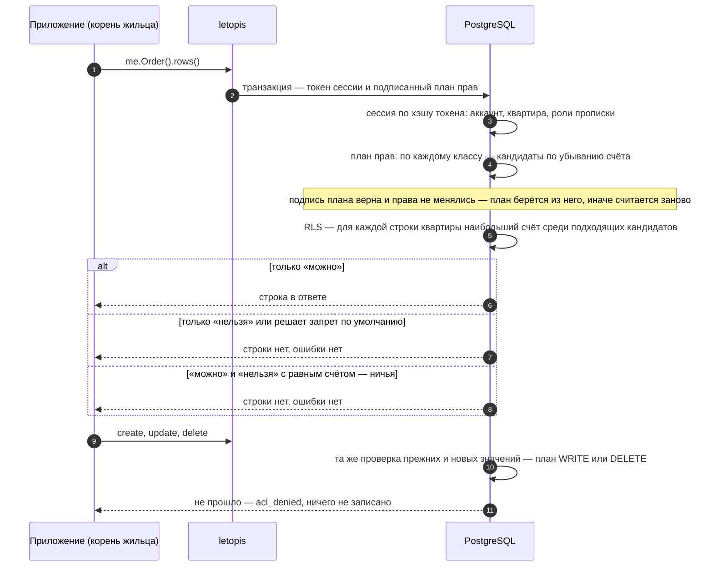

# Квартиры и права

## Зачем

Чтобы данные одной компании не увидела другая, а сотрудник делал только разрешённое, права проверяет сама база — для каждой строки и каждого запроса, в том числе сырого SQL.

**Квартира** — «чьи данные»: компания, магазин, салон, клуб. Строки одной квартиры другим не видны: их отсекает база политиками доступа (RLS). Внутри квартиры решает **матрица** — правила «кто → что: можно или нельзя». Для каждой строки и каждого действия приложения побеждает подходящее правило с наибольшим **счётом**; подходящих нет — правило по умолчанию, на свежем доме «нельзя». Права включены всегда, обойти их запросом нельзя.

Правила выдают не людям, а **ролям**. Роль — метка прописки: `owner`, `staff`, `cashier`. Сама по себе роль ничего не разрешает — она работает только через правила матрицы. Как квартира связана с домом, консьержем, аккаунтом, ключом и пропиской — на странице [«Дом, пропуск, консьерж»](../house/).

## Квартиры и консьерж

Квартиры заводит **консьерж** — подключение `connect(pass, { postman })` по пропуску из `setup()` ([«Установка и подключение»](../install/)). Он же зовёт в квартиры людей и впускает их по ключам; своих данных и цепочек у него нет. `postman` — почтальон: функция приложения, которая доставляет письма с приглашениями ([«Приглашения и почтальон»](../invites/)).

```ts
import { connect } from 'letopis'

const db = await connect(process.env.LETOPIS_PASS!, { postman })   // консьерж: одно подключение на процесс
await db.createTenant('Ромашка')                            // квартира и её правила; имя занято — exists
const romashka = await db.in('Ромашка')                     // консьерж в квартире: полный доступ
await romashka.invite({ email: 'anna@romashka.ru' }, ['owner'])     // письмо со ссылкой уходит почтальону
// Анна открыла ссылку; страница приложения приняла приглашение по токену из неё:
const anna = await db.accept(token, { password: 'Ромашка-2026!', name: 'Анна' })
await anna.Order().create({ number: 'A-1', total: 1200 }).rows()   // корень квартиры Анны — цепочки с её правами
```

- **`createTenant(имя)`** заводит квартиру — строку `Account` в System с уникальным именем (второй раз то же имя — `exists`; регистр букв не важен) — и её правила: консьержу «можно всё» с весом 1 000 000, роли `owner` «можно всё» с весом 100 000. Ответ — `{ id, name }`; список квартир — `db.tenants()`.
- **`await db.in(квартира)`** — корень консьержа в квартире (по имени или id): полный доступ, для фоновых задач, обслуживания и правил, которые жильцы не должны трогать. Квартиры нет — `target_not_found`.
- **`await db.as(аккаунт, квартира)`** — корень с правами прописанного в квартире жильца на пуле консьержа: журнал пишет автором жильца, исполнителем (`agent`) — консьержа. Аккаунт не прописан — `acl_denied`.
- **Классы.** Модели дома — `setup(ADMIN_DSN, имя, { models })` — общие для всех квартир: класс один, а строки у каждой квартиры свои. Класс только одной квартиры записывает `syncModels(корень, модели, { apply: true })` в её корне (у owner на это есть право): другая квартира не видит даже класса — шаг по нему `invalid_class`.

## Приглашение и прописка

Регистрации нет — только приглашения. Весь путь по шагам — в главе [«Приглашения и почтальон»](../invites/); здесь коротко.

```text
 me.invite({ email }, ['staff'])   ──▶ почтальон: письмо со ссылкой   ──▶ человек открыл ссылку
 db.accept(token, { password? })   ──▶ аккаунт + прописка с ролью staff + сессия
```

- **Прописка** — строка `member`: аккаунт и его роли в квартире. Цепочкой её не завести и не перенести на другой аккаунт: `member().create(…)` — `acl_denied` (ключ `sql-access.member_invite_only`). Только приглашение.
- **Роли** (`owner`, `staff`, `cashier` — любые имена без запятых и фигурных скобок) лежат в прописке. Прочитать — `me.acl.roles(аккаунт)`; заменить — `me.acl.roles(аккаунт, ['staff', 'cashier'])` или правкой прописки: `me.member({ User: аккаунт }).update({ roles: ['staff', 'cashier'] }).rows()`. Новые роли действуют сразу, и в уже открытых сессиях.
- **Звать и менять роли может тот, кому матрица разрешает выдать эти роли** — [«Роль — ресурс матрицы»](#роль-ресурс-матрицы). У роли `owner` это право есть сразу. Консьерж в квартире (`db.in`) выдаёт роли без правил.
- **Выписка** — `me.leave()` (сам) или `me.acl.roles(аккаунт, null)` (тот, кому матрица разрешает удалять `member` и снимать роли выписываемого): ключи и сессии человека в этой квартире гаснут сразу, аккаунт остаётся. Последний owner выписаться не может — `last_owner`. Подробно — в главе [«Вход и ключи»](../auth/).

## Пример: жильцы, роли и правила

Цельный путь нескольких жильцов одной квартиры, который можно повторять с нуля: owner заводит заказы и правила для роли `staff`, зовёт сотрудника, тот принимает приглашение и видит заказы по правилам. Чужая квартира не видит ни строки.

<Example id="access/01-residents" />

## Матрица со счётом

Матрица — строки двух системных классов. **`Resource`** — маска: «кто» (группа: роли прописки, категории аккаунта) или «что» (класс с условием на строки, действие приложения или роль). **`rule`** связывает «кто» с «что»: `permission` — `allow` или `deny`, и вес. Руками их не пишут: `me.acl.grant` и `me.acl.deny` заводят ресурсы и правило целиком, `me.acl.revoke` снимает, `me.acl.list()` показывает правила квартиры.

```text
 me.acl.grant( { role: 'staff' , read: 'Order' , weight: 50 } )
                     │                 │               │
                     │                 │               └─ вес: 1…999, по умолчанию 50
                     │                 └─ ЧТО: read | write | delete — класс; api — действие; assign — роль
                     └─ КТО: роль прописки; everyone: true — все жильцы
```

```ts
await me.acl.grant({ role: 'staff', read: 'Order' })                                 // 52
await me.acl.deny({ role: 'staff', read: { class: 'Order', data: { vip: true } } })   // 54
await me.acl.grant({ everyone: true, api: 'reports.daily', weight: 60 })            // всем жильцам квартиры
await me.acl.grant({ role: 'manager', assign: 'staff' })                            // manager может выдавать роль staff
```

### Счёт правила

| Слагаемое | Сколько | Пример `deny` для `staff` |
|---|---|---|
| «кто» | по 1 за каждый ключ маски группы: роль (`role`), категории аккаунта (`everyone: true`) | 1 |
| «что» | 1, если у объекта есть класс, действие API или имя роли | 1 |
| поля условия | по 1 за каждое значение условия (вложенные объекты разворачиваются, элемент массива — отдельное значение) | 1 — `vip: true` |
| запрет | 1 у `deny` | 1 |
| вес | у правил квартиры 1–999, у `grant`/`deny` по умолчанию 50; больше — только у правил, которые заводит `createTenant` | 50 |

`grant({ role: 'staff', read: 'Order' })` — 1 + 1 + 0 + 0 + 50 = **52**, запрет VIP-заказов — 1 + 1 + 1 + 1 + 50 = **54**.

- Повторный `grant` той же роли и цели меняет вес правила.
- `deny` поверх `grant` той же пары «кто → что» (и `grant` поверх `deny`) — отказ `exists` (ключ `sql-access.rule_flip`). Сначала снимите прежнее правило — `me.acl.revoke(…)` с тем же описанием, — потом запишите новое.
- Вес у `grant` и `deny` — целое от 1 до 999; другой — отказ `invalid_data` (ключ `access.bad_rule_weight`).

### Правила, которые жильцу не перебить {#веса-owner-и-консьержа}

Вместе с квартирой `createTenant` заводит два правила. Их владелец — консьерж, а вес выше любого правила жильцов:

| Правило | Вес | Что даёт |
|---|---:|---|
| правила жильцов и обычные правила консьержа в квартире | до 999 | счёт такого правила — не больше 2003: расчёт под таблицей |
| «роль `owner` → можно всё» | 100 000 | читать, писать и удалять любые классы, любые действия API, выдавать любые роли |
| «консьерж → можно всё» | 1 000 000 | то же для консьержа в квартире (`db.in`) |

Откуда 2003. Самое сильное правило жильца — запрет с наибольшим весом и самым длинным условием. По таблице «Счёт правила»: вес 999 + «кто» 2 (в маске группы не больше двух ключей: роль и категории аккаунта) + «что» 1 + условие 1000 (в счёт идёт не больше 1000 значений условия) + запрет 1 = **2003**. Обычный запрет с одним значением в условии и весом 999 — это 1 + 1 + 1 + 1 + 999 = **1003**. У правила owner счёт 1 + 100 000 = **100 001** — его не догнать.

Отсюда два следствия:

- **Запрет жильца против owner всегда проигрывает.** `me.acl.deny({ role: 'owner', read: 'Order' })` запишется, но ничего не изменит: счёт правила owner больше.
- **Написать такой запрет может не каждый.** Писать правила — это писать строки `Resource` и `rule`:

  ```ts
  // Олег, роль staff. Права писать правила у него нет:
  await oleg.acl.deny({ role: 'owner', read: 'Ticket' })     // отказ acl_denied — ничего не записано

  // Хозяйка дала роли staff читать и писать Resource и rule. Теперь запрет запишется…
  await oleg.acl.deny({ role: 'owner', read: 'Ticket' })     // правило записано
  await anya.Ticket().rows()                                 // …но Аня (owner) читает заявки как раньше
  ```
- **Жилец эти правила не снимет и не изменит** — они принадлежат консьержу: правка веса, решения или выключение — отказ `acl_denied` (ключ `sql-access.rule_foreign`). Отнять права у хозяина можно одним способом: снять с него роль `owner`.

## Роль — ресурс матрицы {#роль-ресурс-матрицы}

Кто может дать человеку роль? Если бы хватало права писать прописку, любой такой жилец мог бы выдать роль `owner` самому себе. Поэтому роль — такой же ресурс матрицы, как класс: выдать или снять её можно, только если правило «кто → роль» разрешает это.

```ts
await me.acl.grant({ role: 'manager', assign: 'staff' })              // manager может выдавать и снимать роль staff
await me.acl.grant({ role: 'manager', assign: ['staff', 'guest'] })   // две роли
await me.acl.grant({ role: 'hr', assign: '*' })                       // любые роли и приглашения без ролей
await me.acl.deny({ role: 'hr', assign: 'admin', weight: 60 })        // кроме роли admin
await me.acl.revoke({ role: 'manager', assign: 'staff' })             // снять правило
const d = await me.acl.checkRole('staff')                             // { allow, rule?, score? } — можно ли мне выдать staff
```

Где право проверяется:

| Действие | Что проверяется |
|---|---|
| `me.invite(контакт, роли)` | каждая роль приглашения |
| `db.accept(token)` | заново, за того, кто звал: потерял право — приглашение гаснет |
| `me.acl.roles(аккаунт, роли)`, `me.member(…).update({ roles })` | каждая добавленная и каждая снятая роль |
| `me.acl.roles(аккаунт, null)`, удаление прописки цепочкой | каждая роль выписываемого |
| `me.leave()` — сам себя | не проверяется |

Правила выдачи ролей:

- **Для приглашения хватает правила `assign`.** Право писать `member` звавшему не нужно: `me.invite({ email }, ['guest'])` проходит у жильца, у которого есть только `grant({ role: 'staff', assign: 'guest' })`.
- **Нет правила — нельзя.** Правило по умолчанию ролей не выдаёт, даже на доме с `defaultRule: 'allow'`.
- **У `owner` право есть сразу**: `createTenant` заводит ему правило на все роли. Консьерж в квартире (`db.in`) выдаёт роли без правил.
- **Счёт правила на роль**: ключи маски «кто» + 1 за имя роли + 1 у запрета + вес. Правило на все роли (`assign: '*'`) слабее правила на одну роль на 1.
- **Ничья «можно» и «нельзя» при выдаче — нельзя.**
- **Право писать `member` по-прежнему нужно**, чтобы менять роли прописанного (`me.acl.roles`, правка `member`), но само ролей не даёт: без правила `assign` — отказ `role_denied`.
- В `me.acl.list()` такое правило — `op: 'ROLE'`, `target` — имя роли или `'*'`.

Отказ — `acl_denied` (ключ `sql-access.role_denied`, в `err.params.role` — роль). Приглашение без ролей требует права на все роли (`sql-access.invite_denied`).

<Example id="access/03-roles" />

### Выбор для каждой строки

Правило выбирается не на класс, а **для каждой строки** (и для каждого действия API) отдельно:

1. **Кандидаты** — правила System и квартиры, чья группа подходит аккаунту (роли — только у правил этой квартиры), а объект — классу строки (сам класс или его предок) или действию.
2. Из кандидатов, чьё условие строка проходит, берётся **наибольший счёт**.
3. В этой группе только «можно» — строка видна; только «нельзя» — скрыта, без ошибки.
4. И «можно», и «нельзя» с равным счётом — **ничья**: строка не видна и не правится. Ошибки при чтении нет; остальные строки класса читаются как обычно.
5. Ни один кандидат не подошёл — решает **правило по умолчанию**.

Отсюда следствия. Разрешения с разными условиями складываются: строке подходит любое. Запрет с условием прячет только подходящие строки — если он сильнее разрешения. Две «можно» с равным счётом — не ничья: решение одно.

### Ничья {#ничья}

Ничья — когда строке подходят «можно» и «нельзя» с равным счётом. База не угадывает, кто прав. Что она делает, зависит от места:

| Где | Что будет |
|---|---|
| запись правила напрямую — строками `Resource` и `rule`, мимо `me.acl`, — которое спорит с действующим: те же «кто» и «что», обратное решение, равный счёт | отказ `acl_ambiguous` (ключ `sql-access.rule_tie`), в тексте — оба правила; ничего не записано |
| то же через `me.acl.grant` и `me.acl.deny` | до ничьей не доходит: обратное правило той же пары — отказ `exists` (ключ `sql-access.rule_flip`) |
| чтение и правка строк | спорная строка просто не видна; ошибки нет, остальные строки читаются |
| `me.acl.check(действие)` | отказ `acl_ambiguous` |
| `me.acl.checkData(класс, операция)` | отказ `acl_ambiguous`, когда спорят разрешение и запрет с равным счётом, а условие одного входит в условие другого; в `err.detail.rules` — id правил |
| `me.acl.checkRole(роль)` | отказ `acl_ambiguous`; при выдаче роли ничья значит «нельзя» |

Через `me.acl` ничью на одной паре «кто → что» записать нельзя: у пары одно правило, а обратное поверх него не пишется. Ничья на строке получается у разных пар: например, у жильца две роли, одной VIP-заказы разрешены, другой запрещены, и счёт равный. При записи таких правил отказа нет — ничью показывает `acl.checkData`. Разводят её весом (повторный `grant` с другим весом) или снимают одно из правил.

<Example id="access/04-tie" />

Строка «пропала», а ошибки нет — спросите `acl.checkData`: он назовёт причину. Подробно — [«Отладка»](#отладка-почему-строка-не-видна).

<Example id="access/02-score" />

### Правило по умолчанию {#правило-по-умолчанию}

Правило по умолчанию — правила System «все аккаунты → все классы» (`READ`, `WRITE`, `DELETE`) и «все аккаунты → все действия API» с признаком `default`. В выборе они не участвуют и действуют, только когда у строки или действия нет ни одного подходящего кандидата. В ответах `acl.check` и `acl.checkData` у них `default: true` и счёт 0. На свежем доме — запрет. Изменить или удалить его правилом нельзя (`acl_denied`, ключ `sql-access.rule_default_protected`) — его переключает только мастер-ключ: `setup(ADMIN_DSN, имя, { defaultRule: 'allow' })`, обратно — `'deny'`.

::: danger defaultRule: 'allow' открывает всё нерешённое
С `'allow'` жилец получает всё, что не решили правила: чтение и правку строк любых классов квартиры, в том числе `member`, `rule` и `Resource` (ролей это не выдаёт: для них нужно правило `assign`), и любые действия API — даже `tenant.delete`, то есть **удалить квартиру** (шаг 6 примера выше). Не открывает он только внутренние права движка `letopis.*` — их выдают лишь правила System. `'allow'` годится для прототипа; дому с жильцами нужен `'deny'` и явные правила.
:::

### Кто меняет правило

Правило принадлежит тому, кто его завёл (колонка `owner` строки `rule`). Менять и снимать его может только он или консьерж; другой жилец — `acl_denied` (ключ `sql-access.rule_foreign`), даже owner квартиры.

- Писать правила обёрткой `me.acl` — это писать строки `Resource` и `rule`: жильцу нужны `write` (и `delete` для `revoke`) **и `read`** на оба класса. Без права читать `revoke` не видит чужих правил и отвечает 0 — это не «снято», а «не видно»; `grant` — `acl_denied`.
- Правила консьержа и роли `owner`, которые завёл `createTenant`, завёл консьерж: жилец их не снимет. Правила, которые жильцы не должны трогать, пишите консьержем: `(await db.in('Ромашка')).acl.grant(…)`.
- Правила выписанного жильца остаются и действуют — правила принадлежат квартире, а не прописке. Снимает их консьерж.
- Признаки `default` и `concierge` у правила ставит и меняет только консьерж (`acl_denied`, ключ `sql-access.rule_reserved`). Любая другая правка чужого правила — веса, решения, выключение, удаление — `sql-access.rule_foreign`.

### Условие права — шаблон, а не фильтр

Условие права и фильтр цепочки выглядят похоже, но это разные языки — и путать их опасно:

| Вопрос | Условие права | Фильтр цепочки |
|---|---|---|
| где | `read: { class: 'Order', data: { vip: true } }` в `grant`, `deny` | `me.Order({ vip: true })` |
| к чему | колонки строки: `data`, `tags`, `owner`, `links`, `id`, `tenant` | поля `data` и концы |
| как сравнивает | «строка содержит эти значения» (`@>` PostgreSQL): вложенный объект — частично, массив — «содержит эти элементы», значения — строго по типу JSON | простое значение — равенство, оператор — сравнение по типу поля из описания класса |
| операторы | нет: `gt(…)`, `or(…)`, `like(…)` в условии — отказ `invalid_data`, ничего не записано | `gt`, `inList`, `like`, `or` и другие |
| подстановки | `'$actor'` — тот, от чьего имени запрос, `'$tenant'` — квартира | нет |
| «или» | несколько правил: список целей `read: [{ … }, { … }]` — по правилу на цель | `or(…)` |

Строгость типов: условие `{ data: { total: '800' } }` (строка) не подходит строке с `total: 800` (число). Сравнений «больше» и «меньше» в условии нет — признак, по которому нужно делить строки, храните значением: флаг (`vip: true`), метку в `tags`, конец. Частые условия: свои строки — `{ class: 'Ticket', owner: '$actor' }`, строки с меткой — `{ class: 'Order', tags: ['опт'] }`, строки одного магазина — `{ class: 'Order', links: { Shop: id } }`. Каждое значение условия прибавляет к счёту 1.

## Рецепт: жилец правит только свои строки {#свои-строки}

Задача: сотрудник видит и правит только те заявки, которые завёл сам. Нужны две вещи: у строки должен быть владелец-автор, а правило должно сравнивать владельца с тем, кто спрашивает.

```ts
import { hub } from 'letopis/model'
import { z } from 'zod'

// 1. Модель: владелец новой строки — тот, кто её создал
const Ticket = hub('Ticket', { title: z.string() }, { ownerDefault: 'actor' })

// 2. Правила: роли staff — читать и писать строки, где владелец — он сам
await me.acl.grant({ role: 'staff', read: { class: 'Ticket', owner: '$actor' } })
await me.acl.grant({ role: 'staff', write: { class: 'Ticket', owner: '$actor' } })
```

```text
 ownerDefault: 'actor'          владелец строки (колонка owner) — аккаунт автора; без опции владелец — квартира
 owner: '$actor'                условие правила: «владелец строки — тот, от чьего имени запрос»
```

Что получает Олег с ролью `staff`:

| Действие Олега | Ответ |
|---|---|
| `oleg.Ticket().create({ title })` | строка создана, `owner` — аккаунт Олега |
| `oleg.Ticket().rows()` | только его заявки |
| `oleg.Ticket(своя).update(…)` | 1 строка |
| `oleg.Ticket(чужая).update(…)` | **0 строк, без ошибки**: чужой заявки для него нет |
| `oleg.Report().create(…)` — класс, на который правил нет | отказ `acl_denied` |

Отсюда правило на всю главу: **`acl_denied` приходит, когда нет права на класс или новая строка не проходит правило. Правка строки, которой жилец не видит, — это 0 строк, а не отказ.** Проверяйте длину ответа, если от неё зависит следующий шаг.

Хозяйка (`owner`) видит и правит все заявки: ей это даёт правило `createTenant`. Чтобы «свои строки» мог удалять сам автор, добавьте такое же правило с `delete`.

## Список людей квартиры {#список-людеи-квартиры}

Странице «Команда» нужно знать три вещи: кто живёт в квартире, как кого зовут и у кого какие роли. Всё это одним вызовом отдаёт `me.acl.people()`.

```text
 const people = await me.acl.people()
        │
        ▼
 [ { account: '…id аккаунта…', name: 'Аня',  roles: ['owner'] },
   { account: '…id аккаунта…', name: 'Олег', roles: ['staff'] } ]      порядок — по имени
```

| Поле | Что в нём |
|---|---|
| `account` | id аккаунта человека. По нему меняют роли и выписывают: `me.acl.roles(account, роли)`, `me.acl.roles(account, null)` |
| `name` | имя аккаунта. Его задают, когда человек принимает приглашение: `db.accept(token, { name })`. Не задали — пустая строка |
| `roles` | роли прописки в этой квартире |

Контактов — почты и телефона — в ответе нет. Контакт человека знает только консьерж: `await db.contactOf(аккаунт)` → `{ kind, address }` или `null`.

### Кто кого видит

Человек видит в списке тех, чью прописку (`member`) ему разрешает читать матрица. Свою прописку каждый видит всегда, без правил.

| Кто зовёт `acl.people()` | Кто в ответе |
|---|---|
| хозяин (роль `owner`) | все прописанные |
| жилец без правила на чтение `member` | только он сам; это не отказ |
| жилец с правилом на чтение `member` | все прописанные |
| жилец с правилом с условием: `read: { class: 'member', data: { roles: ['staff'] } }` | он сам и те, чья прописка подходит условию, — здесь люди с ролью `staff` |
| консьерж в квартире: `(await db.in('Мир')).acl.people()` | все прописанные |
| консьерж от имени жильца: `(await db.as(аккаунт, 'Мир')).acl.people()` | те же, кого видит этот жилец |

**Чтобы сотрудники видели коллег, дайте им читать прописки.** Без такого правила сотрудник увидит на странице «Команда» только себя:

```ts
await me.acl.grant({ everyone: true, read: 'member' })      // всем жильцам квартиры
await me.acl.grant({ role: 'staff', read: 'member' })       // или только роли staff
```

- **Только эта квартира.** Человек живёт в «Мире» и в «Весне». В «Мире» он видит людей «Мира»; узнать оттуда, кто живёт в «Весне», нельзя.
- **Выписанного в списке нет.**
- **Порядок — по имени**, при одинаковых именах — по id аккаунта. Люди без имени идут первыми.
- Сессия погашена — отказ `no_session`. Внутри транзакции вызов тоже работает: `tr.acl.people()`.

### Страница «Команда»

```ts
// GET /team; me — корень квартиры вошедшего: db.resume(токен из cookie)
const people = await me.acl.people()
const team = people.map((p) => ({
  id: p.account,
  name: p.name || 'Без имени',          // имя не задано при accept — пустая строка
  roles: p.roles,
  me: p.account === me.account,         // «это я»
}))
// [ { id: '…', name: 'Аня', roles: [ 'owner' ], me: true }, { id: '…', name: 'Олег', roles: [ 'staff' ], me: false } ]
```

Что ещё нужно странице:

| Действие | Вызов | Кому доступно |
|---|---|---|
| позвать человека | `me.invite({ email }, ['staff'])` | тому, кому матрица разрешает выдать роль |
| приглашения, которые ждут ответа | `me.invites()` | звавшему; все — тому, кому можно выдавать их роли |
| отменить приглашение | `me.revokeInvite(id)` | так же |
| сменить роли | `me.acl.roles(p.account, ['staff', 'cashier'])` | тому, кому можно выдать и снять эти роли |
| выписать | `me.acl.roles(p.account, null)` | тому, кому можно удалять `member` и снимать роли выписываемого; у хозяина это есть |

Готовая страница — список, приглашение, отмена и выписка — в рецепте [«Веб-приложение с входом»](../recipes/web-login#команда).

### Подпись автора: чья строка и кто правил {#подпись-автора}

Под заявкой показывают, кто её завёл. Для этого у строки есть два поля с id аккаунта, и значат они разное:

| Поле | Что значит | Когда меняется |
|---|---|---|
| `row.owner` | **чья строка** — владелец | никогда: задаётся при создании. С `ownerDefault: 'actor'` у класса (или шагом `.owner(аккаунт)`) — аккаунт создателя, иначе — id квартиры |
| `row.author` | **кто правил последним** — автор текущей версии | при каждой записи: правка, удаление, возврат |

Сотрудник Олег завёл заявку, хозяйка Аня её поправила, удалила и вернула. Теперь `author` — Аня, а `owner` — по-прежнему Олег, и Олег по правилу `owner: '$actor'` свою заявку видит. Поэтому подпись «автор заявки» берут из `owner` (класс с `ownerDefault: 'actor'`), а имя — из того же списка:

```ts
const names = new Map((await me.acl.people()).map((p) => [p.account, p.name]))

for (const t of await me.Ticket().sort('data.title').rows()) {
  console.log(t.data.title, '—', names.get(t.owner) ?? 'неизвестно')
}
// заказать бумагу — Аня
// не печатает принтер — Олег
```

- **Класс без `ownerDefault: 'actor'`** — владелец у всех строк квартира. Кто создал строку — автор её первой версии: `(await me.Ticket(id).sort('rev').limit(1).versions())[0].author`. Для списка — `me.Ticket().versions()`: версии идут от старой к новой, первая у каждого id — создание.
- **`row.author` — для «изменено кем».** Под заявкой его показывают как «последняя правка: Аня». Всю историю правок по-человечески — рецепт [«Показать журнал человеку»](../history/#журнал-для-человека).
- **Имени нет в списке** — человека выписали, вызывающий не видит его прописку или строку записал консьерж (`db.in`). Держите запасную подпись.
- **Отдельного вызова «имя одного человека» нет.** Чужую строку `Account` цепочкой не прочитать: ответ пустой, без ошибки, — и у хозяина, и у консьержа в квартире. Имена отдаёт только `acl.people()`.
- Своё имя человек меняет сам — `me.changeName(имя)`: [«Имя человека»](../auth/#имя-человека).

Свой класс для людей нужен, только когда приложению мало имени и ролей: должность, фото, рабочий телефон. Заведите справочник с ключом по id аккаунта и храните в нём эти поля, а имя и роли по-прежнему берите из `acl.people()`.

Тот же вызов по шагам — шаг 6 [примера «Роли»](#ex-access-03-roles): хозяйка видит всех, сотрудник без правила — только себя, после правила — всех; заказы подписаны именами авторов.

## Отладка: почему строка не видна

Права применяет база при каждом запросе; заранее спросить можно двумя вызовами. Оба отвечают за того, от чьего имени открыт корень.

1. **`me.acl.checkData(класс, операция)`** — кандидаты на строки класса: `{ allow, all, candidates }`. `candidates` — по убыванию счёта, у каждого `rule` (id правила), `score`, `permission` и `filter` — условие с уже подставленными `$actor` и `$tenant`. `all: true` — разрешены все строки без условий, `allow: false` — нет ни одного «можно». Кандидаты ниже первого правила без условия строку уже не решают: оно подходит всем. На ничьей — отказ `acl_ambiguous` с id спорящих правил в `err.detail.rules`: так находят причину «пропавшей» строки.
2. **`me.acl.check(действие)`** — решение по действию API: `{ allow, rule, score }`, у правила по умолчанию `rule.default: true` и `score: 0`. На ничьей — `acl_ambiguous`.
3. **`me.acl.checkRole(роль)`** — можно ли выдать или снять роль: `{ allow, rule?, score? }`.
4. **`me.acl.list()`** — правила квартиры: роль, операция, цель, условие, `allow`/`deny`, вес. Id из `checkData` и из текста `acl_ambiguous` ищут здесь.

Какой кандидат решил судьбу конкретной строки, можно посчитать в коде — тем же правилом, что у базы. Строку берёт тот, кому она видна (owner или консьерж `db.in`):

```ts
import type { AclCandidate } from 'letopis'

// «содержит» (@>): объект — по ключам, массив — каждый элемент шаблона есть в строке, остальное — равенство
const contains = (row: unknown, pat: unknown): boolean =>
  Array.isArray(pat) ? Array.isArray(row) && pat.every((p) => row.some((r) => contains(r, p)))
    : pat !== null && typeof pat === 'object' ? row !== null && typeof row === 'object' && !Array.isArray(row)
      && Object.entries(pat).every(([k, v]) => contains((row as Record<string, unknown>)[k], v))
    : row === pat

// победители для строки: подходящие кандидаты с наибольшим счётом; «можно» и «нельзя» вместе — ничья, строка скрыта
const winners = (row: object, candidates: AclCandidate[]) => {
  const fit = candidates.filter((c) => contains(row, c.filter ?? {}))
  return fit.filter((c) => c.score === fit[0]?.score)
}

const { candidates } = await oleg.acl.checkData('Order', 'READ')
const a2 = (await me.Order({ number: 'A-2' }).first())!      // owner видит строку целиком: id, owner, tenant, tags, data, links
console.log(winners(a2, candidates).map((c) => `${c.permission} ${c.score}`))   // [ 'deny 54' ] — VIP скрыт
```

Интерфейсу `check` и `checkData` помогают спрятать недоступные кнопки, но запрещает база: прямой вызов получит `acl_denied` или пустой ответ.

## Удалить квартиру

`me.deleteTenant()` удаляет квартиру целиком: её строки и журнал, прописки, ключи, приглашения и сессии стираются, аккаунты жильцов остаются (у них могут быть другие квартиры), имя освобождается. Удалить может консьерж (`(await db.in('Ромашка')).deleteTenant()`) или жилец, которому матрица разрешает действие `tenant.delete`, — у owner оно есть по правилу `createTenant`; остальным — `acl_denied`. Ответ — `{ tenant, rows }`: id квартиры и сколько строк удалено. Вернуть удалённую квартиру нельзя — только из резервной копии базы. Пример — шаг 7 [примера «Выписка, удаление аккаунта и квартиры»](../auth/#ex-auth-03-leave-delete).

## Что внутри: как база проверяет права

<Flow name="access" />

Тот же путь по шагам — что делает база на каждом запросе жильца.



**План прав** — итог правил для пары «аккаунт — квартира»: по каждому классу — кандидаты по убыванию счёта, а класс, где побеждает «можно» без условий, — сразу «все строки». Считать его на каждый запрос дорого, поэтому база отдаёт посчитанный план библиотеке подписанным своим ключом, а библиотека передаёт его с каждым запросом. Подделать подписанный план нельзя; если подпись не сходится, сменились аккаунт или квартира или изменились правила, прописки или классы, база считает план заново. План лишь ускоряет проверку и на её результат не влияет.

## Подводные камни

- **Права включены всегда.** Без подходящего правила действует правило по умолчанию — на свежем доме «нельзя».
- **Роль сама ничего не даёт.** Жилец с ролью, для которой нет правил, не видит ничего.
- **Правило owner жильцу не перебить.** `createTenant` даёт роли `owner` «можно всё» с весом 100 000: запрет жильца против owner не действует.
- **Право писать `member` — не право выдавать роли.** Роль выдаёт только тот, кому это разрешает правило `assign`.
- **Ничья при чтении — не ошибка.** Спорная строка просто не видна. Причину показывает `me.acl.checkData`.
- **Свою прописку и свой аккаунт жилец видит всегда**, без правил: `me.acl.roles(me.account)` работает у любого жильца. Чужие прописки — по правилу на чтение `member`.
- **`deny` поверх `grant` не пишется** (`exists`, ключ `sql-access.rule_flip`): сначала `revoke`.
- **Условие права — не фильтр.** Только значения колонок строки, строго по типу JSON; `gt`, `or` и другие операторы `grant` отклоняет (`invalid_data`). «Или» — несколько правил.
- **`defaultRule: 'allow'` открывает и `tenant.delete`.** Жилец без правил сможет удалить квартиру.
- **Чужое правило не снять.** Правило меняет только тот, кто его завёл, или консьерж (`acl_denied`); правила выписанного жильца остаются и действуют.
- **`revoke` без права читать `rule` отвечает 0.** Это «не видно», а не «правил нет».
- **Роли действуют сразу**, и в уже открытых сессиях: правка `member` меняет права на следующем же запросе.
- **Прописка — только приглашением.** `member().create()` — `acl_denied`; роли меняет `me.acl.roles(аккаунт, роли)`.
- **Интерфейс только прячет кнопки** (`acl.check`, `acl.checkData`), а запрещает база.
- **Классы `syncModels` в корне квартиры — только её.** Другая квартира их не видит (`invalid_class`); общие классы — `setup(…, { models })`.

## Где это в сервисах

В [Helpdesk](../services/helpdesk) компании — квартиры, а руководитель, агент, клиент и интеграция — роли прописки (`owner`, `agent`, `client`, `integration`). Матрицу компании пишет консьерж в её квартире (`db.in`) при регистрации и при каждом запуске, поэтому жильцы её не снимут: агенту — заявки, ответы и справочник, клиенту — только свои заявки (условие `owner: '$actor'`), руководителю — всё. В [«Документах»](../services/documents) правила фирмы тоже пишет консьерж. Остальные сервисы — на странице [сервисов-примеров](../services/).
