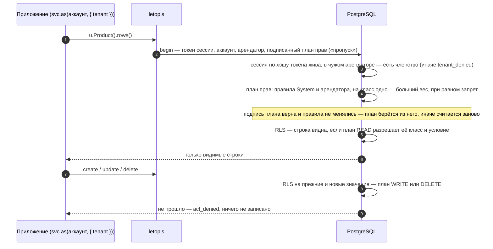

# Арендаторы и права

## Зачем

Чтобы данные одного клиента не увидел другой, а сотрудник делал только разрешённое, права проверяет сама база — для каждой строки и любого запроса.

**Арендатор** — «чьи данные»: магазин, салон, компания. Данные одного арендатора другим не видны. Как арендатор связан с аккаунтом, членством, ролью и сессией — на [карте понятий](../concepts/). **Права** решают, что пользователь может внутри арендатора: читать, менять, удалять строки, вызывать эндпоинты приложения. Права в letopis включены всегда, по умолчанию запрещают всё и проверяются **базой** — одинаково для библиотеки и для сырого SQL.

::: warning Несколько арендаторов — модель в каждом
Классы, которые записал `syncModels`, принадлежат **арендатору сессии**. Второй арендатор (второй магазин, салон, компания) их не видит и на первом же обращении к классу получает `invalid_class`. Вызывайте `syncModels` для каждого арендатора — на подключении с сессией этого арендатора, например при запуске приложения (`svc` — подключение сервиса по его ключу, как в [«Вход для веб-сервиса»](../auth/#вход-для-веб-сервиса-одно-подключение-и-svc-as-на-запрос); `models` — массив ваших классов):

```ts
for (const t of tenants) {   // t — результат createTenant: { tenant, user, … }
  const db = await svc.as(t.user, { tenant: t.tenant })
  await syncModels(db, models, { apply: true })   // повтор безопасен: неизменённые классы не трогаются
}
```

Новый арендатор, заведённый позже, тоже получает модель отдельным вызовом. В примере ниже пользователь другого магазина обращается к товарам и получает `invalid_class`.
:::

## Завести арендатора: createTenant

Арендатора с первым пользователем заводит [`createTenant(admin, schema, opts, owner?)`](../reference/setup#export-createtenant) из `letopis` — одной транзакцией от роли-владельца схемы, поэтому ей нужен **администраторский пул**. В образце `ADMIN_DSN` — строка подключения администратора базы (того, кто вызывал `up()`), `svc` и `models` — как в образце выше:

```ts
import postgres from 'postgres'
import { createTenant, syncModels } from 'letopis'

const admin = postgres(ADMIN_DSN)                         // пул postgres() администратора базы — не строка DSN и не connect()
const t = await createTenant(admin, 'shop', {             // 'shop' — то же имя, что в up({ schema }): станет v2.shop
  name: 'Лютик',
  user: { name: 'Борис', login: 'boris@lutik.ru', password: process.env.BORIS_PASSWORD! },   // пароль — не в коде
})
await admin.end()                                         // пул закрывает вызывающий код
const boris = await svc.as(t.user, { tenant: t.tenant })  // или connect({ dsn, schema, token: t.token })
await syncModels(boris, models, { apply: true })          // модель — в новом арендаторе
```

- **`admin` — пул `postgres()`**, его роль должна уметь стать владельцем схемы (тот же администратор, что вызывал `up()`). Строка DSN, подключение `connect()` letopis, `undefined` — отказ `invalid_query` (ключ `api.create_tenant_admin`) до запросов к базе.
- **`schema`** — как в `connect()` и `up()`: имя без точки получает префикс `v2.` (`'shop'` → `v2.shop`), полное имя (`r.schema` из `up()`) — как есть.
- **Ответ** — `{ tenant, user, token, created }`: id арендатора и пользователя, токен его сессии в этом арендаторе и `created: false`, если арендатор уже был.
- **Арендатор ищется по имени `name`** (с учётом регистра: «Ромашка» и «ромашка» — разные), пользователь — по логину. Повторный вызов с тем же именем нового арендатора не заводит (`created: false`, правило «своим можно всё» второй раз не добавляется), а дальше — смотря кто в `user`:
  - **тот же логин** — ничего не меняется: пароль не проверяется и не заменяется, имя и роли — прежние; выдаётся только новая сессия;
  - **другой логин** — заводится новый пользователь и **становится участником существующего арендатора** с ролями `user.roles` (по умолчанию `['owner']` — владелец). Так добавляют сотрудника — [ниже](#добавить-сотрудника-в-арендатора).
- **Имя арендатора должно быть уникальным.** Если регистрируете компании по имени из формы, совпадение имени с чужой компанией сделает нового пользователя участником чужого арендатора — без ошибки. Делайте имя заведомо уникальным (например, с номером регистрации) и проверяйте, что новой компании ответили `created: true`.
- **Пароль первого пользователя** берите из окружения или формы регистрации, а не из исходников: строка в коде попадёт в репозиторий. В базе он хранится только хэшем.
- Права: по умолчанию `createTenant` заводит правило «своим можно всё» (вес 10) — чтение, запись и удаление (`READ`, `WRITE`, `DELETE`) на **классы** арендатора; права на эндпоинты API (`auth.*`, `letopis.*`) оно не даёт. `createTenant(admin, schema, { …, grantAll: false })` — без этого правила: права выдаёте сами (`db.acl.grant`), ниже — как.

### Добавить сотрудника в арендатора

Отдельного метода «пригласить пользователя» нет: нового сотрудника заводит тот же `createTenant` с **именем существующего арендатора** и логином сотрудника — на администраторском пуле, например в обработчике приглашения на сервере. Роли задайте сразу (`user.roles`), иначе сотрудник станет владельцем:

```ts
import postgres from 'postgres'
import { createTenant } from 'letopis'

const admin = postgres(ADMIN_DSN)                         // администраторский пул, как выше
const oleg = await createTenant(admin, 'shop', {
  name: 'Ромашка',                                        // имя уже заведённого арендатора
  user: { name: 'Олег', login: 'oleg@romashka.ru', password: process.env.OLEG_PASSWORD!, roles: ['staff'] },
})
await admin.end()
// oleg.created === false — арендатор прежний; oleg.user — id Олега, oleg.token — его сессия в «Ромашке»
```

Роли участника потом меняет `db.acl.roles(аккаунт, ['staff'])` на подключении этого арендатора: список заменяет прежний, у пользователя без членства оно заводится, `null` — снимает членство (шаг 1 примера ниже). Повторный `createTenant` роли уже заведённого участника не меняет. Сотрудник входит как обычно — паролем; после входа его сессия в личном арендаторе, и в «Ромашку» он переходит по `auth.tenants()` и `auth.switch()` ([«Вход»](../auth/#после-входа-в-каком-арендаторе-работать)).

## Пример: роль, запрет, право на отчёты

<Example id="access/01-rules" />

## Что внутри: как база проверяет права

<Flow name="access" />

Тот же путь по шагам — что делает база на каждом запросе.

**План прав** — итог всех правил для пары «пользователь — арендатор»: какие классы и при каком условии ему можно читать, менять, удалять. Считать его на каждый запрос дорого, поэтому база отдаёт посчитанный план библиотеке **подписанным своим ключом**, а библиотека передаёт его с каждым запросом (на схеме — «пропуск прав»). Подделать подписанный план без ключа базы нельзя; если подпись не сходится, сменились пользователь, арендатор или правила, база не верит ему и считает план заново. Так он лишь ускоряет проверку и на её результат не влияет:



Права задают три системных класса:

- **`Resource`** описывает либо «кто» — группу людей (`category: 'ACCOUNT'`, например всех с ролью `{staff}`), либо «что» — действие над классом (`READ`, `WRITE`, `DELETE`) или эндпоинт приложения (`API`);
- **`rule`** связывает «кто» с «что» и задаёт `permission: 'allow' | 'deny'` (можно или нельзя) и вес `weight`; при споре побеждает правило с большим весом;
- **`member`** — членство пользователя в арендаторе со списком его ролей.

Писать эти строки руками не нужно: `db.acl.roles(аккаунт, ['staff'])` даёт роли в текущем арендаторе, `db.acl.grant` и `db.acl.deny` — правило роли на операцию с классом (`read`, `write`, `delete`; можно с условием на строки, например `{ class: 'Ticket', owner: '$actor' }`) или на эндпоинт (`api`), `db.acl.revoke` снимает его, `db.acl.list()` показывает правила арендатора. Повтор вызова ничего не меняет: ресурсы и правила, которые заводят эти методы, — с постоянными именами (`role:staff:ACCOUNT`, `class:Product:DELETE`).

В списке `db.acl.list()` есть и правила, которых вы не заводили: `authenticated:ACCOUNT READ *`, `WRITE *`, `DELETE *` с весом 10 — это «своим можно всё» от `createTenant`. `authenticated:ACCOUNT` — системная группа «все вошедшие аккаунты» (кроме анонимных), `*` — любой класс. Правило лежит в самом арендаторе и действует только на его строки, а сессию в арендаторе база даёт только его участникам (иначе `tenant_denied`) — поэтому на деле оно разрешает всё участникам этого арендатора. Убрать его — `createTenant(…, { grantAll: false })` при заведении арендатора, а сузить — запретом с большим весом, как в примере выше.

## Подводные камни

- **По умолчанию запрещено всё.** `createTenant` даёт правило «своим можно всё» (вес 10): `READ`, `WRITE`, `DELETE` на классы арендатора, но не эндпоинты API; с `grantAll: false` его нет — и пользователи арендатора ничего не могут, пока вы не выдадите права.
- **`createTenant` берёт пул `postgres()`, а не строку.** Строка DSN или подключение `connect()` — `invalid_query` (`api.create_tenant_admin`); закрыть пул — `admin.end()`.
- **Запрет с большим весом сильнее.** Так из «можно всё» вырезают исключения: у `db.acl.deny` вес по умолчанию 50, а при равном весе запрет сильнее разрешения.
- **Интерфейс только прячет кнопки** (`acl.check`, `acl.checkData`), а запрещает база: прямой вызов получит `acl_denied`.
- **Классы арендатора чужим не видны:** классы из `syncModels` принадлежат арендатору; общие для всех — в System. Модель записывают в каждом арендаторе отдельно.
- **Права пересчитываются базой сами**; «у кого был доступ на дату» — срез `asOf` по классам `rule`, `member` и `Resource`.

## Где это в сервисах

Салоны в «Салоне записи» — отдельные арендаторы. В [Helpdesk](../services/helpdesk) компании — арендаторы, а роли агента, клиента и руководителя разводят правила: агент видит очередь своей компании, клиент — только свои обращения (условие `owner: '$actor'`), удалять заявки и править правила может только руководитель.
