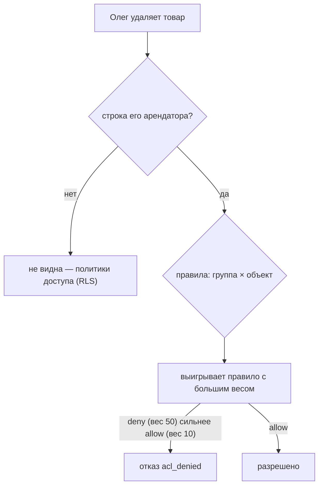

# Арендаторы и права

**Арендатор** — «чьи данные»: магазин, салон, компания. Данные одного арендатора другим не видны. **Права** решают, что пользователь может внутри арендатора: читать, менять, удалять строки, вызывать эндпоинты приложения. Права в letopis включены всегда, по умолчанию запрещают всё и проверяются **базой** — одинаково для библиотеки и для сырого SQL.

## Пример: роль, запрет, право на отчёты

<Example id="access/01-rules" />

Права задают три системных класса:

- **`Resource`** описывает либо «кто» — группу людей (`category: 'ACCOUNT'`, например всех с ролью `{staff}`), либо «что» — действие над классом (`READ`, `WRITE`, `DELETE`) или эндпоинт приложения (`API`);
- **`rule`** связывает «кто» с «что» и задаёт `permission: 'allow' | 'deny'` (можно или нельзя) и вес `weight`; при споре побеждает правило с большим весом;
- **`member`** — членство пользователя в арендаторе со списком его ролей.

## Подводные камни

- **По умолчанию запрещено всё.** `createTenant` даёт правило «своим можно всё» (вес 10) — без него пользователи арендатора ничего не могут.
- **Запрет с большим весом сильнее.** Так из «можно всё» вырезают исключения.
- **Интерфейс только прячет кнопки** (`acl.check`, `acl.checkData`), а запрещает база: прямой вызов получит `acl_denied`.
- **Классы арендатора чужим не видны:** классы из `syncModels` принадлежат арендатору; общие для всех — в System.
- **Права пересчитываются базой сами**; «у кого был доступ на дату» — срез `asOf` по классам `rule`, `member` и `Resource`.

## Где это в сервисах

Салоны в «Салоне записи» — отдельные арендаторы. В [Helpdesk](../services/helpdesk) компании — арендаторы, а роли агента, клиента и руководителя разводят правила: агент видит очередь своей компании, клиент — только свои обращения (условие `owner: '$actor'`), удалять заявки и править правила может только руководитель.
