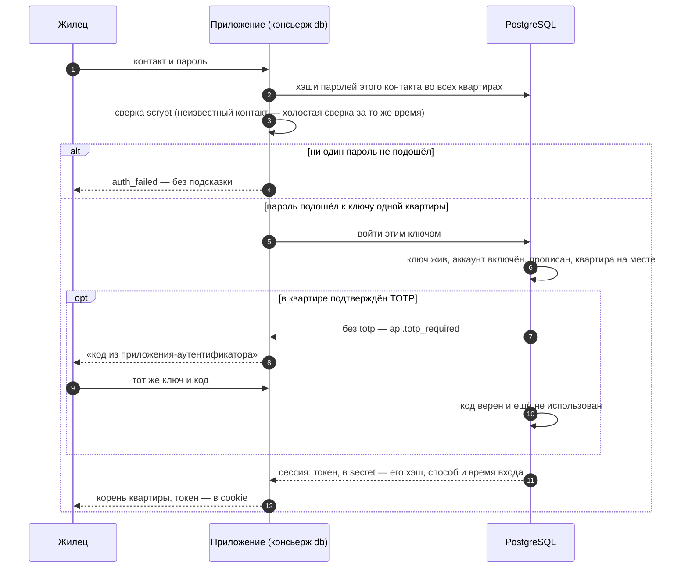

# Вход и ключи

## Зачем

Прежде чем работать с данными, жилец доказывает, кто он, — **ключом**: паролем, кодом из письма, ключом API. Консьерж (`db` — подключение `connect(pass, { postman })`) сверяет ключ и открывает **сессию** в квартире, а приложение получает **корень квартиры** (`me`) — цепочки с правами этого жильца.

Слова этой страницы:

- **контакт** — почта, телефон или Telegram человека. У аккаунта один контакт на весь дом, и он же — **имя для входа**: `{ email: 'anna@mir.ru' }`, `{ phone: '+79991112233' }`;
- **ключ** — способ войти: пароль, код из письма, ключ API, пара «ключ и секрет», внешний вход;
- **сессия** — открытый вход: её **токен** хранят в cookie и по нему возвращаются без ключа;
- **почтальон** — функция приложения, которая доставляет письма с кодами: библиотека код придумывает и проверяет, почтальон доставляет ([«Приглашения и почтальон»](../invites/)).

Пароли, коды, ключи и токены лежат в таблице `secret` только хэшами: пароль — scrypt, остальное — sha256. Исключение — секрет TOTP: по нему база сама считает коды, наружу он не выходит.

Кто что делает:

| Кто | Что | Вызовы |
|---|---|---|
| консьерж (`db`) | впускает по ключу, возвращает по токену, принимает приглашения, отдаёт почтальону коды для входа | `db.open(ключ)`, `db.resume(токен)`, `db.accept(token)`, `db.requestCode(контакт)`, `db.tenantsOf(контакт и код)` |
| жилец (`me`) | свои ключи в этой квартире, свой контакт и имя, срок и выход своей сессии, выписка, удаление аккаунта | `me.keys.*`, `me.changeContact()`, `me.changeName()`, `me.refreshSession()`, `me.close()`, `me.closeAll()`, `me.leave()`, `me.deleteAccount()` |
| матрица | кто зовёт людей и удаляет квартиру | `me.invite()` — право выдать роль, `me.deleteTenant()` — действие `tenant.delete` ([«Квартиры и права»](../access/)) |

Чужие ключи и сессии по одному не гасит ни owner, ни консьерж: их гасит выписка жильца из квартиры (или удаление всей квартиры).

## Какие бывают ключи

| Ключ | Как появляется | Как войти | Что открывает |
|---|---|---|---|
| пароль | `db.accept(token, { password })` или позже `me.keys.setPassword({ password })` | `db.open({ email, password })` | одну квартиру: ту, где задан этот пароль |
| код из письма | `db.requestCode({ email })` — код получает почтальон | `db.open({ email, code, tenant? })` | любую квартиру, где человек прописан: её выбирают после кода |
| внешний вход (Telegram, Google, корпоративный) | `me.keys.link({ kind, identifier })` — токен провайдера проверяет приложение | `db.open({ external: { kind, identifier } })` | одну квартиру |
| ключ API | `me.keys.issueApiKey({ name, ttl })` — показывается один раз | `db.open({ apiKey })` | одну квартиру |
| ключ и секрет | `me.keys.issueKeySecret({ name })` — секрет показывается один раз | `db.open({ key, secret })` | одну квартиру |
| TOTP — второй фактор | `me.keys.enrollTotp()`, включает `me.keys.verifyTotp(код)` | поле `totp` у пароля, кода и внешнего входа | — |

Контакт в ключе пишут той же формой, что в приглашении: `{ email }`, `{ phone }`, `{ telegram }` или `{ kind, address }`. Отдельного поля с именем для входа у пароля и кода нет: имя для входа — это контакт. Поле `identifier` есть только у внешнего входа: это id человека у провайдера.

## Вход паролем

```text
 const me = await db.open( { email: 'anna@mir.ru' , password: 'Мир-2026!' } )
                                   │                        │
                                   │                        └─ пароль от одной из квартир человека
                                   └─ контакт — имя для входа
        │
        ▼
 me — корень той квартиры, от которой этот пароль
```

Пароль **сам выбирает квартиру**. У человека в двух квартирах — два пароля, и они обязаны быть разными: каким паролем вошёл, в ту квартиру и попал. Тот же пароль во второй квартире задать нельзя — `invalid_data` (ключ `api.password_reused`).

```ts
const me = await db.open({ email: 'anna@mir.ru', password: 'Мир-2026!' })
console.log(me.tenantName)        // Мир
const token = me.token!           // токен сессии — в cookie
```

**`tenant` у входа паролем — проверка.** `db.open({ email, password, tenant: 'Мир' })` входит, только если пароль открывает именно эту квартиру. Форма входа «компания, почта, пароль» так не пустит человека в другую его компанию. Пароль от другой квартиры или такой квартиры нет — тот же `auth_failed`, что у неверного пароля: ответ не выдаёт, есть ли такая квартира.

Задать или сменить пароль — `await me.keys.setPassword({ password: 'новый' })`. Имя для входа не указывают: это контакт аккаунта. Смена пароля гасит остальные сессии жильца в квартире; текущая остаётся (`keepCurrent: false` — погасить и её).

## Вход кодом из письма

Пароль не обязателен: человек может входить кодом, который приходит на его контакт. Код доказывает, что контакт — его. Поэтому квартиру при запросе кода не называют: после кода человек видит список своих квартир и выбирает.

```text
 1. await db.requestCode({ email })              ──▶ почтальон: письмо { kind: 'code', code, expiresAt }
       ответ { expiresAt } — всегда одинаковый        (контакта нет в доме — письма нет, ответ тот же)

 2. человек ввёл код из письма

 3. await db.tenantsOf({ email, code })          ──▶ [ { id, name: 'Мир' }, { id, name: 'Весна' } ]
       код не гасится                                 неверный код ──▶ отказ auth_failed (api.code_failed)

 4. await db.open({ email, code, tenant: 'Весна' })  ──▶ me в «Весне»; код погашен
       квартира одна — tenant не нужен
       квартир несколько, а tenant не задан ──▶ отказ tenant_required, список — в err.detail.tenants
```

```ts
await db.requestCode({ email: 'oleg@mir.ru' })                       // код ушёл почтальону

// человек ввёл код: показываем его квартиры
const tenants = await db.tenantsOf({ email: 'oleg@mir.ru', code })   // [{ id, name }, …]

// одна квартира — входим сразу; несколько — человек выбрал одну
const me = await db.open({ email: 'oleg@mir.ru', code, tenant: tenants[0].id })
```

Правила кода:

| Что | Значение |
|---|---|
| длина | 6 цифр |
| срок | 10 минут |
| попытки | 5 неверных вводов подряд (в `tenantsOf` и `open` вместе) гасят код |
| повтор `requestCode` | новый код заменяет прежний |
| после входа | код погашен: второй раз не пройдёт |
| `tenant` | имя или id квартиры; квартира, где человек не прописан, — `auth_failed` (ключ `api.code_failed`), квартиры с таким именем нет в доме — `target_not_found` (ключ `api.tenant_unknown`) |
| неверный или истёкший код | `auth_failed`, ключ `api.code_failed` — и в `tenantsOf`, и в `open` |

- **Ответ `requestCode` не выдаёт, есть ли такой человек.** Контакта нет в доме, аккаунт выключен или нигде не прописан — письма нет, а ответ `{ expiresAt }` тот же. Так посторонний не узнает, чьи адреса есть в доме.
- **Почему на неизвестную квартиру пароль и код отвечают по-разному.** При входе паролем `tenant` — часть проверки пароля: «этот пароль открывает эту квартиру?». Любое «нет» — один ответ `auth_failed`: он не выдаёт, чей это пароль и от какой квартиры. При входе кодом человек уже доказал контакт и выбирает квартиру из своих: имени нет в доме — `target_not_found` (ключ `api.tenant_unknown`), и форма может сказать «такой квартиры нет». Само название квартиры не секрет: занятое имя видно и при `db.createTenant` — отказ `exists`.
- **Список квартир виден только после верного кода.** Без кода узнать, где человек прописан, нельзя.
- **Нужен почтальон.** Без него `requestCode` — отказ `no_postman`.
- **Библиотека доказывает, почтальон доставляет.** Код придумывает, хранит (только хэш), считает попытки и проверяет библиотека. Как доставить код — СМС, почта, бот — и как часто можно его просить, решает почтальон, то есть приложение: [«Кто за что отвечает»](../invites/#кто-за-что-отвечает). Частоту запросов кода библиотека не ограничивает.
- Свои настройки кода: `db.requestCode(контакт, { ttl: '5m', digits: 8, maxAttempts: 3 })`; `maxAttempts` — от 1 до 10.

<Example id="auth/05-code-login" />

Человек в нескольких квартирах целиком — рецепт [«Несколько квартир»](../recipes/rooms).

## Забыл пароль

Отдельного вызова нет — он не нужен. Человек входит кодом из письма и задаёт новый пароль:

```ts
await db.requestCode({ email })                                // 1. код — на контакт
const me = await db.open({ email, code, tenant })              // 2. вход кодом
await me.keys.setPassword({ password: 'новый пароль' })        // 3. новый пароль от этой квартиры
```

Вход кодом — «недавний вход», поэтому менять пароль после него можно сразу. Так же заводит пароль человек, который принял приглашение без пароля.

## Смена контакта

Контакт — это имя для входа, и на него приходят коды. Поэтому сменить его можно, только доказав, что новый контакт ваш: код приходит на **новый** адрес.

```text
 1. await me.changeContact({ phone: '+79990001122' })
       ──▶ почтальон: письмо на НОВЫЙ контакт { kind: 'contact', code, expiresAt }
       ──▶ { expiresAt }

 2. await me.changeContact({ phone: '+79990001122', code })
       ──▶ { contact: { kind: 'phone', address: '+79990001122' } }
       контакт аккаунта сменился; имя для входа у паролей сменилось во ВСЕХ квартирах
```

| Случай | Что будет |
|---|---|
| код верный | контакт сменён; прежний адрес для входа больше не годится |
| код неверный или истёк | `auth_failed` (ключ `api.code_failed`); 5 неверных вводов гасят код |
| новый контакт занят другим аккаунтом | `exists` (ключ `sql-access.identifier_taken`) — на втором шаге; на первом об этом не сообщается |
| вошли давно, по ключу API или по ссылке приглашения | `acl_denied` (ключ `sql-access.bind_denied`): сначала вход паролем или кодом |
| вызывает консьерж (`db.in`, `db.as`) | отказ: контакт меняет только сам жилец |

Пароли при смене контакта остаются прежними.

<Example id="auth/06-change-contact" />

## Имя человека {#имя-человека}

У аккаунта есть имя — например, «Анна Петрова». Его видят соседи по квартире: в списке людей и в подписях к строкам. Имя одно на аккаунт, как и контакт: во всех квартирах человека зовут одинаково.

| Вопрос | Ответ |
|---|---|
| откуда берётся | `db.accept(token, { name })`, когда человек принимает первое приглашение. Не задали — имя пустое: адрес контакта именем не становится |
| кто видит | те, кому матрица разрешает видеть прописку человека: `me.acl.people()` → `[{ account, name, roles }]` — [«Список людей квартиры»](../access/#список-людеи-квартиры). И тот, кого человек зовёт: `from.name` в письме и на странице приглашения |
| как прочитать своё | `(await me.acl.people()).find((p) => p.account === me.account)?.name` — себя жилец видит всегда |
| как сменить | `await me.changeName('Анна Петрова')` |

```text
 await me.changeName( '  Анна Петрова ' )   ──▶ { name: 'Анна Петрова' }
                            │
                            └─ строка от 1 до 200 знаков; пробелы по краям отбрасываются
```

| Случай | Что будет |
|---|---|
| имя сменено | ответ `{ name }` — имя, как оно записано; оно сразу видно во всех квартирах человека и в его приглашениях |
| то же имя ещё раз | ответ тот же, ничего не меняется |
| пустое имя, длиннее 200 знаков или не строка | `invalid_data` (ключ `sql-access.name_args`) |
| вошли давно, по ключу API или по ссылке приглашения (аккаунт уже был) | `acl_denied` (ключ `sql-access.bind_denied`): сначала вход паролем или кодом |
| корень консьержа в квартире (`db.in`) | `invalid_query` (ключ `api.resident_only`): у консьержа нет имени человека |

- **Нужен недавний вход** — как для смены контакта: не позже 10 минут после входа паролем, кодом или внешним входом. Новому человеку, который только что принял приглашение, смена имени доступна сразу.
- **Чужое имя сменить нельзя.** У вызова нет аргумента «чьё»: меняется имя того, кто вошёл.
- **Приложение может сменить имя от лица человека** — например, поддержка исправляет опечатку: `(await db.as(аккаунт, 'Мир')).changeName('Анна Петрова')`. Недавний вход тут не нужен: за человека ручается приложение. Что ещё можно и чего нельзя через `db.as` — [таблица в рецепте «Фоновые задачи консьержа»](../recipes/background#от-лица-человека).

Тот же вызов по шагам — шаг 5 [примера «Смена контакта и имени»](#ex-auth-06-change-contact). Форма «Мой профиль» с одним полем — в рецепте [«Веб-приложение с входом»](../recipes/web-login#мои-профиль).

## Правила для всех ключей

- **Один контакт — один аккаунт во всём доме**, регистр букв не важен.
- **Внешний id открывает одну квартиру во всём доме**: привязать его ко второй — `exists` (ключ `sql-access.key_bound_elsewhere`).
- **Неверный ключ — `auth_failed`** («ключ не подошёл»), причина не раскрывается: неверный пароль, неизвестный контакт (отвечает за то же время), отозванный ключ, выписанный жилец, удалённая квартира — один ответ. Ключ не той формы — `invalid_data` (`api.key_form`).
- **Править ключи и контакт** — выпускать, менять пароль, привязывать, отзывать, подключать TOTP — жилец может **10 минут после входа человеком**: паролем, кодом или внешним входом, с TOTP, если он подтверждён. Из сессии ключа API, пары «ключ и секрет» или принятого приглашения у существующего аккаунта — `acl_denied` (ключ `sql-access.bind_denied`). Свежий верный `me.keys.verifyTotp(код)` тоже открывает это окно.
- `me.keys.list()` — ключи жильца в этой квартире без секретов: `{ id, kind, ident, enabled, meta, createdAt, expiresAt }`. Отзыв — `me.keys.revoke(id)`: ключ API и пара гасят только свои сессии, пароль и внешний вход — все остальные сессии жильца в квартире.
- У консьержа в квартире (`db.in`, `db.as`) ключей нет: `keys.*`, `leave`, `deleteAccount`, `closeAll` — `invalid_query` (ключ `api.resident_only`).

## Пример: все ключи жильца

<Example id="auth/01-keys" />

## Что внутри: вход

<Flow name="auth" />



Ключ API, пара «ключ и секрет» и внешний вход идут тем же путём, только ключ находит сама база: ключи — по хэшу, внешний вход — по внешнему id. Код из письма база сверяет по контакту, а квартиру берёт из `tenant`.

## Второй фактор: TOTP

`me.keys.enrollTotp({ issuer })` даёт секрет и адрес `otpauth://totp/…` — его показывают QR-кодом, человек сканирует его приложением-аутентификатором. Фактор включается первой верной проверкой `me.keys.verifyTotp(код)`. Дальше база сама требует код при входе в эту квартиру паролем, кодом из письма или внешним входом:

- без `totp` — `auth_failed` с ключом `api.totp_required`: ключ верен, нужен код — форма просит его и отправляет ключ ещё раз вместе с ним;
- с неверным кодом — `auth_failed` (`api.auth_failed`);
- один код проходит один раз: повтор в том же 30-секундном шаге — `auth_failed`; принимается и соседний шаг;
- после 5 неверных кодов подряд проверка закрыта на 5 минут;
- ключ API и пара «ключ и секрет» кода не спрашивают — это ключи программ.

```ts
import { LetopisError } from 'letopis'

async function login(form: { email: string; password: string; totp?: string }) {
  try {
    return { me: await db.open(form) }
  } catch (e) {
    if (e instanceof LetopisError && e.key === 'api.totp_required') return { needTotp: true }   // показать поле кода
    if (e instanceof LetopisError && e.code === 'auth_failed') return { error: 'почта, пароль или код не подошли' }
    throw e
  }
}
```

TOTP подтверждается в каждой квартире отдельно: код «Ромашки» на вход в «Лютик» не действует. `totpCode(секрет)` из `letopis` считает код так же, как приложение-аутентификатор, — помощник для проверочных скриптов.

## Сессии

Каждый вход — сессия: строка `SESSION` в `secret` с хэшем токена, способом и временем входа. Сам токен — `me.token` (64 шестнадцатеричных знака) — хранят у клиента: в cookie, в файле. По нему возвращаются без ключа: `db.resume(токен)` — корень той же квартиры от имени того же аккаунта; сессия погашена, истекла, токен неверен или жилец выписан — `auth_failed` с ключом `api.session_closed` и подсказкой войти заново.

<Example id="auth/02-sessions" />

- **Срок.** У входа есть `ttl` — секунды числом или строка (`'15m'`, `'2h'`, `'7 days'`), по умолчанию 7 дней; непонятный — `invalid_data` (`access.bad_ttl`). `me.refreshSession({ ttl })` сдвигает конец на «сейчас + ttl», но не дальше срока, выданного при входе, и никогда не укорачивает; ответ — новый срок строкой ISO 8601. Так делают «скользящую» сессию: пока человек работает, конец отодвигается, брошенная сессия истекает.
- **Выход** — `me.close()`: сессия гаснет. **Выйти на всех устройствах** — `me.closeAll()`: все сессии жильца в этой квартире, и текущая. Смена пароля (`me.keys.setPassword`) гасит остальные сессии жильца в квартире, текущая остаётся (`keepCurrent: false` — погасить и её).
- **Корень после выхода.** Корень, чья сессия погашена — выходом, выпиской, сменой пароля, удалением квартиры или аккаунта, — на любой следующий вызов отвечает отказом `no_session`. Пустых ответов «как будто данных нет» не бывает.
- `close()` у корня жильца — это выход, а не освобождение ресурсов: корень после запроса не закрывают. Пул один — у консьержа; закрывает его `db.close()` при остановке процесса.

## Веб-вход: cookie и resume на каждый запрос

<Example id="auth/04-web-login" />

Веб-приложению нужно одно подключение к дому — консьерж, `connect(pass, { postman })` при запуске. Вход формой — `db.open(ключ)`, токен — в cookie; каждый запрос — `db.resume(токен из cookie)`: корень жильца на общем пуле консьержа, со своими правами. Аккаунт и квартиру помнит сама сессия — из параметров запроса их не берут.

```ts
import { connect, LetopisError } from 'letopis'

const db = await connect(process.env.LETOPIS_PASS!, { postman })   // один раз при запуске

// в начале каждого запроса: токен из cookie → корень жильца или null (ответить 401)
async function resident(cookieHeader: string | undefined) {
  const token = /(?:^|;\s*)sid=([0-9a-f]+)/.exec(cookieHeader ?? '')?.[1]
  if (!token) return null
  return db.resume(token).catch((e) => {
    if (e instanceof LetopisError && e.code === 'auth_failed') return null   // api.session_closed: вышел, истекла, выписан
    throw e
  })
}
```

- Cookie — с `HttpOnly` (скрипты страницы её не прочтут), `SameSite=Lax` (её не пришлёт чужой сайт), на HTTPS — `Secure`; срок — как `ttl` сессии.
- Выход — `(await db.resume(токен)).close()` и стереть cookie (`Max-Age=0`). Погашенный токен, присланный ещё раз, — `auth_failed` (ключ `api.session_closed`).
- Токен — секрет: в журнал приложения и в адрес страницы его не пишут.

Готовый сервис со страницей приглашения, входом паролем и кодом и выбором квартиры — рецепт [«Веб-приложение с входом»](../recipes/web-login).

## Выписка, удаление аккаунта и квартиры

<Example id="auth/03-leave-delete" />

- **`me.leave()`** — жилец выписывается сам: строка `member` удалена, его ключи и сессии в этой квартире гаснут, строки, которыми он владел, остаются квартире. Ключи и прописки в других квартирах не меняются. Вернуться — только по новому приглашению.
- **Выписать другого** — `me.acl.roles(аккаунт, null)` (или удалить его строку `member`): может тот, кому матрица разрешает удалять `member` и снимать роли выписываемого, — у owner это есть. Ключи и сессии выписанного гаснут сразу, и открытые тоже.
  ```ts
  await anya.acl.roles(oleg.account, null)                       // Аня (owner) выписывает Олега
  await anya.acl.roles(oleg.account)                             // null — прописки больше нет
  ```

  Как убедиться, что доступ закрыт:

  | Проверка | Ответ после выписки |
  |---|---|
  | вход Олега паролем этой квартиры: `db.open({ email, password })` | `auth_failed` |
  | его старая сессия: `oleg.Ticket().rows()` | `no_session` |
  | возврат по старому токену: `db.resume(token)` | `auth_failed` (ключ `api.session_closed`) |
  | вход кодом: `db.tenantsOf({ email, code })` | этой квартиры в списке нет; если квартир не осталось вовсе, письмо с кодом не уходит |
- **Последний owner** не выписывается и не удаляет аккаунт — `last_owner`: сначала роль `owner` получает другой жилец.
- **`me.deleteAccount()`** — удалить свой аккаунт целиком: прописки во всех квартирах, все ключи и сессии; строки, которыми он владел, остаются квартирам, версии — в журнале. Нужен недавний вход человеком, как для правки ключей; owner, последний хотя бы в одной квартире, — `last_owner`, не удаляется ничего.
- **`db.deleteAccount(аккаунт)`** — то же делает консьерж: например, по просьбе человека, который не может войти. Ответ — `{ account, memberships, owned }`.
- **`me.deleteTenant()`** — удалить квартиру со всеми её строками, журналом, прописками, ключами и сессиями; может консьерж или жилец с правом `tenant.delete` (у owner оно есть). Аккаунты жильцов остаются. Подробно — [«Квартиры и права»](../access/).

## Подводные камни

- **Пароль открывает одну квартиру.** Человеку в двух квартирах — два пароля, и они разные (`api.password_reused`). Кодом из письма входят в любую свою квартиру.
- **Код не привязан к квартире.** `db.requestCode(контакт)` квартиру не принимает; её выбирают после кода — `tenant` в `db.open`.
- **Несколько квартир без `tenant` — отказ `tenant_required`**, а не вход «в первую попавшуюся». Список — в `err.detail.tenants`; код при этом не гаснет.
- **`auth_failed` не называет причину.** Неверный пароль, неизвестный контакт, отозванный ключ, выписанный жилец — один ответ. Исключения — `api.totp_required` (ключ верен, нужен код TOTP), `api.code_failed` (код из письма не подошёл) и `api.session_closed` (токен сессии больше не действует).
- **Подтверждённый TOTP база требует сама** у пароля, кода из письма и внешнего входа; ключ API и пара «ключ и секрет» его не спрашивают — выдавайте их только программам.
- **Имя — не контакт.** Имя показывают людям, и оно может быть пустым; контакт — имя для входа. Меняют их разными вызовами: `me.changeName` и `me.changeContact`.
- **Ключи и контакт правят только после недавнего входа** — 10 минут после пароля, кода или внешнего входа (с TOTP, если он подтверждён); из сессии ключа API и из сессии принятого приглашения у существующего аккаунта — `acl_denied`.
- **Код TOTP и код из письма — одноразовые.** Тот же код второй раз не проходит.
- **Смена контакта меняет имя для входа во всех квартирах.** Прежний адрес после неё не открывает ни одной.
- **`refreshSession()` не укорачивает сессию** и не продлевает её дальше срока, выданного при входе.
- **Корень с погашенной сессией отвечает `no_session`.** В начале каждого запроса веб-приложения проверяйте токен — `db.resume`.
- **`close()` — выход.** Не закрывайте корень жильца после каждого запроса веб-приложения.
- **Ключи и выписка — только у жильца.** У консьержа в квартире (`db.in`, `db.as`) — `invalid_query` (`api.resident_only`).
- **Последний owner не уходит** — `last_owner`.

## Где это в сервисах

[Helpdesk](../services/helpdesk) показывает почти всё: регистрацию компании приглашением, вход паролем со вторым фактором (QR-код, `api.totp_required` и повтор с кодом), вход кодом из письма, ключи API интеграций и ИИ-агента, «выйти на всех устройствах» (`closeAll`) и закрытие компании (`deleteTenant`). Веб-сессия там — токен в cookie и `db.resume` на каждый запрос, как в примере выше; так же устроены и остальные [сервисы-примеры](../services/).
