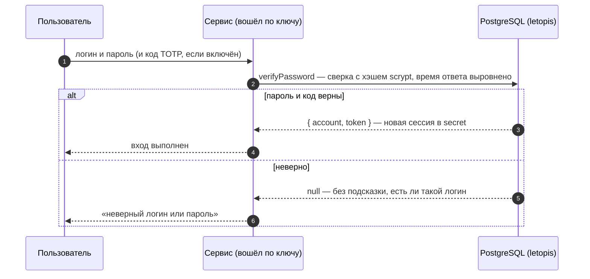
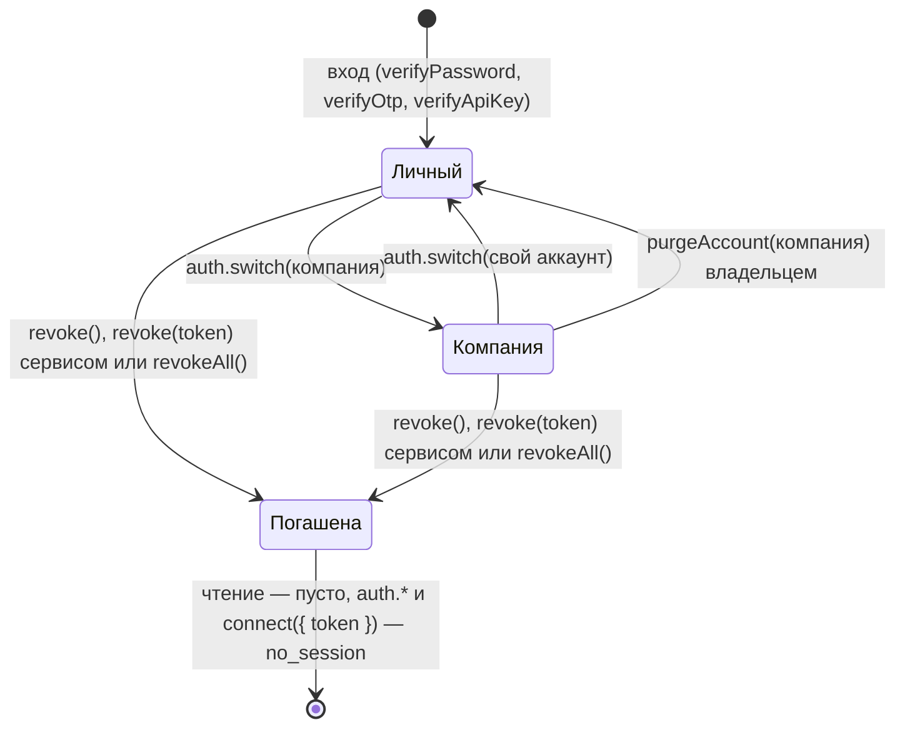

# Вход: пароли, ключи, коды, второй фактор

## Зачем

Прежде чем работать с данными, пользователь доказывает, кто он, — паролем, кодом или ключом. В ответ приложение получает сессию, и с ней база проверяет его права.

Входом в letopis занимается **сервис приложения**: он подключён по своему ключу API, проверяет пароль, код или ключ пользователя и при успехе выдаёт сессию. Все секреты лежат в таблице `secret` — только хэшами.

## Пример: все способы входа

<Example id="auth/01-login-factors" />

## Что внутри: вход

<Flow name="auth" />



| Способ | Выдать | Проверить |
|---|---|---|
| пароль | `setPassword` | `verifyPassword({ identifier, password, totp? })` |
| ключ API | `issueApiKey` (отдаётся один раз) | `verifyApiKey(key)`; отзыв — `revokeCredential` |
| ключ + секрет | `issueKeySecret` | `verifyKeySecret(key, secret)` |
| одноразовый код (OTP) | `issueOtp` (отправляет сервис) | `verifyOtp` — код действует один раз |
| TOTP — код из приложения-аутентификатора | `enrollTotp` (секрет и QR) | `verifyTotp`, или `totp` в `verifyPassword` |
| внешняя учётная запись | `link` | `lookup({ kind, identifier })` |
| сессия для процесса | `sessionFor(account, { ttl })` | `connect({ token })` |

## Сессии и арендаторы

У каждого аккаунта есть свой, личный арендатор. Сразу после входа сессия работает в нём; чтобы работать с данными компании, сессию переключают вызовом `auth.switch()`. Сессию можно продлить (`refresh`), завершить свою (`revoke()`), чужую по токену — сервисом (`revoke(token)`) или все (`revokeAll`), а владелец может стереть арендатора целиком (`purgeAccount`) — даже тот, в котором сейчас работает.

<Example id="auth/02-sessions-tenants" />

### После входа: в каком арендаторе работать

`verifyPassword` возвращает `{ account, token }` — кто вошёл и токен его сессии, но не компанию: свежая сессия работает в личном арендаторе аккаунта (его id равен `account`). Классов компании там нет, и первый же шаг по ним падает:

```text
letopis: invalid_class: класс или роль Item не найдены: в реестре сессии нет ни одного класса арендатора — сессия, похоже, в личном арендаторе
```

`err.hint` подсказывает выход: «после входа сессия работает в личном арендаторе пользователя: найти нужного — db.auth.tenants(), перейти — db.auth.switch(tenant) или db.as(аккаунт, { tenant }); классы в арендатор записывает syncModels». Если классы арендатора в сессии есть, а нужного нет, текст короче — `класс или роль Item не найдены` — с похожими именами, если они есть, и той же подсказкой про арендатора и `syncModels`: проверьте имя и что модель записана именно в этот арендатор.

Исправление — перейти в компанию сразу после входа. В каких арендаторах пользователь состоит, сервис спрашивает у базы — `auth.tenants()` (шаг 1 примера выше): у каждого `tenant`, роли, имя арендатора `name` и `personal` — личный ли; личный — первым, затем компании по id. Свою таблицу «логин → арендатор» держать не нужно: членство хранит база, и в арендатор без членства она не пустит — `tenant_denied`. Дальше — смотря кто работает с базой:

- **веб-сервис** (много пользователей, один процесс) — одно подключение сервиса, клуб в серверной сессии и `svc.as(account, { tenant })` на каждый запрос: [«Вход для веб-сервиса»](#вход-для-веб-сервиса-одно-подключение-и-svc-as-на-запрос) ниже;
- **процесс одного пользователя** (скрипт, утилита, настольное приложение), который держит одно подключение по его токену, — `auth.switch()` (шаг 2):

```ts
const u = await connect({ dsn: appDsn, schema, token })              // одно подключение на процесс
const club = (await u.auth.tenants()).find((t) => !t.personal)      // клубов несколько — дайте выбрать по name
if (club) await u.auth.switch(club.tenant)
```

### Вход для веб-сервиса: одно подключение и svc.as() на запрос

<Example id="auth/04-web-login" />

::: warning Не открывайте connect({ token }) на каждый вход
Каждый `connect()` по `dsn` создаёт свой пул — до `max` соединений, по умолчанию 10. Веб-сервис, который подключается по токену каждого вошедшего пользователя, держит пул на пользователя и быстро исчерпывает соединения PostgreSQL. Подключение у сервиса одно — по ключу сервиса, а от имени пользователя работает `svc.as(account, { tenant })` на том же пуле.
:::

```ts
const svc = await connect({ dsn: APP_DSN, schema, apiKey: SERVICE_KEY })   // один раз при запуске
// серверная сессия: токен → кто и в каком клубе. Map в памяти — ТОЛЬКО ДЛЯ ДЕМОНСТРАЦИИ: теряется при перезапуске и не
// видна другим экземплярам сервиса; в работе — общее хранилище со сроком (Redis с TTL, таблица) — ниже
const sessions = new Map<string, { account: string; tenant: string }>()

// «Войти в клуб» — одна функция: пароль, клубы пользователя у базы, выбор клуба
async function enterClub(identifier: string, password: string, clubName?: string) {
  const ok = await svc.auth.verifyPassword({ identifier, password })
  if (!ok) return null                                                     // неверный логин или пароль
  const me = await svc.as(ok.account)                                      // личный арендатор — только спросить список
  const clubs = (await me.auth.tenants()).filter((t) => !t.personal)
  const club = clubName === undefined ? clubs[0] : clubs.find((c) => c.name === clubName)
  if (!club) {
    await svc.auth.revoke(ok.token)
    return null                                                            // не состоит в этом клубе
  }
  sessions.set(ok.token, { account: ok.account, tenant: club.tenant })
  return ok.token                                                          // → cookie; клиенту больше ничего не нужно
}

// каждый запрос: токен из cookie
async function dbFor(token: string) {
  const s = sessions.get(token)
  if (!s) return null                                                      // 401: такой серверной сессии нет
  if (!(await svc.auth.session(token))) {
    sessions.delete(token)                                                 // сессия letopis погашена или истекла — убрать и запись
    return null                                                            // 401
  }
  return svc.as(s.account, { tenant: s.tenant })                           // права пользователя в его клубе, пул сервиса
}
```

- **Где хранить серверную сессию.** `Map` из образца — только для демонстрации: записи не истекают сами, после перезапуска пропадают, а второй экземпляр сервиса их не видит. В работе — общее хранилище со сроком не дольше сессии letopis (Redis с TTL, таблица с `expires_at`): ключ — токен (лучше его хэш), значение — `{ account, tenant }`. Запись удаляют при выходе (`revoke`) и когда `svc.auth.session(token)` вернул `null`, а `maintain()` чистит в базе погашенные и истёкшие сессии letopis.
- **Арендатор — только из серверной сессии**, никогда из параметра запроса (`?club=…`): иначе посторонний выберет чужой клуб, и если приложение ходит туда от имени сервиса, база его не остановит. `svc.as(account, { tenant })` с аккаунтом из сессии в клуб без членства не пустит — `tenant_denied`.
- **Выход** — `svc.auth.revoke(token)` ([«Выход»](#выход)); после него `svc.auth.session(token)` — `null`, и `dbFor` отвечает «войдите заново» (шаг 3 примера).
- **Погашенный токен.** `connect({ token })` с погашенным, истёкшим или неверным токеном — отказ `no_session` (ключ `api.token_not_active`): подключения без сессии он не возвращает.
- Если сервису всё же нужно подключение по токену пользователя (так делает helpdesk: компанию помнит сама сессия letopis после `auth.switch()`), давайте ему общий пул — `connect({ sql: pool, token })`: с опцией `sql` `connect()` своего пула не создаёт.

### Выход

| Что | Вызов | Кто |
|---|---|---|
| выйти из своей сессии | `db.auth.revoke()` | подключение, открытое по токену пользователя |
| выйти пользователю веб-сервиса | `svc.auth.revoke(token)` — токен из cookie | сервис (право `auth.session`); по токену пользователя он не подключается |
| выйти на всех устройствах | `db.auth.revokeAll()` или `svc.auth.revokeAll(account)` | сам пользователь или сервис |

`revoke(token)` отвечает `true`, если сессия погашена, и `false`, если токен неверный, сессия уже погашена или истекла — причины не различаются (шаг 7 примера). Не зовите в обработчике «Выйти» `svc.auth.revoke()` без токена: так сервис погасит собственную сессию, а пользователь останется в системе.

### Что внутри: жизнь сессии



## Удалить аккаунт

Аккаунт удаляет системный администратор (строку `Account`) или владелец его арендатора (`purgeAccount`). Его строки в таблице `secret` — пароль, ключи, сессии — уходят сразу вместе с ним, а сессии гаснут с сигналом: процессы сбрасывают кэш результатов этих сессий.

<Example id="auth/03-delete-account" />

## Подводные камни

- **Неверный вход — `null`, а не ошибка:** ответ не подсказывает, существует ли логин, и время ответа выровнено.
- **Идентификатор при входе — без учёта регистра**, но id аккаунта из `createTenant` берётся из логина как есть: пишите логины в одном регистре.
- **Смена пароля завершает остальные сессии** аккаунта; текущая сессия остаётся (`keepCurrent` по умолчанию `true`), `keepCurrent: false` — погасить и её.
- **Код OTP доставляет сервис** — база только выдаёт и проверяет его. По умолчанию код — 6 цифр, действует 10 минут и после 5 неверных попыток перестаёт действовать; всё это задают опции `issueOtp({ ttl, digits, maxAttempts })` (попыток — от 1 до 10).
- **Требовать ли второй фактор, решает сервис:** без опции `totp` вход код не проверяет.
- **Последний действующий ключ сервиса не отзывается** — сначала выпустите новый (ротация без простоя).
- **Отозванная или истёкшая сессия при чтении не даёт ошибки:** запросы просто возвращают пустой результат. Ошибку `no_session` дают только запись, `acl.check`, методы `db.auth`, которым нужна сессия, и `connect({ token })`, поэтому серверу стоит проверять сессию в начале каждого запроса (`svc.auth.session(token)`).
- **Веб-сервису — одно подключение.** `connect({ token })` на каждый вход создаёт пул на пользователя и исчерпывает соединения PostgreSQL; на запрос — `svc.as(account, { tenant })` ([выше](#вход-для-веб-сервиса-одно-подключение-и-svc-as-на-запрос)).
- **`refresh()` не укорачивает сессию** и не продлевает её дальше срока, выданного при входе.
- **После входа сессия — в личном арендаторе.** Шаг по классу компании даёт `invalid_class` «…сессия, похоже, в личном арендаторе»: сначала `auth.tenants()` и `auth.switch()` ([выше](#после-входа-в-каком-арендаторе-работать)).
- **Выход пользователя веб-сервиса — `svc.auth.revoke(token)`.** `revoke()` без токена у сервиса гасит его собственную сессию, а не пользователя.
- **`auth.switch()` есть только у самого подключения `db`**, а не у `db.as()`: там арендатор задаётся опцией `tenant`.
- **`svc.as()` несуществующего аккаунта — «не найден», а не «нет прав».** id, которого нет (опечатка, аккаунт удалён), даёт `target_not_found` (ключ `sql-core.impersonation_no_account`); аккаунт есть, но действовать от его имени нельзя (System, сервис, выключен) — `acl_denied`. id берите из ответа `verifyPassword()`, `createTenant()` или `auth.tenants()`.
- **Удалённый аккаунт не оставляет следов в `secret`**: его пароли, ключи и сессии стираются сразу. Аккаунт System удалить нельзя — ему принадлежат служебные строки установки.

## Где это в сервисах

Салон и кошелёк входят по паролю и держат веб-сессию на сервере. [Helpdesk](../services/helpdesk) показывает остальное: второй фактор с QR-кодом, вход по коду из письма, ключи API интеграций и ИИ-агента, переход между компаниями (`auth.switch`), «Выйти на всех устройствах» (`revokeAll`) и закрытие компании (`purgeAccount`). Веб-сессия там — сессия letopis: у каждой вкладки своё подключение по токену на общем пуле сервиса (`connect({ sql: pool, token })`).
