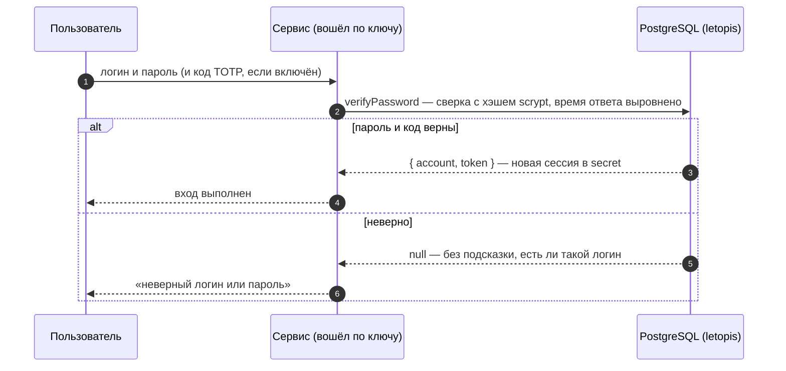
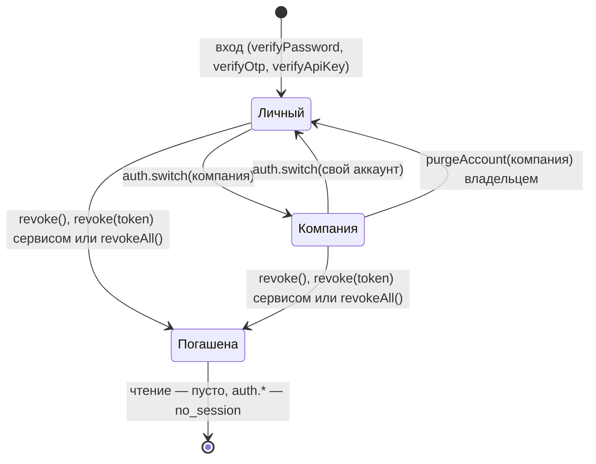

# Вход: пароли, ключи, коды, второй фактор

## Зачем

Прежде чем работать с данными, пользователь доказывает, кто он, — паролем, кодом или ключом. В ответ приложение получает сессию, и с ней база проверяет его права.

Входом в letopis занимается **сервис приложения**: он подключён по своему ключу API, проверяет пароль, код или ключ пользователя и при успехе выдаёт сессию. Все секреты лежат в таблице `secret` — только хэшами.

## Пример: все способы входа

<Example id="auth/01-login-factors" />

## Что внутри: вход

<Flow name="auth" />



| Способ | Выдать | Проверить |
|---|---|---|
| пароль | `setPassword` | `verifyPassword({ identifier, password, totp? })` |
| ключ API | `issueApiKey` (отдаётся один раз) | `verifyApiKey(key)`; отзыв — `revokeCredential` |
| ключ + секрет | `issueKeySecret` | `verifyKeySecret(key, secret)` |
| одноразовый код (OTP) | `issueOtp` (отправляет сервис) | `verifyOtp` — код действует один раз |
| TOTP — код из приложения-аутентификатора | `enrollTotp` (секрет и QR) | `verifyTotp`, или `totp` в `verifyPassword` |
| внешняя учётная запись | `link` | `lookup({ kind, identifier })` |
| сессия для процесса | `sessionFor(account, { ttl })` | `connect({ token })` |

## Сессии и арендаторы

У каждого аккаунта есть свой, личный арендатор. Сразу после входа сессия работает в нём; чтобы работать с данными компании, сессию переключают вызовом `auth.switch()`. Сессию можно продлить (`refresh`), завершить свою (`revoke()`), чужую по токену — сервисом (`revoke(token)`) или все (`revokeAll`), а владелец может стереть арендатора целиком (`purgeAccount`) — даже тот, в котором сейчас работает.

<Example id="auth/02-sessions-tenants" />

### После входа: в каком арендаторе работать

`verifyPassword` возвращает `{ account, token }` — кто вошёл и токен его сессии, но не компанию: свежая сессия работает в личном арендаторе аккаунта (его id равен `account`). Классов компании там нет, и первый же шаг по ним падает:

```text
letopis: invalid_class: класс или роль Item не найдены: в реестре сессии нет ни одного класса арендатора — сессия, похоже, в личном арендаторе
```

`err.hint` подсказывает выход: «после входа сессия работает в личном арендаторе пользователя: найти нужного — db.auth.tenants(), перейти — db.auth.switch(tenant) или db.as(аккаунт, { tenant }); классы в арендатор записывает syncModels». Если классы арендатора в сессии есть, а нужного нет, текст короче — `класс или роль Item не найдены` — с похожими именами, если они есть, и той же подсказкой про арендатора и `syncModels`: проверьте имя и что модель записана именно в этот арендатор.

Исправление — перейти в компанию сразу после входа. В каких арендаторах пользователь состоит, сервис спрашивает у базы — `auth.tenants()` на подключении с этим токеном (шаг 1 примера выше): у каждого `tenant`, роли, имя арендатора `name` и `personal` — личный ли; личный — первым, затем компании по id. Переводит сессию `auth.switch()` (шаг 2):

```ts
const ok = await svc.auth.verifyPassword({ identifier, password })
if (!ok) return 'неверный логин или пароль'
const u = await connect({ dsn: appDsn, schema, token: ok.token })
const clubs = (await u.auth.tenants()).filter((t) => !t.personal)   // без личного арендатора
if (!clubs.length) return 'вы не состоите ни в одном клубе'
await u.auth.switch(clubs[0].tenant)   // клубов несколько — дайте выбрать по clubs[i].name
```

Свою таблицу «логин → арендатор» держать не нужно: членство хранит база, и в арендатор без членства она не пустит — `tenant_denied`. Сервис, который работает от имени пользователя через `svc.as(ok.account, { tenant })`, берёт `tenant` из того же списка `auth.tenants()`.

### Выход

| Что | Вызов | Кто |
|---|---|---|
| выйти из своей сессии | `db.auth.revoke()` | подключение, открытое по токену пользователя |
| выйти пользователю веб-сервиса | `svc.auth.revoke(token)` — токен из cookie | сервис (право `auth.session`); по токену пользователя он не подключается |
| выйти на всех устройствах | `db.auth.revokeAll()` или `svc.auth.revokeAll(account)` | сам пользователь или сервис |

`revoke(token)` отвечает `true`, если сессия погашена, и `false`, если токен неверный, сессия уже погашена или истекла — причины не различаются (шаг 7 примера). Не зовите в обработчике «Выйти» `svc.auth.revoke()` без токена: так сервис погасит собственную сессию, а пользователь останется в системе.

### Что внутри: жизнь сессии



## Удалить аккаунт

Аккаунт удаляет системный администратор (строку `Account`) или владелец его арендатора (`purgeAccount`). Его строки в таблице `secret` — пароль, ключи, сессии — уходят сразу вместе с ним, а сессии гаснут с сигналом: процессы сбрасывают кэш результатов этих сессий.

<Example id="auth/03-delete-account" />

## Подводные камни

- **Неверный вход — `null`, а не ошибка:** ответ не подсказывает, существует ли логин, и время ответа выровнено.
- **Идентификатор при входе — без учёта регистра**, но id аккаунта из `createTenant` берётся из логина как есть: пишите логины в одном регистре.
- **Смена пароля завершает остальные сессии** аккаунта (`keepCurrent` — оставить текущую).
- **Код OTP доставляет сервис** — база только выдаёт и проверяет его; после 5 неверных попыток код перестаёт действовать.
- **Требовать ли второй фактор, решает сервис:** без опции `totp` вход код не проверяет.
- **Последний действующий ключ сервиса не отзывается** — сначала выпустите новый (ротация без простоя).
- **Отозванная или истёкшая сессия при чтении не даёт ошибки:** запросы просто возвращают пустой результат. Ошибку `no_session` дают только запись, `acl.check` и методы `db.auth`, которым нужна сессия, поэтому серверу стоит проверять сессию в начале каждого запроса.
- **`refresh()` не укорачивает сессию** и не продлевает её дальше срока, выданного при входе.
- **После входа сессия — в личном арендаторе.** Шаг по классу компании даёт `invalid_class` «…сессия, похоже, в личном арендаторе»: сначала `auth.tenants()` и `auth.switch()` ([выше](#после-входа-в-каком-арендаторе-работать)).
- **Выход пользователя веб-сервиса — `svc.auth.revoke(token)`.** `revoke()` без токена у сервиса гасит его собственную сессию, а не пользователя.
- **`auth.switch()` есть только у самого подключения `db`**, а не у `db.as()`: там арендатор задаётся опцией `tenant`.
- **Удалённый аккаунт не оставляет следов в `secret`**: его пароли, ключи и сессии стираются сразу. Аккаунт System удалить нельзя — ему принадлежат служебные строки установки.

## Где это в сервисах

Салон и кошелёк входят по паролю и держат веб-сессию на сервере. [Helpdesk](../services/helpdesk) показывает остальное: второй фактор с QR-кодом, вход по коду из письма, ключи API интеграций и ИИ-агента, переход между компаниями (`auth.switch`), «Выйти на всех устройствах» (`revokeAll`) и закрытие компании (`purgeAccount`). Веб-сессия там — сессия letopis: у каждой вкладки своё подключение по токену.
