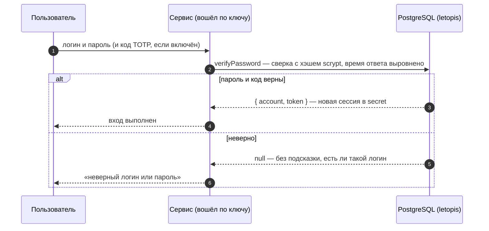
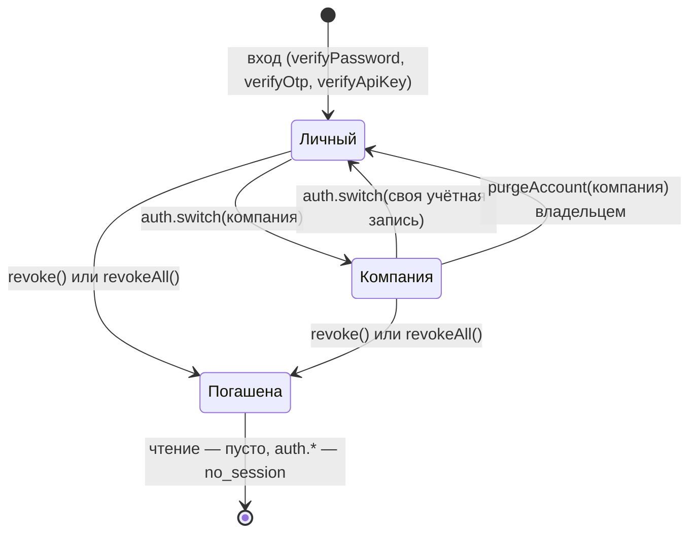

# Вход: пароли, ключи, коды, второй фактор

Входом в letopis занимается **сервис приложения**: он подключён по своему ключу API, проверяет пароль, код или ключ пользователя и при успехе выдаёт сессию. Все секреты лежат в таблице `secret` — только хэшами.

## Пример: все способы входа

<Example id="auth/01-login-factors" />

| Способ | Выдать | Проверить |
|---|---|---|
| пароль | `setPassword` | `verifyPassword({ identifier, password, totp? })` |
| ключ API | `issueApiKey` (отдаётся один раз) | `verifyApiKey(key)`; отзыв — `revokeCredential` |
| ключ + секрет | `issueKeySecret` | `verifyKeySecret(key, secret)` |
| одноразовый код | `issueOtp` (отправляет сервис) | `verifyOtp` — код сгорает |
| TOTP | `enrollTotp` (секрет и QR) | `verifyTotp`, или `totp` в `verifyPassword` |
| внешняя учётная запись | `link` | `lookup({ kind, identifier })` |
| сессия для процесса | `sessionFor(account, { ttl })` | `connect({ token })` |

## Сессии и арендаторы

Свежая сессия входа работает в личном арендаторе учётной записи; в компанию её переводит `auth.switch()`. Сессию можно продлить (`refresh`), погасить свою (`revoke`) или все (`revokeAll`), а владелец может стереть арендатора целиком (`purgeAccount`) — даже тот, в котором сейчас работает.

<Example id="auth/02-sessions-tenants" />

## Подводные камни

- **Неверный вход — `null`, а не ошибка:** ответ не подсказывает, существует ли логин, и время ответа выровнено.
- **Идентификатор при входе — без учёта регистра**, но id аккаунта из `createTenant` берётся из логина как есть: пишите логины в одном регистре.
- **Смена пароля гасит остальные сессии** аккаунта (`keepCurrent` — оставить текущую).
- **Код OTP доставляет сервис** — база только выдаёт и проверяет его; перебор (5 попыток) код сжигает.
- **Требовать ли второй фактор, решает сервис:** без опции `totp` вход код не проверяет.
- **Последний действующий ключ сервиса не отзывается** — сначала выпустите новый (ротация без простоя).
- **Погашенная сессия на чтении ошибки не даёт:** контекст пустой, база ничего не показывает. `no_session` бросают функции входа (`auth.*`) — веб-сервису стоит проверять сессию на входе запроса.
- **`refresh()` не укорачивает сессию** и не продлевает её дальше срока, выданного при входе.
- **`auth.switch()` — только у корня подключения**; у `db.as()` арендатор задаётся опцией `tenant`.

## Где это в сервисах

Салон и кошелёк входят по паролю и держат веб-сессию на сервере. Helpdesk добавит второй фактор (TOTP с QR-кодом), одноразовые коды и ключи API для интеграций.
