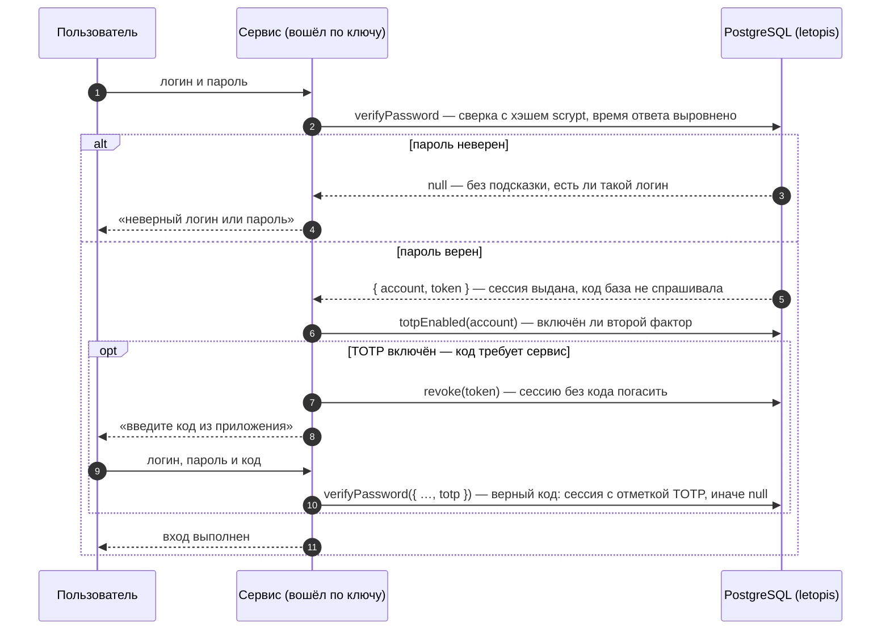
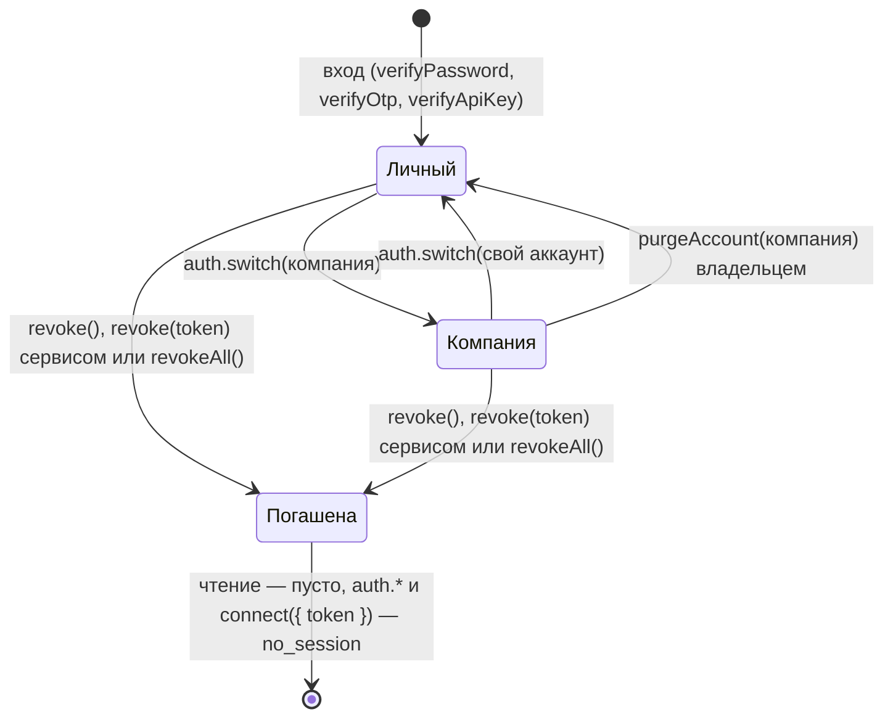

# Вход: пароли, ключи, коды, второй фактор

## Зачем

Прежде чем работать с данными, пользователь доказывает, кто он, — паролем, кодом или ключом. В ответ приложение получает сессию, и с ней база проверяет его права.

Входом в letopis занимается **сервис приложения**: он подключён по своему ключу API, проверяет пароль, код или ключ пользователя и при успехе выдаёт сессию. Все секреты лежат в таблице `secret` — только хэшами.

## Пример: все способы входа

<Example id="auth/01-login-factors" />

## Что внутри: вход

<Flow name="auth" />



Второй фактор база сама не навязывает: `verifyPassword` без `totp` выдаёт сессию и аккаунту с включённым TOTP (шаг 5 [примера «Сессии и арендаторы»](#сессии-и-арендаторы)). Требовать код — дело сервиса: проверить `totpEnabled(account)` и, если он включён, входить только с `verifyPassword({ identifier, password, totp })`. С `totp` база проверяет код после верного пароля: неверный код — `null`, и код, уже принятый в текущем 30-секундном шаге, — тоже `null` (повтор того же кода не проходит; например, вход сразу после `verifyTotp` тем же кодом).

| Способ | Выдать | Проверить |
|---|---|---|
| пароль | `setPassword` | `verifyPassword({ identifier, password, totp? })` |
| ключ API | `issueApiKey` (отдаётся один раз) | `verifyApiKey(key)`; отзыв — `revokeCredential` |
| ключ + секрет | `issueKeySecret` | `verifyKeySecret(key, secret)` |
| одноразовый код (OTP) | `issueOtp` (отправляет сервис) | `verifyOtp` — код действует один раз |
| TOTP — код из приложения-аутентификатора | `enrollTotp` (секрет и QR) | `verifyTotp`, или `totp` в `verifyPassword` |
| внешняя учётная запись | `link` | `lookup({ kind, identifier })` |
| сессия для процесса | `sessionFor(account, { ttl })` | `connect({ token })` |

## Сессии и арендаторы

У каждого аккаунта есть свой, личный арендатор. Сразу после входа сессия работает в нём; чтобы работать с данными компании, сессию переключают вызовом `auth.switch()`. Сессию можно продлить (`refresh` — подробнее [ниже](#продлить-сессию-refresh)), завершить свою (`revoke()`), чужую по токену — сервисом (`revoke(token)`) или все (`revokeAll`), а владелец может стереть арендатора целиком (`purgeAccount`) — даже тот, в котором сейчас работает.

<Example id="auth/02-sessions-tenants" />

### После входа: в каком арендаторе работать

`verifyPassword` возвращает `{ account, token }` — кто вошёл и токен его сессии, но не компанию: свежая сессия работает в личном арендаторе аккаунта (его id равен `account`). Классов компании там нет, и первый же шаг по ним падает:

```text
letopis: invalid_class: класс или роль Item не найдены: в реестре сессии нет ни одного класса арендатора — сессия, похоже, в личном арендаторе
```

`err.hint` подсказывает выход: «после входа сессия работает в личном арендаторе пользователя: найти нужного — db.auth.tenants(), перейти — db.auth.switch(tenant) или db.as(аккаунт, { tenant }); классы в арендатор записывает syncModels». Если классы арендатора в сессии есть, а нужного нет, текст короче — `класс или роль Item не найдены` — с похожими именами, если они есть, и той же подсказкой про арендатора и `syncModels`: проверьте имя и что модель записана именно в этот арендатор.

Исправление — перейти в компанию сразу после входа. В каких арендаторах пользователь состоит, сервис спрашивает у базы — `auth.tenants()` (шаг 1 примера выше): у каждого `tenant`, роли, имя арендатора `name` и `personal` — личный ли; личный — первым, затем компании по id. Свою таблицу «логин → арендатор» держать не нужно: членство хранит база, и в арендатор без членства она не пустит — `tenant_denied`. Дальше — смотря кто работает с базой:

- **веб-сервис** (много пользователей, один процесс) — одно подключение сервиса, компания в серверной сессии и `svc.as(account, { tenant })` на каждый запрос: [«Вход для веб-сервиса»](#вход-для-веб-сервиса-одно-подключение-и-svc-as-на-запрос) ниже;
- **процесс одного пользователя** (скрипт, утилита, настольное приложение), который держит одно подключение по его токену, — `auth.switch()` (шаг 2):

```ts
const u = await connect({ dsn: appDsn, schema, token })              // одно подключение на процесс
const company = (await u.auth.tenants()).find((t) => !t.personal)      // компаний несколько — дайте выбрать по name
if (company) await u.auth.switch(company.tenant)
```

### Продлить сессию: refresh

У сессии два срока: длина, выданная при входе (`sessionFor(account, { ttl })`; у входа паролем — 7 дней), и текущий срок окончания. `auth.refresh({ ttl })` сдвигает окончание на «сейчас + `ttl`», но `ttl` берётся не длиннее выданной длины, а окончание никогда не становится раньше прежнего. Поэтому сразу после входа `refresh` ничего не меняет (шаг 6 примера), а пригождается позже — для «скользящей» сессии: пока пользователь работает, окончание отодвигается, а брошенная сессия истекает через выданный срок после последнего продления. Подключение по токену (`connect({ token })`) продлевает свою сессию само — не чаще раза в минуту работы; `connect({ refreshSession: false })` это выключает.

### Вход для веб-сервиса: одно подключение и svc.as() на запрос

<Example id="auth/04-web-login" />

::: warning Не открывайте connect({ token }) на каждый вход
Каждый `connect()` по `dsn` создаёт свой пул — до `max` соединений, по умолчанию 10. Веб-сервис, который подключается по токену каждого вошедшего пользователя, держит пул на пользователя и быстро исчерпывает соединения PostgreSQL. Подключение у сервиса одно — по ключу сервиса, а от имени пользователя работает `svc.as(account, { tenant })` на том же пуле.
:::

Образец ниже — фрагмент сервера; значения в нём:

- `APP_DSN` — строка подключения роли приложения (без прав администратора базы): её возвращает установка `up({ …, login: { … } })` в `r.login.dsn` ([«Установка»](../install/)); храните её в настройках сервиса, а не в коде.
- `SERVICE_KEY` — ключ API сервисного аккаунта. Свой ключ (`lts_` и 32–128 шестнадцатеричных знаков) передайте в `up({ serviceKey })` и держите в секретах — так ключ один на всех запусках. Без опции `up()` выпускает ключ сам и возвращает его в `r.serviceKey` только на том запуске, где выпустил, — дальше там `null`, поэтому сохраните его сразу.
- `schema` — то же имя, что в `up({ schema })`.

```ts
import { connect } from 'letopis'

const svc = await connect({ dsn: APP_DSN, schema, apiKey: SERVICE_KEY })   // один раз при запуске
// серверная сессия: токен → кто и в какой компании. Map в памяти — ТОЛЬКО ДЛЯ ДЕМОНСТРАЦИИ: теряется при перезапуске и не
// видна другим экземплярам сервиса; в работе — общее хранилище со сроком (Redis с TTL, таблица) — ниже
const sessions = new Map<string, { account: string; tenant: string }>()

// «Войти в компанию» — одна функция: пароль, компании пользователя у базы, выбор компании
async function enterCompany(identifier: string, password: string, companyName?: string) {
  const ok = await svc.auth.verifyPassword({ identifier, password })
  if (!ok) return null                                                     // неверный логин или пароль
  const me = await svc.as(ok.account)                                      // личный арендатор — только спросить список
  const companies = (await me.auth.tenants()).filter((t) => !t.personal)
  const company = companyName === undefined ? companies[0] : companies.find((c) => c.name === companyName)
  if (!company) {
    await svc.auth.revoke(ok.token)
    return null                                                            // не состоит в этой компании
  }
  sessions.set(ok.token, { account: ok.account, tenant: company.tenant })
  return ok.token                                                          // → cookie; клиенту больше ничего не нужно
}

// каждый запрос: токен из cookie
async function dbFor(token: string) {
  const s = sessions.get(token)
  if (!s) return null                                                      // 401: такой серверной сессии нет
  if (!(await svc.auth.session(token))) {
    sessions.delete(token)                                                 // сессия letopis погашена или истекла — убрать и запись
    return null                                                            // 401
  }
  return svc.as(s.account, { tenant: s.tenant })                           // права пользователя в его компании, пул сервиса
}
```

- **Где хранить серверную сессию.** `Map` из образца — только для демонстрации: записи не истекают сами, после перезапуска пропадают, а второй экземпляр сервиса их не видит. В работе — общее хранилище со сроком не дольше сессии letopis (Redis с TTL, таблица с `expires_at`): ключ — токен (лучше его хэш), значение — `{ account, tenant }`. Запись удаляют при выходе (`revoke`) и когда `svc.auth.session(token)` вернул `null`, а `maintain()` чистит в базе погашенные и истёкшие сессии letopis.
- **Арендатор — только из серверной сессии**, никогда из параметра запроса (`?company=…`): иначе посторонний выберет чужую компанию, и если приложение ходит туда от имени сервиса, база его не остановит. `svc.as(account, { tenant })` с аккаунтом из сессии в компанию без членства не пустит — `tenant_denied`.
- **Выход** — `svc.auth.revoke(token)` ([«Выход»](#выход)); после него `svc.auth.session(token)` — `null`, и `dbFor` отвечает «войдите заново» (шаг 3 примера).
- **Погашенный токен.** `connect({ token })` с погашенным, истёкшим или неверным токеном — отказ `no_session` (ключ `api.token_not_active`): подключения без сессии он не возвращает.
- Если сервису всё же нужно подключение по токену пользователя (так делает helpdesk: компанию помнит сама сессия letopis после `auth.switch()`), давайте ему общий пул — `connect({ sql: pool, token })`: с опцией `sql` `connect()` своего пула не создаёт.

### Выход

| Что | Вызов | Кто |
|---|---|---|
| выйти из своей сессии | `db.auth.revoke()` | подключение, открытое по токену пользователя |
| выйти пользователю веб-сервиса | `svc.auth.revoke(token)` — токен из cookie | сервис (право `auth.session`); по токену пользователя он не подключается |
| выйти на всех устройствах | `db.auth.revokeAll()` или `svc.auth.revokeAll(account)` | сам пользователь или сервис |

`revoke(token)` отвечает `true`, если сессия погашена, и `false`, если токен неверный, сессия уже погашена или истекла — причины не различаются (шаг 7 примера). Не зовите в обработчике «Выйти» `svc.auth.revoke()` без токена: так сервис погасит собственную сессию, а пользователь останется в системе.

### Что внутри: жизнь сессии



## Системный администратор: назначить и войти

**Системный администратор** — аккаунт, состоящий в служебном арендаторе System с ролью `admin`. Ему разрешено всё во всех арендаторах: удалять аккаунты (`Account`), стирать арендаторов (`purgeAccount`), вызывать служебные эндпоинты `letopis.*`. Отдельного метода «назначить сисадмина» нет — назначают строкой членства `member` в System, которую пишет загрузчик на администраторском подключении (тот же администратор базы, что вызывал `up()`).

**Вход — заранее.** После назначения сервис этому аккаунту сессий не выдаёт: `verifyPassword()` и `sessionFor()` для него — отказ `acl_denied` (ключ `sql-access.no_sessions_for_account`), а `svc.as(аккаунт)` — `acl_denied` (`sql-core.impersonation_denied`): сервис не может действовать от имени сисадмина, и в веб-сервисе по схеме `svc.as()` такой пользователь работать перестаёт. Поэтому до назначения выпустите ему ключ API — по нему сисадмин и входит:

```ts
import { connect } from 'letopis'

// ADMIN_DSN — администратор базы; APP_DSN, SERVICE_KEY, schema — как во «Входе для веб-сервиса»; anna — id аккаунта
const svc = await connect({ dsn: APP_DSN, schema, apiKey: SERVICE_KEY })
const { key } = await svc.auth.issueApiKey({ account: anna, name: 'консоль администратора' })  // ДО назначения; ключ — в секреты

// назначить: членство в System с ролью admin
const adm = await connect({ dsn: ADMIN_DSN, schema, allowBypassRls: true })
const system = (await adm.Account().rows()).find((a) => a.data.name === 'System')!.id
await adm.load({ member: [{ User: anna, Tenant: system, roles: ['admin'] }] }, { tenant: system })
await adm.close()

// войти сисадмином: сессия по ключу начинается в личном арендаторе — перейти в System
const root = await connect({ dsn: APP_DSN, schema, apiKey: key })
await root.auth.switch(system)                 // auth.tenants() теперь показывает и System с ролью admin
```

Проверено так: `verifyPassword` Анны после назначения — `acl_denied`, вход по ключу и `auth.switch(system)` — работают, после этого `root` удаляет чужой аккаунт и стирает чужого арендатора `purgeAccount`. Сессия, полученная до назначения, тоже остаётся рабочей (так сделано в примере ниже: Анна вошла паролем раньше), но она истечёт — для постоянного входа нужен ключ. Отозвать права сисадмина — снять это членство: удалить строку `member` в System. Администраторское подключение без токена (`allowBypassRls: true`) работает в обход правил, но это не сисадмин: загрузчик и `maintain()` на нём работают, а `purgeAccount` требует сессию — `no_session`.

## Удалить аккаунт

Аккаунт удаляет системный администратор (строку `Account`) или владелец его арендатора (`purgeAccount`). Его строки в таблице `secret` — пароль, ключи, сессии — уходят сразу вместе с ним, а сессии гаснут с сигналом: процессы сбрасывают кэш результатов этих сессий.

<Example id="auth/03-delete-account" />

### Что стирает purgeAccount

`purgeAccount(id)` удаляет аккаунт вместе с его арендатором (у каждого аккаунта он свой: у компании — её данные, у пользователя — личный). Вызывают системный администратор или участник с ролью `owner` в этом арендаторе; себя удалить нельзя, а последнего владельца чужого арендатора — тоже нельзя. Сервису по своему ключу это не разрешено (`acl_denied`).

- **Стирается насовсем:** все строки арендатора и **весь его журнал** — без надгробий; все строки `secret` аккаунта (пароли, ключи, сессии).
- **Удаляется с надгробием:** строка `Account` и членства аккаунта в чужих арендаторах; строки, которыми он владел в чужих арендаторах, переходят их арендаторам.
- **Остаётся:** версии строки `Account` в журнале System (имя аккаунта видно в истории: «создан», «удалён»), аккаунты пользователей, состоявших в стёртом арендаторе (их личные арендаторы и способы входа), и все данные о нём в **чужих** арендаторах.

## Стереть персональные данные клиента

Клиент магазина — не аккаунт, а строка класса арендатора (например, `Customer` с `phone` и `email`), поэтому `purgeAccount` и удаление аккаунта его не касаются. Обычная правка или удаление строки убирает данные из текущего состояния, но **все прежние версии остаются в журнале** (`versions()`, `asOf()`): журнал хранит каждую версию, а `maintain()` его не чистит. Метода, который вычистил бы из журнала версии одной строки, в letopis нет — журнал целиком стирает только `purgeAccount` вместе со всем арендатором.

Поэтому персональные данные, которые могут попросить стереть, держите **в отдельном классе без журнала** — `history: false` — и связывайте его с основной строкой:

```ts
import { hub, link, one } from 'letopis/model'
import { z } from 'zod'

const Customer = hub('Customer', { code: z.string() }, { key: ['code'] })            // с историей: заказы, статусы
const Contact = link('Contact', { phone: z.string(), email: z.string() }, {
  ends: { Customer: one(Customer) }, key: ['Customer'], history: false,               // без журнала: только текущее значение
})
```

У класса с `history: false` версий в журнале нет вовсе (`versions()` — пусто, с предупреждением «истории нет»): правка `Contact` на пустые значения (`update({ phone: '', email: '' })`) или удаление строки не оставляет прежних телефона и почты нигде. Цена — у этих полей нет истории и возврата удалённого.

Если данные уже лежат в классе с историей, переключение `history: false` (в модели и `syncModels`) лишь перестаёт писать новые версии — **старые остаются**. Для таких данных штатного способа стереть прошлые версии нет: перенесите поля в класс без журнала и учитывайте, что прежние версии основного класса по-прежнему содержат их.
## Подводные камни

- **Неверный вход — `null`, а не ошибка:** ответ не подсказывает, существует ли логин, и время ответа выровнено.
- **Идентификатор при входе — без учёта регистра**, но id аккаунта из `createTenant` берётся из логина как есть: пишите логины в одном регистре.
- **Смена пароля завершает остальные сессии** аккаунта (шаг 2 примера): если пароль меняет сам пользователь, его текущая сессия остаётся (`keepCurrent` по умолчанию `true`), `keepCurrent: false` — погасить и её; если меняет сервис — гаснут все сессии аккаунта. Гасит сессии только замена существующего пароля: новый способ входа (например, `setPassword({ kind: 'EMAIL', … })` для логина, которого ещё не было) их не трогает.
- **Код OTP доставляет сервис** — база только выдаёт и проверяет его. По умолчанию код — 6 цифр, действует 10 минут и после 5 неверных попыток перестаёт действовать; всё это задают опции `issueOtp({ ttl, digits, maxAttempts })` (попыток — целое от 1 до 10; другое значение — отказ `invalid_data`, ключ `access.bad_max_attempts`).
- **Требовать ли второй фактор, решает сервис:** без опции `totp` вход код не проверяет и выдаёт сессию ([схема выше](#что-внутри-вход)). Один код TOTP проходит один раз: повтор в том же 30-секундном шаге — `null`.
- **Последний действующий ключ сервиса не отзывается** — сначала выпустите новый (ротация без простоя).
- **Отозванная или истёкшая сессия при чтении не даёт ошибки:** запросы просто возвращают пустой результат. Ошибку `no_session` дают только запись, `acl.check`, методы `db.auth`, которым нужна сессия, и `connect({ token })`, поэтому серверу стоит проверять сессию в начале каждого запроса (`svc.auth.session(token)`).
- **Веб-сервису — одно подключение.** `connect({ token })` на каждый вход создаёт пул на пользователя и исчерпывает соединения PostgreSQL; на запрос — `svc.as(account, { tenant })` ([выше](#вход-для-веб-сервиса-одно-подключение-и-svc-as-на-запрос)).
- **`refresh()` не укорачивает сессию** и не продлевает её больше чем на длину, выданную при входе ([«Продлить сессию»](#продлить-сессию-refresh)).
- **`ttl` в методах входа — срок жизни:** число — секунды (`sessionFor(account, { ttl: 900 })` — 15 минут), строка — короткая форма `'30s'`, `'15m'`, `'2h'`, `'1d'` (как у `connect({ maintain })`) или интервал PostgreSQL (`'15 minutes'`). Так же в `refresh({ ttl })`, `issueOtp({ ttl })`, `issueApiKey({ ttl })`, `verifyPassword({ ttl })`. Ноль, отрицательное число, пустая или непонятная строка — отказ `invalid_data` (ключ `access.bad_ttl`). Срок кэша (`connect({ cache: { ttl } })`, `.cache({ ttl })`) — тоже секунды.
- **После входа сессия — в личном арендаторе.** Шаг по классу компании даёт `invalid_class` «…сессия, похоже, в личном арендаторе»: сначала `auth.tenants()` и `auth.switch()` ([выше](#после-входа-в-каком-арендаторе-работать)).
- **Выход пользователя веб-сервиса — `svc.auth.revoke(token)`.** `revoke()` без токена у сервиса гасит его собственную сессию, а не пользователя.
- **`auth.switch()` работает только у самого подключения `db`.** У `db.as()` и внутри `db.begin()` метод есть, но вызов — отказ `invalid_query` (ключ `access.switch_not_root`): там арендатор задаётся опцией `tenant` — `db.as(account, { tenant })`.
- **`svc.as()` несуществующего аккаунта — «не найден», а не «нет прав».** id, которого нет (опечатка, аккаунт удалён), даёт `target_not_found` (ключ `sql-core.impersonation_no_account`); аккаунт есть, но действовать от его имени нельзя (System, сервис, выключен) — `acl_denied`. id берите из ответа `verifyPassword()`, `createTenant()` или `auth.tenants()`.
- **Удалённый аккаунт не оставляет следов в `secret`**: его пароли, ключи и сессии стираются сразу. Аккаунт System удалить нельзя — ему принадлежат служебные строки установки.

## Где это в сервисах

Салон и кошелёк входят по паролю и держат веб-сессию на сервере. [Helpdesk](../services/helpdesk) показывает остальное: второй фактор с QR-кодом, вход по коду из письма, ключи API интеграций и ИИ-агента, переход между компаниями (`auth.switch`), «Выйти на всех устройствах» (`revokeAll`) и закрытие компании (`purgeAccount`). Веб-сессия там — сессия letopis: у каждой вкладки своё подключение по токену на общем пуле сервиса (`connect({ sql: pool, token })`).
