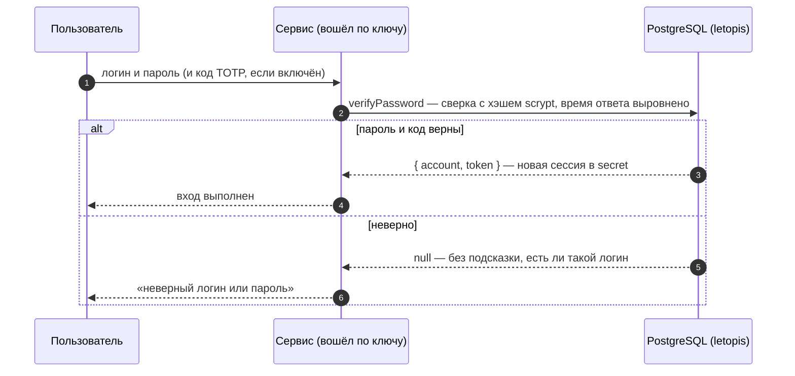
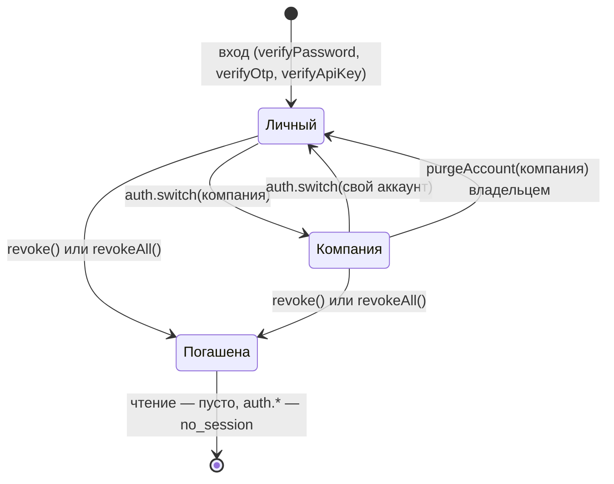

# Вход: пароли, ключи, коды, второй фактор

## Зачем

Прежде чем работать с данными, пользователь доказывает, кто он, — паролем, кодом или ключом. В ответ приложение получает сессию, и с ней база проверяет его права.

Входом в letopis занимается **сервис приложения**: он подключён по своему ключу API, проверяет пароль, код или ключ пользователя и при успехе выдаёт сессию. Все секреты лежат в таблице `secret` — только хэшами.

## Пример: все способы входа

<Example id="auth/01-login-factors" />

## Что внутри: вход

<Flow name="auth" />

| Способ | Выдать | Проверить |
|---|---|---|
| пароль | `setPassword` | `verifyPassword({ identifier, password, totp? })` |
| ключ API | `issueApiKey` (отдаётся один раз) | `verifyApiKey(key)`; отзыв — `revokeCredential` |
| ключ + секрет | `issueKeySecret` | `verifyKeySecret(key, secret)` |
| одноразовый код (OTP) | `issueOtp` (отправляет сервис) | `verifyOtp` — код действует один раз |
| TOTP — код из приложения-аутентификатора | `enrollTotp` (секрет и QR) | `verifyTotp`, или `totp` в `verifyPassword` |
| внешняя учётная запись | `link` | `lookup({ kind, identifier })` |
| сессия для процесса | `sessionFor(account, { ttl })` | `connect({ token })` |

## Сессии и арендаторы

У каждого аккаунта есть свой, личный арендатор. Сразу после входа сессия работает в нём; чтобы работать с данными компании, сессию переключают вызовом `auth.switch()`. Сессию можно продлить (`refresh`), завершить свою (`revoke`) или все (`revokeAll`), а владелец может стереть арендатора целиком (`purgeAccount`) — даже тот, в котором сейчас работает.

<Example id="auth/02-sessions-tenants" />

### Что внутри: жизнь сессии

## Удалить аккаунт

Аккаунт удаляет системный администратор (строку `Account`) или владелец его арендатора (`purgeAccount`). Его строки в таблице `secret` — пароль, ключи, сессии — уходят сразу вместе с ним, а сессии гаснут с сигналом: процессы сбрасывают кэш результатов этих сессий.

<Example id="auth/03-delete-account" />

## Подводные камни

- **Неверный вход — `null`, а не ошибка:** ответ не подсказывает, существует ли логин, и время ответа выровнено.
- **Идентификатор при входе — без учёта регистра**, но id аккаунта из `createTenant` берётся из логина как есть: пишите логины в одном регистре.
- **Смена пароля завершает остальные сессии** аккаунта (`keepCurrent` — оставить текущую).
- **Код OTP доставляет сервис** — база только выдаёт и проверяет его; после 5 неверных попыток код перестаёт действовать.
- **Требовать ли второй фактор, решает сервис:** без опции `totp` вход код не проверяет.
- **Последний действующий ключ сервиса не отзывается** — сначала выпустите новый (ротация без простоя).
- **Отозванная или истёкшая сессия при чтении не даёт ошибки:** запросы просто возвращают пустой результат. Ошибку `no_session` дают только запись, `acl.check` и методы `db.auth`, которым нужна сессия, поэтому серверу стоит проверять сессию в начале каждого запроса.
- **`refresh()` не укорачивает сессию** и не продлевает её дальше срока, выданного при входе.
- **`auth.switch()` есть только у самого подключения `db`**, а не у `db.as()`: там арендатор задаётся опцией `tenant`.
- **Удалённый аккаунт не оставляет следов в `secret`**: его пароли, ключи и сессии стираются сразу. Аккаунт System удалить нельзя — ему принадлежат служебные строки установки.

## Где это в сервисах

Салон и кошелёк входят по паролю и держат веб-сессию на сервере. [Helpdesk](../services/helpdesk) показывает остальное: второй фактор с QR-кодом, вход по коду из письма, ключи API интеграций и ИИ-агента, переход между компаниями (`auth.switch`), «Выйти на всех устройствах» (`revokeAll`) и закрытие компании (`purgeAccount`). Веб-сессия там — сессия letopis: у каждой вкладки своё подключение по токену.
