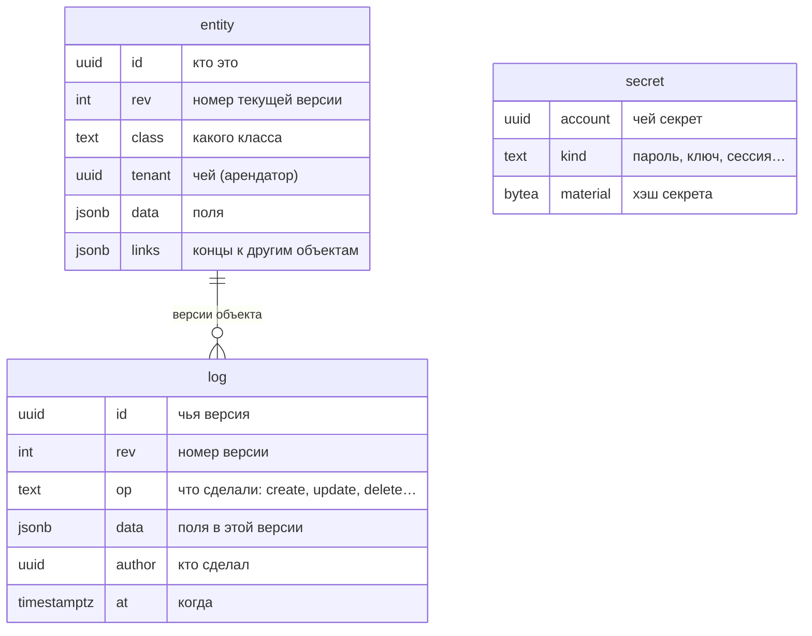
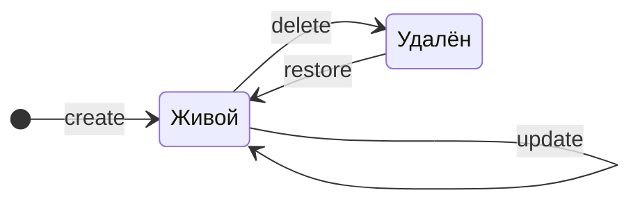

# Что такое letopis

## Зачем

letopis — библиотека для Node.js, которая хранит данные в PostgreSQL и **помнит каждую их версию**.

Обычная таблица хранит только «как сейчас»: поменяли телефон клиента — старый телефон пропал. letopis хранит и «как сейчас», и всю историю: кто, когда и что поменял. Удалённое можно вернуть, а состояние любого объекта можно посмотреть на любую дату.

Ещё три вещи letopis делает сама, без вашего кода:

- **проверяет данные** — объект с неправильными полями база не примет;
- **разделяет арендаторов** (арендатор — владелец данных: компания, салон, магазин) — данные одного арендатора не видны другому, даже если ошибиться в запросе;
- **проверяет права** — кто что может читать, менять и удалять.

Всё это проверяет сама база — триггерами и политиками доступа к строкам (RLS, Row-Level Security), поэтому правила работают даже для запросов в обход библиотеки.

## Пример: жизнь одного объекта

Листайте шаги кнопкой «Дальше» или стрелками. Под кодом — таблицы базы после этого шага: зелёным подсвечены новые строки, жёлтым — то, что изменилось.

<Example id="basics/01-first-object" />

Вся жизнь Анны — на одном ползунке: каждая версия из журнала, от создания до возврата.

<TimeTravel id="basics/01-first-object" object="Client «Анна»" />

Главное, что видно в примере:

- в таблице `entity` у каждого объекта **одна строка** — его текущее состояние; номер версии `rev` растёт с каждой правкой;
- в журнале `log` у объекта **по строке на каждую версию**; журнал только растёт;
- удаление убирает строку из `entity`, но не трогает журнал — поэтому удалённое можно вернуть.

## Что внутри: три таблицы

Всё, что хранит letopis, лежит в трёх таблицах одной схемы:

- `entity` — объекты сейчас: одна строка на объект.
- `log` — журнал: строка на каждую версию каждого объекта.
- `secret` — пароли, ключи и сессии. Сами секреты там не лежат, только их хэши.

Жизнь объекта — это переходы между состояниями. Каждый переход — новая строка в журнале:

Журнал хранит каждую версию: удалённый объект остаётся в нём надгробием, а версии живых объектов не прореживаются и не обрезаются (глава [«История и время»](../history/)). Стереть версии одного объекта нельзя — данные и журнал целиком стирает только удаление аккаунта-арендатора (глава [«Вход»](../auth/#удалить-аккаунт)).

## Три таблицы на примере

Каждый объект относится к **классу** — виду объектов вроде «Магазин» или «Товар», примерно как таблица в обычной базе. Даже описание класса хранится объектом в `entity`, а вход пользователя — строкой в `secret`:

<Example id="basics/02-three-tables" />

## Подводные камни

- `delete()` без `{ confirm: true }` **ничего не удаляет**, а только показывает список (предпросмотр): какой объект удалится и какие связанные объекты удалятся вместе с ним. Этот список показывают пользователю, а удаляют с ним же: `delete({ confirm: true, expect: предпросмотр })` удалит ровно показанное; подтверждение без `expect` — отказ `invalid_query`.
- Удаление не стирает историю: версии удалённого объекта остаются в журнале. Стереть данные совсем (например, по закону о персональных данных) можно только вместе с арендатором — удалением аккаунта (`db.auth.purgeAccount`). Персональные данные лучше не делать ключом: id из email подбирается перебором и остаётся в концах других объектов и в журнале. Подробно — в главах [«Удаление»](../delete/) и [«Вход»](../auth/#удалить-аккаунт).
- Строки удалённого объекта в `entity` нет. Его последнее состояние хранится в журнале особой версией с `op = delete` — её называют надгробием. По ней `restore({ expect: [надгробие] })` возвращает объект с тем же id и следующим номером версии; `restore()` без `expect` — отказ `invalid_query`.

## Где это в сервисах

В каждом сервисе-примере у объектов есть история: у брони в салоне, у операции в кошельке, у заявки в helpdesk, у договора в документах. Панель «Под капотом» в приложениях показывает, какие версии легли в журнал после вашего действия.
