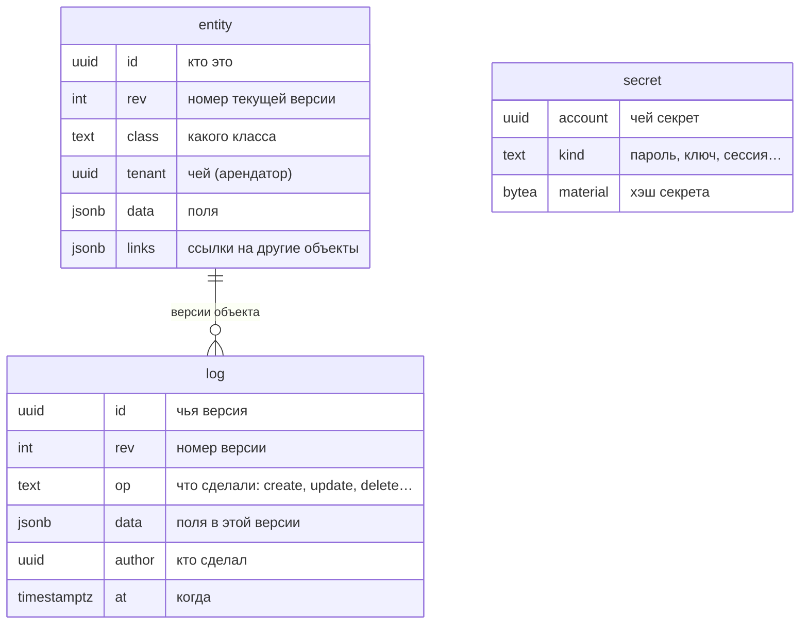
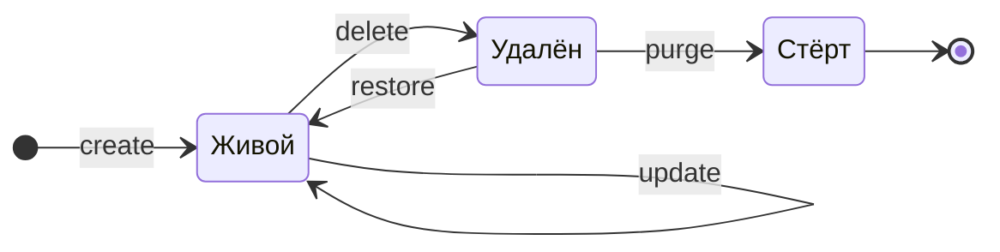

# Что такое letopis

letopis — библиотека для Node.js, которая хранит данные в PostgreSQL и **помнит каждую их версию**.

Обычная таблица хранит только «как сейчас»: поменяли телефон клиента — старый телефон пропал. letopis хранит и «как сейчас», и всю историю: кто, когда и что поменял. Удалённое можно вернуть, а состояние любого объекта можно посмотреть на любую дату.

Ещё три вещи letopis делает сама, без вашего кода:

- **проверяет данные** — объект с неправильными полями база не примет;
- **разделяет арендаторов** — данные одной компании не видны другой, даже если ошибиться в запросе;
- **проверяет права** — кто что может читать, менять и удалять.

Всё это проверяет сама база (триггеры и политики доступа), поэтому правила работают даже для запросов в обход библиотеки.

## Пример: жизнь одного объекта

Листайте шаги кнопкой «Дальше» или стрелками. Под кодом — таблицы базы после этого шага: зелёным подсвечены новые строки, жёлтым — то, что изменилось.

<Example id="basics/01-first-object" />

Главное, что видно в примере:

- в таблице `entity` у каждого объекта **одна строка** — его текущее состояние; номер версии `rev` растёт с каждой правкой;
- в журнале `log` у объекта **по строке на каждую версию**; журнал только растёт;
- удаление убирает строку из `entity`, но не трогает журнал — поэтому удалённое можно вернуть.

## Что внутри: три таблицы

Всё, что хранит letopis, лежит в трёх таблицах одной схемы:

- `entity` — объекты сейчас: одна строка на объект.
- `log` — журнал: строка на каждую версию каждого объекта.
- `secret` — пароли, ключи и сессии. Сами секреты там не лежат, только их хэши.

Жизнь объекта — это переходы между состояниями. Каждый переход — новая строка в журнале:

`purge` — единственный способ стереть историю. Он работает только для уже удалённого объекта. О нём — в главе про удаление.

## Три таблицы на примере

Даже описание класса — это объект в `entity`, а вход пользователя — строка в `secret`:

<Example id="basics/02-three-tables" />

## Подводные камни

- `delete()` без `{ confirm: true }` **ничего не удаляет** — это превью: что удалится и что удалится вместе с объектом. Удобно показать пользователю перед удалением.
- Удаление не стирает историю. Если данные нужно стереть совсем (например, по закону о персональных данных), нужен `purge` или `anonymize`.
- Строку удалённого объекта в `entity` не найти — его последнее состояние лежит в журнале как надгробие (`op = delete`). Поэтому `restore()` возвращает объект с тем же id и следующим номером версии.

## Где это в сервисах

В каждом сервисе-примере у объектов есть история: у брони в салоне, у операции в кошельке, у заявки в helpdesk, у договора в документах. Панель «Под капотом» в приложениях показывает, какие версии легли в журнал после вашего действия.
