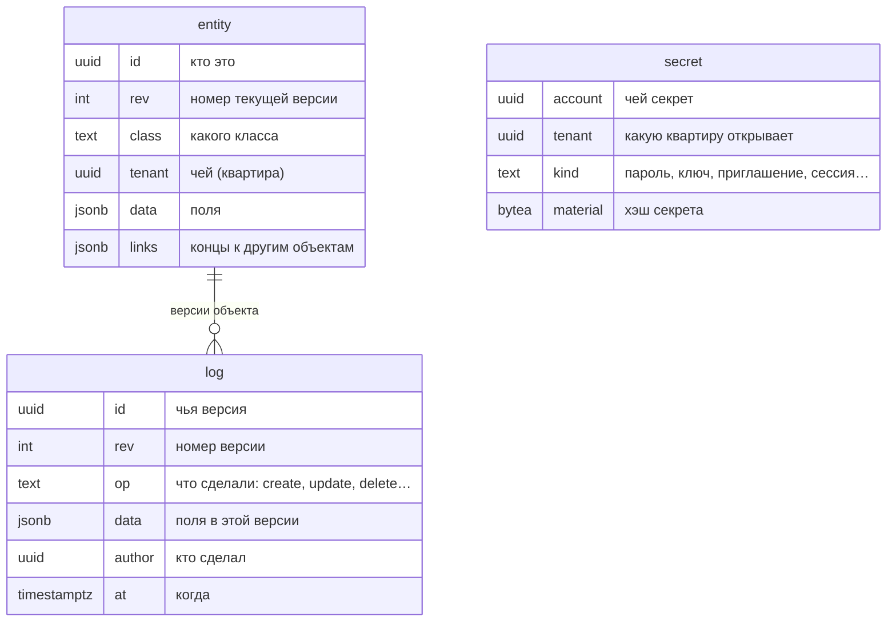
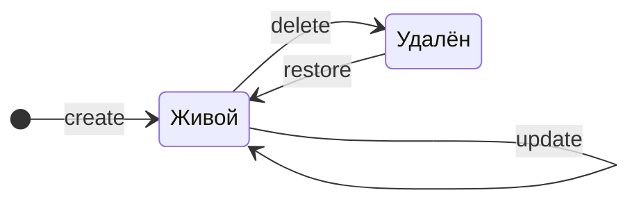

# Что такое letopis

Эта страница объясняет, что такое letopis, как он хранит данные и что происходит в базе, когда объект создают, меняют, удаляют и возвращают. Кода писать не нужно — достаточно прочитать и, если хочется, запустить два примера.

Коротко: letopis — библиотека для Node.js поверх PostgreSQL 18. Всё, что вы в нём храните, лежит в трёх таблицах одного **дома** — схемы базы:

- `entity` — объекты, как они есть сейчас: одна строка на объект;
- `log` — журнал: строка на каждую версию каждого объекта, от создания до удаления и возврата;
- `secret` — ключи, приглашения и сессии (пароли, ключи и токены — в виде хэшей).

**Когда брать letopis.** Если приложению нужна история изменений («кто, когда и что поменял», состояние на дату, возврат удалённого), если в одной базе живут данные нескольких клиентов — **квартир**, — которые не должны видеть друг друга, и если правила доступа должны соблюдаться даже при ошибке в коде приложения. **Когда не брать.** Нужна база старше PostgreSQL 18 (letopis работает только на 18 и новее) или поток из тысяч записей в секунду по одной строке: каждую запись проверяет база, поэтому построчная запись заметно медленнее простой вставки (для больших объёмов есть [массовая загрузка](../load/)).

В главе:

- [Зачем](#зачем) — что letopis делает за вас;
- [Пример: жизнь одного объекта](#пример-жизнь-одного-объекта) — создать, изменить, удалить, вернуть;
- [Что внутри: три таблицы](#что-внутри-три-таблицы) — какие колонки в `entity`, `log` и `secret`;
- [Три таблицы на примере](#три-таблицы-на-примере) — что лежит в базе сразу после подготовки;
- [Подводные камни](#подводные-камни) — удаление и возврат;
- [Где это в сервисах](#где-это-в-сервисах).

## Зачем

letopis — библиотека для Node.js, которая хранит данные в PostgreSQL и **помнит каждую их версию**.

Обычная таблица хранит только «как сейчас»: поменяли телефон клиента — старый телефон пропал. letopis хранит и «как сейчас», и всю историю: кто, когда и что поменял. Удалённое можно вернуть, а состояние любого объекта можно посмотреть на любую дату.

Ещё три вещи letopis делает сама, без вашего кода:

- **проверяет данные** — объект с неправильными полями база не примет;
- **разделяет квартиры** (квартира — чьи это данные: компания, салон, магазин) — данные одной квартиры не видны другой, даже если ошибиться в запросе;
- **проверяет права** — кто что может читать, менять и удалять: решает матрица правил, для каждой строки побеждает правило с наибольшим счётом.

Всё это проверяет сама база — триггерами и политиками доступа к строкам (RLS, Row-Level Security), поэтому правила работают даже для запросов в обход библиотеки.

Как устроен доступ: **мастер-ключом** (строкой администратора PostgreSQL) `setup()` строит дом и отдаёт **пропуск** **консьержа**. Консьерж (`connect(pass)`) заводит квартиры, зовёт в них жильцов **приглашениями** и впускает их по **ключам** — паролю, ключу API и другим. Жилец работает от корня своей квартиры: `me.Client().rows()`. Все слова сразу — на [карте понятий](../concepts/).

## Пример: жизнь одного объекта

Пример — самостоятельная программа: скопируйте её, запустите на своей базе и сравните с ожидаемым выводом. В начале программы — подготовка: дом с моделью, консьерж, квартира «Ромашка» и её хозяйка Анна, которая приняла приглашение; `me` — корень её квартиры. Кнопка «Пошагово: что происходит в базе» под программой открывает те же шаги по одному: листайте их кнопкой «Дальше» или стрелками, под кодом — таблицы базы после шага: зелёным подсвечены новые строки, жёлтым — то, что изменилось.

<Example id="basics/01-first-object" />

Вся жизнь клиентки Анны — на одном ползунке: каждая версия из журнала, от создания до возврата.

<TimeTravel id="basics/01-first-object" object="Client «Анна»" />

Главное, что видно в примере:

- в таблице `entity` у каждого объекта **одна строка** — его текущее состояние; номер версии `rev` растёт с каждой правкой;
- в журнале `log` у объекта **по строке на каждую версию**; журнал только растёт;
- удаление убирает строку из `entity`, но не трогает журнал — поэтому удалённое можно вернуть.

## Что внутри: три таблицы

Всё, что хранит letopis, лежит в трёх таблицах одного дома:

- `entity` — объекты сейчас: одна строка на объект.
- `log` — журнал: строка на каждую версию каждого объекта.
- `secret` — ключи жильцов, приглашения и сессии. Ключ открывает ровно одну квартиру — её id в колонке `tenant`. Пароли, ключи и токены там не лежат, только их хэши.

Жизнь объекта — это переходы между состояниями. Каждый переход — новая строка в журнале:

Журнал хранит каждую версию: удалённый объект остаётся в нём надгробием, а версии живых объектов не прореживаются и не обрезаются (глава [«История и время»](../history/)). Стереть версии одного объекта нельзя — данные и журнал квартиры целиком стирает только удаление самой квартиры (`deleteTenant()`, глава [«Квартиры и права»](../access/)).

## Три таблицы на примере

Каждый объект относится к **классу** — виду объектов вроде «Магазин» или «Товар», примерно как таблица в обычной базе. Даже описание класса хранится объектом в `entity`, а вход жильца — строкой в `secret`:

<Example id="basics/02-three-tables" />

Что за классы в первом шаге. Их заводят сам дом и консьерж, ваши классы появятся рядом:

- `Class` — описания классов: у каждого класса, и системного, и вашего, одна такая строка;
- `Account` — аккаунты: системный аккаунт System, консьерж, квартиры и жильцы;
- `member` — прописка жильца в квартире и его роли в ней (связь «аккаунт → квартира»); без такой строки жилец не может работать в квартире, а завести её можно только приглашением;
- `Resource` — участники правил матрицы: группы аккаунтов (например, «все», «консьерж», «роль owner») и то, к чему дают доступ (действия API, чтение, запись, удаление);
- `rule` — правила матрицы: связь «группа → ресурс» с решением «разрешить» или «запретить» и весом.

`member` и `rule` — системные классы-связи (их имена в библиотеке написаны со строчной буквы). Как ими управлять — в главе [«Квартиры и права»](../access/).

## Подводные камни

- `delete()` без `{ confirm: true }` **ничего не удаляет**, а только показывает список (предпросмотр): какой объект удалится и какие связанные объекты удалятся вместе с ним. Этот список показывают пользователю, а удаляют с ним же: `delete({ confirm: true, expect: предпросмотр })` удалит ровно показанное; подтверждение без `expect` — отказ `invalid_query`.
- Удаление не стирает историю: версии удалённого объекта остаются в журнале. Стереть данные совсем (например, по закону о персональных данных) можно только вместе с квартирой — `deleteTenant()`. Персональные данные лучше не делать ключом: id из email подбирается перебором и остаётся в концах других объектов и в журнале. Подробно — в главах [«Удаление»](../delete/) и [«Квартиры и права»](../access/).
- Строки удалённого объекта в `entity` нет. Его последнее состояние хранится в журнале особой версией с `op = delete` — её называют надгробием. По ней `restore({ expect: [надгробие] })` возвращает объект с тем же id и следующим номером версии; `restore()` без `expect` — отказ `invalid_query`.

## Где это в сервисах

В каждом сервисе-примере у объектов есть история: у брони в салоне, у операции в кошельке, у заявки в helpdesk, у договора в документах. Панель «Под капотом» в приложениях показывает, какие версии легли в журнал после вашего действия.
