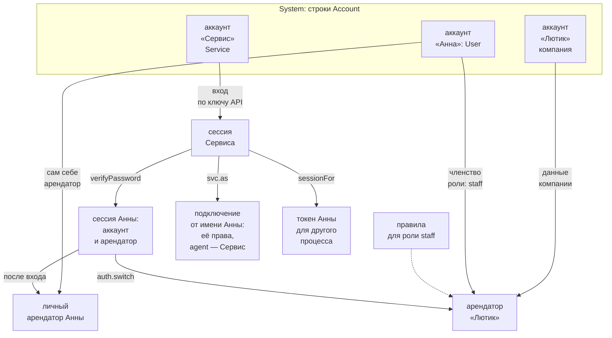

# Карта понятий

Кто работает с данными и в чьих данных — девять понятий на одной странице: аккаунт, арендатор, личный арендатор, членство, роль, сессия, сервис и два способа, которыми сервис работает за пользователя, — `as` и `sessionFor`. Подробности — в главах [«Арендаторы и права»](../access/) и [«Вход»](../auth/).

## Аккаунт

**Аккаунт** — тот, кто работает с letopis: пользователь, сервис или организация. Это строка системного класса `Account` в арендаторе System: имя, категории (`User`, `Service` и свои) и признак `enabled`. Выключенный аккаунт не входит, а его сессии гаснут.

Каждый аккаунт — сам себе арендатор: у пользователя с первого входа есть своё место для данных — личный арендатор. Компания в letopis — тоже аккаунт: её данные лежат в арендаторе с её id, а люди работают в них по членству.

## Схема

## Что это, кто создаёт, где в API

| Понятие | Что это | Кто создаёт | Где в API |
|---|---|---|---|
| аккаунт | пользователь, сервис или организация — строка класса `Account` в System: имя, категории (`User`, `Service` и свои), признак `enabled` | арендатора и первого пользователя — `createTenant` или `up({ tenant })`; сервис установки — `up()`; остальные аккаунты правит системный администратор (член System с ролью `admin`) — строки `Account` цепочкой или загрузчиком | id — в ответах входа (`account` у `verifyPassword`, `user` у `createTenant`); `db.auth.session(token)`; удалить — `db.auth.purgeAccount` |
| арендатор | аккаунт, в чьих данных идёт работа; данные разных арендаторов изолированы — чужие строки отсекает база (RLS) | `createTenant(sql, schema, { name, user })` или `up({ tenant })`: арендатор — аккаунт в System с id из имени, правило «своим можно всё» (вес 10; без него — `grantAll: false`) и первый пользователь с членством | `db.tenant` — арендатор подключения; `db.auth.tenants()`, `db.auth.switch(id)`; опция `tenant` у `db.as()` |
| личный арендатор | арендатор, который есть у каждого аккаунта, — сам аккаунт: id арендатора равен id аккаунта; свежая сессия входа работает в нём | никто: появляется вместе с аккаунтом | первый элемент `db.auth.tenants()` с `roles: ['owner']`; вернуться в него — `db.auth.switch(<id аккаунта>)`; арендатор `db.as(аккаунт)` по умолчанию |
| членство | связь `member` «пользователь — арендатор» с ролями: даёт работать в чужом арендаторе; строка лежит в этом арендаторе | `createTenant` — первому пользователю (роли `user.roles`, по умолчанию `['owner']`); `db.acl.roles(аккаунт, ['staff'])` в текущем арендаторе заводит или меняет членство, `null` — снимает | `db.acl.roles(аккаунт)` — прочитать роли; `db.auth.tenants()` — арендаторы по членству; поле `member` у `db.auth.session(token)` |
| роль | имя в списке ролей членства (`owner`, `staff`, `admin` в System): права выдают ролям, а не людям | роли задаёт членство — `createTenant` (`user.roles`) и `db.acl.roles` | `db.acl.grant({ role, … })`, `db.acl.deny`, `db.acl.revoke`; группа `Resource` по ролям — `{ roles: '{staff}' }` |
| сессия | токен, по которому база узнаёт аккаунт и арендатора; в таблице `secret` — строка `SESSION` с хэшем токена; срок — время простоя, по умолчанию 7 суток | вход: `verifyPassword`, `verifyOtp`, `verifyApiKey`, `verifyKeySecret`, `lookup`; `createTenant`; `connect({ apiKey })` для сервиса; `auth.sessionFor` | `connect({ token })`; `db.auth.session(token)`, `refresh`, `revoke`, `revokeAll`, `switch` |
| сервис | аккаунт категории `Service` с ключом API: проверяет пароли и коды, выпускает сессии, работает от имени пользователей — правила System дают сервисам права `auth.*` | сервис установки и его ключ — `up()` (ключ — в `r.serviceKey`, один раз); другие сервисы и их ключи — системный администратор: строка `Account` категории `Service` и `auth.issueApiKey` | `connect({ dsn, schema, apiKey })`; `db.auth.issueApiKey`, `db.auth.revokeCredential` |
| `as` | подключение на том же пуле соединений, но от имени другого аккаунта: запросы идут с его правами и в его арендаторе; журнал пишет автором этот аккаунт, исполнителем (`agent`) — сервис | вызывает сервис или системный администратор, нужно право `auth.impersonate`; от имени System, сервисов, системных администраторов и выключенных аккаунтов работать нельзя | `db.as(аккаунт, { tenant, owner })` — подключение с тем же API, что у `db`; `auth.switch()` у него нет |
| `sessionFor` | токен новой сессии пользователя — для другого процесса или одной операции; сессия работает в личном арендаторе пользователя, способ входа — `SERVICE` | вызывает сервис или системный администратор, нужно право `auth.session`; для System, сервисов, системных администраторов и выключенных аккаунтов сессии не выпускаются | `db.auth.sessionFor(аккаунт, { ttl: 900 })` → токен; `ttl` — срок сессии числом **в секундах** (900 — 15 минут, без `ttl` — 7 суток), строка вроде `'15m'` не принимается; дальше `connect({ token })`, по окончании — `revoke()` |

## Роль: три значения

Слово «роль» в letopis значит три разные вещи:

1. **Роль в членстве** — `owner`, `staff`, `admin` в System. На неё выдают права (`db.acl.grant({ role: 'staff', … })`). О ней — таблица выше.
2. **Роль конца** — имя конца в модели: `Shop`, `Parent`. Шаг с этим именем переходит по концу (`db.Product().Shop()`), шаг роли после глагола задаёт его (`.Shop.set(…)`). Подробнее — в главе [«Модели»](../models/).
3. **Роль PostgreSQL** — LOGIN-роль, под которой подключаются к базе: роль приложения (член `letopis_app`) или администратор базы. Подробнее — в главе [«Установка и подключение»](../install/).

## `as` или `sessionFor`

- **`as`** — сервис сам работает за пользователя в своём процессе: одно подключение служит многим пользователям, а журнал помнит и пользователя, и сервис.
- **`sessionFor`** — работу делает другой процесс или клиент со своим подключением: ему отдают токен. Когда сессия больше не нужна, её гасят `revoke()`.

## Где это в сервисах

В [Helpdesk](../services/helpdesk) компании — арендаторы, а агенты, клиенты и руководители — пользователи с ролями членства. Человек переходит между компаниями вызовом `auth.switch()`, а ИИ-агент получает сессию `sessionFor` на 15 минут — `{ ttl: 900 }`, срок в секундах.
