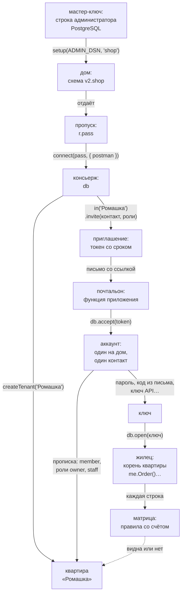

# Карта понятий

Кто работает с данными и в чьих данных — все слова на одной странице: **мастер-ключ**, **дом**, **пропуск**, **консьерж**, **почтальон**, **квартира**, **аккаунт**, **контакт**, **ключ**, **приглашение**, **прописка**, **роль**, **матрица** и её **счёт**. Мягкое введение в те же слова — страница [«Дом, пропуск, консьерж»](../house/); подробности — в главах [«Установка и подключение»](../install/), [«Приглашения и почтальон»](../invites/), [«Вход и ключи»](../auth/) и [«Квартиры и права»](../access/).

Коротко, как в жилом доме. **Мастер-ключом** (строкой администратора PostgreSQL) строят **дом** — схему в базе — и получают **пропуск** для **консьержа**. Консьерж держит дверь: заводит **квартиры**, зовёт в них людей **приглашениями** и впускает их по **ключам**. Письмо со ссылкой-приглашением доставляет **почтальон** — функция приложения — на **контакт** человека. Человек — **аккаунт**, один на весь дом; принятое приглашение даёт ему **прописку** в квартире с **ролями**. Вошедший ключом — **жилец**: он работает от **корня квартиры**, и каждую строку база проверяет **матрицей** — правилами со **счётом**.

## Схема

## Слово — что это — где в API

| Слово | Что это | Где в API |
|---|---|---|
| мастер-ключ | строка подключения администратора PostgreSQL: строит и сносит дом, запускает служебные команды; в приложение её не кладут | `setup(ADMIN_DSN, имя)`, `demolish(ADMIN_DSN, имя)`; `letopis sync`, `types`, `load`, `maintain` с `--dsn` |
| дом | приложение в базе: схема `v2.<имя>` с тремя таблицами, проверками, общими классами, квартирами и матрицей | `setup()` → `{ pass, schema, created }`; общие классы — `setup(…, { models })` |
| пропуск | строка подключения консьержа: его роль базы, дом и ключ; секрет приложения | `r.pass` из `setup()`; новый — `setup(…, { rotate: true })` |
| консьерж | подключение приложения к дому: держит дверь — квартиры, приглашения, вход по ключам; своих данных и цепочек нет | `const db = await connect(pass, { postman })`: `createTenant`, `tenants`, `in`, `as`, `open`, `resume`, `invitation`, `accept`, `requestCode`, `tenantsOf`, `deleteAccount`, `maintain`, `close` |
| почтальон | функция приложения, которая доставляет письма: ссылку-приглашение и коды. Библиотека сама ничего не отправляет | `connect(pass, { postman })`; `postman({ to, message })`, `message.kind` — `'invite'`, `'code'`, `'contact'` |
| письмо | то, что получает почтальон: кому (контакт) и что (токен приглашения или код) | тип `Letter`: `{ to: { kind, address }, message }` |
| квартира | «чьи данные»: компания, салон, клуб; строки одной квартиры другим не видны | `db.createTenant(имя)`, `db.in(имя)`, `me.tenant`, `me.tenantName`, `me.deleteTenant()` |
| аккаунт | человек, один на весь дом: его находят по контакту | заводит `db.accept`; `me.account`; удалить — `me.deleteAccount()`, `db.deleteAccount(аккаунт)`; имя — `db.accept(token, { name })`, сменить — `me.changeName(имя)`; люди квартиры с именами и ролями — `me.acl.people()` |
| контакт | почта, телефон или Telegram человека; один на аккаунт; он же **имя для входа** | `{ email }`, `{ phone }`, `{ telegram }`, `{ kind, address }` в `invite`, `open`, `requestCode`; сменить — `me.changeContact()` |
| ключ | способ войти: пароль (с TOTP), код из письма, ключ API, ключ и секрет, внешний вход. Пароль и ключи программ открывают одну квартиру; код из письма — любую квартиру человека | `db.open(ключ)`; свои ключи — `me.keys.list`, `setPassword`, `issueApiKey`, `issueKeySecret`, `link`, `enrollTotp`, `verifyTotp`, `revoke` |
| приглашение | так человека зовут в квартиру: письмо со ссылкой, в ссылке — одноразовый токен со сроком | `me.invite(контакт, [роли])`, `me.invites()`, `me.revokeInvite(id)`, `db.invitation(token)`, `db.accept(token, { password?, name? })` |
| ссылка | адрес страницы приложения с токеном приглашения; её собирает почтальон | `message.token` в письме `kind: 'invite'` |
| прописка | строка `member` квартиры: аккаунт и его роли; заводит её только приглашение | роли — `me.acl.roles(аккаунт)`, `me.acl.roles(аккаунт, [роли])`; выписка — `me.leave()`, `me.acl.roles(аккаунт, null)` |
| роль | метка прописки (`owner`, `staff`): права выдают ролям, а не людям. Сама роль ничего не разрешает — она работает только через матрицу | `me.acl.grant({ role: 'staff', … })`, `me.invite(…, ['staff'])`; право выдавать роль — `me.acl.grant({ role: 'manager', assign: 'staff' })` |
| жилец, корень квартиры | аккаунт, вошедший ключом, и его объект цепочек: каждый запрос — с его правами | `db.open`, `db.resume`, `db.accept` → `me.Класс(…)`, `me.begin()`, `me.acl` |
| сессия | вход по ключу: токен у клиента, его хэш в `secret`; помнит аккаунт и квартиру | `me.token`, `db.resume(токен)`, `me.refreshSession()`, `me.close()`, `me.closeAll()` |
| матрица | права квартиры: строки `Resource` (маски «кто» и «что») и `rule` (можно или нельзя, вес) | `me.acl.grant`, `deny`, `revoke`, `list`, `check`, `checkData`, `checkRole`, `people` |
| счёт | сила правила: ключи маски «кто» + 1 за класс, действие или роль + поля условия + 1 у запрета + вес; для каждой строки побеждает наибольший | `me.acl.checkData(…).candidates[].score`, `me.acl.check(…).score` |
| правило по умолчанию | решает, когда подходящих правил нет: на свежем доме — «нельзя»; переключает только мастер-ключ; ролей не выдаёт никогда | `setup(ADMIN_DSN, имя, { defaultRule: 'allow' })`, обратно — `'deny'` |

## Кто что может

| Кто | Может | Не может |
|---|---|---|
| мастер-ключ | построить, достроить и снести дом, записать общие классы, загрузить данные, обслуживание | — (поэтому его не кладут в веб-приложение) |
| консьерж | заводить и удалять квартиры, звать людей, впускать по ключам, удалить аккаунт, чистить просроченное (`db.maintain`); в квартире — всё (`db.in`) или с правами жильца (`db.as`) | работать с данными без квартиры, править ключи и контакт жильцов, выписываться |
| жилец | работать с данными квартиры по матрице, звать людей с ролями, которые ему можно выдавать, править свои ключи, контакт и имя, выйти, выписаться, удалить свой аккаунт | войти в квартиру, где он не прописан, прописать человека без приглашения, снять чужое правило, перебить правило owner |

## `in` и `as`: консьерж в квартире

- **`await db.in(квартира)`** — консьерж сам: полный доступ к квартире. Для фоновых задач, обслуживания и правил, которые жильцы не должны снимать: правило, которое завёл консьерж, жилец не изменит.
- **`await db.as(аккаунт, квартира)`** — консьерж от имени прописанного жильца: права — жильца, журнал пишет автором жильца, исполнителем (`agent`) — консьержа. Непрописанный аккаунт — `acl_denied`.

Ключей, смены контакта, выписки и удаления своего аккаунта у обоих нет — это дела самого жильца (`invalid_query`). Подробно — рецепт [«Фоновые задачи консьержа»](../recipes/background).

## Слово «роль»

У слова три значения — различайте их по соседнему слову:

- **роль** (просто) — метка прописки: `owner`, `staff`. В API — поле `role` (`acl.grant({ role: 'staff' })`) и список `roles` (`invite`, `member`). Права роли даёт только матрица;
- **роль конца** — имя конца в модели (`Shop`, `Parent`): шаг с этим именем переходит по концу, `.Роль.set(…)` задаёт его ([«Модели»](../models/));
- **роль базы** — пользователь PostgreSQL: у консьержа своя, `letopis_c_<имя>` ([«Установка и подключение»](../install/)).

## Где это в сервисах

В каждом [сервисе-примере](../services/) свой дом: сервис подключается к нему пропуском, компании и салоны — квартиры, сотрудники и клиенты — аккаунты с ролями прописки. В [Helpdesk](../services/helpdesk) компанию регистрируют приглашением, а руководитель зовёт сотрудников и клиентов с ролями `agent` и `client`.
