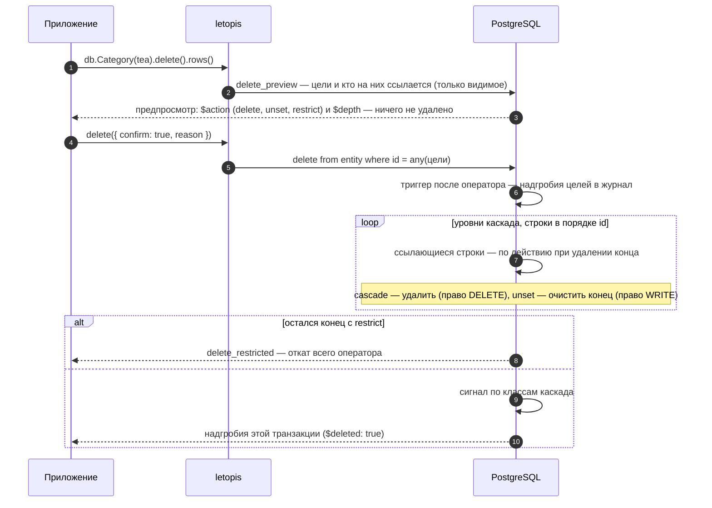

# Удаление и восстановление

## Зачем

Удаление в letopis — **не стирание**. Строка уходит из таблицы `entity` (объекта «сейчас» больше нет), но вся его история остаётся в журнале, а последняя версия лежит там надгробием. Поэтому удалённое можно вернуть. Стереть версии одного объекта нельзя: журнал арендатора стирает только удаление аккаунта (`db.auth.purgeAccount`, [глава 9](../auth/#удалить-аккаунт)).

## Пример: предпросмотр, каскад, запрет, очистка конца

Пример работает на модели магазина главы 3 (её записывает и наполняет помощник сайта `seedShop` из `kit/shop.ts` — его код открывается кнопкой «Весь код примера»). Для удаления важны действия при удалении у концов:

```ts
import { hub, link, one, many } from 'letopis/model'

const Product = hub('Product', { sku: z.string(), title: z.string(), price: z.number().int().min(0) }, {
  ends: { Shop, Category: many(Category, { max: 5, onDelete: 'unset' }) },   // Shop — по умолчанию restrict
  key: ['Shop', 'sku'],
})
const Order = hub('Order', { number: z.string(), status: z.enum(['new', 'paid', 'cancelled']).default('new') }, {
  ends: { Customer, Shop }, key: ['Shop', 'number'],
})
const line = link('line', { qty: z.number().int().min(1), price: z.number().int().min(0) }, {
  ends: { Order: one(Order).onDelete('cascade'), Product },                  // строки уходят вместе с заказом
  key: ['Order', 'Product'],
})
```

<Example id="delete/01-delete-cascade" />

### Как читать предпросмотр

| Поле строки | Значения | Что значит |
|---|---|---|
| `$action` | `delete` | строка удалится — и сама цель, и строки каскада (`cascade`) |
| | `unset` | у строки очистится конец, ведущий на цель; строка останется |
| | `restrict` | строка мешает удалению: подтверждение даст `delete_restricted` |
| `$depth` | `0` | сама цель |
| | `1`, `2`, … | уровень каскада: строка уйдёт вместе с целью; у `unset` и `restrict` поля нет |

Цель от каскада отличает именно `$depth`: у строк каскада `$action` тоже `delete`.

### Удалить ровно то, что показали

Предпросмотр — снимок на момент вызова, а `delete({ confirm: true })` удаляет то, что есть **в момент подтверждения**: если пока пользователь смотрел, в каскад добавилась строка, уйдёт и она. Удалить ровно показанное — `delete({ confirm: true, expect: предпросмотр })` (шаги 7–10 примера выше):

```ts
const preview = await db.Order(order).delete().rows()            // показать пользователю и сохранить
// … пользователь нажал «Удалить»
try {
  await db.Order(order).delete({ confirm: true, expect: preview, reason: 'отмена заказа A-2' }).rows()
} catch (e) {
  if (!(e instanceof LetopisError) || e.code !== 'conflict') throw e
  return showPreview(e.detail.preview)                          // предпросмотр изменился — показать новый
}
```

1. В той же транзакции, что и удаление, letopis строит предпросмотр заново и сравнивает его с `expect`: те же строки по `id`, с теми же `rev` и `$action` (порядок не важен; если в строке `expect` нет `$action`, он не сравнивается).
2. Совпало — удаляет. Не совпало — отказ `conflict` (ключ `write.preview_changed`): ничего не удалено, новый предпросмотр — в `err.detail.preview`; покажите его и подтверждайте уже с ним.
3. `expect` без `confirm: true` — отказ `invalid_query`: без подтверждения `delete()` и есть предпросмотр.
4. Сверка и удаление идут подряд в одной транзакции. Если в этот каскад одновременно пишут другие и нужна строгая гарантия, пусть код, который добавляет строки (строку заказа, выдачу участнику), и удаление берут блокировку родителя — `tr.Order(order).forUpdate()` в `db.begin()` (или общий `tr.lock(…)`).

## Что внутри: что происходит с концами

Что происходит с концами, ведущими на удаляемый объект, решает действие при удалении — его задают у конца в модели:

<Flow name="delete" />

Как это идёт по шагам (`lib/sql/60-write.sql`: `delete_preview`, триггер `trg_entity_ad`):



Удаляемый аккаунт (`Account`): его сессии гасит с сигналом триггер до удаления, а пароли, ключи и коды стирает сама база — внешний ключ `secret.account` с `on delete cascade`.

Весь каскад — один оператор и одна транзакция: если хоть одна строка мешает, не удаляется ничего.

**Какие строки удаляет `delete({ confirm: true })`.** Как и у `update`, цели сужают фильтр, id, `tags()`, `owner()` или `limit()` хотя бы у одного шага цепочки. Без них — отказ `invalid_query` ещё до записи (строгий режим); удалить все строки шага — явно: `delete({ confirm: true, all: true })`. Предпросмотр `delete()` без подтверждения работает и без условий.

## Вернуть удалённое

<Example id="delete/02-restore" />

`restore()` возвращает последний снимок удалённого объекта новой версией, с прежним id, и перепроверяет его по текущему описанию класса. Возвращаются только цели шага, а не весь каскад. Живой объект вернуть нельзя — `not_deleted`. История удалённого объекта остаётся в журнале: `versions()` по его id показывает и надгробие — шаг с явным id берёт и удалённые.

### `withDeleted()` — у каждого шага свой

`withDeleted()` относится к шагу, после которого стоит:

| Цепочка | Что найдёт |
|---|---|
| `db.Order(id).withDeleted()` | заказ, даже если он удалён |
| `db.Order(id).line().withDeleted()` | живые и удалённые строки **живого** заказа |
| `db.Order(id).withDeleted().line().withDeleted()` | удалённые строки удалённого заказа — так смотрят, что ушло каскадом (шаг 2 примера) |
| `db.Order(id).withDeleted().line()` | живые строки удалённого заказа — обычно пусто; letopis один раз предупреждает: `withDeleted() у шага Order относится к нему, а не к последнему шагу line` |

Переход идёт по **последней** версии строки: если после удаления строку пересоздали тем же ключом (выдали вещь другому) и удалили снова, её последнее надгробие ведёт уже не на удалённого родителя, и переход от него её не найдёт. Что ушло конкретным удалением, точно знают его надгробия: ответ `delete` или версии удаления в журнале с причиной этого удаления (`withDeleted().versions()`, отбор `op === 'delete'` и `reason`).

### Вернуть только то, что ушло этим удалением

`db.Order(order).line().withDeleted().restore()` вернёт **все** удалённые строки заказа — и те, что удалили раньше и отдельно (закрытые выдачи, убранные позиции). Строки одного удаления отличает причина: надгробия цели и всего её каскада получают `reason` этого удаления. Поэтому:

1. Удаляйте со своей причиной для каждого удаления: `delete({ confirm: true, reason: 'отмена заказа A-1 (op-7)' })`.
2. При возврате отберите надгробия с этой причиной и верните их **по `expect`**: `db.line(ids).restore({ expect: надгробия })` (шаг 5 примера). `expect` — строки `{ id, rev }`, подходят сами строки ответа.
3. Строка из `expect` вернётся, только если её последняя версия — то самое надгробие. Если после него строку пересоздали тем же ключом, правили или удалили снова, — отказ `conflict` (ключ `write.restore_stale`, в `err.detail.stale` — `{ id, rev, expected, deleted }` каждой такой строки), и не восстановлено ничего из этого вызова. Скажите пользователю, что вещь не вернулась: она уже у другого или её успели закрыть.
4. Если остальные строки должны вернуться и без неё — возвращайте по одной или повторите вызов без строк из `err.detail.stale`.

**Главный случай — «участника удалили, вещь выдали другому и приняли, участника вернули».** С «одной открытой выдачей на вещь» ([глава 7](../money/#одна-открытая-запись-на-объект-выдача-бронь-смена)) выдача — одна строка на вещь с id из ключа. Удалили участника — его выдача ушла каскадом. Вещь выдали другому и приняли — та же строка прожила новую выдачу и снова удалена. `restore()` без `expect` вернул бы её последний снимок — чужую закрытую выдачу, и вещь числилась бы выданной. `restore({ expect: [надгробие из удаления участника] })` даёт `conflict`, ничего не меняет, а приложение сообщает «не вернулась — вещь после удаления выдавали другому». Живой пример — шаги 7–9 примера [«Одна выдача на вещь»](../money/#ex-money-05-one-open).

### Штатные отказы и пустые ответы

| Что вернул `restore()` | Когда | Что сказать пользователю |
|---|---|---|
| строки | вернулось | «возвращено» |
| `[]` | id нет или он не виден (чужой арендатор, нет права на чтение); id из `expect` нет среди строк шага | «не найдено» |
| `not_deleted` | объект жив | «уже не удалён» |
| `not_deleted`, ключ `write.restore_id_taken` | id занят новым объектом с тем же ключом: `create` по ключу удалённого занял его id (шаг 11 примера) | «объект с этим ключом уже есть» |
| `conflict`, ключ `write.restore_stale` | с `expect`: последняя версия уже не то надгробие (шаг 11 примера, глава 7) | «не вернулась — уже у другого» |
| `invalid_data` | последний снимок не проходит нынешнее описание класса | поправить данные, потом вернуть |

`restore()` проверяет снимок только по описанию класса, а не по правилам приложения («у вещи одна выдача», «у участника не больше трёх вещей»): такие правила держит ключ или ваша проверка, а `expect` гарантирует, что возвращается ровно ушедшая версия.

**`restore()` без сужения — предупреждение.** `db.line().restore()` без фильтра, id и `expect` возвращает всё удалённое шага; letopis печатает один раз: `restore() у line без фильтра, id и { expect } восстанавливает всё удалённое шага` (шаг 4 примера). Это не отказ, но почти всегда ошибка: сужайте шаг или передавайте `expect`.

**Пустой ответ — «не найдено».** `restore()` и `delete({ confirm: true })` по id, которого нет или который не виден пользователю, возвращают пустой список без ошибки. Проверяйте длину ответа: `if (!rows.length) return 'не найдено'` — иначе приложение скажет «возвращено», ничего не вернув.

**`create` тем же ключом продолжает историю удалённого.** id объекта с ключом вычисляется из ключа, поэтому `create` с ключом удалённого объекта — не новый объект, а тот же: без ошибки, версией `create` поверх надгробия, и в корзине (`withDeleted()`) его больше нет. Концы, очищенные при удалении, не возвращаются, а прежний снимок вернуть уже нельзя (`write.restore_id_taken`). Если пользователь заводит «нового» с занятым ключом, проверьте до `create`: `db.Member({ card }).withDeleted().first()` с `$deleted: true` — предложите вернуть удалённого (`restore()`) или взять другой ключ.

## Подводные камни

- **`delete()` без `{ confirm: true }` ничего не удаляет** — это только предпросмотр. Покажите его пользователю перед удалением.
- **Предпросмотр устаревает.** Подтверждение удаляет то, что есть в момент вызова; удалить ровно показанное — `delete({ confirm: true, expect: предпросмотр })`, расхождение — `conflict` с новым предпросмотром в `err.detail.preview` ([рецепт выше](#удалить-ровно-то-что-показали)).
- **У строк каскада `$action` — тоже `delete`.** Цель от каскада отличает `$depth`: 0 — цель, 1 и дальше — каскад.
- **Предпросмотр не учитывает права.** Строка с `$action: delete` может не удалиться у пользователя без права — интерфейсу стоит спросить `acl.checkData(класс, 'DELETE')`.
- **`withDeleted()` — модификатор своего шага.** Удалённые дети удалённого родителя — `X(id).withDeleted().Y().withDeleted()`; `withDeleted()` только у первого шага даёт живых `Y` и предупреждение.
- **`restore()` возвращает только объекты, выбранные шагом цепочки**, а не весь каскад. Строки, удалённые каскадом, возвращают отдельно — по надгробиям этого удаления и с `expect`.
- **`restore()` без `expect` возвращает последний снимок**, а не версию, ушедшую конкретным удалением: если строку после удаления пересоздали тем же ключом и удалили снова, вернётся чужая версия. С `expect` — отказ `conflict` вместо порчи данных.
- **`restore()` без фильтра, id и `expect`** восстанавливает всё удалённое шага — letopis предупреждает, но не отказывает.
- **`restore()` — только для удалённых.** Живой объект даёт `not_deleted`; id, занятый новым объектом с тем же ключом, — `not_deleted` с ключом `write.restore_id_taken`.
- **Несуществующий или чужой id — пустой ответ.** `restore()` и `delete({ confirm: true })` не бросают ошибку, а возвращают `[]`: проверяйте длину.
- **`delete({ confirm: true })` без условий — отказ** `invalid_query`: удалить все строки шага можно только явно, `delete({ confirm: true, all: true })`.
- **Удалённый объект можно создать снова тем же ключом** — история продолжится с того же id, без ошибки и без «восстановления» его концов. «Новый» объект с занятым ключом — это удалённый: проверьте `withDeleted().first()` до `create`.
- **Удаление не стирает историю.** Версии удалённого объекта остаются в журнале; стереть их по одному объекту нельзя. Данные и журнал целиком стирает только удаление аккаунта-арендатора (`db.auth.purgeAccount`).

## Где это в сервисах

В салоне отмена брони — удаление с предпросмотром, а «вернуть бронь» — `restore`; перенос брони — новая бронь и удаление прежней одной транзакцией. В документах удалённое попадает в корзину (`withDeleted()`) и возвращается оттуда с прежним id.
