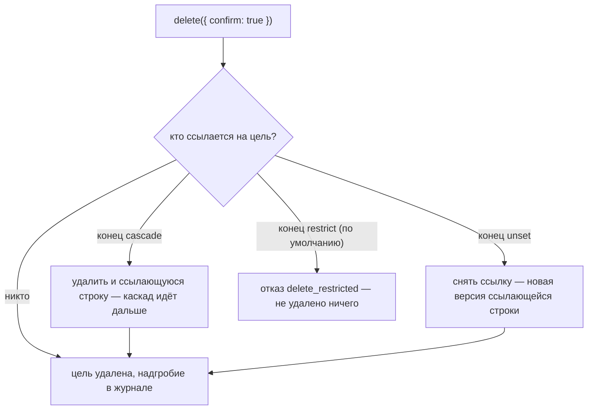

# Удаление и восстановление

Удаление в letopis — **не стирание**. Строка уходит из таблицы `entity` (объекта «сейчас» больше нет), но вся его история остаётся в журнале, а последняя версия лежит там надгробием. Поэтому удалённое можно вернуть. Стереть историю совсем — отдельное действие `purge`, и только для уже удалённого объекта.

## Пример: предпросмотр, каскад, запрет, снятие ссылки

<Example id="delete/01-delete-cascade" />

Что происходит со ссылками на удаляемый объект, решает правило конца в модели:

Весь каскад — один оператор и одна транзакция: если хоть одна строка мешает, не удаляется ничего.

## Вернуть и стереть

<Example id="delete/02-restore-purge" />

## Подводные камни

- **`delete()` без `{ confirm: true }` ничего не удаляет** — это только предпросмотр. Покажите его пользователю перед удалением.
- **Предпросмотр не учитывает права.** Строка с `$action: delete` может не удалиться у пользователя без права — интерфейсу стоит спросить `acl.checkData(класс, 'DELETE')`.
- **`restore()` возвращает только объекты, выбранные шагом цепочки**, а не весь каскад. Строки, удалённые каскадом, возвращают отдельно (`withDeleted().restore()`).
- **`purge` — только для удалённых.** Для неудалённого объекта он вернёт ошибку `not_deleted`. Историю системных классов `purge` не стирает.
- **Удалённый объект можно создать снова тем же ключом** — история продолжится с того же id.
- **Для полного забвения** обычно нужны три шага: `anonymize` (затереть поля), удаление, `purge` (стереть версии). Пока проектор не прочёл удаление, `purge` отказывает (`projector_pending`) — об этом в главе про проекторы.

## Где это в сервисах

В салоне отмена брони — удаление с предпросмотром, а «вернуть бронь» — `restore`. В документах удалённый договор восстанавливается одной кнопкой, а персональные данные контрагента стираются по цепочке `anonymize` → удаление → `purge`.
