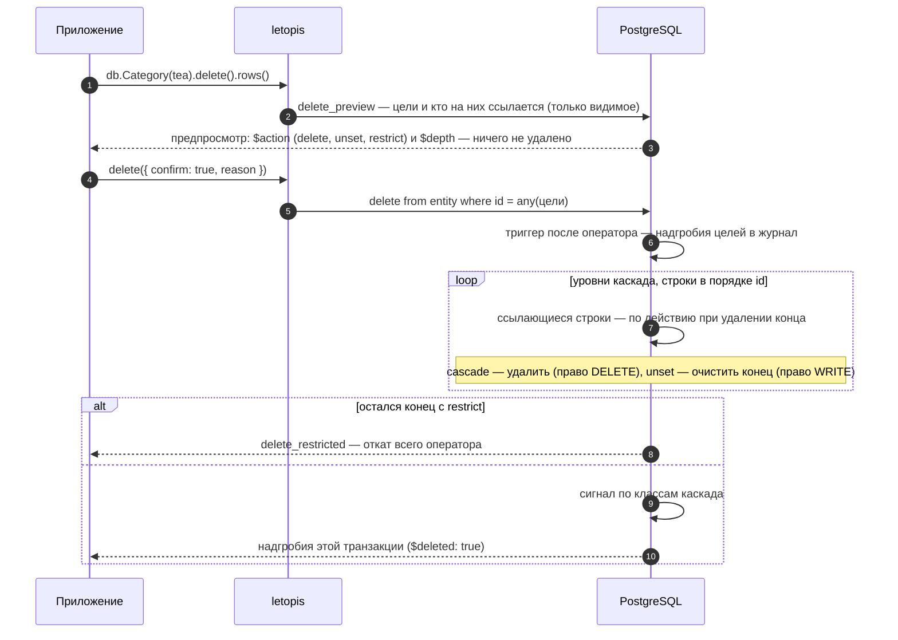

# Удаление и восстановление

## Зачем

Удаление в letopis — **не стирание**. Строка уходит из таблицы `entity` (объекта «сейчас» больше нет), но вся его история остаётся в журнале, а последняя версия лежит там надгробием. Поэтому удалённое можно вернуть. Стереть версии одного объекта нельзя: журнал арендатора стирает только удаление аккаунта (`db.auth.purgeAccount`, [глава 9](../auth/#удалить-аккаунт)).

## Пример: предпросмотр, каскад, запрет, очистка конца

Пример работает на модели магазина главы 3 (её записывает и наполняет помощник сайта `seedShop` из `kit/shop.ts` — его код открывается кнопкой «Весь код примера»). Для удаления важны действия при удалении у концов:

```ts
import { hub, link, one, many } from 'letopis/model'

const Product = hub('Product', { sku: z.string(), title: z.string(), price: z.number().int().min(0) }, {
  ends: { Shop, Category: many(Category, { max: 5, onDelete: 'unset' }) },   // Shop — по умолчанию restrict
  key: ['Shop', 'sku'],
})
const Order = hub('Order', { number: z.string(), status: z.enum(['new', 'paid', 'cancelled']).default('new') }, {
  ends: { Customer, Shop }, key: ['Shop', 'number'],
})
const line = link('line', { qty: z.number().int().min(1), price: z.number().int().min(0) }, {
  ends: { Order: one(Order).onDelete('cascade'), Product },                  // строки уходят вместе с заказом
  key: ['Order', 'Product'],
})
```

<Example id="delete/01-delete-cascade" />

### Как читать предпросмотр

| Поле строки | Значения | Что значит |
|---|---|---|
| `$action` | `delete` | строка удалится — и сама цель, и строки каскада (`cascade`) |
| | `unset` | у строки очистится конец, ведущий на цель; строка останется |
| | `restrict` | строка мешает удалению: подтверждение даст `delete_restricted` |
| `$depth` | `0` | сама цель |
| | `1`, `2`, … | уровень каскада: строка уйдёт вместе с целью; у `unset` и `restrict` поля нет |

Цель от каскада отличает именно `$depth`: у строк каскада `$action` тоже `delete`.

### Удалить ровно то, что показали

Предпросмотр — снимок на момент вызова, а `delete({ confirm: true })` удаляет то, что есть **в момент подтверждения**: если пока пользователь смотрел, в каскад добавилась строка, уйдёт и она. Отдельного «удалить по предпросмотру» в letopis нет — рецепт на текущем API (шаги 7–10 примера выше, функция `deleteAsShown`):

1. Покажите предпросмотр и запомните его отпечаток — id, `rev` и `$action` каждой строки.
2. При подтверждении в одной транзакции `db.begin()` возьмите цель `forUpdate()`, пересчитайте предпросмотр и сверьте отпечаток.
3. Совпал — `delete({ confirm: true })` и `commit()`; не совпал — `rollback()`, ничего не удалено, покажите новый предпросмотр.
4. Блокировка цели защищает, только если её берут все, кто добавляет строки в этот каскад: код, который заводит строку заказа (выдачу участнику и т. п.), тоже берёт `tr.Order(order).forUpdate()` (или общий `tr.lock(…)`) в своей транзакции. Иначе его строка может появиться между сверкой и удалением.

## Что внутри: что происходит с концами

Что происходит с концами, ведущими на удаляемый объект, решает действие при удалении — его задают у конца в модели:

<Flow name="delete" />

Как это идёт по шагам (`lib/sql/60-write.sql`: `delete_preview`, триггер `trg_entity_ad`):



Удаляемый аккаунт (`Account`): его сессии гасит с сигналом триггер до удаления, а пароли, ключи и коды стирает сама база — внешний ключ `secret.account` с `on delete cascade`.

Весь каскад — один оператор и одна транзакция: если хоть одна строка мешает, не удаляется ничего.

**Какие строки удаляет `delete({ confirm: true })`.** Как и у `update`, цели сужают фильтр, id, `tags()`, `owner()` или `limit()` хотя бы у одного шага цепочки. Без них — отказ `invalid_query` ещё до записи (строгий режим); удалить все строки шага — явно: `delete({ confirm: true, all: true })`. Предпросмотр `delete()` без подтверждения работает и без условий.

## Вернуть удалённое

<Example id="delete/02-restore" />

`restore()` возвращает последний снимок удалённого объекта новой версией, с прежним id, и перепроверяет его по текущему описанию класса. Возвращаются только цели шага, а не весь каскад. Живой объект вернуть нельзя — `not_deleted`. История удалённого объекта остаётся в журнале: `versions()` показывает и надгробие.

**Вернуть строки только этого каскада.** `db.Order(order).line().withDeleted().restore()` вернёт **все** удалённые строки заказа — и те, что удалили раньше и отдельно (закрытые выдачи, убранные позиции). Строки одного удаления отличает причина: надгробия цели и всего её каскада получают `reason` этого удаления. Удаляйте со своей причиной (`delete({ confirm: true, reason: 'отмена заказа A-1 (op-7)' })`), а возвращайте надгробия с ней: отберите `withDeleted().rows()` по `r.reason` и верните их списком id — `db.line(ids).withDeleted().restore()` (шаг 4 примера). Если за время удаления на месте вернувшейся строки появилась новая (вещь выдали другому), решает приложение: для «одной открытой записи на объект» берите ключ — [глава 7](../money/#одна-открытая-запись-на-объект-выдача-бронь-смена).

**Пустой ответ — «не найдено».** `restore()` и `delete({ confirm: true })` по id, которого нет или который не виден пользователю (чужой арендатор, нет права на чтение), возвращают пустой список без ошибки. Проверяйте длину ответа: `if (!rows.length) return 'не найдено'` — иначе приложение скажет «возвращено», ничего не вернув.

**`create` тем же ключом продолжает историю удалённого.** id объекта с ключом вычисляется из ключа, поэтому `create` с ключом удалённого объекта — не новый объект, а тот же: без ошибки, версией `create` поверх надгробия, и в корзине (`withDeleted()`) его больше нет. Концы, очищенные при удалении, не возвращаются. Если пользователь заводит «нового» с занятым ключом, проверьте до `create`: `db.Member({ card }).withDeleted().first()` с `$deleted: true` — предложите вернуть удалённого (`restore()`) или взять другой ключ.

## Подводные камни

- **`delete()` без `{ confirm: true }` ничего не удаляет** — это только предпросмотр. Покажите его пользователю перед удалением.
- **Предпросмотр устаревает.** Подтверждение удаляет то, что есть в момент вызова; удалить ровно показанное — транзакция, `forUpdate()`, пересчёт и сверка отпечатка ([рецепт выше](#удалить-ровно-то-что-показали)).
- **У строк каскада `$action` — тоже `delete`.** Цель от каскада отличает `$depth`: 0 — цель, 1 и дальше — каскад.
- **Предпросмотр не учитывает права.** Строка с `$action: delete` может не удалиться у пользователя без права — интерфейсу стоит спросить `acl.checkData(класс, 'DELETE')`.
- **`restore()` возвращает только объекты, выбранные шагом цепочки**, а не весь каскад. Строки, удалённые каскадом, возвращают отдельно (`withDeleted().restore()`) — и он вернёт все удалённые строки шага; только этот каскад — по причине удаления (`reason`).
- **`restore()` — только для удалённых.** Живой объект даёт `not_deleted`.
- **Несуществующий или чужой id — пустой ответ.** `restore()` и `delete({ confirm: true })` не бросают ошибку, а возвращают `[]`: проверяйте длину.
- **`delete({ confirm: true })` без условий — отказ** `invalid_query`: удалить все строки шага можно только явно, `delete({ confirm: true, all: true })`.
- **Удалённый объект можно создать снова тем же ключом** — история продолжится с того же id, без ошибки и без «восстановления» его концов. «Новый» объект с занятым ключом — это удалённый: проверьте `withDeleted().first()` до `create`.
- **Удаление не стирает историю.** Версии удалённого объекта остаются в журнале; стереть их по одному объекту нельзя. Данные и журнал целиком стирает только удаление аккаунта-арендатора (`db.auth.purgeAccount`).

## Где это в сервисах

В салоне отмена брони — удаление с предпросмотром, а «вернуть бронь» — `restore`; перенос брони — новая бронь и удаление прежней одной транзакцией. В документах удалённое попадает в корзину (`withDeleted()`) и возвращается оттуда с прежним id.
