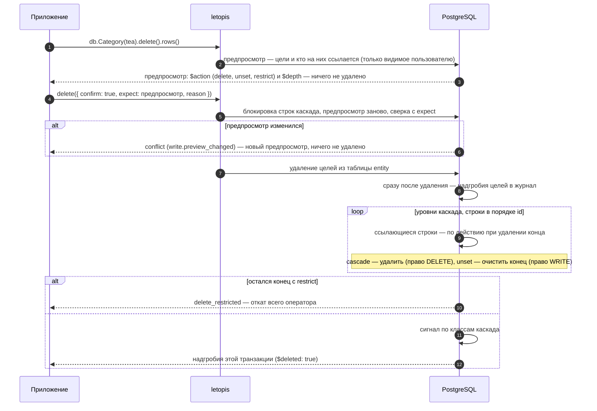

# Удаление и восстановление

## Зачем

Удаление в letopis — всегда **по показанному**: сначала предпросмотр, потом подтверждение с ним же (`expect`); удаление без сверки и возврат без надгробий библиотека отклоняет. И удаление — **не стирание**. Строка уходит из таблицы `entity` (объекта «сейчас» больше нет), но вся его история остаётся в журнале, а последняя версия лежит там надгробием. Поэтому удалённое можно вернуть. Стереть версии одного объекта нельзя: журнал арендатора стирает только удаление аккаунта (`db.auth.purgeAccount`, [глава 9](../auth/#удалить-аккаунт)).

## Пример: предпросмотр, каскад, запрет, очистка конца

Пример работает на модели магазина [главы 3](../models/#пример-модель-магазина) с одним расширением: у заказа есть поле `status` (`new`, `paid`, `cancelled`, по умолчанию `new`). Модель записывает и наполняет данными функция `seedShop` — её код вставлен в начало программы примера. Для удаления важны действия при удалении у концов:

::: details Модель примера: действия при удалении у концов
Классы `Shop`, `Category` и `Customer` — те же, что в [главе 3](../models/#пример-модель-магазина); полная модель — в начале программы примера.

```ts
import { hub, link, one, many } from 'letopis/model'
import { z } from 'zod'

// Shop, Category, Customer — как в главе 3
const Product = hub('Product', { sku: z.string(), title: z.string(), price: z.number().int().min(0) }, {
  ends: { Shop, Category: many(Category, { max: 5, onDelete: 'unset' }) },   // Shop — по умолчанию restrict
  key: ['Shop', 'sku'],
})
const Order = hub('Order', { number: z.string(), status: z.enum(['new', 'paid', 'cancelled']).default('new') }, {   // status — расширение главы 3
  ends: { Customer, Shop }, key: ['Shop', 'number'],
})
const line = link('line', { qty: z.number().int().min(1), price: z.number().int().min(0) }, {
  ends: { Order: one(Order).onDelete('cascade'), Product },                  // строки уходят вместе с заказом
  key: ['Order', 'Product'],
})
```
:::

<Example id="delete/01-delete-cascade" />

### Как читать предпросмотр

| Поле строки | Значения | Что значит |
|---|---|---|
| `$action` | `delete` | строка удалится — и сама цель, и строки каскада (`cascade`) |
| | `unset` | у строки очистится конец, ведущий на цель; строка останется |
| | `restrict` | строка мешает удалению: подтверждение даст `delete_restricted` |
| `$depth` | `0` | сама цель |
| | `1`, `2`, … | уровень каскада: строка уйдёт вместе с целью; у `unset` и `restrict` поля нет |

Цель от каскада отличает именно `$depth`: у строк каскада `$action` тоже `delete`.

### Удалить ровно то, что показали

Предпросмотр — снимок на момент вызова, а пока пользователь смотрел, в каскад могла добавиться строка. Поэтому подтверждение идёт **с тем предпросмотром, который видел человек**: `delete({ confirm: true, expect: предпросмотр })` удаляет ровно показанное. Без `expect` подтверждение — отказ `invalid_query` (ключ `write.confirm_without_expect`) ещё до записи, ничего не удалено:

```ts
import { LetopisError, type Db, type Row } from 'letopis'

// db — подключение пользователя, order — id заказа
async function showDelete(db: Db, order: string): Promise<Row[]> {
  return db.Order(order).delete().rows()                         // предпросмотр: показать пользователю и сохранить
}

// пользователь нажал «Удалить»; preview — тот предпросмотр, который он видел
async function confirmDelete(db: Db, order: string, preview: Row[]) {
  try {
    const gone = await db.Order(order).delete({ confirm: true, expect: preview, reason: 'отмена заказа A-2' }).rows()
    return { deleted: gone }                                     // надгробия: по ним удалённое можно вернуть
  } catch (e) {
    if (!(e instanceof LetopisError) || e.code !== 'conflict') throw e
    return { changed: (e.detail as { preview: Row[] }).preview } // предпросмотр изменился — показать новый
  }
}
```

1. В той же транзакции, что и удаление, letopis строит предпросмотр заново и сравнивает его с `expect`: те же строки по `id`, с теми же `rev` и `$action` (порядок не важен; если в строке `expect` нет `$action`, он не сравнивается).
2. Совпало — удаляет. Не совпало — отказ `conflict` (ключ `write.preview_changed`): ничего не удалено, новый предпросмотр — в `err.detail.preview`; покажите его и подтверждайте уже с ним. Цели уже удалены или не видны — тоже `conflict`, с пустым `detail.preview`.
3. `confirm: true` без `expect` — отказ `invalid_query` (ключ `write.confirm_without_expect`); `expect` без `confirm: true` — тоже `invalid_query` (ключ `write.expect_without_confirm`): без подтверждения `delete()` и есть предпросмотр.
4. Сверка и удаление идут подряд в одной транзакции, и сверка — под блокировкой: letopis блокирует строки каскада из предпросмотра (`for update`, по порядку id), строит предпросмотр заново и только потом удаляет. Строку, которую другой запрос успел добавить в каскад (новую строку заказа), новый предпросмотр увидит — `conflict`; запрос, который добавляет её позже, ждёт удаления и получает `target_not_found` (`цель конца … не найдена`). Строки каскада, которые права не дают пользователю править, letopis не блокирует.

### Вернуть то, что удалили: ответ delete и partial

Ответ `delete({ confirm: true, expect })` — надгробия этого удаления: цель и весь её каскад, у каждой строки `id` и `rev`. Сохраните его — по нему удаление и возвращают, целиком и без чужого:

Продолжение фрагмента выше: `db`, `order` и `preview` — те же, что в `confirmDelete`.

```ts
const gone = await db.Order(order).delete({ confirm: true, expect: preview, reason: 'отмена заказа A-2' }).rows()
// … пользователь нажал «Вернуть»
await db.Order(order).restore({ expect: gone }).rows()                          // сам заказ
const back = await db.Order(order).line().restore({ expect: gone, partial: true }).rows()
for (const r of back) {
  if (r.$action === 'skip') console.log(`строка ${r.id} не вернулась: ${r.$why}`)  // 'reissued' | 'changed' | 'restored'
}
```

Если удаление и возврат — разные запросы к серверу (так почти всегда в веб-приложении), ответа `delete()` к моменту возврата уже нет. Тогда надгробия берут из корзины — [ниже](#корзина-и-возврат-в-отдельном-запросе).

- Вернётся строка, чья последняя версия — то самое надгробие из `expect`; id из `expect`, которых нет среди строк шага, пропускаются.
- С `partial: true` остальные цели приходят в том же ответе строками-пропусками: последняя строка цели и `$action: 'skip'`, `$why` — почему не вернулась: `reissued` — id занял новый живой объект с тем же ключом (в примере — чайник, положенный в заказ заново), `changed` — после удаления строку пересоздавали, правили или удалили снова, `restored` — её уже вернули.
- Без `partial` одна такая цель роняет весь вызов, и ничего не восстановлено ([отказы ниже](#штатные-отказы-и-пустые-ответы)); `partial` без `expect` — `invalid_query`.
- `restore()` без `expect` — отказ `invalid_query` (ключ `write.restore_without_expect`), и для явного id тоже: последнее надгробие объекта может быть уже не тем, что видел человек.

## Что внутри: что происходит с концами

Что происходит с концами, ведущими на удаляемый объект, решает действие при удалении — его задают у конца в модели:

<Flow name="delete" />

Как это идёт по шагам:



Удаляемый аккаунт (`Account`): база сама гасит его сессии и стирает его пароли, ключи и коды входа.

Весь каскад — один оператор и одна транзакция: если хоть одна строка мешает, не удаляется ничего.

**Что принимает подтверждение.** `delete({ confirm: true, expect })` — обычный путь. Цели, как и у `update`, сужает фильтр, id, `tags()`, `owner()` или `limit()` хотя бы у одного шага; без них — отказ `invalid_query` до записи (ключ `write.no_filter`). Осознанно удалить текущий состав без сверки — `delete({ confirm: true, all: true })`: с фильтром — текущие цели фильтра, без фильтра — все строки шага. `all` и `expect` можно передать вместе: `all` снимает требование фильтра, `expect` сверяет предпросмотр. Предпросмотр `delete()` без подтверждения работает и без условий. Правило одно для цепочек, `db.begin()`, `db.batch()` и `db.as()`.

## Вернуть удалённое

<Example id="delete/02-restore" />

`restore({ expect })` возвращает удалённый объект новой версией, с прежним id, — только если его последняя версия и есть надгробие из `expect`, — и перепроверяет снимок по текущему описанию класса. `expect` — надгробия из ответа `delete()` или строки `db.Класс(id).withDeleted().rows()` (у удалённых `$deleted: true`; нужны `id` и `rev`). Возвращаются только цели шага, а не весь каскад. Живой объект вернуть нельзя: с `expect` его последняя версия — не надгробие из `expect`, и ответ — `conflict` (ключ `write.restore_stale`), а если его уже вернули или id занят новым объектом — `not_deleted` ([таблица ниже](#штатные-отказы-и-пустые-ответы)). `restore()` без `expect` — отказ `invalid_query` (ключ `write.restore_without_expect`); осознанно вернуть все удалённые цели шага без сверки — `restore({ all: true })`. История удалённого объекта остаётся в журнале: `versions()` по его id показывает и надгробие — шаг с явным id берёт и удалённые.

### `withDeleted()` — у каждого шага свой {#withdeleted-per-step}

`withDeleted()` относится к шагу, после которого стоит:

| Цепочка | Что найдёт |
|---|---|
| `db.Order(id).withDeleted()` | заказ, даже если он удалён |
| `db.Order(id).line().withDeleted()` | живые и удалённые строки **живого** заказа |
| `db.Order(id).withDeleted().line().withDeleted()` | удалённые строки удалённого заказа — так смотрят, что ушло каскадом (шаг 2 примера) |
| `db.Order(id).withDeleted().line()` | живые строки удалённого заказа — обычно пусто; letopis один раз предупреждает: `withDeleted() у шага Order относится к нему, а не к последнему шагу line` |

Переход идёт по **последней** версии строки: если после удаления строку пересоздали тем же ключом (в вернувшийся заказ снова положили тот же товар) и удалили снова, её последнее надгробие ведёт уже не на удалённого родителя, и переход от него её не найдёт. Что ушло конкретным удалением, точно знают его надгробия: ответ `delete` или версии удаления в журнале с причиной этого удаления (`withDeleted().versions()`, отбор `op === 'delete'` и `reason`).

### Корзина и возврат в отдельном запросе

В веб-приложении удаление и возврат — разные запросы: ответа `delete()` к моменту возврата уже нет. Его заменяют надгробия из базы:

- **Корзина** — шаг с `withDeleted()`: он отдаёт и живые, и удалённые объекты, у удалённых `$deleted: true`. У надгробия `at` — время удаления, `author` — кто удалил, `reason` — причина удаления, `rev` — номер версии-надгробия.
- **История удалённого** — `versions()` по его id: шаг с явным id берёт и удалённые, `withDeleted()` не нужен.
- **Возврат** — `restore({ expect: [{ id, rev }] })` со строкой корзины, которую видел пользователь: клиенту отдают `id` и `rev` надгробия, он присылает их обратно. Причину возврата задаёт опция `reason` — она попадёт в журнал рядом с версией `restore`.

Самостоятельный фрагмент сервера — три обработчика; `db` — подключение пользователя, модель — магазина из примера выше:

```ts
import { LetopisError, type Db } from 'letopis'

// GET /trash — корзина заказов
export async function trash(db: Db) {
  const rows = await db.Order().withDeleted().rows()
  return rows.filter((r) => r.$deleted)
    .map((r) => ({ id: r.id, rev: r.rev, number: r.data.number, deletedAt: r.at, reason: r.reason }))
}

// GET /orders/:id/history — история заказа, в том числе удалённого
export async function history(db: Db, id: string) {
  return (await db.Order(id).versions()).map((v) => ({ rev: v.rev, op: v.op, at: v.at, reason: v.reason }))
}

// POST /trash/restore, тело { id, rev } — строка корзины, которую видел пользователь
export async function restoreOrder(db: Db, body: { id: string; rev: number }) {
  const [tomb] = await db.Order(body.id).withDeleted().rows()
  if (!tomb) return { status: 404 }                                    // id нет или он не виден
  try {
    const [order] = await db.Order(body.id).restore({ expect: [body], reason: 'вернули из корзины' }).rows()
    // строки заказа, ушедшие этим же удалением: у их надгробий та же причина, что у надгробия заказа
    const lines = (await db.Order(body.id).line().withDeleted().rows())
      .filter((r) => r.$deleted && r.reason === tomb.reason)
    const back = lines.length
      ? await db.line(lines.map((r) => r.id)).restore({ expect: lines, partial: true, reason: 'вернули из корзины' }).rows()
      : []
    return { status: 200, order, skipped: back.filter((r) => r.$action === 'skip') }
  } catch (e) {
    // conflict (write.restore_stale) — после удаления заказ меняли; not_deleted — уже вернули или id занят
    if (e instanceof LetopisError && (e.code === 'conflict' || e.code === 'not_deleted')) return { status: 409, key: e.key }
    throw e
  }
}
```

Повторный `POST` с тем же телом получит `not_deleted` с ключом `write.restore_already` — «уже возвращено». Строки каскада здесь отобраны по причине удаления, поэтому давайте каждому удалению свою причину ([ниже](#вернуть-только-то-что-ушло-этим-удалением)). Корзина отдаёт и живые объекты шага, поэтому на большом классе сузьте шаг фильтром (`db.Order({ status: 'cancelled' }).withDeleted()`) или страницами (`sort()`, `limit()`, `after()` — [глава 5](../read/#сортировка-страницы-и-итоги)).

### Вернуть только то, что ушло этим удалением

У заказа могут быть удалённые строки из разных удалений — и те, что убрали раньше и отдельно (убранные покупателем позиции): `restore({ all: true })` на шаге `db.Order(order).line()` вернул бы **все**. Строки одного удаления знает ответ этого удаления, а если его не сохранили — причина: надгробия цели и всего её каскада получают `reason` этого удаления. Поэтому:

1. Сохраняйте ответ удаления и давайте каждому удалению свою причину: `delete({ confirm: true, expect: preview, reason: 'отмена заказа A-1 (op-7)' })`.
2. При возврате отберите надгробия с этой причиной и верните их **по `expect`**: `db.line(ids).restore({ expect: надгробия })` (шаг 5 примера). `expect` — строки `{ id, rev }`, подходят сами строки ответа.
3. Строка из `expect` вернётся, только если её последняя версия — то самое надгробие. Если после него строку пересоздали тем же ключом, правили или удалили снова, — отказ, и не восстановлено ничего из этого вызова: `conflict` (ключ `write.restore_stale`), а если id сейчас занят новым живым объектом — `not_deleted` (ключ `write.restore_id_taken`). В `err.detail.stale` — каждая цель, которую не вернуть: `{ id, rev, expected, after, deleted, live, why }` — последняя версия сейчас, ожидаемая, что было сразу после того удаления, удалена ли и жива ли строка, причина. Скажите пользователю, что строка не вернулась: после удаления её пересоздали или изменили.
4. Если остальные строки должны вернуться и без неё — `restore({ expect: надгробия, partial: true })`: что можно, вернётся, остальное придёт строками-пропусками с `$why` ([выше](#вернуть-то-что-удалили-ответ-delete-и-partial)).

**Главный случай — строку после удаления пересоздали тем же ключом и снова удалили.** В магазине: заказ отменили — строка «заказ + чайник» ушла каскадом; потом заказ вернули, чайник положили в него заново (та же строка, тот же id из ключа) и снова убрали. `restore({ all: true })` на строках заказа вернул бы её последний снимок — второе, более позднее состояние, а не то, что ушло с отменой; поэтому `restore()` без `expect` и отклоняется. `restore({ expect: надгробия отмены, partial: true })` её не оживляет: строка приходит пропуском `$why: 'changed'`, а приложение сообщает «не вернулась — после удаления её меняли». Тот же случай в прокате — участника удалили, вещь выдали другому и приняли, участника вернули — разобран в [главе 7](../money/#участника-удалили-вещь-выдали-другому-и-приняли-участника-вернули), живой пример — шаги 7–9 примера [«Одна выдача на вещь»](../money/#ex-money-05-one-open).

### Штатные отказы и пустые ответы

| Что вернул `restore()` | Когда | Что сказать пользователю |
|---|---|---|
| строки | вернулось | «возвращено» |
| `[]` | id нет или он не виден (чужой арендатор, нет права на чтение); id из `expect` нет среди строк шага | «не найдено» |
| `not_deleted`, ключ `write.restore_already` | объект уже вернули — другой запрос или прошлый вызов (шаг 7 примера) | «уже возвращено» |
| `not_deleted`, ключ `write.restore_id_taken` | id занят новым объектом с тем же ключом: `create` по ключу удалённого занял его id (шаг 11 примера) — с `expect` и без | «объект с этим ключом уже есть» |
| `conflict`, ключ `write.restore_stale` | с `expect`: последняя версия уже не то надгробие — строку правили или удалили снова; и объект, который не удалялся вовсе (шаг 7 примера) | «не вернулась — после удаления её меняли» |
| `not_deleted`, ключ `write.not_deleted` | `restore({ all: true })` без `expect`, а все цели шага живы и не удалялись | «не удалён» |
| строки с `$action: 'skip'` | с `expect` и `partial: true` — цели, которые не вернуть; причина — `$why` (`restored`, `reissued`, `changed`) | «не вернулась» по каждой |
| `invalid_query`, ключ `write.restore_without_expect` | `restore()` без `expect` и без `all: true` — и для явного id | — (ошибка в коде: передайте надгробия) |
| `invalid_query`, ключ `write.partial_without_expect` | `partial: true` без `expect` | — (ошибка в коде) |
| `invalid_data` | последний снимок не проходит нынешнее описание класса | поправить данные, потом вернуть |

`restore()` проверяет снимок только по описанию класса, а не по правилам приложения («у покупателя один открытый заказ», «в заказе не больше десяти строк»): такие правила держит ключ или ваша проверка, а `expect` гарантирует, что возвращается ровно ушедшая версия.

**Пустой ответ — «не найдено».** Предпросмотр, удаление и возврат по id, которого нет или который не виден пользователю, возвращают пустой список без ошибки. Проверяйте длину ответа: `if (!rows.length) return 'не найдено'` — иначе приложение скажет «возвращено», ничего не вернув.

**`create` тем же ключом продолжает историю удалённого.** id объекта с ключом вычисляется из ключа, поэтому `create` с ключом удалённого объекта — не новый объект, а тот же: без ошибки, версией `create` поверх надгробия, и в корзине (`withDeleted()`) его больше нет. Концы, очищенные при удалении, не возвращаются, а прежний снимок вернуть уже нельзя (`write.restore_id_taken`). Если пользователь заводит «нового» с занятым ключом, проверьте до `create`: `db.Category({ name }).withDeleted().first()` с `$deleted: true` (шаг 9 примера) — предложите вернуть удалённого (`restore({ expect: [эта строка] })`) или взять другой ключ.

## Подводные камни

- **`delete()` без `{ confirm: true }` ничего не удаляет** — это только предпросмотр. Покажите его пользователю перед удалением.
- **Подтверждение — только с `expect`.** `delete({ confirm: true })` — отказ `invalid_query` (`write.confirm_without_expect`); `delete({ confirm: true, expect: предпросмотр })` удаляет ровно показанное: сверка идёт под блокировкой строк каскада, расхождение — `conflict` с новым предпросмотром в `err.detail.preview` ([рецепт выше](#удалить-ровно-то-что-показали)). Без сверки — только явно: `{ confirm: true, all: true }`.
- **У строк каскада `$action` — тоже `delete`.** Цель от каскада отличает `$depth`: 0 — цель, 1 и дальше — каскад.
- **Предпросмотр показывает только то, что пользователь видит.** Строки, невидимые ему по правам, в предпросмотр не попадают, и чистый предпросмотр ещё не обещает удаления: невидимая строка, которая мешает (`restrict`), даст при подтверждении `delete_restricted` (в `err.detail.others` — сколько таких строк), строка каскада без права на удаление или строка с `unset` без права на правку — `acl_denied`. Ничего не удаляется. Спросить заранее, можно ли пользователю удалять объекты класса, — `db.acl.checkData('Order', 'DELETE')` ([глава 8](../access/)); кнопку это только прячет, запрещает всё равно база.
- **`withDeleted()` — модификатор своего шага.** Удалённые дети удалённого родителя — `X(id).withDeleted().Y().withDeleted()`; `withDeleted()` только у первого шага даёт живых `Y` и предупреждение.
- **`restore()` возвращает только объекты, выбранные шагом цепочки**, а не весь каскад. Строки, удалённые каскадом, возвращают отдельно — по надгробиям этого удаления и с `expect`.
- **Возврат — только с `expect`.** `restore()` без него — отказ `invalid_query` (`write.restore_without_expect`), и для явного id тоже: последний снимок может оказаться чужой версией. `restore({ all: true })` возвращает последние снимки без сверки — только осознанно.
- **`restore()` — только для удалённых.** Почему объект жив, говорит ключ: `write.restore_already` (`not_deleted`) — уже вернули, `write.restore_id_taken` (`not_deleted`) — id занят новым объектом с тем же ключом. Объект, который не удалялся вовсе, с `expect` даёт `conflict` (`write.restore_stale`): его последняя версия — не надгробие из `expect`; `not_deleted` с ключом `write.not_deleted` — только у `restore({ all: true })`, когда все цели шага живы.
- **Возврат в отдельном запросе — по корзине.** Ответ `delete()` живёт только в том запросе, где удаляли. Позже надгробия берут из `withDeleted()` и возвращают `restore({ expect: [{ id, rev }] })` ([рецепт выше](#корзина-и-возврат-в-отдельном-запросе)).
- **Вернуть удаление целиком — `restore({ expect: ответ delete, partial: true })`.** Без `partial` одна цель, которую уже не вернуть, отменяет весь вызов; с `partial` она приходит строкой-пропуском `$action: 'skip'` с причиной `$why`.
- **Несуществующий или чужой id — пустой ответ.** Предпросмотр и удаление без сверки (`{ all: true }`) не бросают ошибку, а возвращают `[]`: проверяйте длину. У подтверждения с `expect` пустой ответ — только при `expect: []`; если в `expect` есть строки, а целей уже нет (удалили, не видны), — `conflict` `write.preview_changed` с `detail.preview: []`.
- **Подтверждение без условий на цели — отказ** `invalid_query` (`write.no_filter`): удалить все строки шага можно только явно, `delete({ confirm: true, all: true })`.
- **Удалённый объект можно создать снова тем же ключом** — история продолжится с того же id, без ошибки и без «восстановления» его концов. «Новый» объект с занятым ключом — это удалённый: проверьте `withDeleted().first()` до `create`.
- **Удаление не стирает историю.** Версии удалённого объекта остаются в журнале; стереть их по одному объекту нельзя. Данные и журнал целиком стирает только удаление аккаунта-арендатора (`db.auth.purgeAccount`).

## Где это в сервисах

В [салоне записи](../services/salon) отмена брони — удаление с причиной, а «вернуть бронь» — `restore` по надгробию; перенос брони — новая бронь и удаление прежней одной транзакцией. В [документах с аудитом](../services/documents) удаление идёт по предпросмотру, удалённое попадает в корзину (`withDeleted()`) и возвращается оттуда отдельным запросом с прежним id: строка корзины и есть `expect`.

Что делала библиотека при удалении и возврате — события `delete.preview`, `delete` и `restore` в [журнале letopis](../logging/#удаление-и-возврат-по-журналу): сколько строк, сверено ли с `expect`, какие цели пришли пропусками.
