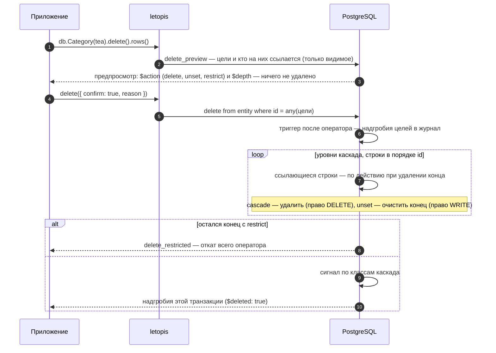

# Удаление и восстановление

## Зачем

Удаление в letopis — **не стирание**. Строка уходит из таблицы `entity` (объекта «сейчас» больше нет), но вся его история остаётся в журнале, а последняя версия лежит там надгробием. Поэтому удалённое можно вернуть. Стереть версии одного объекта нельзя: журнал арендатора стирает только удаление аккаунта (`db.auth.purgeAccount`, [глава 9](../auth/#удалить-аккаунт)).

## Пример: предпросмотр, каскад, запрет, очистка конца

<Example id="delete/01-delete-cascade" />

## Что внутри: что происходит с концами

Что происходит с концами, ведущими на удаляемый объект, решает действие при удалении — его задают у конца в модели:

<Flow name="delete" />

Как это идёт по шагам (`lib/sql/60-write.sql`: `delete_preview`, триггер `trg_entity_ad`):

Удаляемый аккаунт (`Account`): его сессии гасит с сигналом триггер до удаления, а пароли, ключи и коды стирает сама база — внешний ключ `secret.account` с `on delete cascade`.

Весь каскад — один оператор и одна транзакция: если хоть одна строка мешает, не удаляется ничего.

**Какие строки удаляет `delete({ confirm: true })`.** Как и у `update`, цели сужают фильтр, id, `tags()`, `owner()` или `limit()` хотя бы у одного шага цепочки. Без них — отказ `invalid_query` ещё до записи (строгий режим); удалить все строки шага — явно: `delete({ confirm: true, all: true })`. Предпросмотр `delete()` без подтверждения работает и без условий.

## Вернуть удалённое

<Example id="delete/02-restore" />

`restore()` возвращает последний снимок удалённого объекта новой версией, с прежним id, и перепроверяет его по текущему описанию класса. Возвращаются только цели шага, а не весь каскад. Живой объект вернуть нельзя — `not_deleted`. История удалённого объекта остаётся в журнале: `versions()` показывает и надгробие.

## Подводные камни

- **`delete()` без `{ confirm: true }` ничего не удаляет** — это только предпросмотр. Покажите его пользователю перед удалением.
- **Предпросмотр не учитывает права.** Строка с `$action: delete` может не удалиться у пользователя без права — интерфейсу стоит спросить `acl.checkData(класс, 'DELETE')`.
- **`restore()` возвращает только объекты, выбранные шагом цепочки**, а не весь каскад. Строки, удалённые каскадом, возвращают отдельно (`withDeleted().restore()`).
- **`restore()` — только для удалённых.** Живой объект даёт `not_deleted`.
- **`delete({ confirm: true })` без условий — отказ** `invalid_query`: удалить все строки шага можно только явно, `delete({ confirm: true, all: true })`.
- **Удалённый объект можно создать снова тем же ключом** — история продолжится с того же id.
- **Удаление не стирает историю.** Версии удалённого объекта остаются в журнале; стереть их по одному объекту нельзя. Данные и журнал целиком стирает только удаление аккаунта-арендатора (`db.auth.purgeAccount`).

## Где это в сервисах

В салоне отмена брони — удаление с предпросмотром, а «вернуть бронь» — `restore`; перенос брони — новая бронь и удаление прежней одной транзакцией. В документах удалённое попадает в корзину (`withDeleted()`) и возвращается оттуда с прежним id.
