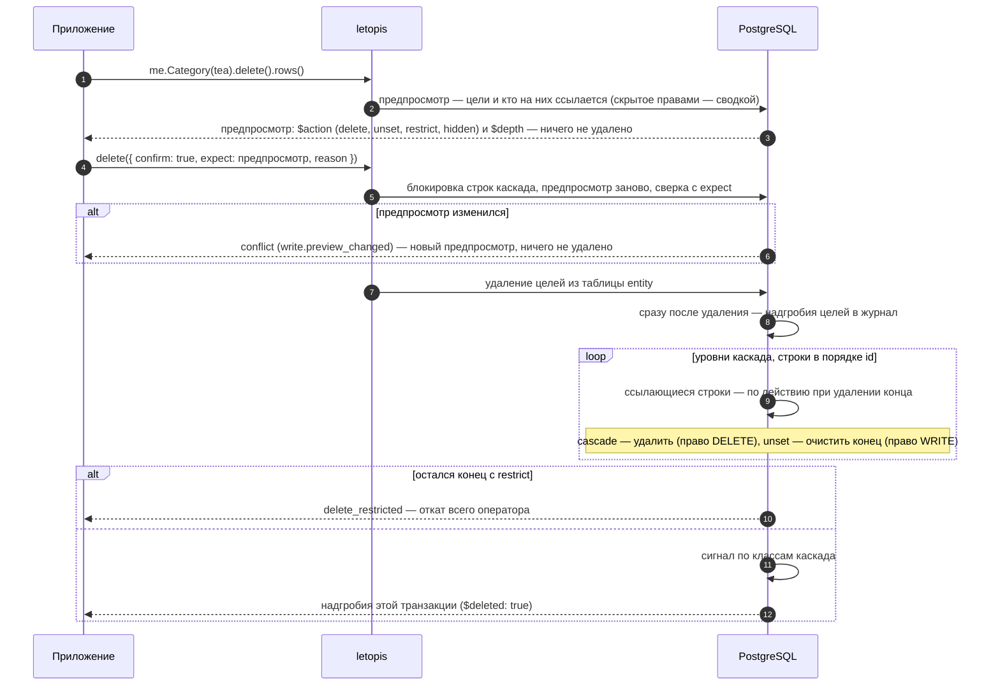

# Удаление: что внутри

Продолжение страницы [«Удаление и восстановление»](../delete/). Там — как удалить по предпросмотру и вернуть удалённое. Здесь — что при этом происходит в базе, редкие случаи возврата, отказы и подводные камни.

## Что внутри: что происходит с концами

Что происходит с концами, ведущими на удаляемый объект, решает действие при удалении — его задают у конца в модели:

<Flow name="delete" />

Как это идёт по шагам:

Весь каскад — один оператор и одна транзакция: если хоть одна строка мешает, не удаляется ничего. Порядок «по id» внутри уровня — порядок id строк, а id строк с ключом вычисляются из id квартиры: у тех же данных в другой квартире порядок другой.

Аккаунты и прописки цепочкой не удаляют: свой аккаунт жилец удаляет `deleteAccount()`, выписывается — `leave()` ([«Вход и ключи»](../auth/)), а квартиру целиком удаляет `deleteTenant()` ([«Квартиры и права»](../access/)).

**Что принимает подтверждение.** `delete({ confirm: true, expect })` — обычный путь. Цели, как и у `update`, сужает фильтр, id, `tags()`, `owner()` или `limit()` хотя бы у одного шага; без них — отказ `invalid_query` до записи (ключ `write.no_filter`). Осознанно удалить текущий состав без сверки — `delete({ confirm: true, all: true })`: с фильтром — текущие цели фильтра, без фильтра — все строки шага. `all` и `expect` можно передать вместе: `all` снимает требование фильтра, `expect` сверяет предпросмотр. Предпросмотр `delete()` без подтверждения работает и без условий. Правило одно для цепочек корня жильца, `me.begin()`, `me.batch()` и корней консьержа `db.in()` и `db.as()`.

## `withDeleted()` — у каждого шага свой {#withdeleted-per-step}

`withDeleted()` относится к шагу, после которого стоит:

| Цепочка | Что найдёт |
|---|---|
| `me.Order(id).withDeleted()` | заказ, даже если он удалён |
| `me.Order(id).line().withDeleted()` | живые и удалённые строки **живого** заказа |
| `me.Order(id).withDeleted().line().withDeleted()` | удалённые строки удалённого заказа — так смотрят, что ушло каскадом (шаг 2 примера) |
| `me.Order(id).withDeleted().line()` | живые строки удалённого заказа — обычно пусто; letopis один раз предупреждает: `withDeleted() у шага Order относится к нему, а не к последнему шагу line` |

Переход идёт по **последней** версии строки: если после удаления строку пересоздали тем же ключом (в вернувшийся заказ снова положили тот же товар) и удалили снова, её последнее надгробие ведёт уже не на удалённого родителя, и переход от него её не найдёт. Что ушло конкретным удалением, точно знают его надгробия: ответ `delete` или версии удаления в журнале с причиной этого удаления (`withDeleted().versions()`, отбор `op === 'delete'` и `reason`).

## Вернуть только то, что ушло этим удалением

У заказа могут быть удалённые строки из разных удалений — и те, что убрали раньше и отдельно (убранные покупателем позиции): `restore({ all: true })` на шаге `me.Order(order).line()` вернул бы **все**. Строки одного удаления знает ответ этого удаления, а если его не сохранили — причина: надгробия цели и всего её каскада получают `reason` этого удаления. Поэтому:

1. Сохраняйте ответ удаления и давайте каждому удалению свою причину: `delete({ confirm: true, expect: preview, reason: 'отмена заказа A-1 (op-7)' })`.
2. При возврате отберите надгробия с этой причиной и верните их **по `expect`**: `me.line(ids).restore({ expect: надгробия })` (шаг 5 примера). `expect` — строки `{ id, rev }`, подходят сами строки ответа.
3. Строка из `expect` вернётся, только если её последняя версия — то самое надгробие. Если после него строку пересоздали тем же ключом, правили или удалили снова, — отказ, и не восстановлено ничего из этого вызова: `conflict` (ключ `write.restore_stale`), а если id сейчас занят новым живым объектом — `not_deleted` (ключ `write.restore_id_taken`). В `err.detail.stale` — каждая цель, которую не вернуть: `{ id, rev, expected, after, deleted, live, why }` — последняя версия сейчас, ожидаемая, что было сразу после того удаления, удалена ли и жива ли строка, причина. Скажите пользователю, что строка не вернулась: после удаления её пересоздали или изменили.
4. Если остальные строки должны вернуться и без неё — `restore({ expect: надгробия, partial: true })`: что можно, вернётся, остальное придёт строками-пропусками с `$why` ([выше](../delete/#вернуть-то-что-удалили-ответ-delete-и-partial)).

**Главный случай — строку после удаления пересоздали тем же ключом и снова удалили.** В магазине: заказ отменили — строка «заказ + чайник» ушла каскадом; потом заказ вернули, чайник положили в него заново (та же строка, тот же id из ключа) и снова убрали. `restore({ all: true })` на строках заказа вернул бы её последний снимок — второе, более позднее состояние, а не то, что ушло с отменой; поэтому `restore()` без `expect` и отклоняется. `restore({ expect: надгробия отмены, partial: true })` её не оживляет: строка приходит пропуском `$why: 'changed'`, а приложение сообщает «не вернулась — после удаления её меняли». Тот же случай в прокате — участника удалили, вещь выдали другому и приняли, участника вернули — разобран в главе [«Транзакции и деньги»](../money/#участника-удалили-вещь-выдали-другому-и-приняли-участника-вернули), живой пример — шаги 7–9 примера [«Одна выдача на вещь»](../money/#ex-money-05-one-open).

## Штатные отказы и пустые ответы

| Что вернул `restore()` | Когда | Что сказать пользователю |
|---|---|---|
| строки | вернулось | «возвращено» |
| `[]` | id нет или он не виден (чужая квартира, нет права на чтение); id из `expect` нет среди строк шага | «не найдено» |
| `not_deleted`, ключ `write.restore_already` | объект уже вернули — другой запрос или прошлый вызов (шаг 7 примера) | «уже возвращено» |
| `not_deleted`, ключ `write.restore_id_taken` | id занят новым объектом с тем же ключом: `create` по ключу удалённого занял его id (шаг 11 примера) — с `expect` и без | «объект с этим ключом уже есть» |
| `conflict`, ключ `write.restore_stale` | с `expect`: последняя версия уже не то надгробие — строку правили или удалили снова; и объект, который не удалялся вовсе (шаг 7 примера) | «не вернулась — после удаления её меняли» |
| `not_deleted`, ключ `write.not_deleted` | `restore({ all: true })` без `expect`, а все цели шага живы и не удалялись | «не удалён» |
| строки с `$action: 'skip'` | с `expect` и `partial: true` — цели, которые не вернуть; причина — `$why` (`restored`, `reissued`, `changed`) | «не вернулась» по каждой |
| `invalid_query`, ключ `write.restore_without_expect` | `restore()` без `expect` и без `all: true` — и для явного id | — (ошибка в коде: передайте надгробия) |
| `invalid_query`, ключ `write.partial_without_expect` | `partial: true` без `expect` | — (ошибка в коде) |
| `invalid_data` | последний снимок не проходит нынешнее описание класса | поправить данные, потом вернуть |

`restore()` проверяет снимок только по описанию класса, а не по правилам приложения («у покупателя один открытый заказ», «в заказе не больше десяти строк»): такие правила держит ключ или ваша проверка, а `expect` гарантирует, что возвращается ровно ушедшая версия.

**Пустой ответ — «не найдено».** Предпросмотр, удаление и возврат по id, которого нет или который не виден жильцу, возвращают пустой список без ошибки. Проверяйте длину ответа: `if (!rows.length) return 'не найдено'` — иначе приложение скажет «возвращено», ничего не вернув.

**`create` тем же ключом продолжает историю удалённого.** id объекта с ключом вычисляется из ключа, поэтому `create` с ключом удалённого объекта — не новый объект, а тот же: без ошибки, версией `create` поверх надгробия, и в корзине (`withDeleted()`) его больше нет. Концы, очищенные при удалении, не возвращаются, а прежний снимок вернуть уже нельзя (`write.restore_id_taken`). Если пользователь заводит «нового» с занятым ключом, проверьте до `create`: `me.Category({ name }).withDeleted().first()` с `$deleted: true` (шаг 9 примера) — предложите вернуть удалённого (`restore({ expect: [эта строка] })`) или взять другой ключ.

## Подводные камни

- **`delete()` без `{ confirm: true }` ничего не удаляет** — это только предпросмотр. Покажите его пользователю перед удалением.
- **Подтверждение — только с `expect`.** `delete({ confirm: true })` — отказ `invalid_query` (`write.confirm_without_expect`); `delete({ confirm: true, expect: предпросмотр })` удаляет ровно показанное: сверка идёт под блокировкой строк каскада, расхождение — `conflict` с новым предпросмотром в `err.detail.preview` ([рецепт выше](../delete/#удалить-ровно-то-что-показали)). Без сверки — только явно: `{ confirm: true, all: true }`.
- **У строк каскада `$action` — тоже `delete`.** Цель от каскада отличает `$depth`: 0 — цель, 1 и дальше — каскад.
- **Предпросмотр не раскрывает то, что жилец не видит.** Строки, невидимые ему по правам, приходят сводками `$action: 'hidden'` с `$hidden` и `$count`, без класса, id и данных. Со сводкой `restrict` подтверждение отклоняется заранее: `delete_restricted` (в `err.detail.others` — сколько скрытых строк мешает). Права на удаление предпросмотр не проверяет: строка каскада без права на удаление или строка с `unset` без права на правку даст `acl_denied`, ничего не удаляется. Спросить заранее, можно ли жильцу удалять объекты класса, — `me.acl.checkData('Order', 'DELETE')` ([«Квартиры и права»](../access/)); кнопку это только прячет, запрещает всё равно база.
- **`withDeleted()` — модификатор своего шага.** Удалённые дети удалённого родителя — `X(id).withDeleted().Y().withDeleted()`; `withDeleted()` только у первого шага даёт живых `Y` и предупреждение.
- **`restore()` возвращает только объекты, выбранные шагом цепочки**, а не весь каскад. Строки, удалённые каскадом, возвращают отдельно — по надгробиям этого удаления и с `expect`.
- **Возврат — только с `expect`.** `restore()` без него — отказ `invalid_query` (`write.restore_without_expect`), и для явного id тоже: последний снимок может оказаться чужой версией. `restore({ all: true })` возвращает последние снимки без сверки — только осознанно.
- **`restore()` — только для удалённых.** Почему объект жив, говорит ключ: `write.restore_already` (`not_deleted`) — уже вернули, `write.restore_id_taken` (`not_deleted`) — id занят новым объектом с тем же ключом. Объект, который не удалялся вовсе, с `expect` даёт `conflict` (`write.restore_stale`): его последняя версия — не надгробие из `expect`; `not_deleted` с ключом `write.not_deleted` — только у `restore({ all: true })`, когда все цели шага живы.
- **Возврат в отдельном запросе — по сохранённым надгробиям или по корзине.** Ответ `delete()` живёт только в том запросе, где удаляли: сервис хранит его сам ([рецепт](../recipes/undo)) или позже берёт надгробия из `withDeleted()` и возвращает `restore({ expect: [{ id, rev }] })` ([корзина](../delete/#корзина-и-возврат-в-отдельном-запросе)).
- **Вернуть удаление целиком — `restore({ expect: ответ delete, partial: true })`.** Без `partial` одна цель, которую уже не вернуть, отменяет весь вызов; с `partial` она приходит строкой-пропуском `$action: 'skip'` с причиной `$why`.
- **Несуществующий или чужой id — пустой ответ.** Предпросмотр и удаление без сверки (`{ all: true }`) не бросают ошибку, а возвращают `[]`: проверяйте длину. У подтверждения с `expect` пустой ответ — только при `expect: []`; если в `expect` есть строки, а целей уже нет (удалили, не видны), — `conflict` `write.preview_changed` с `detail.preview: []`.
- **Подтверждение без условий на цели — отказ** `invalid_query` (`write.no_filter`): удалить все строки шага можно только явно, `delete({ confirm: true, all: true })`.
- **Удалённый объект можно создать снова тем же ключом** — история продолжится с того же id, без ошибки и без «восстановления» его концов. «Новый» объект с занятым ключом — это удалённый: проверьте `withDeleted().first()` до `create`.
- **Удаление не стирает историю.** Версии удалённого объекта остаются в журнале; стереть их по одному объекту нельзя. Данные и журнал целиком стирает только удаление квартиры (`deleteTenant()`).
