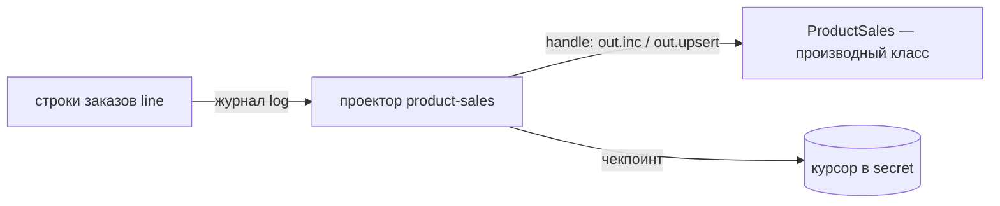

# Агрегаты и проекторы: производные данные

Иногда нужен итог, который всегда согласован с исходными данными: баланс кошелька, число позиций заказа, продажи товара. В letopis для этого два средства.

| | Агрегат | Проектор |
|---|---|---|
| кто считает | сама база, триггером | ваш код `handle`, по журналу |
| когда | в той же транзакции, что и запись | с небольшим отставанием |
| писатели ждут друг друга | да: одна цель — очередь (около 150 операций в секунду) | нет |
| для чего | деньги, счётчики, которые обязаны совпадать всегда | отчёты, витрины, горячие счётчики |

## Агрегат в базе

<Example id="derived/01-aggregate" />

## Проектор из журнала

<Example id="derived/02-projector" />

## Подводные камни

- **В агрегатное поле не пишут** — ни библиотекой, ни сырым SQL: `aggregate_field`. Правило модели проверяется над итогом.
- **Источник описывают раньше агрегата** — `syncModels` делает это сам; агрегат над несуществующим классом отклоняется.
- **Производный класс (`derivedBy`) заводит только администратор**, а пишет только его проектор: у приложения запись — `derived_class`.
- **Проектор отстаёт.** Итог появляется после прохода `run()`. Пока проектор не прочёл удаление, `purge` источника отказывает (`projector_pending`).
- **Служебные записи журнала** (`purge`, `trim`, `reset`) — не версии объекта: `handle` их пропускает.
- **Ремонт:** `rebuildAggregates(класс)` пересчитывает агрегат, `rebuild()` — проектор с текущего состояния.

## Где это в сервисах

Кошелёк держит баланс агрегатом (сумма операций), а выписку за месяц собирает проектор.
