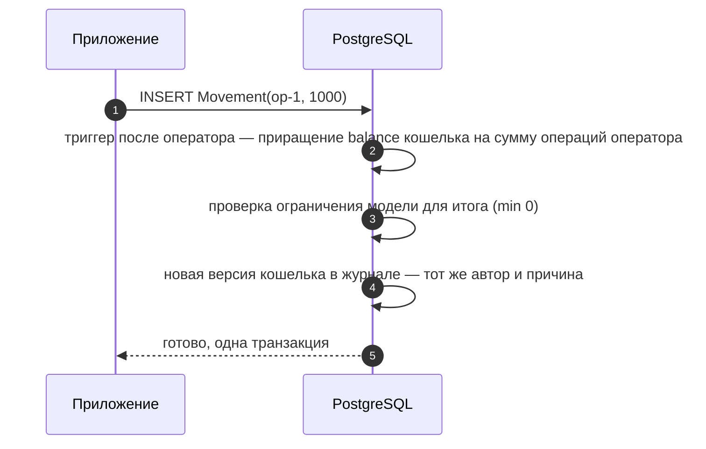

# Агрегаты и проекторы: производные данные

Иногда нужен итог, который всегда согласован с исходными данными: баланс кошелька, число позиций заказа, продажи товара. В letopis для этого два средства. **Агрегат** — поле, которое база сама пересчитывает при каждой записи в исходные данные (баланс — сумма операций). **Проектор** — процесс, который читает журнал изменений и вашей функцией `handle` заполняет отдельный класс (например, выписку за месяц).

| | Агрегат | Проектор |
|---|---|---|
| кто считает | сама база, триггером | ваш код `handle`, по журналу |
| когда | в той же транзакции, что и запись | с небольшим отставанием |
| одновременные записи ждут друг друга | да: записи, которые меняют один итог (баланс одного кошелька), идут по очереди — около 150 в секунду | нет |
| для чего | деньги, счётчики, которые обязаны совпадать всегда | отчёты, витрины, часто обновляемые счётчики (просмотры) |

## Агрегат в базе

<Example id="derived/01-aggregate" />

<Flow name="aggregate" />

## Проектор из журнала

<Example id="derived/02-projector" />

<Flow name="projector" />

## Опции проектора

Проектор можно настроить: сколько изменений брать за проход (`batch`), как часто опрашивать журнал, если сигнал не пришёл (`pollMs`), сколько ждать чужую блокировку строки (`lockTimeout`) и сколько проходов подряд терпеть её у одного арендатора (`lockRetries`), каких арендаторов обслуживать (`tenants`) и что делать, если журнал уже обрезан дальше курсора (`onExpired`). Все опции с умолчаниями — в [справочнике](../reference/derived).

<Example id="derived/03-projector-options" />

## Проектор как процесс

`run({ once: true })` делает один проход и возвращается. Без `once` проектор работает постоянно: догоняет журнал, ждёт новых изменений и просыпается по сигналу. Так его запускают в отдельном процессе — и останавливают `stop()`.

<Example id="derived/04-projector-process" />

## Подводные камни

- **В агрегатное поле нельзя писать** — ни библиотекой, ни сырым SQL: ошибка `aggregate_field`. Ограничения модели проверяются для посчитанного значения.
- **Источник описывают раньше агрегата** — `syncModels` делает это сам; агрегат над несуществующим классом отклоняется.
- **Производный класс (`derivedBy`) заводит только администратор**, а пишет в него только его проектор: запись из приложения — ошибка `derived_class`.
- **Проектор отстаёт.** Итог появляется после прохода `run()`. Пока проектор не прочёл удаление, `purge` источника отказывает (`projector_pending`).
- **Служебные записи журнала** (`purge`, `trim`, `reset`) — не версии объекта: `handle` их пропускает.
- **Ремонт:** `rebuildAggregates(класс)` пересчитывает агрегат, `rebuild()` — проектор с текущего состояния.

## Где это в сервисах

Кошелёк держит баланс агрегатом (сумма операций), а выписку за месяц собирает проектор.
