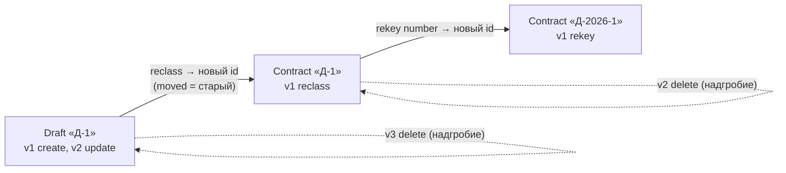
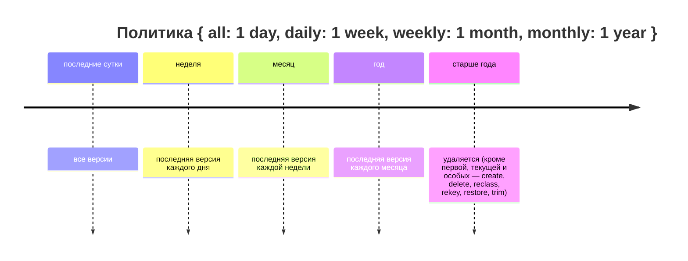

# История и время

## Зачем

В letopis ничего не перезаписывается: каждая правка — новая версия в журнале (`log`) с автором, временем и причиной. Поэтому можно посмотреть все версии, открыть объект на любой момент, сравнить две версии и узнать, кто последним менял поле. Сколько истории хранить, решает политика класса.

## Пример: версии, срез на момент, сравнение, «кто менял»

<Example id="history/01-versions-asof-diff-blame" />

## Что внутри: журнал версий

<Flow name="history" />

Ползунок ниже листает версии того же товара из снимка примера: на каждой видно, что было в объекте на тот момент и что изменилось.

<TimeTravel id="history/01-versions-asof-diff-blame" object="Product «Чайник»" />

| Вопрос | Вызов | Ответ |
|---|---|---|
| какие были версии | `versions()` | строки версий: `rev`, `op`, `at`, `author`, `reason`, данные |
| каким объект был тогда | `.asOf(момент)` | тот же запрос по состоянию журнала на момент |
| что поменялось | `diff({ from, to })` | по полям: путь, `added`/`removed`/`changed`, было, стало |
| кто менял поле | `blame()` | для каждого поля — версия, которая его последней изменила |

`from` и `to` у `diff` — номер версии или момент (строка ISO, `Date`). Без них — последняя версия против предыдущей.

## Смена номера и класса: versions({ follow })

<Example id="history/02-follow-rekey-reclass" />

### Что внутри: как связаны старый и новый id

## Хранение по ярусам

<Example id="history/03-retention-maintain-trim" />

### Что внутри: ярусы хранения

<Flow name="retention" />

Политика — свойство класса `history` (в `letopis/model` — опция `hub(…, { history })`), потомок наследует политику предка. Умолчание для всей установки — `up({ history })`. `history: false` — журнала нет совсем.

## Подводные камни

- **Лишние по политике версии удаляет (прореживает) `maintain()`, сама база этого не делает.** Запускайте его по расписанию (`connect({ maintain: '1h' })`) или из своего планировщика. `maintain({ now })` — прореживание «как будто сейчас другая дата» — работает только в установке с `allowReset` (тестовые базы).
- **Прореживание — не разрыв:** `verify()` считает законными пропуски номеров старше яруса `all`.
- **Подписка с курсором старше `all` получает `cursor_expired`** — события уже прорежены, перечитайте текущее состояние и подпишитесь заново.
- **`reclass` и `rekey` класса с ключом дают новый id**: id вычисляется из класса и ключа (UUID v5). Историю целиком показывает только `versions({ follow: true })`; `blame` сам учитывает прежние id.
- **`trimHistory` текущую версию не трогает**, а на место версии 1 ставит запись `trim`. Если проектор источника ещё не прочёл обрезаемое — `projector_pending`: сначала `run()`.
- **`asOf` и запись несовместимы** (`invalid_query`), `asOf` с `forUpdate()` — `lock_unsupported`.
- **После `rekeyClass` подключение узнаёт о новом ключе по сигналу, с задержкой**: описания классов оно держит в памяти (реестр классов). Чтобы обновить их сразу, вызовите `db.refresh()`.

## Где это в сервисах

[Документы с аудитом](../services/documents) построены на этой главе: лента версий договора через подписание и смену номера, сравнение версий, «кто менял», ползунок времени, хранение по ярусам и обрезка истории.
