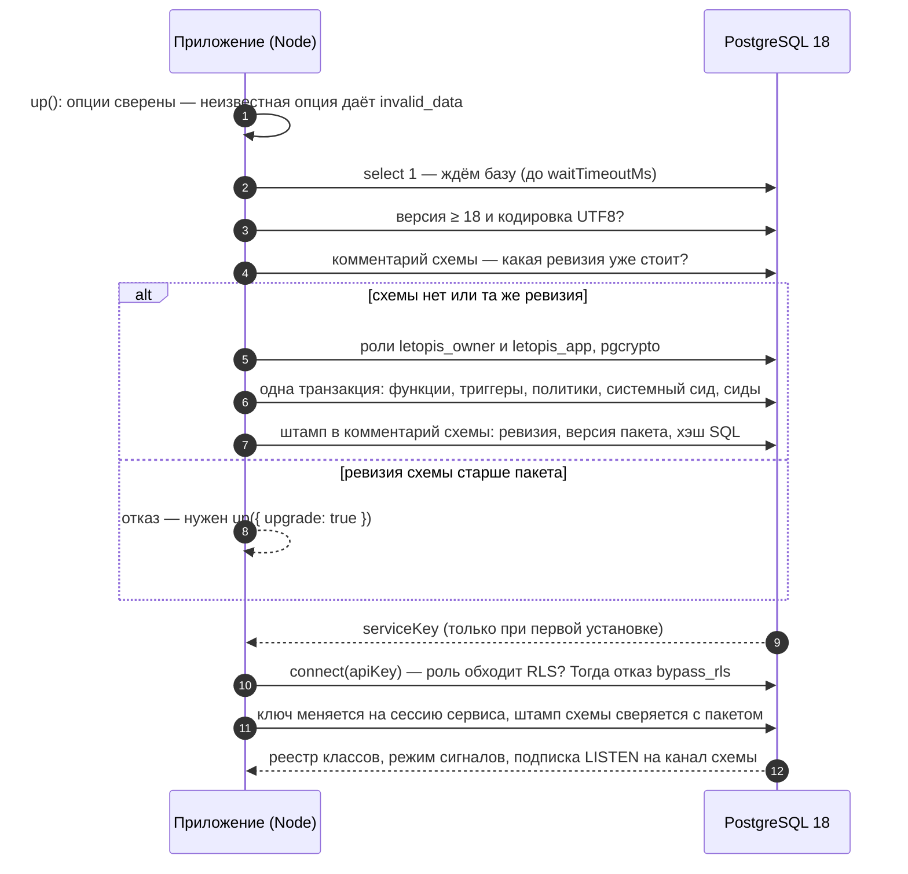

# Установка и подключение

::: danger Ключ сервиса выдаётся один раз
`up()` возвращает ключ сервиса `r.serviceKey` (с ним серверная часть подключается: `connect({ apiKey })`) **только при первой установке** или когда в схеме не осталось ни одного ключа API, кроме отозванных; истёкший или выключенный ключ тоже в счёт. Повторный `up()` отвечает `serviceKey: null`, а в базе ключ хранится только хэшем. Сохраните его сразу — или задайте заранее свой: `up({ serviceKey: process.env.SERVICE_KEY })` (`lts_` и 32–128 шестнадцатеричных знаков; [как](../start/#service-key)).
:::

## Зачем

Чтобы letopis заработал, нужны две вещи:

1. **Установка** — один раз (и при каждом обновлении пакета) вызвать `up()` от администратора базы. Он ставит в базу схему: три таблицы, проверки, политики доступа и служебные объекты.
2. **Подключение** — приложение вызывает `connect()` своей отдельной ролью и дальше работает цепочками вида `db.Product().rows()`.

Роли две, и это важно. Администратор (`dsn.admin` в примерах) ставит схему и обходит проверки доступа. Приложение (`dsn.app`) — обычная роль PostgreSQL, которая входит в группу `letopis_app`. Для неё работают все проверки — и в запросах библиотеки, и в сыром SQL. Создать её нужно один раз после первой установки:

```sql
create role shop_app login password 'app-secret';
grant letopis_app to shop_app;
```

Роль приложения может завести и сам `up()` — опция `login`: `up({ login: { user: 'shop_app', password } })` заводит роль (или меняет ей пароль), включает в `letopis_app` и возвращает её строку подключения `r.login.dsn`. Так делают все примеры сайта. Весь путь одним процессом, от пустой базы до первых данных, — на странице [«Первые 15 минут»](../first/).

## Права установщика

`up()` выполняет роль из `dsn` (в примерах — `ADMIN_DSN`). Что ей нужно:

| Что делает `up()` | Какое право нужно | Когда |
|---|---|---|
| создаёт базу из строки подключения, если её нет (подключившись к базе `postgres`) | `CREATEDB` | только если базы ещё нет |
| заводит роли `letopis_owner` и `letopis_app`, включает себя в `letopis_owner` (`set`, без наследования прав) | `CREATEROLE` — или роли уже заведены, а у установщика на `letopis_owner` есть `ADMIN OPTION` | первая установка в кластере |
| заводит роль приложения (опция `login`) и включает её в `letopis_app` | `CREATEROLE` и `ADMIN OPTION` на `letopis_app` (если `letopis_app` завёл сам установщик, `ADMIN OPTION` у него уже есть) | при каждом `up({ login })` |
| ставит расширение `pgcrypto` (хэши паролей и ключей) | право `CREATE` на базе: `pgcrypto` — доверенное расширение | если расширения в базе ещё нет |
| создаёт схему `v2.<имя>` и отдаёт её `letopis_owner` | право `CREATE` на базе ([CREATE SCHEMA](https://www.postgresql.org/docs/18/sql-createschema.html)) | первая установка схемы |

Отсюда три варианта ([атрибуты ролей PostgreSQL](https://www.postgresql.org/docs/18/role-attributes.html)):

1. **Суперпользователь** — может всё; так в примерах сайта (`postgres` из Docker).
2. **Отдельная роль-установщик** — без суперпользователя, с `CREATEROLE` и правом `CREATE` на заранее созданной базе (`CREATEDB` — только если `up()` должен создать базу сам):

   ```sql
   -- от суперпользователя, один раз
   create role letopis_installer login password '…' createrole;
   create database shop owner letopis_installer;   -- владелец базы имеет CREATE; или: grant create on database shop to letopis_installer
   ```

   Роли PostgreSQL общие для всех баз сервера, поэтому `letopis_owner` и `letopis_app` могли остаться от прошлой установки — например, их завёл суперпользователь. С PostgreSQL 16 права `CREATEROLE` мало, чтобы включать других в чужую роль: нужен `ADMIN OPTION` на неё. Роль, которую установщик завёл сам, он получает с `ADMIN OPTION` автоматически, а на чужие роли его выдают отдельно — иначе `up()` отвечает «нет `ADMIN OPTION`» про `letopis_owner` (ключ `boot.owner_no_admin`), а `up({ login })` — сырой ошибкой PostgreSQL `permission denied to grant role "letopis_app"`:

   ```sql
   -- от суперпользователя, если роли letopis уже есть на сервере
   grant letopis_owner to letopis_installer with admin option;
   grant letopis_app to letopis_installer with admin option;   -- нужно для up({ login })
   ```

   Если `up({ login })` всё же упал на этом шаге, схема к этому моменту уже поставлена, а ключ сервиса из этого вызова не вернулся. Выдайте права и повторите вызов с `fresh: true` — схема ещё пустая, и `up()` выдаст новый ключ.

3. **Заранее подготовленная база** — у установщика нет ни `CREATEROLE`, ни `CREATEDB`: администратор базы один раз готовит всё, что требует этих прав, а `up()` только ставит схему:

   ```sql
   -- от суперпользователя, в базе установки
   create extension if not exists pgcrypto;
   do $$ begin                                                     -- роли общие для сервера: могли остаться от прошлой установки
     if not exists (select 1 from pg_roles where rolname = 'letopis_owner') then create role letopis_owner nologin; end if;
     if not exists (select 1 from pg_roles where rolname = 'letopis_app') then create role letopis_app nologin; end if;
   end $$;
   grant letopis_owner to letopis_installer with admin option;   -- up() включает себя в letopis_owner
   grant create on database shop to letopis_installer;           -- для create schema
   create role shop_app login password '…' in role letopis_app;  -- роль приложения заводит администратор
   ```

   Простое `create role letopis_owner nologin` на сервере, где роль уже есть, падает с `role "letopis_owner" already exists` — поэтому роли заводятся блоком `do` с проверкой. Опцию `login` в этом варианте не передавайте — роль приложения уже есть. Без `ADMIN OPTION` на `letopis_owner` `up()` отвечает понятной ошибкой (ключ `boot.owner_no_admin`), а не сырым отказом PostgreSQL.

Установщик — не роль приложения: приложение подключается своей ролью из `letopis_app`. Суперпользователь или роль с `BYPASSRLS` обходили бы проверки прав, поэтому `connect()` такой роли отказывает (`bypass_rls`).

## Пример: установка, арендатор и вход

<Example id="install/01-up-and-connect" />

Что видно в сводке:

- `up()` завёл служебные объекты: описания системных классов (`Class`), аккаунты (`Account`), ресурсы и правила доступа. Это одинаково для любой установки.
- `createTenant` заводит арендатора — например, компанию-клиента вашего сервиса — вместе с правилами доступа и первым пользователем. Без правил пользователям арендатора запрещено всё: в letopis запрещено всё, что не разрешено явно.
- Каждый вход — новая сессия в `secret`: и вход сервиса по ключу, и проверка пароля пользователя.

## Что внутри: как работают up() и connect()

<Flow name="install" />



Повторный `up()` заново применяет ту же версию схемы и не трогает данные, поэтому его можно вызывать при каждом запуске приложения.

## Опции up()

<Example id="install/02-up-options" />

| Опция | Что делает |
|---|---|
| `dsn` или `sql` | строка подключения администратора или готовый пул postgres.js |
| `schema` | имя установки: `'shop'` даёт схему `v2.shop` |
| `tenant` | первый арендатор и его пользователь (то же, что `createTenant`) |
| `login` | роль приложения с паролем — `{ user, password }`: заводится и входит в роль приложения; имя и пароль квотирует база; повторный вызов обновляет пароль; строка подключения роли — `r.login.dsn` |
| `seeds` | готовые наборы классов: `'booking'` — салон, или пути к своим файлам `.sql` |
| `serviceKey` | свой ключ сервиса вместо случайного: `lts_` и 32–128 шестнадцатеричных знаков |
| `signals` | режим сигналов — как база оповещает процессы приложения об изменениях для подписок и кэша (глава [«Подписка, кэш и сигналы»](../watch/)): `class`, `tenant`, `opaque` или `none`; хранится в схеме |
| `fresh` | удалить схему и поставить заново — **данные теряются** |
| `upgrade` | обновить схему, ревизия которой отстала от пакета: выполнить миграции и заново применить SQL |
| `pglite` | PostgreSQL в WebAssembly для разработки (ниже) |
| `quiet`, `waitTimeoutMs` | без сообщений в консоль; сколько ждать базу |
| `log`, `logLevel`, `redact` | журнал работы библиотеки: логгер (pino, `console` или функция), порог и свои поля для маскировки — глава [«Логирование»](../logging/) |
| `owner`, `app` | имена ролей владельца и приложения |
| `migrationsDir` | каталог, откуда `upgrade` берёт миграции вместо каталога самого пакета (ниже) |

Неизвестная опция `up()` или `connect()` — отказ `invalid_data` с похожими именами ещё до подключения к базе (строгий режим): опечатка вроде `serviceKye` молча не пройдёт.

Установка через готовый пул, с явными именами ролей, первым арендатором и режимом сигналов `none` — для пулов в режиме транзакций (PgBouncer), где база не может слать сигналы:

<Example id="install/06-up-pool-roles" />

Каталог миграций в этом примере — `migrate` рядом с программой. Миграция — файл SQL, который `up({ upgrade: true })` выполняет над схемой старой ревизии, прежде чем заново поставить функции: имя файла — `NNNN-описание.sql`, где `NNNN` — ревизия, к которой он ведёт. Применяются файлы с номером выше ревизии схемы и не выше ревизии пакета, по возрастанию. Обычно опция не нужна: миграции лежат в самом пакете (каталог `sql/migrate` в `node_modules/letopis`). Свой каталог заменяет их целиком, поэтому в нём должны быть и файлы пакета; файл с номером выше ревизии пакета не применится. Здесь схема ставится с нуля — миграций нет, и каталога `migrate` может не быть вовсе: `up()` считает его пустым.

## Опции connect()

<Example id="install/03-connect-options" />

## Один процесс

Малому приложению хватит одного процесса: `up({ login })` заводит роль приложения, а `connect({ admin })` открывает второй пул для администраторских вызовов — цепочки остаются под правами базы.

<Example id="install/07-one-process" />

## Разработка без PostgreSQL

PGlite — PostgreSQL в WebAssembly внутри процесса Node: сервер базы не нужен, поэтому и `ADMIN_DSN` этой программе не нужен. Нужны два пакета PGlite — библиотека их не ставит сама (они необязательные):

```sh
npm i -D @electric-sql/pglite @electric-sql/pglite-socket
```

Без них `up({ pglite: true })` отказывает и называет недостающий пакет.

<Example id="install/04-pglite" />

## Обновление пакета: штамп движка

<Example id="install/05-engine-stamp" />

У схемы есть ревизия движка — у letopis 3.0 это 11 (её номер — экспорт `DDL_REVISION` и поле `revision` в ответе `up()`). Ревизия меняется не с каждой версией пакета, поэтому `up()` пишет в комментарий схемы ещё и штамп: версию пакета и хэш его файлов SQL; `connect()` сверяет штамп с пакетом и предупреждает о расхождении. Новую ревизию накатывает `up({ schema, upgrade: true })`: миграции и повторный накат функций, данные сохраняются. Обновлять умеют только схемы ревизии 8 и выше — их ставит letopis 2.0 и новее. Схему letopis 1.x (ревизия ниже 8) пакет не обновляет: `up()` и `connect()` отказывают и советуют `up({ schema, fresh: true })` — поставить схему заново, без переноса данных; в тексте этой ошибки «2.0» — первая версия с ревизией 8 (последний шаг примера выше).

## Подводные камни

- **Ключ сервиса выдаётся один раз** — подробно [в начале главы](#установка-и-подключение) и [в «Старте с нуля»](../start/#service-key).
- **Режим сигналов живёт в схеме.** `up()` без опции `signals` его не меняет; после смены режима перезапустите процессы приложения.
- **`fresh: true` стирает данные.** Это «поставить с нуля», а не «обновить».
- **Неизвестная опция — отказ, а не предупреждение.** `up()`, `connect()`, `db.load()`, `db.watch()` и `createMcpServer()` отвечают `invalid_data` и называют похожие имена.
- **Логин входит в id как есть.** `Anna@shop.ru` и `anna@shop.ru` дали бы два разных аккаунта — пишите логины в одном регистре.
- **Администраторское подключение — не для веб-приложения.** Оно обходит проверки доступа; держите его в отдельном процессе (загрузка, обслуживание, запись моделей) или во втором пуле `connect({ admin })` малого приложения.
- **PGlite не проверяет права.** Подключение к нему — суперпользователь; изоляцию арендаторов и гонки проверяйте на настоящем PostgreSQL.

## Где это в сервисах

Каждый сервис-пример при запуске вызывает `up()` своей схемы (повторный вызов безопасен) и регистрирует компании или салоны через `createTenant`; модели и настройку пишет администраторское подключение. Салон, кошелёк и «Документы» держат одно подключение по ключу сервиса и работают от имени вошедшего пользователя через `as()`. Helpdesk ведёт запросы вошедшего по его собственной сессии (`connect({ token })`), а `as()` у него — для работы от имени клиента.
