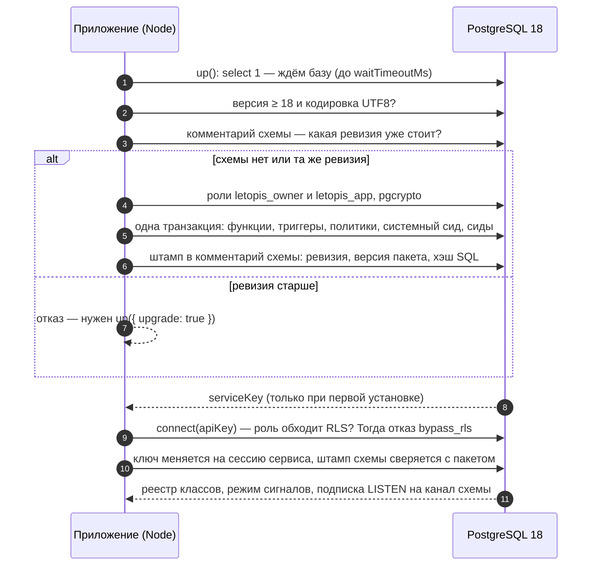

# Установка и подключение

## Зачем

Чтобы letopis заработал, нужны две вещи:

1. **Установка** — один раз (и при каждом обновлении пакета) вызвать `up()` от администратора базы. Он ставит в базу схему: три таблицы, проверки, политики доступа и служебные объекты.
2. **Подключение** — приложение вызывает `connect()` своей отдельной ролью и дальше работает цепочками вида `db.Product().rows()`.

Роли две, и это важно. Администратор (`dsn.admin` в примерах) ставит схему и обходит проверки доступа. Приложение (`dsn.app`) — обычная роль PostgreSQL, которая входит в группу `letopis_app`. Для неё работают все проверки — и в запросах библиотеки, и в сыром SQL. Создать её нужно один раз после первой установки:

```sql
create role shop_app login password 'app-secret';
grant letopis_app to shop_app;
```

Роль приложения может завести и сам `up()` — опция `login`. Весь путь одним процессом, от пустой базы до первых данных, — на странице [«Первые 15 минут»](../first/).

## Пример: установка, арендатор и вход

<Example id="install/01-up-and-connect" />

Что видно в сводке:

- `up()` завёл служебные объекты: описания системных классов (`Class`), аккаунты (`Account`), ресурсы и правила доступа. Это одинаково для любой установки.
- `createTenant` заводит арендатора — например, компанию-клиента вашего сервиса — вместе с правилами доступа и первым пользователем. Без правил пользователям арендатора запрещено всё: в letopis запрещено всё, что не разрешено явно.
- Каждый вход — новая сессия в `secret`: и вход сервиса по ключу, и проверка пароля пользователя.

## Что внутри: как работают up() и connect()

<Flow name="install" />



Повторный `up()` заново применяет ту же версию схемы и не трогает данные, поэтому его можно вызывать при каждом запуске приложения.

## Опции up()

<Example id="install/02-up-options" />

| Опция | Что делает |
|---|---|
| `dsn` или `sql` | строка подключения администратора или готовый пул postgres.js |
| `schema` | имя установки: `'shop'` даёт схему `v2.shop` |
| `tenant` | первый арендатор и его пользователь (то же, что `createTenant`) |
| `login` | роль приложения с паролем — `{ user, password }`: заводится и входит в роль приложения; имя и пароль квотирует база; повторный вызов обновляет пароль; строка подключения роли — `r.login.dsn` |
| `seeds` | готовые наборы классов: `'booking'` — салон, или пути к своим файлам `.sql` |
| `history` | политика хранения истории для классов без своей (глава про историю) |
| `serviceKey` | свой ключ сервиса вместо случайного: `lts_` и 32–128 шестнадцатеричных знаков |
| `allowReset` | разрешить `db.reset()`; по умолчанию выключено |
| `signals` | режим сигналов — как база оповещает процессы приложения об изменениях для подписок и кэша (глава [«Подписка, кэш и сигналы»](../watch/)): `class`, `tenant`, `opaque` или `none`; хранится в схеме |
| `fresh` | удалить схему и поставить заново — **данные теряются** |
| `upgrade` | обновить схему старой версии: выполнить миграции и заново применить SQL |
| `pglite` | PostgreSQL в WebAssembly для разработки (ниже) |
| `quiet`, `waitTimeoutMs` | без сообщений в консоль; сколько ждать базу |
| `owner`, `app` | имена ролей владельца и приложения |
| `migrationsDir` | свой каталог миграций для `upgrade` |

Установка через готовый пул, с явными именами ролей, первым арендатором и режимом сигналов `none` — для пулов в режиме транзакций (PgBouncer), где база не может слать сигналы:

<Example id="install/06-up-options" />

## Опции connect()

<Example id="install/03-connect-options" />

## Один процесс

Малому приложению хватит одного процесса: `up({ login })` заводит роль приложения, а `connect({ admin })` открывает второй пул для администраторских вызовов — цепочки остаются под правами базы.

<Example id="install/07-one-process" />

## Разработка без PostgreSQL

<Example id="install/04-pglite" />

## Обновление пакета: штамп движка

<Example id="install/05-engine-stamp" />

## Подводные камни

- **Ключ сервиса выдаётся один раз.** Это ключ API, с которым серверная часть приложения подключается к letopis: `connect({ apiKey })`. `up()` возвращает его (`serviceKey`) только при первой установке или когда в установке не осталось ни одного ключа API, кроме отозванных (истёкший или выключенный ключ тоже в счёт), — сохраните его сразу.
- **Режим сигналов живёт в схеме.** `up()` без опции `signals` его не меняет; после смены режима перезапустите процессы приложения.
- **`fresh: true` стирает данные.** Это «поставить с нуля», а не «обновить».
- **Логин входит в id как есть.** `Anna@shop.ru` и `anna@shop.ru` дали бы два разных аккаунта — пишите логины в одном регистре.
- **Администраторское подключение — не для веб-приложения.** Оно обходит проверки доступа; держите его в отдельном процессе (загрузка, проекторы, обслуживание).
- **PGlite не проверяет права.** Подключение к нему — суперпользователь; изоляцию арендаторов и гонки проверяйте на настоящем PostgreSQL.

## Где это в сервисах

Каждый сервис-пример при запуске вызывает `up()` своей схемы (повторный вызов безопасен) и регистрирует компании или салоны через `createTenant`; модели и настройку пишет администраторское подключение. Салон, кошелёк и «Документы» держат одно подключение по ключу сервиса и работают от имени вошедшего пользователя через `as()`. Helpdesk ведёт запросы вошедшего по его собственной сессии (`connect({ token })`), а `as()` у него — для работы от имени клиента.
