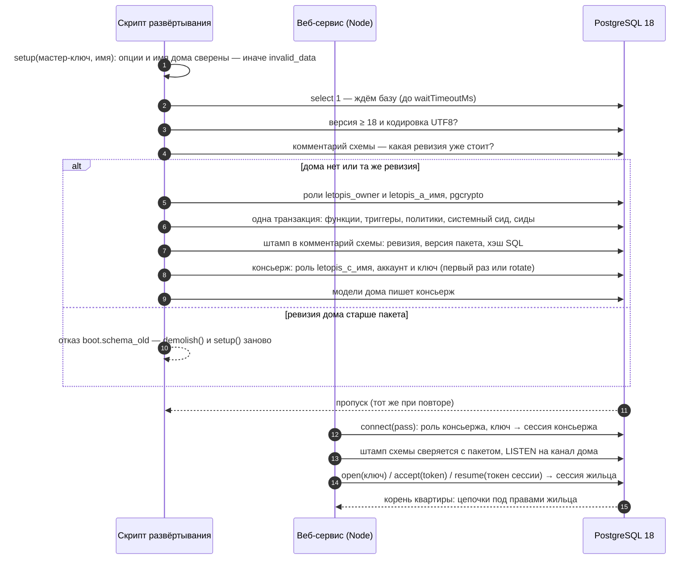

# Установка и подключение

::: warning Пропуск — секрет, и он лежит в базе
`setup()` отдаёт **пропуск** консьержа — строку подключения его роли с паролем, именем дома и ключом. По нему веб-сервис подключается к дому. Храните его как пароль: в переменной окружения или хранилище секретов, не в репозитории. Пропуск хранится и в самой базе (повторный `setup()` отдаёт тот же), а значит — и в её резервных копиях: доступ к копиям — как к пропуску. Пропуск утёк — `setup(…, { rotate: true })` выдаёт новый, старый перестаёт работать сразу ([ниже](#новыи-пропуск-и-снос-дома)).
:::

## Зачем

Чтобы letopis заработал, нужны три вещи:

1. **Дом** — один раз (и при каждом обновлении пакета или модели) вызвать `setup(ADMIN_DSN, 'имя', { models })` **мастер-ключом** — строкой подключения администратора PostgreSQL. `setup()` строит в базе схему `v2.<имя>`: три таблицы, проверки, политики доступа, системные классы, матрицу прав и консьержа — и отдаёт его пропуск. Повторный вызов достраивает дом (новые модели, сиды, правило по умолчанию) и отдаёт тот же пропуск.
2. **Консьерж** — приложение вызывает `connect(pass, { postman })`: одно подключение на процесс. У консьержа нет своих данных и цепочек; он держит дверь дома: заводит квартиры (`createTenant`), зовёт в них жильцов (`invite`, `accept`) и впускает их по ключам (`open`, `resume`). `postman` — **почтальон**: функция приложения, которая доставляет письма с приглашениями и кодами ([«Приглашения и почтальон»](../invites/)).
3. **Корень квартиры** — то, что отдают `accept()`, `open()` и `resume()`: от него идут цепочки вида `me.Product().rows()`, и каждый запрос база проверяет правами этого жильца.

Ролей базы три, и это важно. **Мастер-ключ** (суперпользователь или роль-установщик) строит и сносит дом и обходит проверки доступа — веб-сервису он не нужен. **Консьерж** — роль базы `letopis_c_<имя>`; она входит в служебную роль своего дома `letopis_a_<имя>`, которой выданы таблицы и функции этого дома. Это обычная роль, для неё работают все проверки — и в запросах библиотеки, и в сыром SQL. Служебная роль у каждого дома своя, поэтому консьерж одного дома не видит таблиц другого. **Владелец схемы** `letopis_owner` — роль без входа, от неё работают функции движка. Весь путь одним процессом, от пустой базы до первых данных, — на странице [«Первые 15 минут»](../first/), путь веб-сервиса — [«Старт с нуля»](../start/).

## Права установщика

`setup()` выполняет роль из мастер-ключа (в примерах — `ADMIN_DSN`). Что ей нужно:

| Что делает `setup()` | Какое право нужно | Когда |
|---|---|---|
| создаёт базу из строки подключения, если её нет (подключившись к базе `postgres`) | `CREATEDB` | только если базы ещё нет |
| заводит общую роль-владельца `letopis_owner` и служебную роль дома `letopis_a_<имя>`, включает себя в `letopis_owner` (`set`, без наследования прав) | `CREATEROLE` — или роли уже заведены, а у установщика на `letopis_owner` есть `ADMIN OPTION` | `letopis_owner` — первая установка в кластере; `letopis_a_<имя>` — первый `setup()` дома |
| заводит роль консьержа `letopis_c_<имя>` (имя длиннее 63 знаков сокращается хэшем) с паролем и включает её в служебную роль дома `letopis_a_<имя>` | `CREATEROLE` и `ADMIN OPTION` на `letopis_a_<имя>` (если эту роль завёл сам установщик, `ADMIN OPTION` у него уже есть) | первый `setup()` дома и `setup({ rotate: true })` |
| ставит расширение `pgcrypto` (хэши паролей и ключей) | право `CREATE` на базе: `pgcrypto` — доверенное расширение | если расширения в базе ещё нет |
| создаёт схему `v2.<имя>` и отдаёт её `letopis_owner` | право `CREATE` на базе ([CREATE SCHEMA](https://www.postgresql.org/docs/18/sql-createschema.html)) | первый `setup()` дома |

Отсюда два варианта ([атрибуты ролей PostgreSQL](https://www.postgresql.org/docs/18/role-attributes.html)):

1. **Суперпользователь** — может всё; так в примерах сайта (`postgres` из Docker).
2. **Отдельная роль-установщик** — без суперпользователя, с `CREATEROLE` и правом `CREATE` на заранее созданной базе (`CREATEDB` — только если `setup()` должен создать базу сам):

   ```sql
   -- от суперпользователя, один раз
   create role letopis_installer login password '…' createrole;
   create database shop owner letopis_installer;   -- владелец базы имеет CREATE; или: grant create on database shop to letopis_installer
   ```

   Роли PostgreSQL общие для всех баз сервера, поэтому `letopis_owner` и служебная роль дома `letopis_a_<имя>` могли остаться от прошлой установки — например, их завёл суперпользователь. С PostgreSQL 16 права `CREATEROLE` мало, чтобы включать других в чужую роль: нужен `ADMIN OPTION` на неё. Роль, которую установщик завёл сам, он получает с `ADMIN OPTION` автоматически, а на чужие роли его выдают отдельно — иначе `setup()` отвечает понятной ошибкой: «нет `ADMIN OPTION`» про `letopis_owner` (ключ `boot.owner_no_admin`) или про `letopis_a_<имя>` (ключ `boot.login_grant_denied`):

   ```sql
   -- от суперпользователя, если роли letopis уже есть на сервере
   grant letopis_owner to letopis_installer with admin option;
   grant letopis_a_shop to letopis_installer with admin option;   -- служебная роль дома shop
   ```

Мастер-ключ — не для веб-сервиса: суперпользователь или роль с `BYPASSRLS` обходит проверки прав, и под ней видны данные всех квартир. Веб-сервис ходит пропуском — ролью консьержа, под которой база проверяет каждый запрос сама. Сносит дом тот же мастер-ключ: `demolish()` удаляет схему от имени её владельца, роль консьержа и служебную роль дома.

## Пример: дом, консьерж, квартира и первый жилец

<Example id="install/01-setup-and-connect" />

Что видно в сводке:

- `setup()` завёл служебные объекты: описания системных классов (`Class`), аккаунты System и консьержа (`Account`), ресурсы и правила матрицы, среди них — правило по умолчанию «всем — нельзя». Это одинаково для любого дома.
- `createTenant` заводит квартиру — компанию, магазин, клуб — вместе с её правилами: консьержу можно всё, хозяину (роль `owner`) — тоже. Без правил жильцам квартиры запрещено всё: в letopis запрещено всё, что не разрешено явно.
- Приглашение — строка `INVITE` в `secret` (в базе — хэш токена; сам токен получает только почтальон); `accept(token)` гасит его и заводит аккаунт, прописку и сессию, а с `password` — ещё и ключ «пароль». Каждый вход — новая сессия в `secret`.

## Что внутри: как работают setup() и connect()

<Flow name="install" />



Повторный `setup()` заново ставит функции движка той же ревизии и не трогает данные, поэтому его можно вызывать при каждом развёртывании.

## Опции setup()

<Example id="install/02-setup-options" />

| Опция | Что делает |
|---|---|
| `models` | модели дома (`letopis/model`): общие классы для всех квартир; их записывает консьерж, итог — в `r.models` |
| `seeds` | готовые наборы классов: `'booking'` — салон, или пути к своим файлам `.sql` |
| `signals` | режим сигналов — как база оповещает процессы приложения об изменениях для подписок и кэша (глава [«Подписка, кэш и сигналы»](../watch/)): `class`, `tenant`, `opaque` или `none`; хранится в доме |
| `defaultRule` | правило по умолчанию матрицы: `deny` (у нового дома) или `allow`; без опции не меняется ([«Квартиры и права»](../access/)) |
| `rotate` | новый ключ консьержа и новый пароль его роли: прежний пропуск перестаёт работать сразу |
| `pglite` | PostgreSQL в WebAssembly для разработки (ниже) |
| `quiet`, `waitTimeoutMs` | без сообщений в консоль; сколько ждать базу (по умолчанию 60 000 мс) |
| `log`, `logLevel`, `redact` | журнал работы библиотеки: логгер (pino, `console` или функция), порог и свои поля для маскировки — глава [«Логирование»](../logging/) |

Имя дома — латиница в нижнем регистре, цифры и `_`, с буквы или `_`, не длиннее 41 знака: `'shop'` даёт схему `v2.shop`. Другое имя — отказ `invalid_data` (ключ `boot.setup_name`). Неизвестная опция `setup()` или `connect()` — тоже отказ `invalid_data` с похожими именами ещё до подключения к базе (строгий режим): опечатка вроде `defaultRul` молча не пройдёт.

**Имя дома — одно на сервер PostgreSQL, а не на базу.** Роли дома (`letopis_c_<имя>` и `letopis_a_<имя>`) общие для всех баз сервера. Если дом `shop` уже стоит в другой базе этого сервера, `setup(ADMIN_DSN, 'shop')` отвечает отказом `exists` (ключ `boot.house_elsewhere`) и ничего не меняет: второй дом с тем же именем сломал бы пропуск первого. Дайте дому в этой базе другое имя — например, `shop_test`. Повторный `setup()` того же дома в его же базе отказом не кончается.

Ответ `setup()`: `pass` — пропуск, `schema` — полное имя схемы, `created` — дом построен этим вызовом, `revision` — ревизия движка, `analyzed` — таблицы, которым собрана статистика, `warnings` — предупреждения, `models` — итог записи моделей, `pglite` — запущенный PGlite.

## Опции connect()

<Example id="install/03-connect-options" />

| Опция | Что делает |
|---|---|
| `postman` | почтальон — функция приложения `async ({ to, message }) => …`: доставляет письма с приглашениями (`me.invite`), кодами входа (`db.requestCode`) и кодами смены контакта (`me.changeContact`). Без него эти вызовы — отказ `no_postman`. Подробно — [«Приглашения и почтальон»](../invites/#шаг-0-почтальон-как-письмо-доходит-до-человека) |
| `max` | размер пула соединений консьержа (на нём же работают корни квартир) |
| `listen` | слушать сигналы дома (`LISTEN`): подписки и сброс кэша по изменениям; `false` — без сигналов |
| `cache` | кэш результатов цепочек в памяти процесса — глава [«Подписка, кэш и сигналы»](../watch/) |
| `notifyIntervalMs` | как часто процесс отправляет накопленные сигналы своих записей |
| `onQuery`, `slowMs` | что выполнила каждая цепочка: текст запроса, время; медленные — с отметкой |
| `models` | модели для строгих типов: `connect(pass, { models: MODELS })` (MODELS — `as const`) — корни квартир со строгими шагами; без них — `loose(me)` |
| `log`, `logLevel`, `redact` | журнал работы библиотеки — глава [«Логирование»](../logging/) |

Строка, которая не пропуск, — отказ `invalid_data` (ключ `boot.pass_invalid`); пропуск дома, который снесли, или старый после `rotate` — `auth_failed` (ключ `boot.pass_stale`).

## Разработка без PostgreSQL

PGlite — PostgreSQL в WebAssembly внутри процесса Node: сервер базы не нужен, поэтому и мастер-ключ этой программе не нужен. Нужны два пакета PGlite — библиотека их не ставит сама (они необязательные):

```sh
npm i -D @electric-sql/pglite @electric-sql/pglite-socket
```

Без них `setup({ pglite: true })` отказывает и называет недостающий пакет.

<Example id="install/04-pglite" />

::: danger PGlite не проверяет права
Подключение к PGlite — суперпользователем: матрица прав и изоляция квартир там не действуют (`setup()` предупреждает об этом в `warnings`). Права, квартиры и гонки проверяйте на настоящем PostgreSQL 18.
:::

## Обновление пакета: штамп движка

<Example id="install/05-engine-stamp" />

У дома есть ревизия движка — у letopis 4.0.0 это 12 (её номер — экспорт `DDL_REVISION` и поле `revision` в ответе `setup()`). Ревизия меняется не с каждой версией пакета, поэтому `setup()` пишет в комментарий схемы ещё и штамп: версию пакета и хэш его файлов SQL; `connect()` сверяет штамп с пакетом и предупреждает о расхождении — тогда достаточно вызвать `setup()` с именем дома. Дом другой ревизии пакет не трогает: дом ревизии новее пакета — `connect()` предупреждает, `setup()` отказывает (обновите пакет); дом ревизии старше — `connect()` и `setup()` отказывают с `invalid_data` (ключ `boot.schema_old`) и подсказывают снести его `demolish()` и построить заново `setup()` — данные не переносятся.

## Новый пропуск и снос дома

<Example id="install/06-rotate-demolish" />

- **Пропуск утёк** — `setup(ADMIN_DSN, имя, { rotate: true })`: новый ключ консьержа и новый пароль его роли. Новое подключение по старому пропуску — `auth_failed`; консьерж, подключённый до `rotate`, теряет ключ — такой процесс перезапускают с новым пропуском. Сессии жильцов не связаны с ключом консьержа: кто уже вошёл, работает дальше.
- **Дом больше не нужен** — `demolish(ADMIN_DSN, имя, { quiet? })`: схема со всеми квартирами, данными и журналом и роль консьержа удаляются. Вернуть их нельзя — только из резервной копии базы.

```ts
import { demolish } from 'letopis'

const r = await demolish(process.env.ADMIN_DSN!, 'shop', { quiet: true })
console.log(r)   // { schema: 'v2.shop', dropped: true }; дома не было — dropped: false, без ошибки
```

| Аргумент | Что это |
|---|---|
| `ADMIN_DSN` | мастер-ключ: тот же, которым дом строили |
| имя | имя дома, как в `setup()`: `'shop'` — схема `v2.shop` |
| `{ quiet: true }` | не печатать в консоль строку `letopis.demolish: v2.shop`; по умолчанию она печатается, когда дом снесён |

Учебные скрипты сайта начинают с `demolish(…)` и сразу зовут `setup(…)`: так каждый запуск идёт с чистого дома.

## Подводные камни

- **Пропуск — в резервных копиях базы.** Он хранится в доме, поэтому копия базы — это и копия пропуска. Подозреваете утечку — `rotate`.
- **Режим сигналов живёт в доме.** `setup()` без опции `signals` его не меняет; после смены режима перезапустите процессы приложения.
- **Корень, открытый до новой модели, видит её после сигнала.** `setup({ models })` дописал класс — открытые корни узнают о нём по сигналу дома; сразу — `me.refresh()`.
- **Неизвестная опция — отказ, а не предупреждение.** `setup()`, `connect()`, `me.watch()` и `createMcpServer()` отвечают `invalid_data` и называют похожие имена.
- **Контакт сравнивается без учёта регистра.** `Anna@shop.ru` и `anna@shop.ru` — одно имя для входа, один аккаунт. Остальное библиотека не приводит: `+7 999…` и `+7999…` — разные контакты.
- **Без почтальона не позвать.** `connect(pass)` без `postman` годится для задач без приглашений и входа кодом; `invite`, `requestCode` и `changeContact` ответят `no_postman`.
- **На PGlite почтальон не должен ходить в базу.** Соединение одно, а почтальона вызывают посреди записи: запрос к тому же дому из почтальона не дождётся ответа.
- **Мастер-ключ — не для веб-приложения.** Он обходит проверки доступа; держите его у скрипта развёртывания и команд обслуживания (`letopis sync`, `load`, `maintain`).
- **PGlite не проверяет права.** Подключение к нему — суперпользователь; изоляцию квартир и гонки проверяйте на настоящем PostgreSQL.

## Где это в сервисах

У каждого сервиса-примера дом строит отдельный шаг подготовки — `src/setup.mjs` мастер-ключом: `setup()` с моделью, демо-квартиры и демо-жильцы. Сам сервис мастер-ключа не знает и работает пропуском: консьерж заводит квартиры и впускает жильцов по ключам, а каждый запрос жильца идёт от его корня квартиры. Подробно — на страницах [сервисов-примеров](../services/).
