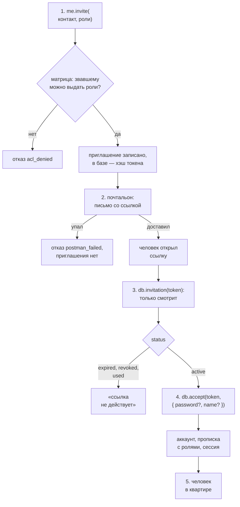

# Приглашения и почтальон

## Зачем

В letopis нет регистрации. Человек попадает в квартиру одним путём — по **приглашению**: его зовут, он получает письмо со **ссылкой** и принимает приглашение. Так в квартиру не попадёт тот, кого в ней не ждут.

Слова этой страницы:

- **контакт** — куда писать человеку: почта, телефон, Telegram. Контакт — это и **имя для входа**: один контакт — один аккаунт на весь дом;
- **почтальон** — функция вашего приложения, которая доставляет письма. Библиотека сама ничего не отправляет;
- **письмо** — то, что библиотека отдаёт почтальону: кому (контакт) и что (ссылка приглашения или код);
- **ссылка** — адрес страницы вашего приложения с **токеном** приглашения: 48 случайных знаков, которые знает только получатель письма;
- **прописка** — запись «этот аккаунт живёт в этой квартире»; её даёт только принятое приглашение;
- **роль** — метка прописки (`owner`, `staff`). Сама роль ничего не разрешает: права ей выдаёт матрица — [«Квартиры и права»](../access/).

Кто такие консьерж (`db`) и корень квартиры (`me`) — на странице [«Дом, пропуск, консьерж»](../house/).

## Путь приглашения целиком

```text
 Аня (жилец)             letopis                 почтальон               Олег
 ───────────             ───────                 ─────────               ────
 1. anya.invite(контакт, роли)
        │ ─────────────▶ матрица: можно ли Ане
        │                выдать эти роли?
        │                приглашение записано ─▶ 2. письмо со ссылкой ─▶ открыл ссылку
        │ ◀───────────── { id, expiresAt }                                  │
                                                                            ▼
                         3. db.invitation(token) ◀──────────────── страница приглашения
                            только смотрит                                  │
                                                                            ▼
                         4. db.accept(token)     ◀──────────────── кнопка «Принять»
                            аккаунт, прописка, сессия
                                                 ─────────────────▶ 5. Олег в квартире
```



Дальше — каждый шаг отдельно. Тот же путь программой, которую можно скопировать и запустить, — [пример в конце страницы](#пример-приглашение-целиком).

## Шаг 0. Почтальон: как письмо доходит до человека

Правило одно: **библиотека доказывает, почтальон доставляет**. Библиотека придумывает секрет — токен ссылки или короткий код — и потом проверяет его. Как донести секрет до человека, она не знает: у каждого приложения своя почта, свои СМС, свой бот. Поэтому доставку делает ваша функция — **почтальон**. Её задают один раз, при подключении консьержа:

```text
 db = await connect( pass , { postman } )
                              │
                              └─ async ({ to, message }) => { …отправить… }
                                          │      │
                                          │      └─ что доставить: приглашение или код
                                          └─ кому: { kind: 'email', address: 'oleg@mir.ru' }
```

```ts
import { connect, type Letter } from 'letopis'

const db = await connect(process.env.LETOPIS_PASS!, {
  postman: async ({ to, message }: Letter) => {
    if (message.kind === 'invite') {
      const link = `https://shop.example/invite/${message.token}`     // адрес страницы знает приложение
      await sendMail(to.address, `Вас зовут в «${message.tenantName}»: ${link}`)
    } else {
      await sendMail(to.address, `Ваш код: ${message.code}`)          // код входа или смены контакта
    }
  },
})
```

`sendMail` здесь — ваша функция отправки: почтовый сервис, СМС-шлюз, бот.

### Кто за что отвечает {#кто-за-что-отвечает}

| Дело | Библиотека | Почтальон (ваше приложение) |
|---|---|---|
| решить, что нужен секрет: ссылка или код | да | — |
| придумать секрет | да: случайный токен или код | — |
| хранить секрет | да: только хэш, со сроком | никогда не хранит |
| следить за сроком, одноразовостью и числом попыток | да | — |
| проверить секрет, когда человек его предъявил | да | никогда не проверяет |
| проверить по матрице, можно ли звавшему выдать роли | да | — |
| выбрать способ доставки: СМС, почта, бот | — | да |
| текст письма и язык | — | да |
| адрес страницы приложения для ссылки | — | да |
| отправить | — | да |
| сдерживать частоту писем | — | да |
| повторить при сбое доставки | — | да |

Почтальон бросил ошибку — ничего не создано: ни приглашения, ни кода. Вызов отвечает отказом `postman_failed`.

### Три письма одного устройства

Писем три вида. Устроены они одинаково: кому (`to`) и что (`message`).

| Письмо | Когда | Кому (`to`) | Секрет | Что в `message` |
|---|---|---|---|---|
| приглашение | `me.invite(контакт, роли)` | контакт приглашения | токен ссылки, 48 знаков | `{ kind: 'invite', token, tenant, tenantName, roles, from?, expiresAt }` |
| вход | `db.requestCode(контакт)` | контакт человека | короткий код, 6 цифр | `{ kind: 'code', code, expiresAt }` |
| смена контакта | `me.changeContact(новый контакт)` | **новый** контакт | короткий код, 6 цифр | `{ kind: 'contact', code, expiresAt }` |

- `to` — всегда `{ kind, address }`: вид контакта (`email`, `phone`, `telegram` или свой) и адрес.

::: warning Зовёте коротко — получаете полно
В вызовах контакт можно писать коротко: `{ email: 'oleg@mir.ru' }`. Но библиотека всегда отдаёт его в полной форме — `{ kind, address }`. Поля `to.email` не бывает:

| Где | Что приходит |
|---|---|
| письмо почтальону: `letter.to` | `{ kind: 'email', address: 'oleg@mir.ru' }` |
| список приглашений: `(await me.invites())[0].to` | `{ kind: 'email', address: 'oleg@mir.ru' }` |
| страница приглашения: `(await db.invitation(token)).to` | `{ kind: 'email', address: 'o***@mir.ru' }` — адрес под маской |

Адрес берите так: `letter.to.address`. Вид — `letter.to.kind`: по нему почтальон решает, слать письмо или СМС.
:::
- `from` — кто позвал: `{ account, name }`. Если зовёт консьерж, поля `from` нет. У звавшего без имени `name` — пустая строка.
- `expiresAt` — до какого времени ссылка или код действуют, строка ISO 8601.
- Вход кодом и смена контакта описаны в главе [«Вход и ключи»](../auth/); эта страница — о приглашении.

### Почтальон-заглушка для разработки

Пока приложение не умеет слать письма, письма можно складывать в массив и печатать. Так устроены все примеры сайта:

```ts
const mail: Letter[] = []
const postman = async (letter: Letter) => {
  mail.push(letter)
  console.log(`письмо → ${letter.to.address}: ${letter.message.kind}`)
}
// последнее письмо на адрес: из приглашения берут токен, из письма с кодом — код
const lastLetter = <K extends Letter['message']['kind']>(address: string, kind: K) => {
  const m = mail.findLast((l) => l.to.address === address && l.message.kind === kind)?.message
  if (!m) throw new Error(`письма ${kind} на ${address} нет`)
  return m as Extract<Letter['message'], { kind: K }>
}

const db = await connect(pass, { postman })
```

Токен — `lastLetter('oleg@mir.ru', 'invite').token`, код — `lastLetter('oleg@mir.ru', 'code').code`. В настоящем приложении токен приходит из ссылки, которую открыл человек, а код человек вводит сам.

### Четыре правила почтальона

1. **Без почтальона звать нельзя.** `invite`, `requestCode` и `changeContact` без него отвечают отказом `no_postman`.
2. **Почтальон бросил ошибку — ничего не записано.** Вызов отвечает `postman_failed`, приглашения нет. Подробно — [ниже](#если-почтальон-не-доставил).
3. **Почтальон не хранит и не проверяет секреты.** Отправил — и забыл. Токен и код не пишут в журналы приложения.
4. **Внутри почтальона не ходите в базу через тот же дом.** Его вызывают посреди записи приглашения: запрос к `db` из почтальона будет ждать окончания этой записи. Нужно что-то записать — сделайте это после `invite`.

## Шаг 1. Позвать человека

```text
 await anya.invite( { phone: '+79991112233' } , ['staff'] , { ttl: '3 days' } )
                              │                    │               │
                              │                    │               └─ срок ссылки; по умолчанию 7 суток
                              │                    └─ роли будущей прописки
                              └─ контакт: ровно одна форма
        │
        ▼
 { id, expiresAt }      токена в ответе нет: его получает только почтальон
```

```ts
const invite = await anya.invite({ phone: '+79991112233' }, ['staff'])
console.log(invite)   // { id: '…', expiresAt: '2026-11-17T12:07:49.816163+00:00' }
```

**Контакт** — ровно одна из форм:

| Форма | То же самое полностью |
|---|---|
| `{ email: 'oleg@mir.ru' }` | `{ kind: 'email', address: 'oleg@mir.ru' }` |
| `{ phone: '+79991112233' }` | `{ kind: 'phone', address: '+79991112233' }` |
| `{ telegram: '12345' }` | `{ kind: 'telegram', address: '12345' }` |
| `{ kind: 'max', address: '777' }` | свой вид: строчные латинские буквы, цифры, подчёркивание |

Библиотека адрес не разбирает и не исправляет. `+7 999 111-22-33` и `+79991112233` для неё — два разных контакта и два разных аккаунта. Приведите адрес к одному виду сами, до вызова. Регистр букв не важен: `Oleg@mir.ru` и `oleg@mir.ru` — один контакт. Это правило контактов; значения полей-ключей в ваших моделях сравниваются как есть, с учётом регистра.

**Кто может звать:**

| Кто | Как | Что проверяется |
|---|---|---|
| жилец | `me.invite(…)` | матрица: можно ли ему выдать каждую роль приглашения |
| консьерж в квартире | `(await db.in('Мир')).invite(…)` | ничего: консьержу можно всегда |
| консьерж от имени жильца | `(await db.as(аккаунт, 'Мир')).invite(…)` | права этого жильца |

Первого жильца новой квартиры всегда зовёт консьерж: в пустой квартире звать некому.

```ts
await db.createTenant('Мир')
await (await db.in('Мир')).invite({ email: 'anya@mir.ru' }, ['owner'])   // первая хозяйка
```

**Что происходит по порядку:**

```text
 me.invite(контакт, роли)
   почтальона нет                          ──▶ отказ no_postman
   матрица: звавшему можно выдать роли?    нет ──▶ отказ acl_denied
   контакт уже прописан в этой квартире    ──▶ отказ exists
   на этот контакт уже есть живое приглашение ──▶ старая ссылка гаснет
   приглашение записано (в базе — только хэш токена)
   postman({ to, message: { kind: 'invite', token, … } })
   почтальон упал                          ──▶ отказ postman_failed, приглашения нет
   ──▶ { id, expiresAt }
```

## Шаг 2. Письмо со ссылкой

Почтальон получил токен и собирает **ссылку**: адрес страницы вашего приложения плюс токен.

```text
 https://shop.example/invite/9f2c41…e1
 └──── адрес страницы ─────┘ └─ токен ─┘
        знает приложение       дала библиотека
```

- Токен — 48 шестнадцатеричных знаков. Он не возвращается звавшему и не лежит в базе: там только его хэш.
- Ссылка одноразовая и со сроком.
- Кто владеет ссылкой, тот и может принять приглашение. Поэтому токен не пишут в журналы приложения.

## Шаг 3. Страница приглашения только смотрит

Человек открыл ссылку. Страница спрашивает у консьержа, что это за приглашение:

```ts
const view = await db.invitation(token)
```

```text
 {
   tenant: '…id квартиры…', tenantName: 'Мир',
   to: { kind: 'phone', address: '+7***33' },       адрес под маской
   roles: ['staff'],
   from: { account: '…', name: 'Аня' },             нет, если звал консьерж
   expiresAt: '2026-11-17T12:07:49.816163+00:00',
   status: 'active',
   hasAccount: false                                 есть ли у контакта аккаунт в доме
 }
```

`db.invitation` ничего не меняет и не считает попыток. Это важно: почтовые сервисы и мессенджеры сами открывают ссылки из писем, чтобы проверить их. Если бы приглашение принималось при открытии страницы, его принял бы робот. Поэтому принимает только кнопка — шаг 4.

Что показать человеку:

| `status` | Что это значит | Что показать |
|---|---|---|
| `active` | приглашение ждёт | «Аня зовёт вас в „Мир“» и кнопку «Принять» |
| `expired` | срок вышел | «Срок вышел. Попросите прислать новое приглашение» |
| `revoked` | отменено или заменено новым | «Приглашение отменено» |
| `used` | уже принято | «Приглашение уже принято. Войдите» |
| отказ `auth_failed` | такого токена нет | «Ссылка неверна» |

`hasAccount` подсказывает, какую форму показать: `false` — спросить имя нового человека, `true` — имя уже есть.

## Шаг 4. Принять приглашение

```text
 const oleg = await db.accept( token , { password: 'Мир-2026!' , name: 'Олег' } )
                                 │              │                    │
                                 │              │                    └─ имя нового аккаунта — по желанию
                                 │              └─ пароль от этой квартиры — по желанию
                                 └─ токен из ссылки
        │
        ▼
 oleg — корень квартиры «Мир»: человек уже вошёл
```

Вызов один — и для нового человека, и для того, у кого аккаунт в доме уже есть. Входить заранее не нужно: хватает ссылки.

| У контакта | Что делает `accept` |
|---|---|
| аккаунта нет | заводит аккаунт с этим контактом и прописывает его в квартире |
| аккаунт есть (человек живёт в другой квартире) | прописывает тот же аккаунт; имя аккаунта не меняется |

В обоих случаях: прописка получает роли из приглашения, открывается сессия, ссылка гаснет. Ответ — корень квартиры, его `token` кладут в cookie.

```ts
const oleg = await db.accept(lastLetter('+79991112233', 'invite').token, { name: 'Олег' })
console.log(oleg.tenantName, await oleg.acl.roles(oleg.account))   // Мир [ 'staff' ]
```

**Имя — по желанию.** `name` — имя нового аккаунта. Его увидят соседи по квартире (`me.acl.people()`) и те, кого человек позовёт сам (`from.name` в письме). Не задали — имя пустое: адрес контакта именем не становится. Позже человек меняет имя сам — `me.changeName(имя)`: [«Имя человека»](../auth/#имя-человека). У человека с аккаунтом `name` в `accept` ничего не меняет.

::: warning Роль без правил ничего не может
Приглашение даёт человеку прописку и роль — и больше ничего. Права роли выдаёт матрица. Олег с ролью `staff`, для которой нет ни одного правила, войдёт в квартиру, но ничего не увидит и ничего не запишет: чтение — пустой ответ, запись — `acl_denied`. Только роль `owner` может всё сразу.

Поэтому сначала правила, потом приглашение:

```ts
await anya.acl.grant({ role: 'staff', read: 'Note' })      // что может роль staff
await anya.acl.grant({ role: 'staff', write: 'Note' })
await anya.invite({ email: 'oleg@mir.ru' }, ['staff'])     // теперь зовём
```

Как писать правила — [«Квартиры и права»](../access/#матрица-со-счетом).
:::

### Пароль — по желанию

| Вызов | Как человек входит потом |
|---|---|
| `db.accept(token, { password })` | паролем: `db.open({ phone, password })` — или кодом |
| `db.accept(token)` | кодом из письма: `db.requestCode({ phone })` → `db.open({ phone, code })` — [«Вход кодом»](../auth/#вход-кодом-из-письма) |

Имя для входа — контакт из приглашения, отдельно его не задают. Пароль можно завести и позже: `me.keys.setPassword({ password })`.

У одного человека пароли в разных квартирах должны быть разными: по паролю библиотека понимает, в какую квартиру он входит. Пароль совпал с паролем этого же аккаунта в другой квартире — отказ `invalid_data` (ключ `api.password_reused`). Ссылка при этом жива: человек вводит другой пароль и повторяет.

### Человек с аккаунтом в другой квартире

Олег уже живёт в «Мире». Теперь его зовут в «Весну» на тот же контакт:

```ts
await db.createTenant('Весна')
await (await db.in('Весна')).invite({ phone: '+79991112233' }, ['owner'])
const token = lastLetter('+79991112233', 'invite').token

console.log((await db.invitation(token)).hasAccount)    // true — аккаунт у контакта уже есть
const olegSpring = await db.accept(token)               // тот же вызов; пароль не задан
console.log(olegSpring.account === oleg.account)        // true — аккаунт один на весь дом
```

Как потом войти в нужную из двух квартир — рецепт [«Несколько квартир»](../recipes/rooms).

::: warning Сессия из accept — не «недавний вход»
Ссылку можно переслать. Поэтому человеку, у которого аккаунт уже был, сессия из `accept` не даёт править ключи, менять контакт и удалять аккаунт: сначала нужен вход паролем или кодом (`acl_denied`, ключ `sql-access.bind_denied`). Аккаунту, который этим `accept` только что заведён, эти действия доступны 10 минут.

Следствие: человек с аккаунтом принял приглашение без пароля и хочет завести пароль от новой квартиры. Сначала он входит кодом из письма (`db.requestCode` → `db.open`), потом — `me.keys.setPassword({ password })`.
:::

## Шаг 5. Список, отмена, повтор

```ts
console.log(await anya.invites())
// [ { id: '…', to: { kind: 'email', address: 'petr@mir.ru' }, roles: [ 'staff' ],
//     from: { account: '…', name: 'Аня' }, expiresAt: '2026-11-17T…' } ]

await anya.revokeInvite(id)     // true — ссылка погасла; false — такого живого приглашения нет
```

| Действие | Что будет |
|---|---|
| `me.invites()` | приглашения, которые ещё ждут. Токенов в списке нет. Принятых, отменённых и просроченных — тоже |
| `me.revokeInvite(id)` | ссылка гаснет: человек увидит `status: 'revoked'` |
| `me.invite(тот же контакт, …)` ещё раз | новая ссылка уходит почтальону, прежняя гаснет. Это и есть «отправить ещё раз» |
| срок вышел | ссылка мертва (`status: 'expired'`); строку приглашения потом убирает обслуживание — `db.maintain()` |

Кто что видит:

| Кто | Что может |
|---|---|
| тот, кто звал | видеть и отменять свои приглашения |
| консьерж в квартире (`db.in`) | видеть и отменять все приглашения квартиры |
| жилец, которому матрица разрешает выдать все роли приглашения | видеть и отменять это приглашение |

## Кто может звать и выдавать роли

Право звать — это право **выдать роль**. Его даёт правило матрицы «кто → роль»:

```ts
await anya.acl.grant({ role: 'manager', assign: 'staff' })   // manager может выдавать и снимать роль staff
```

```text
 anya.acl.grant( { role: 'manager' , assign: 'staff' } )
                        │                   │
                        │                   └─ что можно: выдавать и снимать роль staff
                        └─ кому: жильцам с ролью manager
```

| Правило | Что разрешает |
|---|---|
| `{ role: 'manager', assign: 'staff' }` | звать с ролью `staff`, выдавать и снимать её у прописанных |
| `{ role: 'manager', assign: ['staff', 'guest'] }` | то же для двух ролей |
| `{ role: 'hr', assign: '*' }` | любые роли и приглашения без ролей |
| правила нет | нельзя: правило по умолчанию ролей не выдаёт |

- Для приглашения хватает правила `assign`. Право писать прописку (`member`) звавшему не нужно.
- У роли `owner` право выдавать любые роли есть сразу: его заводит `createTenant`.
- Приглашение с несколькими ролями проходит, только если звавшему можно выдать **каждую**.
- Проверить заранее — `await me.acl.checkRole('staff')` → `{ allow, rule?, score? }`.
- Право проверяется дважды: когда зовут и когда приглашение принимают. Звавшего выписали или забрали у него право — `accept` ответит отказом, ссылка погаснет.

Подробно о матрице и счёте — [«Квартиры и права»](../access/#роль-ресурс-матрицы).

## Если почтальон не доставил

Почтальон бросил ошибку — например, почтовый сервис не ответил. Тогда:

```text
 me.invite(…) ──▶ postman(…) бросил ошибку
        │
        ▼
 запись отменена: приглашения нет, в me.invites() пусто
 прежняя ссылка на этот контакт (если была) остаётся живой
        │
        ▼
 отказ: err.code = 'postman_failed', исходная ошибка — в err.cause
```

```ts
import { LetopisError } from 'letopis'

try {
  await me.invite({ email: 'petr@mir.ru' }, ['staff'])
} catch (e) {
  if (e instanceof LetopisError && e.code === 'postman_failed') {
    console.error('письмо не ушло:', e.cause)      // показать «не удалось отправить, повторите позже»
  } else throw e
}
```

Висящих приглашений без письма не бывает: либо письмо ушло и приглашение есть, либо нет ни того, ни другого. Повтор вызова безопасен.

## Края: что будет, если…

| Что случилось | Что будет |
|---|---|
| срок ссылки вышел | `db.invitation` показывает `status: 'expired'`; `db.accept` — отказ `auth_failed` (ключ `api.invite_inactive`). Нужно новое приглашение |
| приглашение отменили (`revokeInvite`) | `status: 'revoked'`; `db.accept` — `auth_failed` (`api.invite_inactive`) |
| человека позвали ещё раз | старая ссылка — `revoked`, действует только новая |
| нажали «Принять» дважды или в двух вкладках | первое нажатие проходит, второе — `auth_failed` (`api.invite_inactive`, `status: 'used'`): «уже принято, войдите» |
| ссылку переслали другому | приглашение примет тот, у кого ссылка: он войдёт в квартиру аккаунтом этого контакта. Но имя для входа — контакт из приглашения, и коды входа пойдут на него. Править ключи и контакт существующего аккаунта по такой сессии нельзя. Переслал ссылку — отдал место |
| почтальон упал | отказ `postman_failed`: приглашения нет, прежняя ссылка жива |
| звавший потерял право выдавать эти роли (или его выписали) | `db.accept` — отказ `acl_denied` (ключ `api.invite_lost`), ссылка гаснет |
| пять неудачных попыток принять (пароль пять раз совпал с паролем другой квартиры) | ссылка гаснет: `auth_failed` (ключ `api.invite_attempts`) |
| контакт уже прописан в этой квартире | `invite` и `accept` — отказ `exists` (ключ `sql-access.already_member`). Роли прописанного меняют без приглашения: `me.acl.roles(аккаунт, роли)` |
| человека зовут в две квартиры сразу | две независимые ссылки |
| кто-то шлёт сотни приглашений или запросов кода | частоту сдерживает почтальон: считайте письма на адрес и бросайте ошибку, когда их слишком много, — вызов ответит `postman_failed`, ничего не создав |
| квартиру создали, а хозяйка приглашение не приняла | пустая квартира остаётся. Удалить её или позвать снова — решает приложение |

Те же края исполняемым примером — повтор, отмена, потеря права звавшим, упавший почтальон:

<Example id="invites/02-edges" />

## Отказы

Программа смотрит на `err.code`, точную причину называет `err.key`. Подсказка, что делать, — в `err.hint`.

| Когда | `err.code` | `err.key` |
|---|---|---|
| почтальон не задан | `no_postman` | `api.no_postman` |
| почтальон бросил ошибку | `postman_failed` | `api.postman_failed` |
| контакт не той формы | `invalid_data` | `api.contact_form` |
| роли — не массив разных имён | `invalid_data` | `sql-access.roles_args` |
| звавшему нельзя выдать роль | `acl_denied` | `sql-access.role_denied` |
| приглашение без ролей, а права на все роли нет | `acl_denied` | `sql-access.invite_denied` |
| контакт уже прописан в квартире | `exists` | `sql-access.already_member` |
| токена нет | `auth_failed` | `api.invite_unknown` |
| приглашение не действует: `expired`, `revoked`, `used` | `auth_failed` | `api.invite_inactive` |
| звавший потерял право | `acl_denied` | `api.invite_lost` |
| пять неудачных попыток принять | `auth_failed` | `api.invite_attempts` |
| пароль совпал с паролем другой квартиры | `invalid_data` | `api.password_reused` |
| прописку пытаются завести цепочкой, без приглашения | `acl_denied` | `sql-access.member_invite_only` |

Что значит каждый код и как его обработать — [«Ошибки»](../errors/); все ключи с текстами — [«Ошибки: все коды и ключи»](../errors/codes).

## Пример: приглашение целиком

Весь путь исполняемым примером: консьерж с почтальоном, приглашение первой хозяйке, страница приглашения, принятие с паролем и без, человек с аккаунтом во второй квартире. Под программой — что после каждого шага лежит в базе.

<Example id="invites/01-invite-path" />

## Подводные камни

- **Токена нет в ответе `invite`.** Его получает только почтальон. В разработке берите токен из почтальона-заглушки.
- **Страница по ссылке не должна принимать приглашение сама.** Открытие — `db.invitation`, принятие — только по кнопке, `db.accept`.
- **Контакт — это имя для входа.** Опечатка в адресе при `invite` — и аккаунт заведётся на чужой адрес. Проверяйте адрес до вызова.
- **Адрес не нормализуется.** `+7 999…` и `+7999…` — разные контакты. Приводите к одному виду в приложении.
- **Роль с опечаткой отдельно не проверяется.** Для `stafff` правила нет — матрица ответит `acl_denied`, как на любую роль, которую нельзя выдать.
- **Почтальон работает внутри записи.** Не ходите из него в базу через тот же дом и не делайте долгой работы: пока он не вернётся, `invite` ждёт.
- **Сессия из `accept` у существующего аккаунта — не «недавний вход».** Ключи и контакт правят после входа паролем или кодом.
- **Выписанного зовут заново.** Аккаунт остаётся, поэтому новое приглашение на тот же контакт пропишет тот же аккаунт.

## Что дальше

- Как человек входит после приглашения — [«Вход и ключи»](../auth/).
- Какие права дают роли прописки — [«Квартиры и права»](../access/).
- Готовый сайт со страницей приглашения — рецепт [«Веб-приложение с входом»](../recipes/web-login).
- Человек в двух квартирах — рецепт [«Несколько квартир»](../recipes/rooms).
