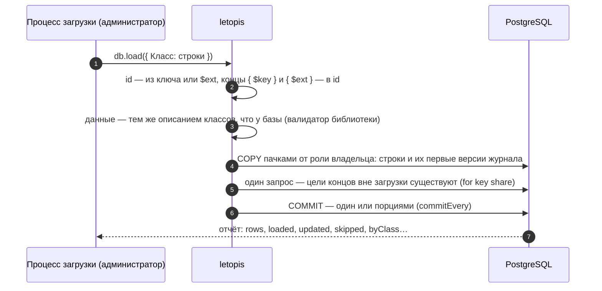

# Массовая загрузка

## Зачем

Когда строк тысячи и миллионы, цепочки по одной — медленно. `db.load` пишет их пачками `COPY`, а правила те же, что у цепочек: данные проверяются тем же описанием классов, что и в базе. Первая заливка в пустую схему ещё быстрее: индексы, ограничения и триггеры строятся разом в конце.

## Пример: вход, концы по ключу, повторы, уже существующее

<Example id="load/01-load-options" />

| Опция | По умолчанию | Что делает |
|---|---|---|
| `duplicates` | `'error'` | повтор id во входных данных: ошибка, `'first'` (оставить первую строку) или `'last'` (последнюю) |
| `existing` | `'error'` | объект уже есть: ошибка, `'skip'` или `'update'` (новая версия, если отличается) |
| `batch` | 10 000 | строк в пачке `COPY` |
| `commitEvery` | одна транзакция | фиксировать порциями примерно по N строк |
| `withHistory` | нет | строки — версии с `$rev`, `$at`, `$op` (перенос архива) |
| `class` | — | класс строк без `$class` |
| `tenant` | арендатор сессии | куда писать |
| `agent` | `'letopis load'` | кто записан исполнителем (`agent`) в версиях журнала |
| `as` | — | от имени пользователя: он автор, и права его |
| `initial` | нет | первая заливка в пустую схему |

`db.load()` возвращает отчёт:

| Поле | Что значит |
|---|---|
| `rows` | строк во входных данных |
| `loaded` | записано объектов: новых и воскрешённых (удалённых раньше) |
| `updated` | новых версий уже существующих объектов (`existing: 'update'`, данные отличались) |
| `skipped` | пропущено существующих: `existing: 'skip'` или `existing: 'update'` без изменений |
| `duplicates` | пропущено повторов id во входных данных (`duplicates: 'first'` или `'last'`) |
| `byClass` | сколько объектов **записано** (`loaded`) по классам: `{ Product: 2 }`; новые версии (`updated`) сюда не входят — поэтому при одних обновлениях `byClass` пуст |
| `external` | сколько разных объектов вне загрузки, на которые ведут концы строк (`{ $key }`, `{ $ext }`, id), загрузчик сверил одним запросом в конце: они должны существовать |
| `portions` | зафиксировано порций: 1 — одна транзакция, больше — при `commitEvery` |
| `ms` | время загрузки в миллисекундах |

Служебные поля строки: `$class` — класс; `$ext` — внешний идентификатор строки (например, id в вашей прежней системе), из него вычисляется id объекта класса без ключа; `$tags` — теги; `$owner` — владелец. В конце, ведущем на другой объект, укажите его ключ (`{ $key: [...] }`) или тот же идентификатор (`{ $ext: '…' }`).

## Что внутри: как идёт загрузка

Строки уходят в базу без построчных триггеров — поэтому загрузка быстрая, а данные заранее проверяет библиотека тем же описанием классов, что и база. Шаблоны `pattern` из описания класса процесс не исполняет: строки таких классов загрузчик сверяет запросом к базе на пачку до записи — нарушение попадает в отчёт с номером строки.

## Первая заливка

<Example id="load/02-initial" />

### Что внутри: первая заливка

<Flow name="initial" />

## Подводные камни

- **`load` — только администраторское подключение:** обход RLS и право стать владельцем схемы, иначе `admin_required`. Загрузить «от имени пользователя» — опция `as`.
- **Входные данные загрузчик читает в память целиком**, даже если передан поток: огромные файлы делите на части.
- **Классы загрузчик не пишет** (`class_not_loadable`) — их записывает `syncModels` или `letopis sync`.
- **Первая заливка — только в пустую схему** (`not_empty`) и одной транзакцией: несовместима с `commitEvery`, `existing` и `as`.
- **Неизвестная опция — отказ** `invalid_data` с похожими именами, ещё до открытия пула администратора.

## Где это в сервисах

[Документы с аудитом](../services/documents) получают архив старых договоров первой заливкой с историей.
