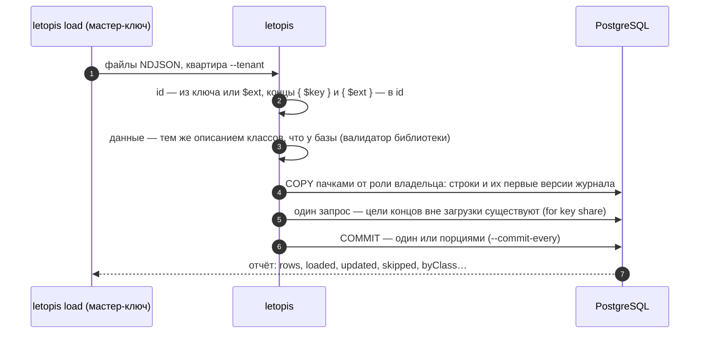

# Массовая загрузка

## Зачем

Когда строк тысячи и миллионы, цепочки по одной — медленно. `letopis load` пишет их пачками `COPY`, а правила те же, что у цепочек: данные проверяются тем же описанием классов, что и в базе. Первая заливка в пустой дом ещё быстрее: индексы, ограничения и триггеры строятся разом в конце.

Загрузка — служебная команда дома. Она работает **мастер-ключом** — строкой подключения администратора PostgreSQL, — а не ключом жильца, и пишет в квартиру, названную явно (`--tenant`). У корня квартиры метода загрузки нет: строки идут мимо построчных триггеров, поэтому загрузку запускает тот, у кого есть мастер-ключ, — из терминала, CI или задачи переезда.

## Пример: файлы, концы по ключу, повторы, история

<Example id="load/01-load-options" />

Вход — файлы NDJSON в UTF-8: в каждой строке объект JSON. Несколько файлов — одна загрузка и, без `--commit-every`, одна транзакция; порядок строк и классов не важен, концы по кругу допустимы.

```sh
npx letopis load shops.ndjson products.ndjson --dsn "$ADMIN_DSN" --schema shop --tenant Ромашка
```

| Флаг | По умолчанию | Что делает |
|---|---|---|
| `--dsn` | — (обязателен) | мастер-ключ |
| `--schema` | — (обязателен) | имя дома из `setup()`: `shop` (или полное `v2.shop`) |
| `--tenant` | — (обязателен) | квартира, куда идут строки: имя или id |
| `--class` | — | класс строк без `$class` |
| `--duplicates` | `error` | повтор id во входе: ошибка, `first` (оставить первую строку) или `last` (последнюю) |
| `--existing` | `error` | объект уже есть: ошибка (`exists`, удалённый раньше — `deleted`), `skip` или `update` (новая версия, если данные отличаются; удалённый — снова живой, с прежним id) |
| `--commit-every` | одна транзакция | фиксировать порциями примерно по N строк: ошибка отменяет только текущую порцию |
| `--with-history` | нет | каждая строка — версия объекта с `$rev`, `$at`, `$op` (перенос архива) |
| `--agent` | `letopis load` | кто записан исполнителем (`agent`) в версиях журнала |
| `--initial` | нет | первая заливка в пустой дом |
| `--log[=уровень]` | нет | события журнала letopis — JSON-строками в stderr |

Команда печатает отчёт одной строкой JSON и выходит с кодом 0:

| Поле | Что значит |
|---|---|
| `rows` | строк во входных данных |
| `loaded` | записано объектов: новых и созданных заново (удалённых раньше) |
| `updated` | новых версий уже существующих объектов (`--existing update`, данные отличались) |
| `skipped` | пропущено существующих: `--existing skip` или `--existing update` без изменений |
| `duplicates` | пропущено повторов id во входных данных (`--duplicates first` или `last`) |
| `byClass` | сколько объектов **записано** (`loaded`) по классам: `{ Product: 2 }`; новые версии (`updated`) сюда не входят — поэтому при одних обновлениях `byClass` пуст |
| `external` | сколько разных объектов вне загрузки, на которые ведут концы строк (`{ $key }`, `{ $ext }`, id), загрузчик сверил одним запросом в конце: они должны существовать |
| `portions` | зафиксировано порций: 1 — одна транзакция, больше — при `--commit-every` |
| `ms` | время загрузки в миллисекундах |

Ошибка — код выхода 1: в stderr её текст (`letopis: exists: загрузка отменена: строка 1 — …`), а следом JSON с первыми 100 нарушениями (`line` — номер строки входа с 1, `code`, `message`, `id`, `class`, `issues`). Ошибка отменяет всю загрузку (с `--commit-every` — текущую порцию). Без файлов или без `--tenant` — подсказка по командам и код 2.

Служебные поля строки: `$class` — класс; `$ext` — внешний ключ строки (например, id в вашей прежней системе), из него вычисляется id объекта класса без ключа; `$tags` — теги; `$owner` — владелец; с `--with-history` — ещё `$rev` (номер версии, с 1 подряд), `$at` (время версии) и `$op` (`create`, `update` или `delete`; по умолчанию первая — `create`, остальные — `update`). В конце, ведущем на другой объект, укажите его id, ключ (`{ $key: [...] }`) или тот же внешний ключ (`{ $ext: '…' }`).

Автор загруженных версий — служебный аккаунт System (загрузку вёл мастер-ключ), исполнитель — `--agent`. Подписки и кэши узнают о новых строках по сигналу базы после фиксации.

## Что внутри: как идёт загрузка



Строки уходят в базу без построчных триггеров — поэтому загрузка быстрая, а данные заранее проверяет библиотека тем же описанием классов, что и база. Шаблоны `pattern` из описания класса процесс не исполняет: строки таких классов загрузчик сверяет запросом к базе на пачку до записи — нарушение попадает в отчёт ошибки с номером строки.

## Первая заливка

<Example id="load/02-initial" />

### Что внутри: первая заливка

<Flow name="initial" />

`--initial` — одна транзакция под исключительной блокировкой таблиц `entity` и `log`: на время заливки дом закрыт и для чтения. Строки системных классов (`Class`, `Account`, `member`, `Resource`, `rule`) сохраняются, индексы, ограничения и триггеры снимаются, строки идут через `COPY … FREEZE`; в конце база возвращает индексы и триггеры, разом проверяет ограничения и собирает статистику (`ANALYZE`). Любая ошибка откатывает всё.

## Подводные камни

- **Загрузка — только мастер-ключом:** роль, которая может стать владельцем схемы (суперпользователь или роль с `SET` на роль-владельца), иначе `admin_required`. Ключом жильца и пропуском консьержа не загрузить — у корня квартиры метода загрузки нет.
- **`--tenant` обязателен:** строки идут в названную квартиру, а не «куда-нибудь». Квартиры с таким именем нет — `target_not_found`.
- **Права при загрузке не проверяются:** мастер-ключ видит весь дом. Проверки данных (поля, концы, ключи, `pattern`) — те же, что у цепочек.
- **Входные данные загрузчик читает в память целиком:** огромные файлы делите на части.
- **Классы загрузчик не пишет** (`class_not_loadable`) — их записывает `setup(…, { models })`, `letopis sync` или `syncModels`.
- **Первая заливка — только в пустой дом** (`not_empty`: кроме строк системных классов — ничего) и одной транзакцией: несовместима с `--commit-every` и `--existing` (кроме `error`).
- **Неизвестный флаг — отказ** до подключения: «неизвестный флаг …», код 1.

## Где это в сервисах

[Документы с аудитом](../services/documents) заливают архив старых договоров при подготовке дома: `letopis load --initial --with-history --agent` — первая заливка с историей.
