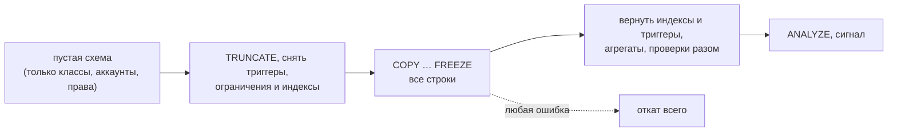

# Массовая загрузка и импорт

Когда строк тысячи и миллионы, цепочки по одной — медленно. `db.load` пишет их пачками `COPY`, а целостность проверяет сама база — те же правила, что у цепочек. Первая заливка в пустую схему ещё быстрее: проверки делаются разом в конце. Переезд с letopis 0.21 — команда `letopis import`.

## Пример: вход, ссылки по ключу, повторы, уже существующее

<Example id="load/01-load-options" />

| Опция | По умолчанию | Что делает |
|---|---|---|
| `duplicates` | `'error'` | повтор id во входе: ошибка, `'first'` или `'last'` |
| `existing` | `'error'` | объект уже есть: ошибка, `'skip'` или `'update'` (новая версия, если отличается) |
| `batch` | 10 000 | строк в пачке `COPY` |
| `commitEvery` | одна транзакция | фиксировать порциями примерно по N строк |
| `withHistory` | нет | строки — версии с `$rev`, `$at`, `$op` (перенос архива) |
| `verify` | нет | в конце — перепроверка проверкой базы |
| `class` | — | класс строк без `$class` |
| `tenant` | арендатор сессии | куда писать |
| `agent` | `'letopis load'` | агент версий в журнале |
| `as` | — | от имени пользователя: он автор, и права его |
| `initial` | нет | первая заливка в пустую схему |

Служебные ключи строки: `$class`, `$ext` (внешний ключ класса без ключа — id из него), `$tags`, `$owner`; в значении ссылки — `{ $key: [...] }` или `{ $ext: '…' }`.

## Первая заливка

<Example id="load/02-initial" />



## Импорт из letopis 0.21

<Example id="load/03-import-021" />

```sh
letopis import --from postgres://…/old --from-schema v1.salon \
  --dsn postgres://…/new --schema v2.salon --tenant "Общие данные" [--keyless Класс] [--rename Старое=Новое]
```

Источник и приёмник — администраторские подключения; приёмник поставлен заранее (`up()`). Флаги: `--update` (обновлять существующие), `--commit-every N`, `--partition p` (раздел источника), `--initial` (первая заливка).

## Подводные камни

- **`load` — только администраторское подключение:** обход RLS и право стать владельцем схемы, иначе `admin_required`. Загрузить «от имени пользователя» — опция `as`.
- **Вход читается в память целиком**, даже поток: делите огромные файлы на части.
- **Классы загрузчик не пишет** (`class_not_loadable`) — их записывает `syncModels` или `letopis sync`.
- **Первая заливка — только в пустую схему** (`not_empty`) и одной транзакцией: несовместима с `commitEvery`, `existing` и `as`.
- **Импорт проверяет всё до первой записи** и называет строки: дубли id, нарушенный ключ. Класс с нарушенным ключом можно перенести без ключа (`--keyless`).

## Где это в сервисах

[Документы с аудитом](../services/documents) получают архив старых договоров первой заливкой с историей.
