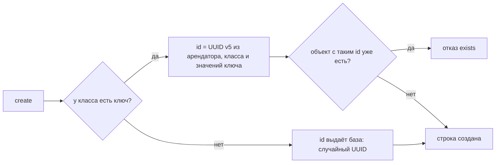

# Модели: какие бывают классы

## Зачем

Прежде чем хранить данные, letopis нужно знать их форму: какие поля у объекта, на что он ссылается, что делает его единственным. Это описание называется **моделью класса**. Модели пишут на [Zod](https://zod.dev) из подпути `letopis/model`, а `syncModels` записывает их в базу.

Дальше база сама проверяет каждую запись по описанию — даже сырой SQL в обход библиотеки.

Главные слова этой главы:

- **hub** (`hub()`) — класс обычных объектов: магазин, товар, клиент;
- **link** (`link()`) — класс-связка: соединяет объекты и хранит данные самой связи. Строка заказа связывает заказ и товар и хранит количество и цену;
- **конец** (end) — именованный указатель на другой объект: у товара конец `Shop` указывает на его магазин. Имя конца называют ролью;
- **ключ** — поля и концы, по которым объект уникален: магазин — по названию, товар — по магазину и артикулу.

## Пример: модель магазина

<Example id="models/01-shop-model" />

## Концы: на что можно ссылаться

| Запись | Что значит |
|---|---|
| `ends: { Shop }` | обязательный конец на магазин, роль `Shop` |
| `one('Category').optional()` | необязательный конец; класс по имени — так класс ссылается сам на себя |
| `one(A, B)` | конец на объект одного из нескольких классов |
| `many(Category, { max: 5 })` | список целей в одном конце |
| `.onDelete('restrict')` | удалить цель нельзя, пока на неё ссылаются (по умолчанию) |
| `.onDelete('cascade')` | удалить и эту строку вместе с целью |
| `.onDelete('unset')` | очистить конец (только для необязательных и списков) |

Объект, на который ведёт конец (цель), проверяет база. Он должен существовать, принадлежать тому же арендатору или общему системному арендатору System и быть нужного класса или его потомка.

## Ключ и id

<Example id="models/02-keys-and-ids" />

### Что внутри: откуда берётся id

Как letopis выбирает id:



Ключ задают опцией `key` — списком полей и концов. В ключ можно включить только обязательные строковые поля и обязательные одиночные концы. Числа, логические значения, вложенные объекты, необязательные поля и множественные концы в него не входят.

## Наследование и алиасы

<Example id="models/03-inheritance-alias" />

## Проверка данных

<Example id="models/04-validation" />

Изменения, которые не могут сломать записанные данные, применяются сразу: новое необязательное поле или конец, метаданные, алиас (второе имя класса). Остальные изменения — **ужесточение**: база проверяет по новой модели все строки класса и его потомков. Если какие-то строки ей не подходят, база отвечает `tightening_conflict` со списком этих строк. Модель не меняется, пока строки не исправят.

## Настройки класса

<Example id="models/05-class-settings" />

| Настройка | Что делает |
|---|---|
| `history: false` | журнал класса не ведётся: нет версий, среза на дату, восстановления и событий подписки |
| `ownerDefault: 'actor'` | владелец новой строки — сам пользователь, а не арендатор |
| `meta` | свободные метаданные для интерфейса: название, иконка, порядок |
| `cache: { ttl }` | чтения этого класса кэшируются без `.cache()` |

`history` — только `true` (по умолчанию: журнал хранит каждую версию) или `false`. Сменить `history` у существующего класса может только тот, у кого есть право `READ` и `DELETE` без условий на все строки класса и его потомков: `false` выключает журнал — аудит этих строк. Настройки и метаданные класса подключение держит в реестре классов: `db.registry.find('Product')?.meta`.

## Строгий режим

Строгий режим ловит ошибки раньше записи: опечатку в имени класса, роли или поля — при компиляции, а без строгих типов — до обращения к базе; правку всех строк без условия, неизвестную опцию и курсор у счёта — тоже до обращения к базе.

**Строгие типы.** `connect({ …, models })` с моделями `letopis/model` или `connect<Models>({ … })` с объявлениями из `letopis types` дают подключение со строгими типами (`TypedDb`). Описания классов библиотека всё равно берёт из базы: модели и объявления нужны только TypeScript.

- шаг от корня — только класс или алиас из моделей и системные классы `Class`, `Account`, `member`, `Resource`, `rule`;
- переход — только по концам: от класса — его роли и классы, связанные с ним концом в любую сторону;
- шаг роли после глагола — только роль записываемого класса: `set()`, у множественного конца ещё `add()` и `remove()`, у необязательного — `unset()`;
- поля фильтра и `or()` — поля и роли класса шага; поле `sum()` и `avg()` — числовое, `min()`, `max()` и `countBy()` — любое поле класса;
- строки ответа типизированы данными и концами класса.

```ts
import { connect, gte, loose } from 'letopis'

const typed = await connect({ dsn: APP, schema: 'v2.shop', token, models: [Shop, Product] })
const pricey = await typed.Shop({ name: 'Ромашка' }).Product({ price: gte(1000) }).rows()   // data.price — number
// @ts-expect-error — класса Prodcut нет
typed.Prodcut()
const name: string = 'Product'                 // имя, известное только во время выполнения
const n = await loose(typed)[name]().count()   // то же подключение без строгих типов
```

`letopis types` выдаёт для каждого класса `<Класс>Data`, `<Класс>Links` и `<Класс>Model`, а в конце — список `Models`: строгие типы работают и без моделей Zod. Имя, известное только во время выполнения, — `loose(db)[имя]()`: проверки во время выполнения те же. `db.as()`, `db.begin()`, `db.batch()` и `entity()` отдают цепочки без строгих типов.

**Отказы во время выполнения** — с моделями и без них:

| Что | Ответ |
|---|---|
| `update()` или `delete({ confirm: true, expect })`, а ни у одного шага нет фильтра, id, `tags()`, `owner()` или `limit()` | `invalid_query` до записи (`write.no_filter`); все строки шага — `{ all: true }` ([запись](../write/), [удаление](../delete/)) |
| `delete({ confirm: true })` без `expect` и без `all: true` | `invalid_query` до записи (`write.confirm_without_expect`): удаляют ровно показанный предпросмотр ([удаление](../delete/#удалить-ровно-то-что-показали)) |
| `restore()` без `expect` и без `all: true` | `invalid_query` до записи (`write.restore_without_expect`): возвращают по надгробиям ([удаление](../delete/#вернуть-удаленное)) |
| неизвестная опция `connect()`, `up()`, `db.load()`, `db.watch()`, `createMcpServer()` | `invalid_data` с похожими именами |
| шаг — не класс, не алиас и не роль | `invalid_class` с похожими именами |
| поле фильтра (и внутри `or()`), `sort('data.…')` или итога, которого нет в описании ни одного класса шага (с потомками, если шаг не `exact()`) | `invalid_query` с похожими именами до запроса, у записи — до записи; сверяется только первый ключ пути |
| `after()` перед `count()`, `sum()`, `avg()`, `min()`, `max()` или `countBy()` | `invalid_query`: курсор листает строки, а счёт идёт по всем объектам шага |
| хаб с зарезервированным именем (`count`, `sort`, `set`, `sql` и другие имена методов) | `invalid_class` от `hub()`, `syncModels` и базы |

Поле сверяется только по первому ключу пути: опечатку внутри поля-объекта (`{ specs: { colr } }`) не ловит ничто — условие просто ничего не найдёт.

## Служебные функции пакета

Кроме `connect` и цепочек пакет отдаёт помощников: вычислить id объекта по ключу без запроса к базе, захэшировать пароль, проверить данные тем же валидатором, что и база, сгенерировать типы TypeScript, узнать имена, которые нельзя дать классу, снять строгие типы с подключения (`loose`).

<Example id="models/06-exports" />

## Подводные камни

- **id в `create` не передают.** Его вычисляет (или выдаёт) база; поле `id` в данных — лишнее поле, отказ `invalid_data`.
- **Регистр в ключе важен.** `Anna@Mail.ru` и `anna@mail.ru` — разные id. Нормализуйте значения или задайте формат поля в модели.
- **Класс без ключа не защищён от повтора.** Повтор записи после сбоя сети создаст второй объект — давайте классу ключ.
- **Ключ и класс правкой не меняются** (`immutable_key`). Объект с другим ключом или классом — новый объект: создать его, перевести на него концы других строк и удалить прежний ([«Ключ и класс неизменны»](../write/#ключ-и-класс-неизменны)).
- **Класс с историей строк не удалить.** Стереть версии одного объекта нельзя, поэтому класс, у которого они есть, не удаляется: класс, который придётся удалять, заводят с `history: false`.
- **`refine` база не исполняет.** `syncModels` возвращает такие правила в `lost` — проверяйте их в приложении.
- **Преобразования Zod не поддерживаются.** `.trim()`, `.toLowerCase()`, `.transform()`, `z.preprocess()`, `.pipe()` при записи никто не исполняет — значение записалось бы как есть, поэтому `syncModels` отклоняет такую модель: `invalid_class` с ключом `model.transform_unsupported` (в `err.detail.rules` — путь и вид). Приводите значение в коде до записи (`name.trim()`), а в модели оставляйте проверки: `.regex()`, `.min()`, `.refine()`.
- **Сортировка по полю данных — с префиксом:** `sort('data.name')`, а не `sort('name')`.
- **Классы, записанные `syncModels`, принадлежат арендатору текущей сессии.** Другие арендаторы их не видят: в приложении с несколькими арендаторами вызывайте `syncModels` для каждого — на подключении с его сессией (`svc.as(пользователь, { tenant })`), иначе второй арендатор получит `invalid_class`. Общие для всех классы лежат в системном арендаторе System — их ставят готовые наборы установки (`up({ seeds })`).

## Где это в сервисах

Салон записи берёт готовую модель салона (`seeds: ['booking']`): мастера, услуги, слоты, брони. Кошелёк, helpdesk и документы описывают свои модели на `letopis/model` и записывают их при запуске. ER-схемы каждого сервиса — на его странице.
