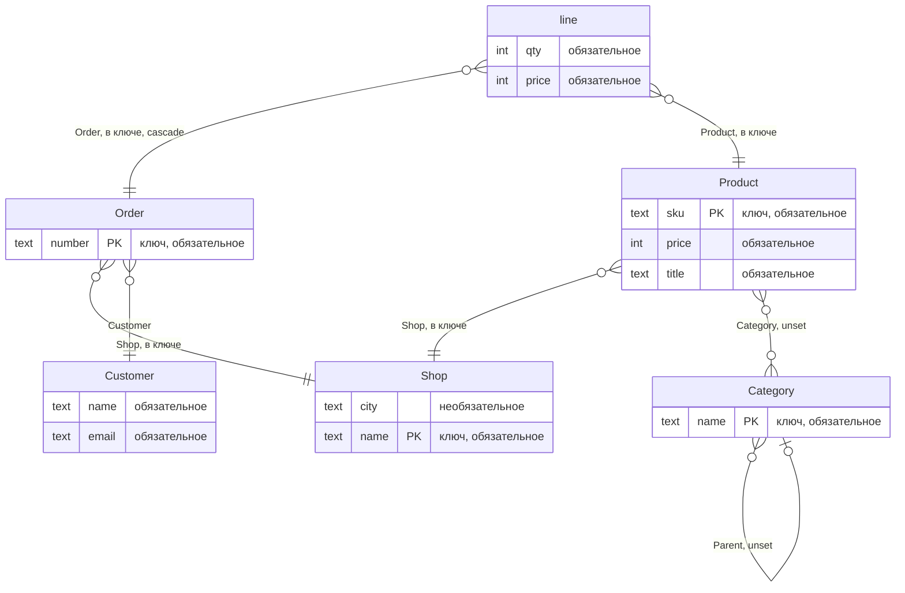

# Модели: какие бывают классы

## Зачем

Прежде чем хранить данные, letopis нужно знать их форму: какие поля у объекта, на что он ссылается, что делает его единственным. Это описание называется **моделью класса**. Модели пишут на [Zod](https://zod.dev) из подпути `letopis/model`.

Модель — часть дома. Её записывает мастер-ключом `setup(ADMIN_DSN, 'shop', { models })` или команда `letopis sync`, и классы дома общие для всех квартир: описание одно, а строки у каждой квартиры свои. Дальше база сама проверяет каждую запись по описанию — даже сырой SQL в обход библиотеки.

Главные слова этой главы:

- **hub** (`hub()`) — класс обычных объектов: магазин, товар, клиент;
- **link** (`link()`) — класс-связка: соединяет объекты и хранит данные самой связи. Строка заказа связывает заказ и товар и хранит количество и цену;
- **конец** (end) — именованный указатель на другой объект: у товара конец `Shop` указывает на его магазин. Имя конца называют ролью;
- **ключ** — поля и концы, по которым объект уникален: магазин — по названию, товар — по магазину и артикулу.

## Пример: модель магазина

<Example id="models/01-shop-model" />

Схема этой модели — как её записали в базу (`PK` — поле ключа, подпись связи — роль конца, входит ли он в ключ и что будет при удалении цели):



## Концы: на что можно ссылаться

| Запись | Что значит |
|---|---|
| `ends: { Shop }` | обязательный конец на магазин, роль `Shop` |
| `one('Category').optional()` | необязательный конец; класс по имени — так класс ссылается сам на себя |
| `one(A, B)` | конец на объект одного из нескольких классов |
| `many(Category, { max: 5 })` | список целей в одном конце |
| `.onDelete('restrict')` | удалить цель нельзя, пока на неё ссылаются (по умолчанию) |
| `.onDelete('cascade')` | удалить и эту строку вместе с целью |
| `.onDelete('unset')` | очистить конец (только для необязательных и списков) |

Объект, на который ведёт конец (цель), проверяет база. Он должен существовать, лежать в той же квартире или в общей квартире дома System и быть нужного класса или его потомка.

## Ключ и id

<Example id="models/02-keys-and-ids" />

Ключ задают опцией `key` — списком полей и концов. В ключ можно включить только обязательные строковые поля и обязательные одиночные концы. Числа, логические значения, вложенные объекты, необязательные поля и множественные концы в него не входят. id квартиры входит в формулу, поэтому один и тот же ключ в двух квартирах даёт разные id.

Как letopis выбирает id по шагам — [схема](../models/inside#что-внутри-откуда-берется-id).

## Наследование и алиасы

<Example id="models/03-inheritance-alias" />

Объекты абстрактного класса (`abstract: true`) не создаются: `create()` у него — отказ `invalid_class` (ключ `sql-write.class_abstract`, «класс … абстрактный»), ничего не записано. Создают объекты его потомков, а читают — через шаг абстрактного класса: он находит строки всех потомков.

## Проверка данных

<Example id="models/04-validation" />

Изменения, которые не могут сломать записанные данные, применяются сразу: новое необязательное поле или конец, метаданные, алиас (второе имя класса). Остальные изменения — **ужесточение**: база проверяет по новой модели все строки класса и его потомков во всех квартирах дома. Если какие-то строки ей не подходят, база отвечает `tightening_conflict` со списком этих строк. Модель не меняется, пока строки не исправят.

Новое обязательное поле поэтому вводят в три шага:

1. Добавить поле необязательным и записать модель (`setup()` или `letopis sync --apply`) — это безопасное изменение. Код приложения с этого момента пишет поле во все новые объекты.
2. Заполнить старые строки в каждой квартире — консьержем, отдельным скриптом:

   ```ts
   import { connect, exists } from 'letopis'

   const db = await connect(process.env.LETOPIS_PASS!)        // пропуск консьержа
   for (const t of await db.tenants()) {
     const flat = await db.in(t.id)                            // консьерж в квартире
     await flat.Order({ priority: exists(false) }).update({ priority: 'normal' }).rows()   // только строки без поля
   }
   await db.close()
   ```

3. Сделать поле обязательным и записать модель. Если кто-то успел записать строку без поля, придёт `tightening_conflict` — повторите шаг 2.

## Настройки класса

<Example id="models/05-class-settings" />

| Настройка | Что делает |
|---|---|
| `history: false` | журнал класса не ведётся: нет версий, среза на дату, восстановления и событий подписки; `versions()` у такого класса — пустой список без ошибки (letopis один раз предупредит в консоли) |
| `ownerDefault: 'actor'` | владелец новой строки — сам жилец, который её создал, а не квартира |
| `meta` | свободные метаданные для интерфейса: название, иконка, порядок |
| `cache: { ttl }` | чтения этого класса кэшируются без `.cache()` |

`history` — только `true` (по умолчанию: журнал хранит каждую версию) или `false`. Сменить `history` у существующего класса может только тот, у кого есть право `READ` и `DELETE` без условий на все строки класса и его потомков: `false` выключает журнал — аудит этих строк. Настройки и метаданные класса корень квартиры держит в реестре классов: `me.registry.find('Product')?.meta`.

## Служебные функции пакета

Пакет отдаёт и помощников: вычислить id объекта по ключу без запроса к базе, проверить данные тем же валидатором, что и база, сгенерировать типы TypeScript. Список и пример — на странице [«Модели: что внутри»](../models/inside#служебные-функции-пакета).

## Что внутри и подводные камни

Кто записывает классы и чьи они, откуда берётся id, что ловит строгий режим и на чём здесь спотыкаются — на странице [«Модели: что внутри»](../models/inside).

## Где это в сервисах

[Салон записи](../services/salon) берёт готовую модель салона: `setup()` с сидом `booking` (мастера, услуги, слоты, брони). [Кошелёк](../services/wallet), [helpdesk](../services/helpdesk) и [документы](../services/documents) описывают свои модели на `letopis/model` и записывают их в дом `setup(ADMIN_DSN, имя, { models })` при подготовке. ER-схема каждого сервиса — на его странице.
