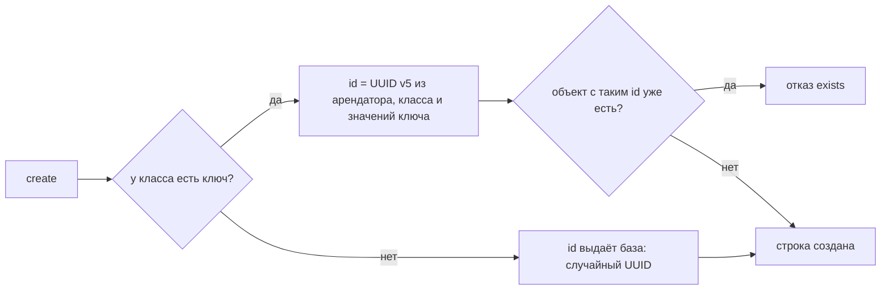

# Модели: какие бывают классы

Прежде чем хранить данные, letopis нужно знать их форму: какие поля у объекта, на что он ссылается, что делает его единственным. Это описание называется **моделью класса**. Модели пишут на [Zod](https://zod.dev) из подпути `letopis/model`, а `syncModels` записывает их в базу.

Дальше база сама проверяет каждую запись по описанию — даже сырой SQL в обход библиотеки.

Главные слова этой главы:

- **hub** — объект: магазин, товар, клиент;
- **link** — связь со своими данными: строка заказа (сколько и почём), навык мастера;
- **конец** (end) — ссылка на другой объект: товар → магазин;
- **ключ** — что делает объект единственным: магазин — по названию, товар — по магазину и артикулу.

## Пример: модель магазина

<Example id="models/01-shop-model" />

## Концы: на что можно ссылаться

| Запись | Что значит |
|---|---|
| `ends: { Shop }` | обязательная ссылка на магазин, роль `Shop` |
| `one('Category').optional()` | необязательная ссылка; класс по имени — так класс ссылается сам на себя |
| `one(A, B)` | ссылка на объект одного из нескольких классов |
| `many(Category, { max: 5 })` | список ссылок в одном конце |
| `.onDelete('restrict')` | удалить цель нельзя, пока на неё ссылаются (по умолчанию) |
| `.onDelete('cascade')` | удалить и эту строку вместе с целью |
| `.onDelete('unset')` | снять ссылку (только для необязательных и списков) |

Цели проверяет база: цель существует, принадлежит тому же арендатору (или System) и относится к нужному классу или его потомку.

## Ключ и id

<Example id="models/02-keys-and-ids" />

Как letopis выбирает id:

Ключ — это обязательные строковые поля и обязательные одиночные концы. Числа, логические значения, необязательные поля и списки в ключ не входят.

## Наследование и алиасы

<Example id="models/03-inheritance-alias" />

## Проверка данных

<Example id="models/04-validation" />

Безопасные изменения модели применяются сразу: новое необязательное поле или конец, метаданные, алиас. Всё остальное — **ужесточение**: база проверяет все строки класса и его потомков, и если какие-то ему не подходят, отвечает `tightening_conflict` со списком. Модель не меняется, пока строки не исправлены.

## Настройки класса

<Example id="models/05-class-settings" />

| Настройка | Что делает |
|---|---|
| `history: false` | журнал класса не ведётся: нет версий, среза на дату, восстановления и событий подписки |
| `history: { all, daily, … }` | политика хранения истории по ярусам (глава про историю) |
| `ownerDefault: 'actor'` | владелец новой строки — сам пользователь, а не арендатор |
| `meta` | свободные метаданные для интерфейса: название, иконка, порядок |
| `cache: { ttl }` | чтения этого класса кэшируются без `.cache()` |
| `derivedBy`, `aggregate` | производные данные: проекторы и агрегаты (своя глава) |

## Подводные камни

- **id в `create` не передают.** Его вычисляет (или выдаёт) база; поле `id` в данных — лишнее поле, отказ `invalid_data`.
- **Регистр в ключе важен.** `Anna@Mail.ru` и `anna@mail.ru` — разные id. Нормализуйте значения или задайте формат поля в модели.
- **Класс без ключа не защищён от повтора.** Повтор записи после сбоя сети создаст второй объект — давайте классу ключ.
- **Ключ правкой не меняется** (`immutable_key`) — для этого `rekey`, он создаёт объект с новым id и переводит ссылки.
- **`refine` и `transform` база не исполняет.** `syncModels` возвращает их в `lost` — проверяйте такие правила в приложении.
- **Сортировка по полю данных — с префиксом:** `sort('data.name')`, а не `sort('name')`.
- **Классы пишутся в арендатора сессии.** Другие арендаторы их не видят; общие для всех классы лежат в System и ставятся сидом установки.

## Где это в сервисах

Салон записи берёт готовую модель салона (`seeds: ['booking']`): мастера, услуги, слоты, брони. Кошелёк, helpdesk и документы описывают свои модели на `letopis/model` и записывают их при запуске. ER-схемы каждого сервиса — на его странице.
