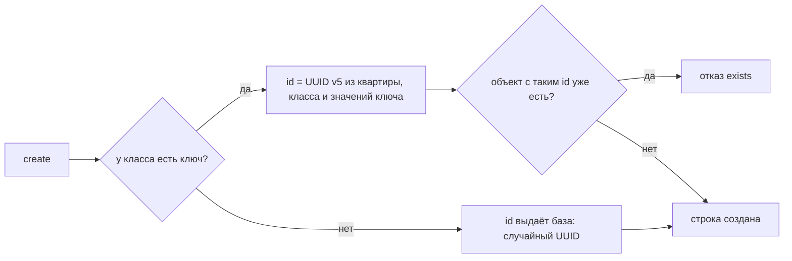

# Модели: что внутри

Продолжение страницы [«Модели: какие бывают классы»](../models/). Там — как описать класс: поля, концы, ключ, проверки. Здесь — кто записывает классы и чьи они, откуда берётся id, что ловит строгий режим и подводные камни.

## Модели дома и классы квартиры

Классы записывают два пути, и они отличаются тем, кто увидит класс:

| Путь | Кто пишет | Чьи классы |
|---|---|---|
| `setup(ADMIN_DSN, имя, { models })` | мастер-ключ, при построении дома и при каждом запуске установки | дома: общие для всех квартир; отчёт — `r.models` |
| `npx letopis sync ./models.js --dsn … --schema …` | мастер-ключ, из командной строки: без флага — сухой прогон, `--apply` — записать, `--check` — код 1, если модели расходятся с домом | дома, как у `setup` |
| `syncModels(me, модели, { apply: true })` | жилец в корне своей квартиры, если матрица разрешает ему запись `Class` (у `owner` такое право есть) | только этой квартиры: другие квартиры их не видят |

- `setup()` и `letopis sync` записывают только переданные классы и ничего лишнего не удаляют. Новые классы создаются, изменённые меняются; повторный вызов с той же моделью ничего не меняет.
- `syncModels(me, модели)` без `apply` ничего не пишет: это сухой прогон, он отвечает, что будет создано и изменено (шаг 1 примера). Класс, который уже есть у дома, `syncModels` в квартире не трогает: он в `skipped`.
- Отчёт у всех путей один: `{ applied, created, updated, unchanged, skipped, lost }`; в `lost` — ограничения модели, которые база выразить не может ([ниже](../models/#проверка-данных)).
- Корень квартиры, открытый до записи модели, узнаёт о новых классах по сигналу базы, а сразу — после `me.refresh()` (шаг 2 примера).

Команды `letopis sync` и `letopis types` — в главе [«Эксплуатация»](../ops/).

## Что внутри: откуда берётся id

Как letopis выбирает id:



## Строгий режим

Строгий режим ловит ошибки раньше записи: опечатку в имени класса, роли или поля — при компиляции, а без строгих типов — до обращения к базе; правку всех строк без условия, неизвестную опцию и курсор у счёта — тоже до обращения к базе.

**Строгие типы.** Консьерж с моделями — `connect(pass, { models })` с моделями `letopis/model` или `connect<Models>(pass)` с объявлениями, которые выдаёт команда `npx letopis types` ([«Эксплуатация»](../ops/)), — отдаёт корни квартир (`open`, `resume`, `accept`, `in`, `as`) со строгими типами цепочек. Описания классов библиотека всё равно берёт из базы: модели и объявления нужны только TypeScript.

- шаг от корня — только класс или алиас из моделей и системные классы `Class`, `Account`, `member`, `Resource`, `rule`;
- переход — только по концам: от класса — его роли и классы, связанные с ним концом в любую сторону;
- шаг роли после глагола — только роль записываемого класса: `set()`, у множественного конца ещё `add()` и `remove()`, у необязательного — `unset()`;
- поля фильтра и `or()` — поля и роли класса шага; поле `sum()` и `avg()` — числовое, `min()`, `max()` и `countBy()` — любое поле класса;
- строки ответа типизированы данными и концами класса.

Фрагмент: `pass` — пропуск консьержа ([«Установка и подключение»](../install/)), `Shop` и `Product` — модели из [примера выше](../models/#пример-модель-магазина).

```ts
import { connect, gte, loose } from 'letopis'

const db = await connect(pass, { models: [Shop, Product] })    // консьерж с моделями — вместо connect(pass)
const me = await db.open({ email: 'anna@romashka.ru', password: 'Ромашка-2026!' })
const pricey = await me.Shop({ name: 'Ромашка' }).Product({ price: gte(1000) }).rows()   // data.price — number
// @ts-expect-error — класса Prodcut нет
me.Prodcut()
const cls: string = 'Product'                  // имя, известное только во время выполнения
const n = await loose(me)[cls]().count()       // тот же корень без строгих типов
```

`npx letopis types` выдаёт для каждого класса `<Класс>Data`, `<Класс>Links` и `<Класс>Model`, а в конце — список `Models`: строгие типы работают и без моделей Zod (`connect<Models>(pass)`). Консьерж с моделями — тот же консьерж, только с типами: в приложении его открывают вместо `connect(pass)`, а не вторым подключением. Имя, известное только во время выполнения, — `loose(me)[имя]()`: проверки во время выполнения те же. `me.begin()`, `me.batch()` и `entity()` отдают цепочки без строгих типов.

**Отказы во время выполнения** — с моделями и без них:

| Что | Ответ |
|---|---|
| `update()` или `delete({ confirm: true, expect })`, а ни у одного шага нет фильтра, id, `tags()`, `owner()` или `limit()` | `invalid_query` до записи (`write.no_filter`); все строки шага — `{ all: true }` ([запись](../write/), [удаление](../delete/)) |
| `delete({ confirm: true })` без `expect` и без `all: true` | `invalid_query` до записи (`write.confirm_without_expect`): удаляют ровно показанный предпросмотр ([удаление](../delete/#удалить-ровно-то-что-показали)) |
| `restore()` без `expect` и без `all: true` | `invalid_query` до записи (`write.restore_without_expect`): возвращают по надгробиям ([удаление](../delete/#вернуть-удаленное)) |
| неизвестная опция `setup()`, `connect()`, `me.watch()`, `createMcpServer()` | `invalid_data` с похожими именами |
| шаг — не класс, не алиас и не роль | `invalid_class` с похожими именами; в доме ещё нет ни одного класса — ключ `api.unknown_step_no_classes` с подсказкой записать модели |
| поле фильтра (и внутри `or()`), `sort('data.…')` или итога, которого нет в описании ни одного класса шага (с потомками, если шаг не `exact()`) | `invalid_query` с похожими именами до запроса, у записи — до записи; сверяется только первый ключ пути |
| `after()` перед `count()`, `sum()`, `avg()`, `min()`, `max()` или `countBy()` | `invalid_query`: курсор листает строки, а счёт идёт по всем объектам шага |
| класс `hub` с зарезервированным именем (`count`, `sort`, `set`, `sql`, `invite`, `keys` и другие имена методов) | `invalid_class` от `hub()`, `syncModels` и базы |

Поле сверяется только по первому ключу пути: опечатку внутри поля-объекта (`{ specs: { colr } }`) не ловит ничто — условие просто ничего не найдёт.

## Служебные функции пакета

Кроме `setup`, `connect` и цепочек пакет отдаёт помощников: вычислить id объекта по ключу без запроса к базе, проверить данные тем же валидатором, что и база, сгенерировать типы TypeScript, узнать имена, которые нельзя дать классу, снять строгие типы с корня квартиры (`loose`).

<Example id="models/06-exports" />

## Подводные камни

- **id в `create` не передают.** Его вычисляет (или выдаёт) база; поле `id` в данных — лишнее поле, отказ `invalid_data`.
- **Регистр в ключе важен.** `Anna@Mail.ru` и `anna@mail.ru` — разные id. Нормализуйте значения или задайте формат поля в модели.
- **Класс без ключа не защищён от повтора.** Повтор записи после сбоя сети создаст второй объект — давайте классу ключ.
- **Ключ и класс правкой не меняются** (`immutable_key`). Объект с другим ключом или классом — новый объект: создать его, перевести на него концы других строк и удалить прежний ([«Ключ и класс неизменны»](../write/inside#ключ-и-класс-неизменны)).
- **Класс с историей строк не удалить.** Стереть версии одного объекта нельзя, поэтому класс, у которого они есть, не удаляется: класс, который придётся удалять, заводят с `history: false`.
- **`refine` база не исполняет.** `setup()` и `syncModels` возвращают такие правила в `lost` — проверяйте их в приложении.
- **Преобразования Zod не поддерживаются.** `.trim()`, `.toLowerCase()`, `.transform()`, `z.preprocess()`, `.pipe()` при записи никто не исполняет — значение записалось бы как есть, поэтому `setup()` и `syncModels` отклоняют такую модель: `invalid_class` с ключом `model.transform_unsupported` (в `err.detail.rules` — путь и вид). Приводите значение в коде до записи (`name.trim()`), а в модели оставляйте проверки: `.regex()`, `.min()`, `.refine()`.
- **Сортировка по полю данных — с префиксом:** `sort('data.name')`, а не `sort('name')`.
- **Класс, записанный `syncModels` в корне квартиры, — только её.** Другие квартиры его не видят: шаг по нему у них — `invalid_class`. Общие для всех квартир классы — модели дома: `setup(ADMIN_DSN, имя, { models })` или `letopis sync`.
- **Корень, открытый до записи модели, видит новый класс не сразу.** Он перечитывает классы по сигналу базы; если класс нужен тут же — `me.refresh()`.
