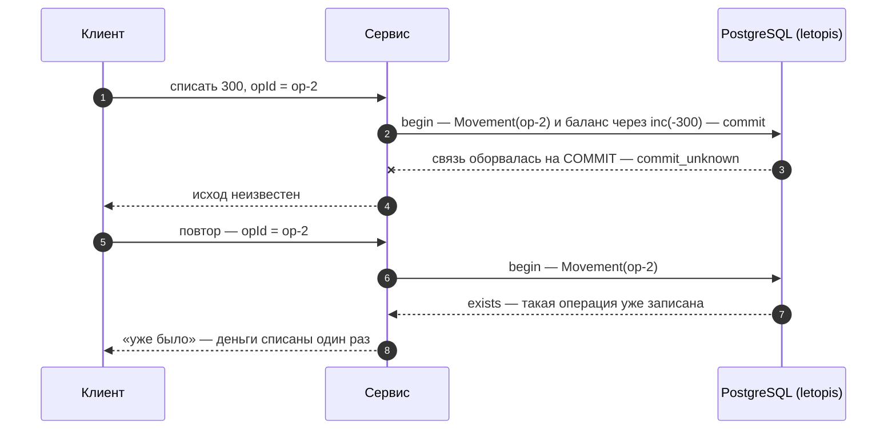

# Транзакции и деньги

## Зачем

Деньги и счётчики нельзя потерять или списать дважды — ни при одновременных запросах, ни при сбое сети. Для этого есть транзакции, блокировки и ключ операции.

Каждый терминал цепочки (`rows`, `first`, `count`…) — **своя транзакция** уровня `read committed`. Если такая транзакция сорвалась из-за взаимной блокировки (deadlock), конфликта сериализации или конфликта записи в журнал, библиотека сама повторяет её целиком. Когда несколько записей должны пройти вместе, берут явную транзакцию `db.begin()`.

## Пример: всё или ничего

<Example id="money/01-transactions" />

## Что внутри: транзакция

<Flow name="tx" />

## Деньги без двойного списания

<Example id="money/02-wallet-opid" />

### Что внутри: ключ операции

<Flow name="opid" />

Как это защищает от повтора:

## Обрыв связи на COMMIT

Тот же сценарий на живой базе: между приложением и PostgreSQL стоит TCP-прокси, который рвёт связь на `COMMIT` — один раз до того, как база его получила, другой раз после. В обоих случаях приложение видит одно и то же — `commit_unknown`, а правду говорит повтор операции с тем же ключом.

<Example id="money/03-commit-unknown" />

## Одновременные списания

Два списания с одной карты в одну и ту же секунду — обычное дело: двойной клик, две вкладки, повтор запроса. Пример ставит такую гонку на живой базе — без пауз: вторая транзакция стартует, пока первая не зафиксирована, а порядок задаёт сама база.

<Example id="money/04-race" />

## Одна открытая запись на объект: выдача, бронь, смена

Правило «у вещи одна открытая выдача» легко написать так: `tr.Item({ id, status: 'free' }).update({ status: 'out' })`, а пустой ответ считать отказом. **При одновременных запросах это не работает.** `update()` сначала отбирает строки по фильтру, потом пишет по их id и условие фильтра заново не проверяет: вторая выдача нашла вещь свободной, пока первая не зафиксировалась, дождалась строки и записала поверх. Обе получили по строке ответа. Проверка длины ответа ловит только «строки не было вовсе», а не гонку.

<Example id="money/05-one-open" />

Что выбрать:

- **Ключ** — когда правило звучит «не больше одной … на …». Заведите отдельный класс (связь) с ключом только из конца объекта: `link('OpenLoan', { … }, { ends: { Item: one(Item), Member: one(Member) }, key: ['Item'] })`. id такой строки вычисляется из вещи, и вторая открытая выдача — `exists` при любом числе процессов и даже в сыром SQL. Возврат — удаление этой строки; следующая выдача создаётся тем же ключом и продолжает её историю.
- **`forUpdate()` в `db.begin()`** — когда решение зависит от прочитанного: `tr.Item({ id, status: 'free' }).forUpdate().first()`, пусто — отказ, иначе `update` и `commit()`. Вторая транзакция ждёт строку, перечитывает её и, раз вещь уже не свободна, получает пустой ответ. Защищает, только если так читают все, кто выдаёт.
- **`{ rev }`** — без транзакции, одна строка: прочли версию — пишите `update(patch, { rev })`; проигравший получает `conflict`, ничего не записано.

## Подводные камни

- **Ключ операции обязателен.** Без ключа (например, `[кошелёк, opId]`) повтор после сбоя запишет операцию второй раз.
- **`commit_unknown` библиотека не повторяет:** транзакция могла и зафиксироваться. Исход выясняют повтором той же операции с тем же ключом.
- **Внутри `db.begin()` повторов нет.** На взаимную блокировку (`40P01`) повторите весь блок; переводы между кошельками блокируйте в порядке id — тогда взаимных блокировок не будет.
- **`lock()` защищает, только если его берут все,** кто правит эти данные.
- **`forUpdate()` — только внутри транзакции,** иначе `tx_required`.
- **Фильтр `update()` — не «сравнить и записать».** При параллельной записи условие фильтра не перепроверяется: два одновременных `update()` с одним условием пройдут оба. Уникальность — ключом, решение по прочитанному — `forUpdate()` или `{ rev }` (пример выше).
- **Деньги — целым числом копеек** и только через `inc`: `upsert` и запись «прочитал — посчитал — записал» теряют параллельные приращения.

## Где это в сервисах

В салоне бронь пишется внутри `db.begin()` под блокировкой мастера. Кошелёк проводит каждую операцию с ключом `[кошелёк, opId]` и приращением баланса.
