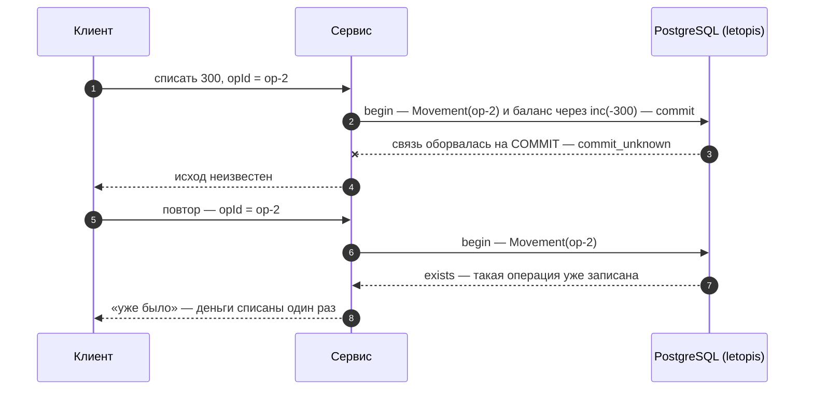

# Транзакции и деньги

## Зачем

Деньги и счётчики нельзя потерять или списать дважды — ни при одновременных запросах, ни при сбое сети. Для этого есть транзакции, блокировки и ключ операции.

Каждый терминал цепочки (`rows`, `first`, `count`…) — **своя транзакция** уровня `read committed`. Если такая транзакция сорвалась из-за взаимной блокировки (deadlock), конфликта сериализации или конфликта записи в журнал, библиотека сама повторяет её целиком. Когда несколько записей должны пройти вместе, берут явную транзакцию `db.begin()`.

## Пример: всё или ничего

<Example id="money/01-transactions" />

## Что внутри: транзакция

<Flow name="tx" />

## Деньги без двойного списания

<Example id="money/02-wallet-opid" />

### Что внутри: ключ операции

<Flow name="opid" />

Как это защищает от повтора:



## Обрыв связи на COMMIT

Тот же сценарий на живой базе: между приложением и PostgreSQL стоит TCP-прокси, который рвёт связь на `COMMIT` — один раз до того, как база его получила, другой раз после. В обоих случаях приложение видит одно и то же — `commit_unknown`, а правду говорит повтор операции с тем же ключом.

<Example id="money/03-commit-unknown" />

## Одновременные списания

Два списания с одной карты в одну и ту же секунду — обычное дело: двойной клик, две вкладки, повтор запроса. Пример ставит такую гонку на живой базе — без пауз: вторая транзакция стартует, пока первая не зафиксирована, а порядок задаёт сама база.

<Example id="money/04-race" />

## Одна открытая запись на объект: выдача, бронь, смена

Правило «у вещи одна открытая выдача» можно держать тремя способами — и они защищают от разного. `tr.Item({ id, status: 'free' }).update({ status: 'out' })` с пустым ответом как отказом защищает **одну строку**: если у шага фильтр по данным (не только id), `update()` блокирует найденные строки, читает их заново тем же запросом и правит только те, что всё ещё подходят. Вторая из двух одновременных выдач дождётся первой, увидит `status: 'out'` и получит пустой ответ (шаг 2 примера). Но правило, которое зависит от других строк или от решения кода («есть ли у вещи открытая выдача», «сколько вещей на руках у участника»), фильтр одной строки не удержит.

<Example id="money/05-one-open" />

Что выбрать:

- **Ключ** — когда правило звучит «не больше одной … на …». Заведите отдельный класс (связь) с ключом только из конца объекта: `link('OpenLoan', { … }, { ends: { Item: one(Item), Member: one(Member) }, key: ['Item'] })`. id такой строки вычисляется из вещи, и вторая открытая выдача — `exists` при любом числе процессов и даже в сыром SQL. Возврат — удаление этой строки; следующая выдача создаётся тем же ключом и продолжает её историю.
- **`forUpdate()` в `db.begin()`** — «прочитал — проверил — записал», когда решение принимает код приложения: `tr.Item({ id, status: 'free' }).forUpdate().first()`, пусто — отказ, иначе проверки, `update` и `commit()`. Вторая транзакция ждёт строку, перечитывает её и, раз вещь уже не свободна, получает пустой ответ. Защищает, только если так читают все, кто выдаёт.
- **`{ rev }`** — без транзакции, одна строка: прочли версию — пишите `update(patch, { rev })`; проигравший получает `conflict`, ничего не записано.
- **Фильтр `update()` по данным** — смена состояния одной строки («свободна → выдана»): при гонке правка достанется одному, остальные получат пустой ответ.

### Участника удалили, вещь выдали другому и приняли, участника вернули

С ключом по вещи все выдачи одной вещи — версии **одной** строки. Если участника удалили (его выдача ушла каскадом), а вещь тем временем выдали другому и приняли, последнее надгробие выдачи — уже чужая закрытая выдача. `restore()` без `expect` вернул бы именно её: вещь числилась бы у того, кто её вернул, а в истории появилась бы выдача, которой не было. Возвращайте выдачи участника по надгробиям его удаления — `restore({ expect: [надгробие] })`:

```ts
const [tomb] = await db.Member(member).withDeleted().rows()                 // причина удаления участника
const loans = (await db.OpenLoan().withDeleted().versions())               // или сохранённый ответ delete
  .filter((v) => v.op === 'delete' && v.reason === tomb.reason)
await db.Member(member).restore().rows()
for (const loan of loans) {
  try {
    await db.OpenLoan(loan.id).restore({ expect: [loan] }).rows()           // «выдача вернулась»
  } catch (e) {
    if (!(e instanceof LetopisError) || e.code !== 'conflict') throw e
    report('не вернулась: после удаления вещь выдавали другому')           // write.restore_stale, ничего не изменено
  }
}
```

Шаги 7–9 примера выше проводят этот сценарий на базе: `restore({ expect })` отвечает `conflict`, выдача не оживает, у участника на руках — 0. Как устроены `expect`, переход `withDeleted()` по шагам и остальные отказы восстановления — [«Вернуть удалённое»](../delete/#вернуть-только-то-что-ушло-этим-удалением). Причину удаления делайте своей для каждого удаления (с номером операции): по ней находят его надгробия. Журнал всего класса (`db.OpenLoan().withDeleted().versions()`) на большом классе дорог — тогда сохраните ответ `delete`: в нём `id` и `rev` каждого надгробия.

## Подводные камни

- **Ключ операции обязателен.** Без ключа (например, `[кошелёк, opId]`) повтор после сбоя запишет операцию второй раз.
- **`commit_unknown` библиотека не повторяет:** транзакция могла и зафиксироваться. Исход выясняют повтором той же операции с тем же ключом.
- **Внутри `db.begin()` повторов нет.** На взаимную блокировку (`40P01`) повторите весь блок; переводы между кошельками блокируйте в порядке id — тогда взаимных блокировок не будет.
- **`lock()` защищает, только если его берут все,** кто правит эти данные.
- **`forUpdate()` — только внутри транзакции,** иначе `tx_required`.
- **Фильтр `update()` защищает одну строку, а не правило.** Фильтр по данным перепроверяется под блокировкой: из двух одновременных `update()` с одним условием правку получит один, второй — пустой ответ. Правило «одна открытая … на …» держит ключ, решение «прочитал — проверил — записал» — `forUpdate()` или `{ rev }` (пример выше).
- **Возврат удалённого участника — с `expect`.** С ключом по вещи все выдачи вещи — одна строка: `restore()` без `expect` может оживить чужую закрытую выдачу ([рецепт выше](#участника-удалили-вещь-выдали-другому-и-приняли-участника-вернули)).
- **Деньги — целым числом копеек** и только через `inc`: `upsert` и запись «прочитал — посчитал — записал» теряют параллельные приращения.

## Где это в сервисах

В салоне бронь пишется внутри `db.begin()` под блокировкой мастера. Кошелёк проводит каждую операцию с ключом `[кошелёк, opId]` и приращением баланса.
