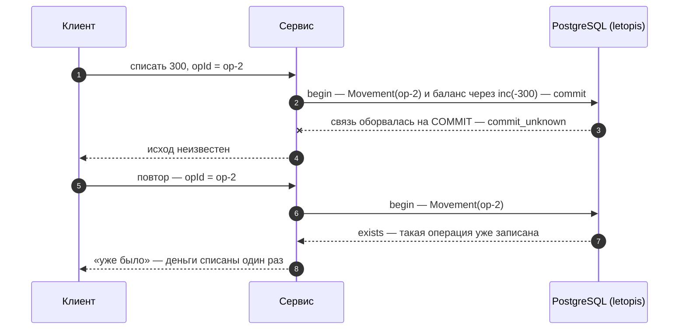

# Транзакции и деньги

## Зачем

Деньги и счётчики нельзя потерять или списать дважды — ни при одновременных запросах, ни при сбое сети. Для этого есть транзакции, блокировки и ключ операции.

Каждый терминал цепочки (`rows`, `first`, `count`…) — **своя транзакция** уровня `read committed`. Если такая транзакция сорвалась из-за взаимной блокировки (deadlock), конфликта сериализации или конфликта записи в журнал, библиотека сама повторяет её целиком. Когда несколько записей должны пройти вместе, берут явную транзакцию `db.begin()`.

## Пример: всё или ничего

<Example id="money/01-transactions" />

## Что внутри: транзакция

<Flow name="tx" />

## Деньги без двойного списания

<Example id="money/02-wallet-opid" />

### Что внутри: ключ операции

<Flow name="opid" />

Как это защищает от повтора:

## Обрыв связи на COMMIT

Тот же сценарий на живой базе: между приложением и PostgreSQL стоит TCP-прокси, который рвёт связь на `COMMIT` — один раз до того, как база его получила, другой раз после. В обоих случаях приложение видит одно и то же — `commit_unknown`, а правду говорит повтор операции с тем же ключом.

<Example id="money/03-commit-unknown" />

## Подводные камни

- **Ключ операции обязателен.** Без ключа (например, `[кошелёк, opId]`) повтор после сбоя запишет операцию второй раз.
- **`commit_unknown` библиотека не повторяет:** транзакция могла и зафиксироваться. Исход выясняют повтором той же операции с тем же ключом.
- **Внутри `db.begin()` повторов нет.** На взаимную блокировку (`40P01`) повторите весь блок; переводы между кошельками блокируйте в порядке id — тогда взаимных блокировок не будет.
- **`lock()` защищает, только если его берут все,** кто правит эти данные.
- **`forUpdate()` — только внутри транзакции,** иначе `tx_required`.
- **Деньги — целым числом копеек** и только через `inc`: `upsert` и запись «прочитал — посчитал — записал» теряют параллельные приращения.

## Где это в сервисах

В салоне бронь пишется внутри `db.begin()` под блокировкой мастера. Кошелёк проводит каждую операцию с ключом `[кошелёк, opId]` и приращением баланса.
