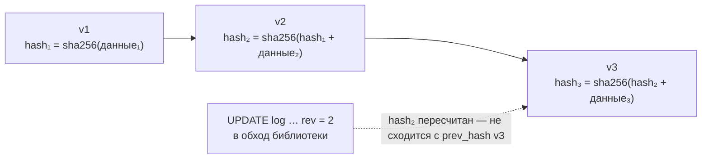

# Эксплуатация

Что делать с работающей установкой: проверять целостность журнала, прореживать историю, сбрасывать тестовые установки, описывать модель для людей и ИИ-агентов, следить за запросами и пользоваться командной строкой.

## Проверка целостности

<Example id="ops/01-verify-corrupt" />

| Находка `verify()` | Что случилось |
|---|---|
| `хэш версии не совпадает с prev_hash следующей` | версию правили в обход библиотеки |
| `разрыв: нет версий N…M` | версии удалены (не прореживанием по политике) |
| `строка entity не совпадает с последней версией журнала` | строку или последнюю версию правили руками |
| с `{ data: true }`: данные против описания класса, id против ключа, ссылки, владельцы, агрегаты | данные записаны в обход проверок |

## Сброс тестовой установки

<Example id="ops/02-reset" />

## Описание модели, сырой SQL, кэш, сигналы

<Example id="ops/03-describe-sql-cache" />

Телеметрия запросов — опции `connect({ onQuery, slowMs })`: событие на каждый запрос цепочки (режим, классы, строки, время, `slow`). Её показывают панели «Под капотом» во всех сервисах-примерах.

## Командная строка

<Example id="ops/04-cli" />

| Команда | Что делает |
|---|---|
| `letopis sync модуль [--apply]` | сравнить модели модуля с базой; `--apply` — записать |
| `letopis types [--out файл]` | интерфейсы TypeScript по модели из базы |
| `letopis load файлы… [--existing …] [--initial]` | загрузка NDJSON (администраторское подключение) |
| `letopis describe [--format text]` | модель для людей и ИИ-агентов |
| `letopis verify [--data]` | проверка журнала; код 1 при находках |
| `letopis maintain [--batches N]` | обслуживание: прореживание, истёкшие сессии и коды |
| `letopis import …` | импорт из 0.21 ([глава 13](../load/)) |
| `letopis mcp [--write]` | сервер MCP по stdio ([глава 15](../mcp/)) |

Запуск из репозитория без сборки: `node --import tsx lib/src/cli.ts <команда> …`.

## Подводные камни

- **`verify`, `maintain`, `reset` — администраторские:** права `letopis.*` у администратора System или администраторское подключение.
- **`reset` включается только флагом `up({ allowReset: true })`**, подтверждается полным именем схемы; уровень `tenant` стирает и членства с правами — пользователи арендатора теряют доступ.
- **`db.sql` — под той же сессией и RLS**, а запись через него сбрасывает весь кэш результатов.
- **В режиме сигналов `none` и при `listen: false` (за PgBouncer) кэш выключен.** Кэш только по сроку годности включает опция подключения `cache: { ttlOnly: true }`; подписка в этом случае опрашивает журнал.

## Где это в сервисах

[Документы с аудитом](../services/documents): «Проверить целостность», «Испортить запись журнала» и обратно, прореживание по ярусам кнопкой.
