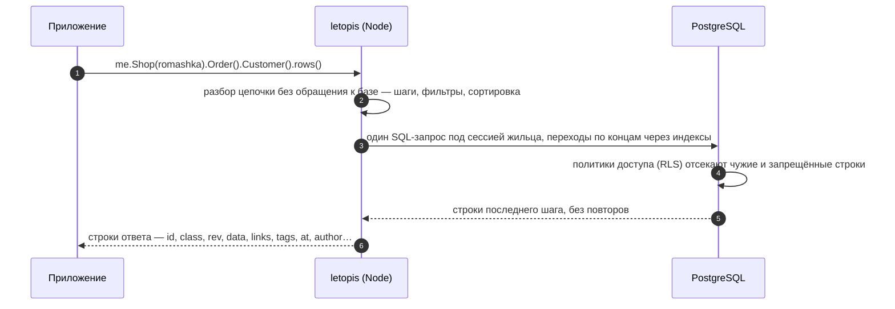

# Чтение: цепочки, фильтры, страницы

## Зачем

Читать приходится не таблицы, а связанные объекты: магазин, его заказы, покупателей этих заказов. Цепочка описывает такой путь, а библиотека превращает его в один запрос с проверкой прав.

Читать в letopis — значит идти по концам. Цепочка начинается от корня квартиры жильца (`me`, [«Установка и подключение»](../install/)) с класса, а каждый следующий шаг — переход к связанным объектам:

```ts
await me.Shop(romashka).Order().Customer().sort('data.name').rows()
//  магазин  →  его заказы  →  покупатели этих заказов, по имени
```

Шаг переходит по концам в обе стороны: назад — к объектам, которые ссылаются на текущие (магазин → его заказы); вперёд — к объектам, на которые ссылаются текущие (заказ → покупатель). Шаг того же класса ведёт к дочерним узлам дерева (категория → подкатегории). Шаг называют именем класса, его алиасом или ролью конца.

**Порядок строк задаёт только `sort()`.** Без него в запросе нет `ORDER BY`, и PostgreSQL отдаёт строки в том порядке, в каком их нашёл план, — он меняется от вызова к вызову (после записи, `VACUUM`, смены плана). Это касается `rows()`, `first()` (без `sort()` — любая подходящая строка) и страниц: `limit()` и `offset()` без `sort()` листают наугад. Нужен порядок — `sort()`. Без `sort()` порядок есть только у ответа глагола (по `sort()` до глагола, без него — по id), у `versions()` (по id и номеру версии) и у инструмента MCP `letopis_query` (по id, [«ИИ-агенты: MCP»](../mcp/)).

## Пример: шаги и переходы

<Example id="read/01-steps" />

## Что внутри: один запрос на всю цепочку

<Flow name="read" />



Права проверяет база при каждом чтении: строки чужой квартиры или без права на чтение в ответ просто не попадают ([«Квартиры и права»](../access/)).

## Фильтры

<Example id="read/02-filters" />

<!-- ops -->
| TypeScript | Смысл |
|---|---|
| `ne(v)` | Не равно. Подходят и строки без поля или с `null`; `ne(null)` — строки, где у поля есть значение |
| `gt(v)` | Больше. Сравнение — по типу поля из описания класса (числа — как числа, даты — как даты), поле без описания — как текст; строки без поля не подходят |
| `gte(v)` | Больше или равно; сравнение — как у `gt` |
| `lt(v)` | Меньше; сравнение — как у `gt` |
| `lte(v)` | Меньше или равно; сравнение — как у `gt` |
| `between(a, b)` | От `a` до `b` включительно; сравнение — как у `gt`. Если `a` больше `b`, не подходит ничего |
| `inList([v, …])` | Одно из значений списка. Пустой список не находит ничего; `null` в списке не находит строк без значения — для них `isNull` |
| `like(s)` | Текст по шаблону с учётом регистра: `%` — любые символы, в том числе ни одного, `_` — ровно один; буквальные `%` и `_` — с обратной косой чертой |
| `ilike(s)` | Как `like`, но без учёта регистра |
| `starts(s)` | Текст начинается с `s`, с учётом регистра. Это `like(s + '%')`: `%` и `_` внутри `s` не экранируются и работают как в шаблоне |
| `ends(s)` | Текст заканчивается на `s`, с учётом регистра. Это `like('%' + s)`: `%` и `_` внутри `s` не экранируются и работают как в шаблоне |
| `has(v)` | Поле-массив содержит элемент `v`. Тип важен: `has(5)` найдёт число 5, но не строку `'5'` |
| `hasAny([v, …])` | Поле-массив содержит хотя бы один элемент списка. Находит только строковые элементы; пустой список не находит ничего |
| `hasAll([v, …])` | Поле-массив содержит все элементы списка, в любом порядке. Тип важен, как у `has`; пустой список подходит любой строке, даже без поля |
| `exists(b = true)` | Поле есть в данных (`true`, по умолчанию) или его нет (`false`); значение не важно — поле с `null` тоже есть |
| `isNull()` | В поле `null` или поля нет совсем; отличить одно от другого помогает `exists` |
| `not(x)` | Отрицание: `x` — оператор (`not(gte(1000))` — меньше 1000 или поля нет) или простое значение — тогда это «не равно», как `ne` |
| `or(f1, f2, …)` | Хотя бы один из фильтров. Ставится вместо всего фильтра шага, а не значением поля; условия внутри одного фильтра соединяются через «и» |
<!-- /ops -->

### Фильтр, собранный во время выполнения

Если имя поля известно только во время выполнения (пришло из строки запроса, из настроек), собирайте фильтр в объект типа `FieldFilter` — его экспортирует `letopis`. С `Record<string, unknown>` TypeScript цепочку не примет:

```ts
import { gte, type FieldFilter, type Room } from 'letopis'

// me — корень квартиры жильца, field и min — из запроса: ?field=price&min=1000
async function productsFrom(me: Room, field: string, min: number) {
  const filter: Record<string, FieldFilter> = { [field]: gte(min) }
  return me.Product(filter).sort('data.price').rows()
}
```

Имя поля проверяет библиотека: поле, которого нет в описании класса, — `invalid_query` с похожими именами ещё до запроса.

## Сортировка, страницы и итоги

<Example id="read/03-sort-pages-aggregates" />

### Курсор страницы по HTTP

Курсор `cursorOf(строка, поле)` — обычный объект JSON: `{ v, id, rev }` (значение поля сортировки, id и номер версии последней строки страницы; у курсора `paths()` ещё `path`). Клиенту его отдают как есть или строкой, а на следующем запросе разбирают обратно и передают в `after()` — с тем же полем `sort()`:

```ts
import { cursorOf, type Cursor, type Room } from 'letopis'

// GET /products?after=<курсор> — страница товаров по цене; me — корень квартиры жильца из сессии запроса
async function productsPage(me: Room, after?: string) {
  let q = me.Product().sort('data.price').limit(20)
  if (after) q = q.after(JSON.parse(Buffer.from(after, 'base64url').toString()) as Cursor)
  const rows = await q.rows()
  const last = rows.at(-1)
  const next = rows.length === 20 && last
    ? Buffer.from(JSON.stringify(cursorOf(last, 'data.price'))).toString('base64url')
    : null                                                 // страниц больше нет
  return { rows, next }
}
```

Курсор от клиента — чужие данные, но подделать им ничего нельзя: библиотека проверяет его форму и тип значения по полю сортировки ещё до запроса, неверный курсор — `invalid_query`, а права на строки проверяет база, как при любом чтении. Строку, которая не разбирается как JSON (`JSON.parse` бросит `SyntaxError`), отклоните сами — ответом 400.

## Деревья и пути

<Example id="read/04-deep-paths" />

## Подводные камни

- **Без `sort()` порядок строк не определён** — у `rows()`, `first()` и страниц (`limit`, `offset`). Номер строки на экране, «первый» объект, страница — только с `sort()`. При равных значениях поля `sort()` досортировывает по id, поэтому страницы устойчивы. Инструмент MCP `letopis_query` без `sort` отдаёт строки по id — у цепочки такого умолчания нет.
- **Сортировка по полю — с префиксом `data.`:** `sort('data.price')`. Без префикса доступны только `at`, `rev` и `id`.
- **Порядок — вторым аргументом, поле — одно:** `sort('data.price')` — по возрастанию, `sort('data.price', 'desc')` — по убыванию. Повторный `sort()` заменяет прежний: `sort('data.title').sort('data.price')` сортирует только по цене.
- **`sort()` относится к последнему шагу цепочки.** `me.Shop(shop).sort('data.name').Product()` сортирует товары и предупреждает в консоли (`api.sort_not_last`): ставьте `sort()` в конец.
- **Фильтр не приводит типы.** `{ price: 900 }` не найдёт цену `"900"` — храните числа числами. Операторы (`gt`, `between`…) приводят своё значение к типу поля из модели.
- **`count()` считает каждый объект один раз**, даже если цепочка пришла к нему разными путями (покупатель с двумя заказами). Посчитать все пути — `count({ paths: true })`.
- **Итог (`sum` и подобные) по пустому набору строк — `null`**, а `countBy` — `{}`.
- **Курсор страницы — только для того же поля, что и `sort`.** Значение курсора проверяется по типу поля ещё до запроса: неверное — `invalid_query`.
- **`after()` — только для строк.** Перед `count()` и итогами (`sum`, `avg`, `min`, `max`, `countBy`) он даёт `invalid_query` ещё до запроса: курсор листает строки, а счёт идёт по всем объектам шага.
- **`limit` перед `countBy` ограничивает группы**, а не строки: `limit(1).countBy(…)` — самое частое значение.
- **`hasAny` находит только строковые элементы.** `hasAny([5])` не найдёт массив `[5, 7]`, хотя `has(5)` и `hasAll([5])` его находят; TypeScript числа в `hasAny` принимает молча. Для чисел — `has(v)` или `or()` из нескольких `has`.
- **`deep()` — только на шаге того же класса**, от родителя к детям: `me.Category(tea).Category().deep()` — подкатегории любой глубины (дети ссылаются на родителя концом `Parent`). Переход к другому классу с `deep()` — `invalid_query` (ключ `query.deep_hop`) ещё до запроса.
- **Невидимый по правам узел дерева скрывает и своё поддерево** при обходе `deep()`.

## Где это в сервисах

Расписание [салона записи](../services/salon) — цепочка «салон → мастера → слоты дня», каталог — фильтр по категории и цене с постраничным выводом. Отчёт дня — суммы и группировки (`sum`, `countBy`). Очередь [helpdesk](../services/helpdesk) — заявки, отсортированные по сроку, страницами по курсору.
