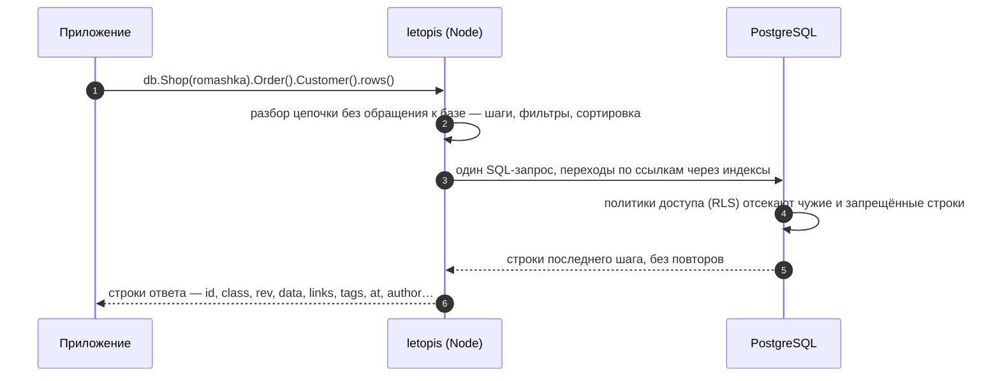

# Чтение: цепочки, фильтры, страницы

## Зачем

Читать приходится не таблицы, а связанные объекты: магазин, его заказы, покупателей этих заказов. Цепочка описывает такой путь, а библиотека превращает его в один запрос с проверкой прав.

Читать в letopis — значит идти по ссылкам. Цепочка начинается с класса, а каждый следующий шаг — переход к связанным объектам:

```ts
await db.Shop(romashka).Order().Customer().rows()
//  магазин  →  его заказы  →  покупатели этих заказов
```

Шаг переходит по ссылкам в обе стороны: назад — к объектам, которые ссылаются на текущие (магазин → его заказы); вперёд — к объектам, на которые ссылаются текущие (заказ → покупатель). Шаг того же класса ведёт к дочерним узлам дерева (категория → подкатегории). Шаг называют именем класса, его алиасом или именем ссылки (ролью конца).

## Пример: шаги и переходы

<Example id="read/01-steps" />

## Что внутри: один запрос на всю цепочку

<Flow name="read" />



Права проверяет база при каждом чтении: строки чужого арендатора или без права на чтение в ответ просто не попадают.

## Фильтры

<Example id="read/02-filters" />

| Оператор | Условие |
|---|---|
| `ne`, `gt`, `gte`, `lt`, `lte` | ≠, >, ≥, <, ≤ |
| `between(a, b)`, `inList([…])` | от a до b включительно; значение из списка |
| `like`, `ilike`, `starts`, `ends` | шаблон с `%` и `_`; без учёта регистра; начинается с; заканчивается на |
| `has`, `hasAny`, `hasAll` | массив содержит значение; хотя бы одно; все |
| `exists(true \| false)`, `isNull()` | поле есть или нет; поле `null` или отсутствует |
| `not(v)` | отрицание; скаляр — «не равно» |
| `or(f1, f2, …)` | любой из фильтров |

## Сортировка, страницы и итоги

<Example id="read/03-sort-pages-aggregates" />

## Деревья и пути

<Example id="read/04-deep-paths" />

## Подводные камни

- **Сортировка по полю — с префиксом `data.`:** `sort('data.price')`. Без префикса доступны только `at`, `rev` и `id`.
- **Фильтр не приводит типы.** `{ price: 900 }` не найдёт цену `"900"` — храните числа числами. Операторы (`gt`, `between`…) приводят своё значение к типу поля из модели.
- **`count()` считает каждый объект один раз**, даже если цепочка пришла к нему разными путями (покупатель с двумя заказами). Посчитать все пути — `count({ paths: true })`.
- **Итог (`sum` и подобные) по пустому набору строк — `null`**, а `countBy` — `{}`.
- **Курсор страницы — только для того же поля, что и `sort`.** Значение курсора проверяется по типу поля ещё до запроса: неверное — `invalid_query`.
- **`limit` перед `countBy` ограничивает группы**, а не строки: `limit(1).countBy(…)` — самое частое значение.
- **Невидимый по правам узел дерева скрывает и своё поддерево** при обходе `deep()`.

## Где это в сервисах

Расписание салона — цепочка «салон → мастера → слоты дня», каталог — фильтр по категории и цене с постраничным выводом. Отчёт дня — суммы и группировки (`sum`, `countBy`). Очередь helpdesk — заявки, отсортированные по сроку, страницами по курсору.
