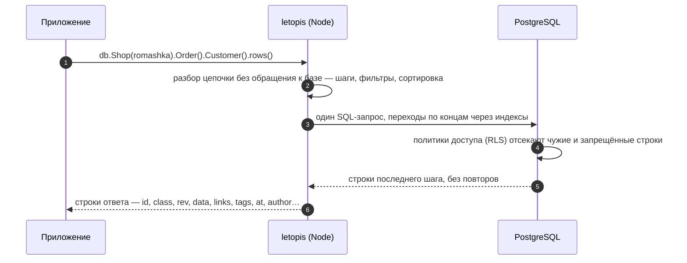

# Чтение: цепочки, фильтры, страницы

## Зачем

Читать приходится не таблицы, а связанные объекты: магазин, его заказы, покупателей этих заказов. Цепочка описывает такой путь, а библиотека превращает его в один запрос с проверкой прав.

Читать в letopis — значит идти по концам. Цепочка начинается с класса, а каждый следующий шаг — переход к связанным объектам:

```ts
await db.Shop(romashka).Order().Customer().rows()
//  магазин  →  его заказы  →  покупатели этих заказов
```

Шаг переходит по концам в обе стороны: назад — к объектам, которые ссылаются на текущие (магазин → его заказы); вперёд — к объектам, на которые ссылаются текущие (заказ → покупатель). Шаг того же класса ведёт к дочерним узлам дерева (категория → подкатегории). Шаг называют именем класса, его алиасом или ролью конца.

## Пример: шаги и переходы

<Example id="read/01-steps" />

## Что внутри: один запрос на всю цепочку

<Flow name="read" />



Права проверяет база при каждом чтении: строки чужого арендатора или без права на чтение в ответ просто не попадают.

## Фильтры

<Example id="read/02-filters" />

<!-- ops -->
| TypeScript | Смысл |
|---|---|
| `ne(v)` | Не равно. Подходят и строки без поля или с `null`; `ne(null)` — строки, где у поля есть значение |
| `gt(v)` | Больше. Сравнение — по типу поля из описания класса (числа — как числа, даты — как даты), поле без описания — как текст; строки без поля не подходят |
| `gte(v)` | Больше или равно; сравнение — как у `gt` |
| `lt(v)` | Меньше; сравнение — как у `gt` |
| `lte(v)` | Меньше или равно; сравнение — как у `gt` |
| `between(a, b)` | От `a` до `b` включительно; сравнение — как у `gt`. Если `a` больше `b`, не подходит ничего |
| `inList([v, …])` | Одно из значений списка. Пустой список не находит ничего; `null` в списке не находит строк без значения — для них `isNull` |
| `like(s)` | Текст по шаблону с учётом регистра: `%` — любые символы, в том числе ни одного, `_` — ровно один; буквальные `%` и `_` — с обратной косой чертой |
| `ilike(s)` | Как `like`, но без учёта регистра |
| `starts(s)` | Текст начинается с `s`, с учётом регистра. Это `like(s + '%')`: `%` и `_` внутри `s` не экранируются и работают как в шаблоне |
| `ends(s)` | Текст заканчивается на `s`, с учётом регистра. Это `like('%' + s)`: `%` и `_` внутри `s` не экранируются и работают как в шаблоне |
| `has(v)` | Поле-массив содержит элемент `v`. Тип важен: `has(5)` найдёт число 5, но не строку `'5'` |
| `hasAny([v, …])` | Поле-массив содержит хотя бы один элемент списка. Находит только строковые элементы; пустой список не находит ничего |
| `hasAll([v, …])` | Поле-массив содержит все элементы списка, в любом порядке. Тип важен, как у `has`; пустой список подходит любой строке, даже без поля |
| `exists(b = true)` | Поле есть в данных (`true`, по умолчанию) или его нет (`false`); значение не важно — поле с `null` тоже есть |
| `isNull()` | В поле `null` или поля нет совсем; отличить одно от другого помогает `exists` |
| `not(x)` | Отрицание: `x` — оператор (`not(gte(1000))` — меньше 1000 или поля нет) или простое значение — тогда это «не равно», как `ne` |
| `or(f1, f2, …)` | Хотя бы один из фильтров. Ставится вместо всего фильтра шага, а не значением поля; условия внутри одного фильтра соединяются через «и» |
<!-- /ops -->

## Сортировка, страницы и итоги

<Example id="read/03-sort-pages-aggregates" />

## Деревья и пути

<Example id="read/04-deep-paths" />

## Подводные камни

- **Сортировка по полю — с префиксом `data.`:** `sort('data.price')`. Без префикса доступны только `at`, `rev` и `id`.
- **Фильтр не приводит типы.** `{ price: 900 }` не найдёт цену `"900"` — храните числа числами. Операторы (`gt`, `between`…) приводят своё значение к типу поля из модели.
- **`count()` считает каждый объект один раз**, даже если цепочка пришла к нему разными путями (покупатель с двумя заказами). Посчитать все пути — `count({ paths: true })`.
- **Итог (`sum` и подобные) по пустому набору строк — `null`**, а `countBy` — `{}`.
- **Курсор страницы — только для того же поля, что и `sort`.** Значение курсора проверяется по типу поля ещё до запроса: неверное — `invalid_query`.
- **`after()` — только для строк.** Перед `count()` и итогами (`sum`, `avg`, `min`, `max`, `countBy`) он даёт `invalid_query` ещё до запроса: курсор листает строки, а счёт идёт по всем объектам шага.
- **`limit` перед `countBy` ограничивает группы**, а не строки: `limit(1).countBy(…)` — самое частое значение.
- **Невидимый по правам узел дерева скрывает и своё поддерево** при обходе `deep()`.

## Где это в сервисах

Расписание салона — цепочка «салон → мастера → слоты дня», каталог — фильтр по категории и цене с постраничным выводом. Отчёт дня — суммы и группировки (`sum`, `countBy`). Очередь helpdesk — заявки, отсортированные по сроку, страницами по курсору.
