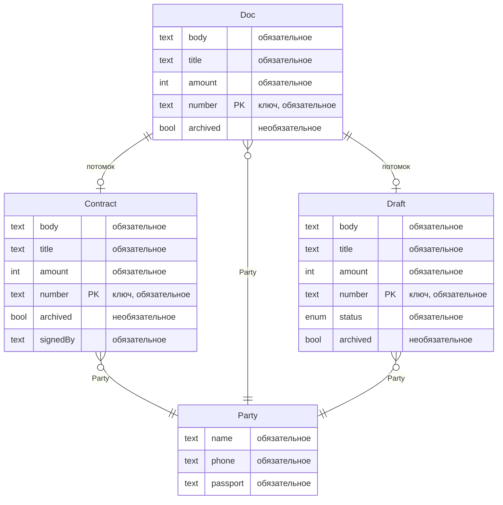
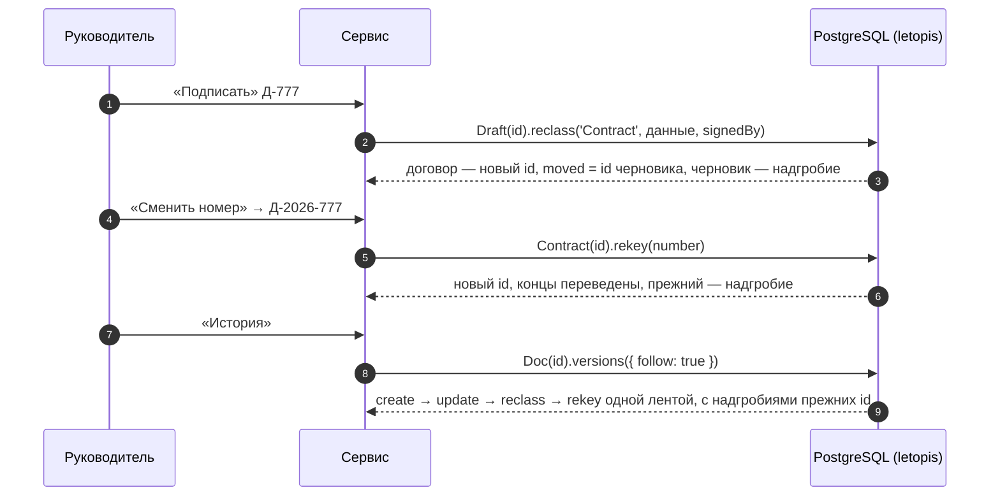

# Документы с аудитом

Договоры с полной историей. Каждая правка — новая версия с автором и причиной. Любую версию можно открыть и сравнить с другой, а целостность всей истории — проверить. Интерфейс собран из блоков shadcnblocks (`login1`, `navbar1`, `stats8`, `changelog1` — лента версий), сервер — Express и JSON API.

**Запустить в Docker:** `docker compose -f services/compose.yaml up --build documents` → http://127.0.0.1:8084 (юрист `lawyer@pravo.ru` / `Pravo-2026!`, руководитель `head@pravo.ru` / `Head-2026!`). Демо с нуля — `FRESH=1` в `environment` сервиса `documents` в `services/compose.yaml`: схема пересоздаётся.

**Запустить руками:** база — `docker compose -f services/compose.yaml up -d pg`, затем `services/documents/run-local.sh`; шаги для PowerShell — в `services/documents/README.md`.

## Что из letopis здесь работает

| Возможность letopis | Где в сервисе |
|---|---|
| `reason` у глаголов | причина правки обязательна и видна в ленте версий |
| `update(…, { rev })` | правка по устаревшей версии — 409 «Документ уже изменили — обновите и повторите» |
| `reclass` | «Подписать»: черновик становится договором и получает новый id — в id входит класс (v5-id) |
| `rekey` | «Сменить номер»: номер входит в ключ, поэтому id меняется; концы других строк, ведущие на документ, переводятся на новый id |
| `versions({ follow: true })` | лента версий через подписание и смену номера (блок `changelog1`) |
| `diff({ from, to, follow })` | «Сравнить» две версии: поле, было, стало |
| `blame()` | «Кто менял»: последний автор каждого поля |
| `asOf(момент)` | «Машина времени»: ползунок по версиям |
| `delete()` без `confirm`, `withDeleted`, `restore`, `purge({ confirm })` | «Удалить…»: сначала предпросмотр, затем удаление; «Корзина»: «Восстановить» или «Стереть навсегда» |
| `anonymize` | «Обезличить контрагента»: паспорт и телефон затираются |
| `trimHistory` | «Обрезать историю до сегодня» у архивного договора |
| политика `history` и `maintain({ now })` | «Обслуживание» → «Хранение истории»: прореживание «как будто сейчас — через N дней» |
| `verify({ data: true })` | «Проверить целостность», «Испортить запись журнала», «Вернуть как было» |
| `load(…, { initial: true, withHistory: true })` | архив старых договоров залит первой заливкой с историей |
| `watch()` → SSE, `onQuery`, журнал `log`, `flushSignals()` | живое обновление: вкладка сама перечитывает данные после изменений. Панель «Под капотом» показывает, что сделало действие: цепочки letopis и запросы к базе, версии, которые оно записало (класс, номер, `rev`, `op`, причина, изменённые поля), и сигналы об изменении классов, в которые оно записало (только имя класса) |

## Модель

Классы принадлежат арендатору — фирме «Право и Дело». При каждом запуске сервиса их записывает `syncModels` — через администраторское подключение letopis (`allowBypassRls`: построчные правила доступа базы, RLS, на него не действуют), а не через сессию пользователя. Сессия руководителя у этого подключения — токен `createTenant` только на эту запись: после неё сессия гаснет, подключение закрывается. Установку обслуживает другое администраторское подключение — без сессии: `verify` и `maintain` пускает его роль, архив `load` пишет в арендатора фирмы, названного явно.

Обрезке истории (`trimHistory`) нужна живая сессия с правами READ и DELETE на документ — роль подключения её не заменяет. Поэтому сессия руководителя выдаётся на каждую обрезку: `svc.auth.sessionFor`, подключение с её токеном, `auth.switch` в фирму, после обрезки — `revoke`. Постоянного токена у сервиса нет: подключение с постоянным токеном после простоя дольше срока сессии получает `no_session`.

Будь классы в System, правка модели не дошла бы до работающей установки: классы System `syncModels` пропускает — их меняет только установка, а сид установки не трогает класс, который уже есть.

Схема построена по реестру классов (`db.describe()`):

<!-- er:documents -->

<!-- /er -->

`Draft` и `Contract` наследуют `Doc`: его поля, ключ (номер), конец на контрагента и политику хранения истории. У контрагента ключа нет, поэтому при загрузке архива его id вычисляется из `$ext` — внешнего ключа (id записи в прежней системе). По `$ext` на контрагента ссылаются и архивные договоры.

## Подписание и смена номера

## Подводные камни

- **Подписание и смена номера меняют id.** Поэтому другим системам документ лучше хранить по номеру или переходить по `moved`: надгробие прежнего id указывает на новый. «Машина времени» запрашивает документ по id той версии, на которую указывает ползунок: до подписания и смены номера у документа был другой id.
- **`purge()` без `{ confirm: true }` — только предпросмотр**, как и `delete()`: ничего не стирается.
- **`anonymize` затирает поля новой версией.** Прежние версии с паспортом остаются в журнале. Стереть и их можно `trimHistory`, а у удалённого объекта — `purge`.
- **Первая заливка — только в пустую схему** (описания классов, аккаунты и права не в счёт), поэтому архив заливается раньше первых черновиков.
- **`maintain({ now })` работает только в установке с `allowReset`.** Сервис-пример ставит установку с этим флагом, чтобы показать прореживание так, будто прошло N дней; в рабочей установке флаг не включают.
- **Правку журнала в обход библиотеки находит `verify`.** «Испортить запись журнала» прямым `UPDATE` меняет сумму в одной из промежуточных версий документа, «Вернуть как было» возвращает запись байт в байт.
