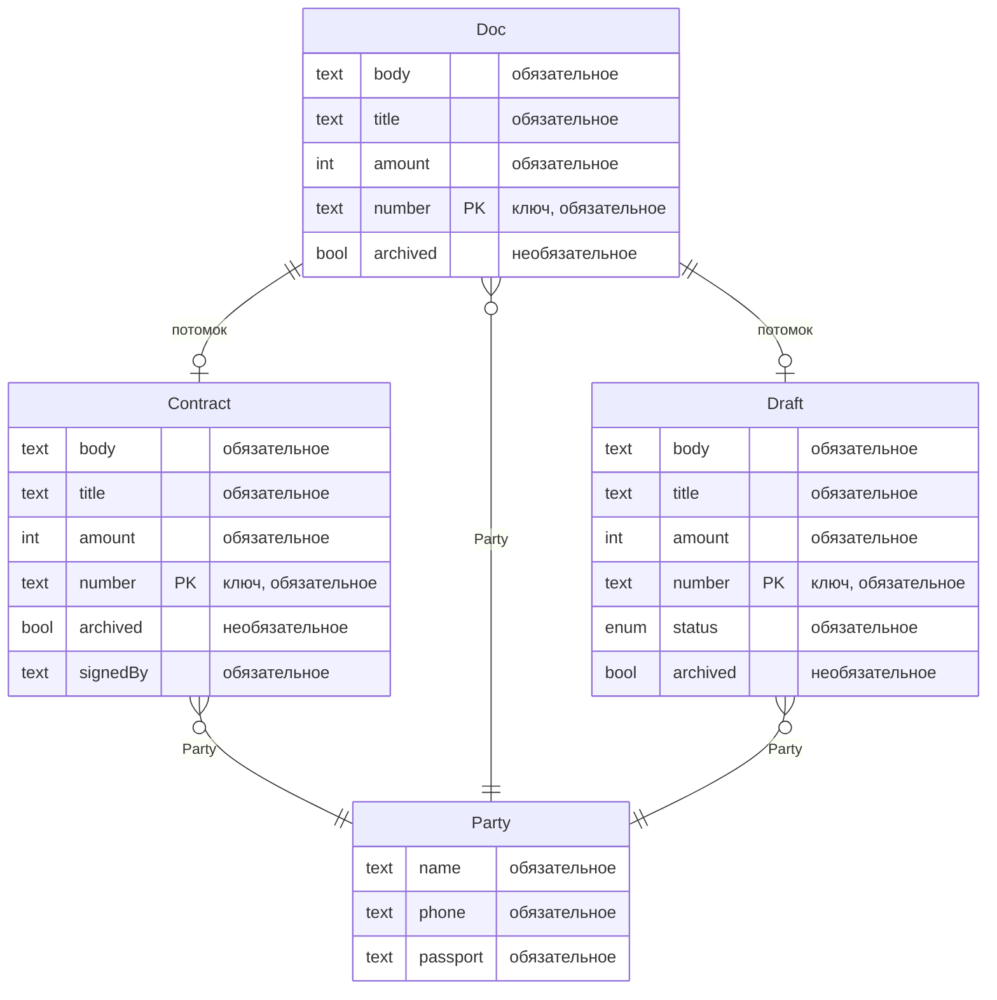
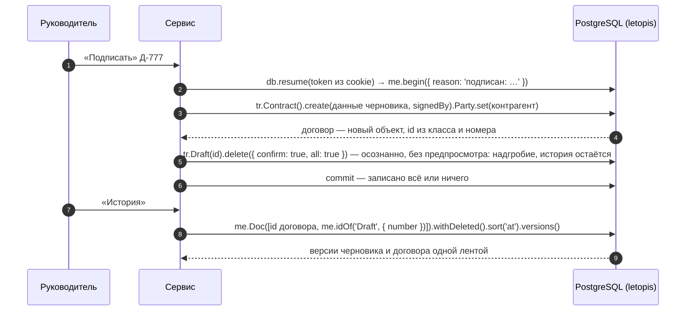

# Документы с аудитом

Договоры с полной историей. Каждая правка — новая версия с автором и причиной. Документ можно открыть на любой момент, а подписанный договор помнит и версии черновика, из которого его подписали. Интерфейс собран из блоков shadcnblocks (`login1`, `navbar1`, `stats8`, `changelog1` — лента версий), сервер — Express и JSON API.

**Сначала — исходники.** Сервисы лежат в [репозитории letopis](https://github.com/alepri51/letopis), а не в npm-пакете: `git clone https://github.com/alepri51/letopis && cd letopis` — все команды ниже выполняются из корня клона ([как запустить](./#run)).

**Запустить в Docker:** `docker compose -f services/compose.yaml up --build documents`, затем открыть адрес сервиса — по умолчанию http://127.0.0.1:8084, порт меняет переменная `DOCUMENTS_PORT` (юрист `lawyer@pravo.ru` / `Pravo-2026!`, руководитель `head@pravo.ru` / `Head-2026!`). Дом и архив готовит шаг подготовки `documents-setup`; дом с нуля — переменная `FRESH=1` у него (данные пропадают).

**Запустить руками:** база — `docker compose -f services/compose.yaml up -d pg` (или своя, её мастер-ключ — в `ADMIN_DSN`), затем `services/documents/run-local.sh`: дом и архив готовит `node src/setup.mjs`, сервер получает только пропуск. Шаги для PowerShell — в `services/documents/README.md`.

## Что из letopis здесь работает

| Возможность letopis | Где в сервисе |
|---|---|
| `setup(ADMIN_DSN, 'documents', { models })` | подготовка дома (`src/setup.mjs`) мастер-ключом: модель документов — общие классы дома |
| `letopis load --initial --with-history --agent` | архив старых договоров заливает подготовка дома мастер-ключом — первой заливкой с историей в квартиру фирмы: у каждого договора четыре версии из прежней системы с их датами, исполнитель в журнале — «перенос архива» |
| `connect(pass, { postman })`, `createTenant`, `invite` → `accept`, `me.acl.grant` | подготовка дома (`src/setup.mjs`) заводит квартиру фирмы «Право и Дело», зовёт руководителя (роль `owner`) и юриста (роль `staff`) — приглашения идут через почтальона-заглушку и тут же принимаются — и даёт роли `staff` чтение, правку и удаление документов и контрагентов; сервис при старте жильцов не заводит |
| `db.open({ email, password })`, `db.resume(token)` | вход паролем: токен сессии — в cookie, каждый запрос открывает по нему корень квартиры; выход — `me.close()` |
| `reason` у глаголов | причина правки обязательна и видна в ленте версий |
| `update(…, { rev })` | правка по устаревшей версии — 409 «Документ уже изменили — обновите и повторите» |
| `begin()`: `create` и `delete` | «Подписать»: ключ и класс строки неизменны, а класс входит в id (v5-id), поэтому договор — новый объект. Одна транзакция создаёт `Contract` с данными черновика и удаляет `Draft`; ошибка любого шага откатывает оба |
| `me.idOf('Draft', { number })`, `withDeleted().sort('at').versions()` | лента версий договора (блок `changelog1`): версии обоих id — договора и черновика, из которого он подписан |
| `asOf(момент)` | «Машина времени»: ползунок по версиям |
| `delete()` без `confirm`, `delete({ confirm, expect })`, `withDeleted`, `restore({ expect })` | «Удалить…»: сначала предпросмотр, затем удаление ровно показанного (`expect` — тот предпросмотр); «Корзина»: «Восстановить» с прежним id — строка корзины и есть `expect`. Подписанного черновика в корзине нет: он не удалён пользователем, а стал договором |
| `db.as(сотрудник, фирма)` | демо-черновики при первом запуске пишет консьерж от имени юриста и руководителя: автор версии — человек, исполнитель — консьерж |
| `me.transaction` — свой SQL под правами жильца | «Обслуживание»: сводка архива — сколько договоров и версий залито и за какие даты (журнал `log` по исполнителю «перенос архива») |
| `letopis maintain` | «Обслуживание» показывает команду мастер-ключа с именем дома: истёкшие и погашенные сессии, коды и приглашения, строки-замки удалённых классов; журнал она не трогает. У сервиса с пропуском обслуживания нет |
| `watch()` → SSE, `onQuery`, журнал `log`, сигналы | живое обновление: вкладка сама перечитывает данные после изменений. Панель «Под капотом» показывает, что сделало действие: цепочки letopis и запросы к базе, версии, которые оно записало (класс, номер, `rev`, `op`, причина, изменённые поля), и сигналы об изменении классов, в которые оно записало (только имя класса) |

## Модель

Модель — общие классы дома `documents`: их записывает подготовка `setup(ADMIN_DSN, 'documents', { models })`, правка модели доходит до работающего дома повторным `setup()` при развёртывании. Строки фирмы — договоры, черновики, контрагенты — лежат в её квартире и видны только её жильцам. Мастер-ключа у работающего сервиса нет: архив залит при подготовке дома, а обслуживание — команда мастер-ключа по расписанию.

Схема построена из реестра корня квартиры (`me.registry`):

<!-- er:documents -->

<!-- /er -->

`Draft` и `Contract` наследуют `Doc`: его поля, ключ (номер) и конец на контрагента. Журнал у классов — по умолчанию (`history: true`): каждая версия хранится целиком. У контрагента ключа нет, поэтому при загрузке архива его id вычисляется из `$ext` — внешнего ключа (id записи в прежней системе). По `$ext` на контрагента ссылаются и архивные договоры.

## Подписание

## Подводные камни

- **Подписание меняет id.** Класс входит в id (v5-id), а класс строки правкой не меняется, поэтому договор — новый объект, а черновик удаляется той же транзакцией. Другим системам документ лучше хранить по номеру. Ленту версий договора сервис собирает по двум id: id черновика даёт `me.idOf('Draft', { number })`. «Машина времени» запрашивает документ по id той версии, на которую указывает ползунок: до подписания документ жил черновиком под другим id.
- **Подписанный черновик не вернуть.** Его надгробие — не удаление пользователем, поэтому в корзине его нет. `restore` оживил бы его рядом с договором — стало бы два документа с одним номером; сервис отвечает 409. Новый черновик с номером договора — тоже отказ (422).
- **`delete()` без `{ confirm: true }` — только предпросмотр:** ничего не удаляется. Удаление по кнопке пользователя — `delete({ confirm: true, expect: предпросмотр })`; черновик при подписании сервис удаляет сам, без показа, — поэтому там `{ confirm: true, all: true }`.
- **Историю одного объекта не стереть.** Журнал хранит каждую версию целиком: прореживания и обрезки истории нет, версии одного объекта не стираются. Данные и журнал фирмы целиком стирает только удаление её квартиры (`me.deleteTenant()`).
- **Первая заливка — только в пустой дом** (строки системных классов не в счёт), поэтому архив заливается при постройке дома, раньше первых черновиков. Если дом уже был, а договоров в нём нет, подготовка заливает архив обычной загрузкой — тоже с историей.
- **Загрузка и обслуживание — у мастер-ключа.** У сервиса с пропуском их нет: `letopis load` и `letopis maintain` запускают подготовка дома и планировщик.
