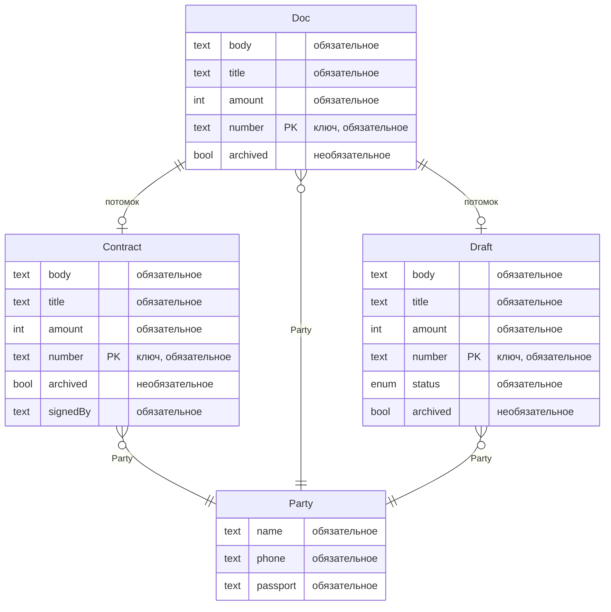
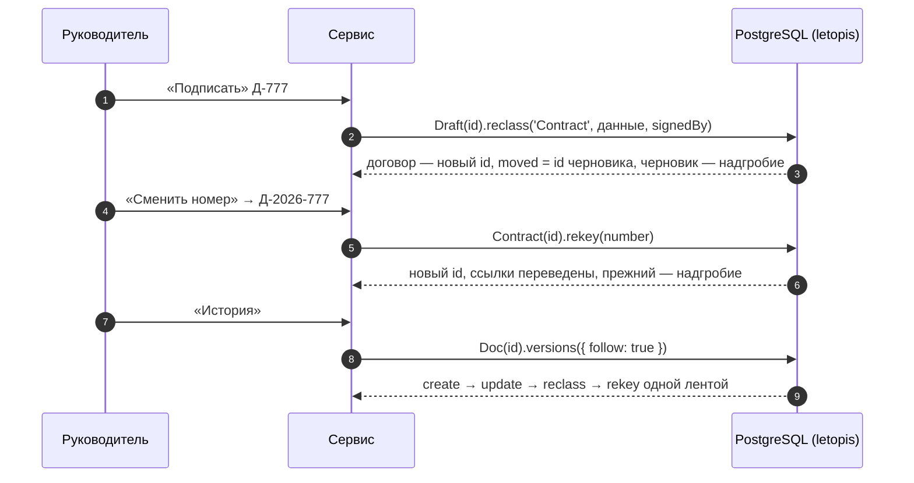

# Документы с аудитом

Договоры с полной историей: каждая правка — версия с автором и причиной, любую можно открыть, сравнить и проверить. Интерфейс собран из блоков shadcnblocks (`login1`, `navbar1`, `stats8`, `changelog1` — лента версий), сервер — Express и JSON API.

**Запустить в Docker:** `docker compose -f services/compose.yaml up --build documents` → http://127.0.0.1:8084 (юрист `lawyer@pravo.ru` / `Pravo-2026!`, руководитель `head@pravo.ru` / `Head-2026!`). Демо с нуля — `FRESH=1`.

**Запустить руками:** база — `docker compose -f services/compose.yaml up -d pg`, затем `services/documents/run-local.sh`; шаги для PowerShell — в `services/documents/README.md`.

## Что из letopis здесь работает

| Возможность letopis | Где в сервисе |
|---|---|
| `reason` у глаголов | причина правки обязательна — она в ленте версий |
| `update(…, { rev })` | правка по устаревшей версии — 409 «документ уже изменили» |
| `reclass` | «Подписать»: черновик становится договором и получает новый id — id вычисляется из класса и ключа |
| `rekey` | «Сменить номер»: номер в ключе — новый id, ссылки переведены |
| `versions({ follow: true })` | лента версий через подписание и смену номера (блок `changelog1`) |
| `diff({ from, to, follow })` | «Сравнить» две версии: поле, было, стало |
| `blame()` | «Кто менял»: последний автор каждого поля |
| `asOf(момент)` | «Машина времени»: ползунок по версиям |
| `delete()` без `confirm`, `withDeleted`, `restore`, `purge({ confirm })` | удаление с предпросмотром, корзина, восстановление, стирание навсегда |
| `anonymize` | «Обезличить контрагента»: паспорт и телефон затёрты |
| `trimHistory` | «Обрезать историю до сегодня» у архивного договора |
| политика `history` и `maintain({ now })` | «Обслуживание»: прореживание «как будто через N дней» |
| `verify({ data: true })` | «Проверить целостность», «Испортить запись журнала», «Вернуть как было» |
| `load(…, { initial: true, withHistory: true })` | архив старых договоров залит первой заливкой с историей |
| `watch()` → SSE, `onQuery` | живое обновление и панель «Под капотом» |

## Модель

Схема получена из реестра (`db.describe()`):

`Draft` и `Contract` наследуют `Doc` (ключ — номер, ссылка на контрагента, политика хранения истории). У контрагента ключа нет — его id при загрузке архива задаёт внешний ключ `$ext`.

## Подписание и смена номера

## Подводные камни

- **Подписание и смена номера меняют id**, поэтому ссылки на документ в других системах лучше хранить по номеру или следовать за `moved`; машина времени берёт id той версии, на которую указывает ползунок.
- **`purge()` без `{ confirm: true }` — только предпросмотр**, как `delete()`.
- **`anonymize` затирает поля новой версией** — прежние версии с паспортом остаются в журнале; для полного забвения — `trimHistory` и `purge`.
- **Первая заливка — только в пустую схему**, поэтому архив заливается до первых черновиков.
- **`maintain({ now })` и прореживание «вперёд» — только с `allowReset`**: сервис-пример ставит установку с этим флагом, а в рабочей установке его не включают.
- **Правка журнала в обход библиотеки видна `verify`**: «Испортить запись журнала» меняет сумму во второй версии архивного договора прямым `UPDATE`, «Вернуть как было» возвращает её байт в байт.
