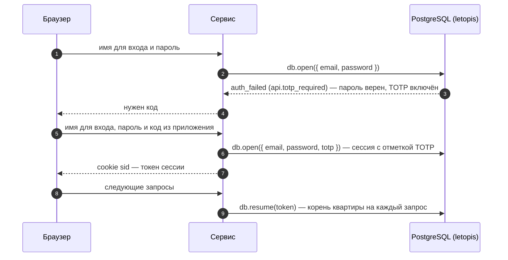
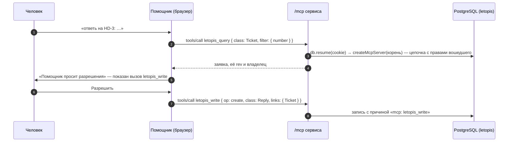

# Helpdesk

Служба поддержки для нескольких компаний. Каждая компания — отдельная квартира в доме `helpdesk`: у неё свои заявки, сотрудники и клиенты, а чужого не видно даже по прямому запросу. Роли — руководитель, агент поддержки и клиент; это метки прописки (`owner`, `agent`, `client`), а что кому можно, решает матрица прав в базе. Интерфейс собран из блоков shadcnblocks (`login1`, `signup1`, `navbar1`, `stats8`). Сервер — Express: JSON API и адрес `/mcp` для ИИ-агентов.

**Сначала — исходники.** Сервисы лежат в [репозитории letopis](https://github.com/alepri51/letopis), а не в npm-пакете: `git clone https://github.com/alepri51/letopis && cd letopis` — все команды ниже выполняются из корня клона ([как запустить](./#run)).

**Запустить в Docker:** `docker compose -f services/compose.yaml up --build helpdesk`, затем открыть адрес сервиса — по умолчанию http://127.0.0.1:8083 (порт меняет переменная `HELPDESK_PORT`, [как запустить](./#run)). Дом строит шаг подготовки `helpdesk-setup`; дом с нуля — переменная `FRESH=1` у него (данные пропадают).

**Запустить руками:** база — `docker compose -f services/compose.yaml up -d pg` (или своя, её мастер-ключ — в `ADMIN_DSN`), затем `services/helpdesk/run-local.sh`: дом строит `node src/setup.mjs`, сервер получает только пропуск. Шаги для PowerShell — в `services/helpdesk/README.md`.

| Кто | Имя для входа | Как войти |
|---|---|---|
| руководитель «Севера» | `boss@sever.ru` | пароль `Sever-2026!` |
| руководитель «Байкала» | `boss@baikal.ru` | пароль `Baikal-2026!` |
| агент поддержки (работает в «Севере» и «Байкале») | `agent@sever.ru` | пароль `Agent-2026!` в «Севере», `Agent-Baikal-2026!` в «Байкале»; после включения TOTP — ещё код |
| клиент «Севера» | `client@sever.ru` | «Код на почту» → письмо в демо-почте: `<адрес сервиса>/mail` (по умолчанию http://127.0.0.1:8083/mail) |

## Что из letopis здесь работает

| Возможность letopis | Где в сервисе |
|---|---|
| `setup(ADMIN_DSN, 'helpdesk', { models, signals: 'tenant' })` | подготовка дома (`src/setup.mjs`) мастер-ключом: модель заявок — общие классы дома; режим сигналов `tenant` — правки одной компании не будят подписки и кэш другой |
| `connect(pass, { postman })`, `createTenant`, `invite` → `invitation` → `accept` | демо-компании и демо-жильцов заводит подготовка дома (`src/setup.mjs`), а не старт сервиса; «Зарегистрировать» заводит квартиру новой компании, и консьерж зовёт её руководителя (`invite({ email }, ['owner'], { ttl: '7 days' })`): почтальон сервиса кладёт письмо со ссылкой в демо-почту, страница по ссылке `/invite/<токен>` показывает приглашение (`db.invitation(token)`) и принимает его (`db.accept(token, { password, name })`) — код приглашения уходит письмом в демо-почту, человек принимает его со своим паролем (`db.accept`). Название занято — 409 |
| прописка и роли (`member.roles`) | руководитель — `owner`, агент — `agent`, клиент — `client`, аккаунт интеграции — `integration`; «Пригласить» — `me.invite({ email }, [роль])`: письмо со ссылкой уходит почтальону; отозвать приглашение — `me.revokeInvite(id)` |
| матрица прав (`me.acl.grant`) и условия `owner: '$actor'`, `data.client` | клиент видит только свои заявки и ответы на них; внутренние заметки и счётчик ему закрыты; удалить заявку и править компанию может только руководитель — [правила ниже](#правила-доступа) |
| `me.acl.check(действие)` | разделы «Команда», «Интеграции», «Помощник» — по действиям API `desk.team`, `desk.keys`, `desk.assistant` |
| `ownerDefault: 'actor'`, `.owner()` | владелец заявки — её автор; интеграция ставит владельцем клиента |
| `db.open({ email, password, totp })`, `keys.enrollTotp`, `keys.verifyTotp` | второй фактор с QR-кодом: ключ верен, а TOTP включён — `auth_failed` с ключом `api.totp_required`, сервис просит код и входит паролем и кодом одним вызовом |
| `db.requestCode({ email })`, `db.tenantsOf({ email, code })`, `db.open({ email, code, tenant })` | вход по коду из письма (письмо — в демо-почте): код один на человека, после него сервис показывает его компании и входит в выбранную; ответ на «Прислать код» одинаков, есть такой адрес в доме или нет |
| `db.resume(token)` | токен сессии — в cookie (HttpOnly); каждый запрос открывает по нему корень квартиры. Погашенная сессия или выписка — 401, вкладка просит войти |
| `keys.issueApiKey`, `keys.list`, `keys.revoke` | ключи интеграций и ключи ИИ-агента — постоянный и временный на 15 минут (`{ ttl: 900 }`) |
| `me.closeAll()` | «Выйти на всех устройствах»: все сессии человека в этой компании и его временные ключи агента |
| выписка — удаление строки `member` | «Удалить из компании»: `me.member(id).delete({ confirm: true, all: true })` — его ключи и сессии в этой компании гаснут сразу. Запись в справочнике `Profile` остаётся: по ней в заявках видно, кто их вёл |
| `me.deleteTenant()` | «Закрыть компанию»: квартира, её данные и журнал стираются целиком (демо-компании закрыть нельзя) |
| `db.as(аккаунт, компания)` | «Работать от имени»: консьерж от имени клиента — в журнале автор клиент, исполнитель (`agent`) — консьерж; помощник MCP в этом режиме не работает |
| `inc` | номер заявки — счётчик компании: `db.in(компания).Counter(…).update({ next: inc(1) })`, без повторов при одновременных обращениях; выдаёт его консьерж — клиенту счётчик закрыт |
| `sort` + `after(cursorOf(…))` | очередь по сроку ответа, страницы по курсору |
| `update(…, { rev })` | правка по устаревшей версии — 409 «Заявку уже изменили — обновите и повторите» |
| `watch()` → SSE | очередь обновляется сама; клиенту приходят события только его заявок |
| `.cache()` | справочник людей компании: повторное чтение в течение минуты — без запроса к базе |
| `createMcpServer` + `createMcpHandler` | помощник и внешний ИИ-агент работают через MCP с правами вошедшего человека — по cookie вкладки или по ключу API |
| `onQuery`, `slowMs`, журнал `log`, сигналы | панель «Под капотом» — что сделало действие: цепочки letopis и запросы к базе (дольше `slowMs` — отмечены), версии, которые оно записало (из журнала `log`, с изменёнными полями), и сигналы об изменении классов, в которые оно записало (только имя класса, без токена квартиры). При работе от имени видны версии того, от чьего имени работают, — под его правами |

## Модель

Модель — общие классы дома `helpdesk`: их записывает подготовка `setup(ADMIN_DSN, 'helpdesk', { models })`, правка модели доходит до работающего дома повторным `setup()` при развёртывании. Строки каждой компании лежат в её квартире. Правила матрицы консьерж пишет в квартире каждой компании при её регистрации и при каждом запуске сервиса — так изменения правил доходят до всех компаний.

Схема получена из реестра корня квартиры (`me.registry`), а не нарисована руками:

<!-- er:helpdesk -->

<!-- /er -->

- `Desk` — название компании; править его может только руководитель: у агента и клиента правил записи на него нет.
- `Counter` — счётчик номеров заявок (`history: false`: история счётчика не нужна). Номер выдаёт консьерж в квартире компании, поэтому клиентам и интеграциям счётчик закрыт: иначе любой клиент мог бы сбить нумерацию.
- `Profile` — справочник email людей компании. Имена и роли сервис берёт из `me.acl.people()`; свой класс нужен для того, чего в списке людей нет, — почты, по которой интеграция ищет клиента. Запись в нём заводит консьерж, когда человек принимает приглашение.
- `Reply` хранит в поле `client` владельца заявки. Условие правила смотрит только в поля самой строки, а связанных строк не видит.

## Правила доступа

Правило по умолчанию дома — «нельзя». Руководителю всё даёт правило хозяина квартиры: его заводит `createTenant` для роли `owner`. Остальным ролям — правила, которые консьерж пишет обёрткой `me.acl.grant` в квартире каждой компании:

| Роль | Что | Как |
|---|---|---|
| `agent` | читать `Desk`, `Profile`, `Ticket`, `Reply`, `Note`, `member`; писать `Ticket`, `Reply`, `Note` | очередь, ответы, заметки, справочник людей и прописки — чтобы `me.acl.people()` отдавал агенту имена коллег; удалять заявки и править компанию агенту нечем — правил на это нет |
| `agent` | действия API `desk.{queue,assistant}` | разделы «Очередь» и «Помощник» |
| `client` | читать `Desk`, `Ticket` с `owner: '$actor'`, `Reply` с `data.client: '$actor'`, `Profile` с `owner: '$actor'`; писать свои `Ticket` и `Reply` | только свои заявки и ответы на них, в справочнике — только себя; заметки и счётчик закрыты |
| `integration` | читать `Ticket`, `Profile`; писать `Ticket` | заявки от имени клиентов, поиск клиента по email |

`me.acl.grant` пишет ресурс и правило целиком по постоянному `alias` (`role:client:ACCOUNT`, `class:Ticket:READ`) и паре «группа — объект», поэтому повтор ничего не меняет, расходящееся с кодом приводится к нему, а изменения в коде доходят и до уже зарегистрированных компаний. Владелец этих правил — консьерж: руководитель компании их не снимет. Правила, которые компания завела сама, остаются как есть.

## Вход со вторым фактором

Вход по коду из письма: `db.requestCode({ email })` отдаёт код почтальону (письмо — в демо-почте), `db.tenantsOf({ email, code })` показывает компании человека, `db.open({ email, code, tenant })` входит в выбранную; компания одна — выбора нет. Если у человека включён второй фактор, сервис просит ещё код из приложения.

Включить второй фактор — «Безопасность»: `me.keys.enrollTotp()` отдаёт секрет и адрес для QR-кода, `me.keys.verifyTotp(код)` его подтверждает. Отключить можно только с действующим кодом: сервис сверяет его (`verifyTotp`), находит ключ `TOTP` в `keys.list()` и отзывает его `keys.revoke(id)`. Без кода фактор снял бы любой, кто сел за открытую вкладку. Править свои ключи можно в первые 10 минут после входа: позже база отвечает отказом, и сервис просит войти снова.

## Помощник через MCP

Внешний ИИ-агент (например, Claude Code) подключается к тому же адресу по ключу API. Кнопка «Выдать ключ для агента» в разделе «Помощник» выпускает ваш ключ (`me.keys.issueApiKey`) и показывает готовую команду `claude mcp add --transport http …` с ним. Сервис открывает по ключу корень квартиры (`db.open({ apiKey })`) и отдаёт его в `createMcpServer`: агент работает с вашими правами в этой компании, в журнале автор правок — вы. «Временный ключ на 15 минут» — тот же ключ со сроком (`{ ttl: 900 }`): истекает сам, «Отозвать» (`me.keys.revoke(id)`) и «Выйти на всех устройствах» гасят его сразу. Писать через MCP могут сотрудники; клиенту и ключу интеграции помощник только читает.

## Подводные камни

- **Пароль открывает одну квартиру.** Агент, который работает в двух компаниях, — один аккаунт с двумя паролями: у каждой компании свой, и вход в «Байкал» — паролем «Байкала». Один и тот же пароль в двух квартирах letopis не примет (`api.password_reused`).
- **Выход закрывает потоки сам.** Подписка погашенной сессии не падает, а молчит, поэтому «Выйти», «Выйти на всех устройствах» и «Удалить из компании» закрывают потоки живого обновления этих сессий на сервере.
- **Выписка гасит доступ сразу.** Удаление строки `member` гасит ключи и сессии человека в этой компании: следующий запрос его вкладки — 401, ключ интеграции — 401. Чтобы отозвать ключ интеграции, сервис выписывает её аккаунт.
- **Прописка — только по приглашению.** Завести строку `member` цепочкой нельзя (`acl_denied`): человека зовут `invite`, почтальон доставляет ссылку, человек принимает приглашение — `accept(token)`. Ключ интеграции сервис получает так же — зовёт аккаунт программы и сам принимает приглашение.
- **Название закрытой компании свободно.** `deleteTenant()` стирает квартиру целиком, и её имя можно занять снова.
- **Код на почту — один на человека.** `db.requestCode({ email })` компанию не спрашивает: код доказывает адрес, а компанию выбирают после него. Ответ на «Прислать код» одинаков, есть такой адрес в доме или нет.
- **Демо-почта отключает защиту входа по коду:** коды и ссылки приглашений видит любой, кто откроет `/mail`. Запускайте сервис только на своей машине; `DEMO_MAIL=0` выключает демо-почту.
- **Ключ API — вход без пароля.** Поэтому интеграции получают ключ не руководителя, а отдельного аккаунта компании с ролью `integration` и меньшими правами.
