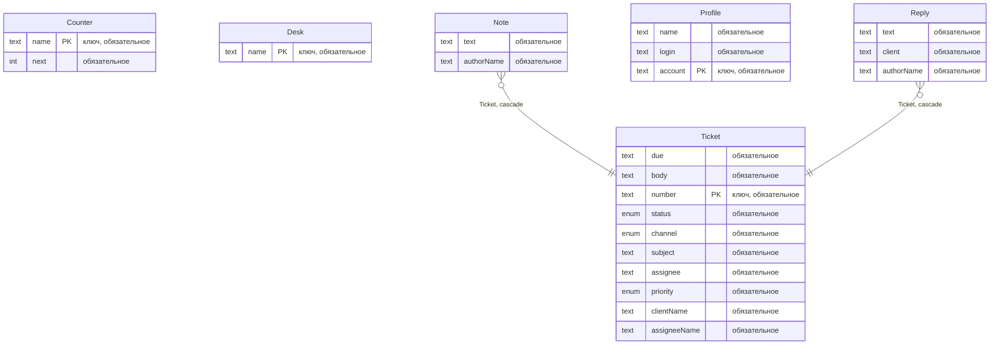
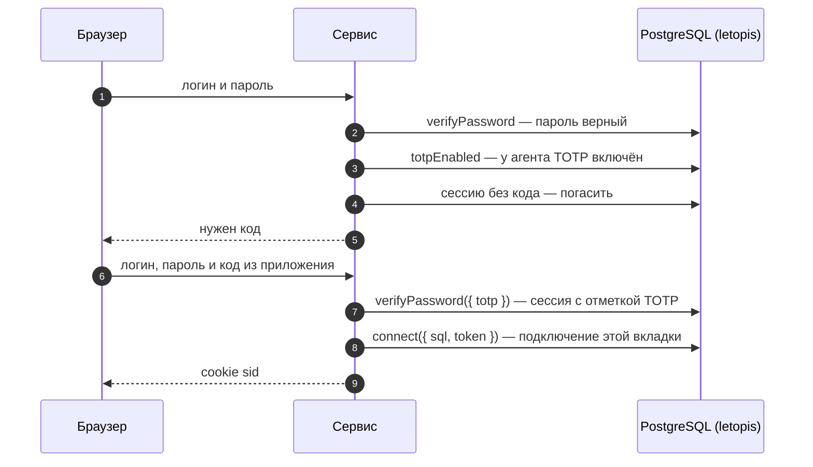
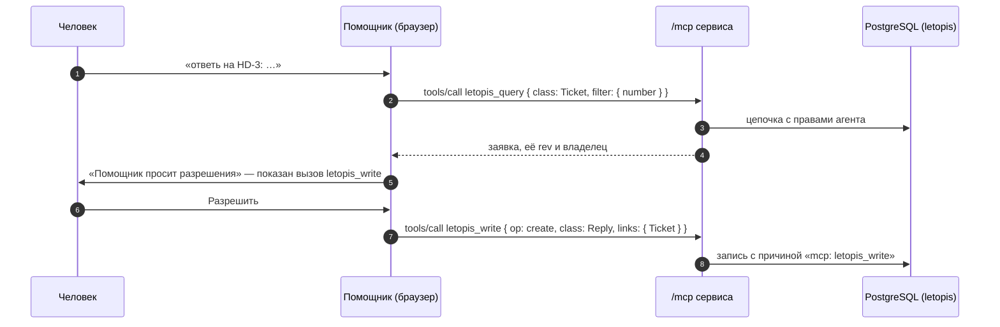

# Helpdesk

Служба поддержки для нескольких компаний. Каждая компания — отдельный арендатор: у неё свои заявки, сотрудники и клиенты, а чужого не видно даже по прямому запросу. Роли — руководитель, агент поддержки и клиент. Что кому можно, решают правила доступа в базе. Интерфейс собран из блоков shadcnblocks (`login1`, `signup1`, `navbar1`, `stats8`). Сервер — Express: JSON API и адрес `/mcp` для ИИ-агентов.

**Запустить в Docker:** `docker compose -f services/compose.yaml up --build helpdesk` → http://127.0.0.1:8083. Демо с нуля — переменная `FRESH=1`: схема пересоздаётся.

**Запустить руками:** база — `docker compose -f services/compose.yaml up -d pg`, затем `services/helpdesk/run-local.sh`; шаги для PowerShell — в `services/helpdesk/README.md`.

| Кто | Логин | Как войти |
|---|---|---|
| руководитель «Севера» | `boss@sever.ru` | пароль `Sever-2026!` |
| агент поддержки (работает в «Севере» и «Байкале») | `agent@sever.ru` | пароль `Agent-2026!`; после включения TOTP — ещё код |
| клиент «Севера» | `client@sever.ru` | «Код на почту» → письмо в демо-почте http://127.0.0.1:8083/mail |

## Что из letopis здесь работает

| Возможность letopis | Где в сервисе |
|---|---|
| `createTenant` | регистрация компании; приглашение человека в компанию с ролью |
| членство и роли (`member.roles`) | руководитель — `owner`, агент — `agent`, клиент — `client` |
| правила доступа (`Resource`, `rule`) и условия `owner: '$actor'`, `data.client` | клиент видит только свои заявки и ответы на них; внутренние заметки ему закрыты; удалить заявку может только руководитель |
| `acl.check(endpoint)` | разделы «Команда», «Интеграции», «Помощник» — по правилам API |
| `ownerDefault: 'actor'`, `.owner()` | владелец заявки — её автор; интеграция ставит владельцем клиента |
| `verifyPassword({ totp })`, `enrollTotp`, `verifyTotp` | второй фактор с QR-кодом; вход паролем и кодом одним вызовом |
| `issueOtp`, `verifyOtp` | вход по коду из письма (письмо — в демо-почте) |
| `issueApiKey`, `verifyApiKey`, `credentials`, `revokeCredential` | ключи интеграций и ключ ИИ-агента |
| веб-сессия = сессия letopis (`connect({ sql, token })`) | у каждой вкладки своё подключение, поэтому `revokeAll` и удаление членства закрывают доступ сразу |
| `auth.switch`, `auth.tenants` | агент переходит между «Севером» и «Байкалом» |
| `svc.as(аккаунт, { tenant })` | «Работать от имени»: в журнале автор — клиент, исполнитель (`agent`) — сервис |
| `auth.sessionFor(аккаунт, { ttl })`, `connect({ sql, token, refreshSession: false })` | «Помощник» → «Сессия агента на 15 минут»: ИИ-агент получает короткую сессию вместо ключа. Сессия — не кред (учётные данные для входа: пароль, ключ API…), поэтому в `credentials()` её нет. Она истекает сама, а «Погасить» гасит её сразу (`auth.revoke()` её подключением). В журнале автор правок агента — сам пользователь, исполнителя (`agent`) нет, в отличие от `svc.as` |
| `purgeAccount` | «Закрыть компанию»: данные арендатора стираются целиком |
| `anonymize` | «Удалить из компании»: имя и email в справочнике затёрты |
| `inc` в транзакции | номер заявки — счётчик компании, без повторов при одновременных обращениях |
| `sort` + `after(cursorOf(…))` | очередь по сроку ответа, страницы по курсору |
| `update(…, { rev })` | правка по устаревшей версии — 409 «Заявку уже изменили — обновите и повторите» |
| `watch()` → SSE | очередь обновляется сама; клиенту приходят события только его заявок |
| `.cache()` | справочник людей компании: повторное чтение в течение минуты — без запроса к базе |
| `up({ signals: 'tenant' })` | правки одной компании не будят подписки и кэш другой |
| `createMcpServer` + `createMcpHandler` | помощник и настоящий ИИ-агент работают через MCP с правами пользователя |
| `onQuery`, `slowMs`, журнал `log`, `flushSignals()` | панель «Под капотом» — что сделало действие: цепочки letopis и запросы к базе (дольше `slowMs` — отмечены), версии, которые оно записало (из журнала `log`, с изменёнными полями), и сигналы об изменении классов, в которые оно записало (`flushSignals()`; только имя класса, без токена арендатора). При работе от имени видны версии того, от чьего имени работают, — под его правами |

## Модель

У каждой компании свои классы — классы её арендатора. Их записывает `syncModels` через администраторское подключение letopis (`allowBypassRls`: построчные правила доступа базы, RLS, на него не действуют). Для записи сервис выпускает короткую сессию руководителя компании (`auth.sessionFor`), переводит её в компанию (`auth.switch`), а после записи гасит. Так он делает при регистрации компании и при каждом запуске — во всех компаниях, демо и зарегистрированных (это арендаторы со строкой `Desk`). Поэтому изменение модели после перезапуска доходит до всех. Сессии пользователей модели не пишут. Классы лежат в арендаторе компании, а не в System: классы System `syncModels` пропускает — их меняет только установка, а её сид не трогает класс, который уже есть. Правка модели не дошла бы до работающей установки.

Схема получена из реестра (`db.describe()`), а не нарисована руками:

<!-- er:helpdesk -->

<!-- /er -->

- `Desk` — название компании; править его может только руководитель (правило ниже).
- `Counter` — счётчик номеров заявок (`history: false`: история счётчика не нужна). Его правит каждый, кто создаёт заявку, поэтому счётчик хранится отдельно от названия: иначе любой клиент мог бы переименовать компанию.
- `Profile` — справочник людей компании: имя и email. Чужие учётные записи (`Account`) обычному пользователю не видны, поэтому сервис ведёт свой справочник.
- `Reply` хранит в поле `client` владельца заявки. Условие правила смотрит только в поля самой строки, а связанных строк не видит.

## Правила доступа

`createTenant` уже дал всем участникам компании «можно всё»: три правила (чтение, запись, удаление) с весом 10. Сервис добавляет обёрткой `db.acl` правила с большим весом — они сильнее:

| Кто | Что | Решение |
|---|---|---|
| клиент | читать и править `Ticket` с `owner: '$actor'` | разрешено (вес 50) — остальные заявки отсекает база |
| клиент | читать и писать `Reply` с `data.client: '$actor'` | разрешено (вес 50) |
| клиент | `Note` | запрещено (вес 50) |
| клиент | читать `Profile` с `owner: '$actor'` | разрешено (вес 50) — в справочнике клиент видит только себя |
| клиент | писать `Profile` | запрещено (вес 50) |
| клиент и ключ интеграции | писать `Counter` (счётчик номеров заявок) | запрещено (вес 50) — номер выдаёт сервис от имени руководителя |
| все, кроме руководителя (`agent`, `client`, `integration`) | удалять `Ticket` | запрещено (вес 50) |
| все, кроме руководителя | писать и удалять `rule`, `Resource`, `member` | запрещено (вес 60) — иначе клиент выдал бы себе права сам |
| все, кроме руководителя | писать `Desk` (название компании) | запрещено (вес 50) |
| руководитель | эндпоинты `desk.*` | разрешено |
| агент | эндпоинты `desk.{queue,assistant}` | разрешено |

Правила сервис записывает так же, как модели: администраторским подключением в короткой сессии руководителя — при регистрации компании и при каждом запуске, во всех компаниях. Список правил в коде — вызовы `db.acl.grant` и `db.acl.deny`: обёртка пишет ресурс и правило целиком по постоянному `alias` (`role:client:ACCOUNT`, `class:Note:READ`) и паре `Group`–`Object`, поэтому расходящееся с кодом приводится к нему, совпадающее не трогается, а изменения в коде доходят и до уже зарегистрированных компаний. Ресурсы и правила, которые компания завела сама, остаются как есть.

## Вход со вторым фактором

letopis второй фактор не навязывает: `verifyPassword` без кода выдаёт сессию и при включённом TOTP. Требовать код — дело сервиса.

Отключить второй фактор можно на той же странице «Безопасность», но только с действующим кодом: сервис сверяет его (`verifyTotp`), находит кред `TOTP` в `credentials()` и гасит его `revokeCredential`. Вместе с кредом гаснут и сессии, открытые с этим фактором, поэтому после отключения сервис просит войти снова. Без кода фактор снял бы любой, кто сел за открытую вкладку.

## Помощник через MCP

Внешний ИИ-агент (например, Claude Code) подключается к тому же адресу по ключу API. Кнопка «Выдать ключ для агента» в разделе «Помощник» показывает готовую команду `claude mcp add --transport http …` с ключом. ИИ-агент работает с правами того, кому выдан ключ; отзыв ключа его отключает.

Вместо ключа можно выдать короткую сессию. Кнопка «Сессия агента на 15 минут» вызывает `svc.auth.sessionFor(вы, { ttl: 900 })`, открывает по токену подключение (`connect({ token, refreshSession: false })`) и переводит сессию в компанию (`auth.switch`). Компанию база помнит в самой сессии, поэтому в адресе агента нет `?tenant`. Сессия гаснет сама через 15 минут. Раньше её гасят кнопка «Погасить» (`auth.revoke()` её подключением), выход из вкладки, которая её выдала, и «Выйти на всех устройствах». Вызовы агента по сессии видны в «Под капотом» у того, кто её выдал.

## Подводные камни

- **Отозванная сессия при чтении не даёт ошибки.** Запросы просто возвращают пустой результат. `no_session` бросают создание строк, `acl.check` и методы `db.auth`, которым нужна сессия, а чтение — нет. Поэтому сервис проверяет сессию в начале каждого запроса: `svc.auth.session(token)` отвечает `null`, если сессию погасили, и `member: false`, если человека убрали из компании. Так «Выйти на всех устройствах», удаление из компании и отзыв ключа срабатывают сразу. Пример — [«Сессии и арендаторы»](../auth/#сессии-и-арендаторы), шаг 9.
- **`auth.switch()` есть только у самого подключения**, не у `db.as()`. Поэтому веб-сессия здесь — отдельное подключение по токену пользователя (`connect({ sql, token })` поверх общего пула), а не `svc.as()`, как в салоне и кошельке.
- **`auth.tenants()` не упорядочен.** Компанию по умолчанию сервис выбирает сам — ту, где человек состоит дольше всего: свои строки `member` ему видны всегда, а в них есть дата.
- **Свежая сессия входа работает в личном арендаторе** учётной записи — в компанию её переводит `auth.switch()`. Это касается и сессии от `sessionFor`: сервис переводит её в компанию сразу при выдаче.
- **Правки по сессии от `sessionFor` — от самого пользователя.** Это его собственная сессия, а не работа от имени, поэтому исполнителя (`agent`) в журнале нет. Что сессию выпустил сервис, видно только в сведениях о ней: `auth.session(token).methods` — `['SERVICE']`. Если журнал должен называть сервис, нужен `svc.as()`: на нём и сделано «Работать от имени». Сессию агента сервис выдаёт только на себя.
- **Сессии нет в списках.** `credentials()` перечисляет креды — пароли, ключи API, секреты TOTP, а сессия к ним не относится. Какие сессии выданы агентам, сервис помнит сам. Гасит сессию `auth.revoke()` подключением с её токеном или `revokeAll` — вместе со всеми сессиями человека.
- **Срок сессии — это допустимое время простоя.** Подключение само продлевает сессию не чаще раза в минуту, пока ею работают, — каждый раз на исходный срок от текущего момента. Поэтому сессия работающего агента не истекла бы. У сессии агента продление выключено (`connect({ refreshSession: false })`), и она гаснет через 15 минут после выдачи.
- **Код на почту — по логину.** `issueOtp` нужен id учётной записи. У учётной записи, заведённой `createTenant`, id вычисляется из логина (`v5Id`), поэтому сервис находит его по введённому адресу. Ответ на «Прислать код» одинаков, есть такой адрес в системе или нет.
- **Закрыть компанию можно, работая в ней:** начиная с 1.4.1 `purgeAccount` стирает и арендатора, в котором сейчас работает сессия. Пример — [«Сессии и арендаторы»](../auth/#сессии-и-арендаторы), шаг 8.
- **Название закрытой компании занято навсегда.** `purgeAccount` стирает данные, но надгробие учётной записи компании остаётся в журнале для аудита. Поэтому `createTenant` с тем же именем отвечает `invalid_data`: арендатор удалён, а его история осталась в журнале.
- **`createTenant` находит арендатора по имени.** Приглашая человека, сервис сначала сверяет, что имя ведёт именно к арендатору сессии (`v5Id(System, 'Account', ['tenant:' + имя])`). Приглашает он только новые адреса: существующую учётную запись без её согласия в компанию не добавить.
- **`revokeAll` завершает сессии во всех компаниях человека.** Поэтому «Завершить сеансы» работает только для тех, кто состоит лишь в этой компании. Чтобы закрыть человеку доступ только сюда, есть «Удалить из компании».
- **Демо-почта отключает защиту входа по коду:** коды видит любой, кто откроет `/mail`. Запускайте сервис только на своей машине; `DEMO_MAIL=0` выключает демо-почту.
- **Ключ API — вход без пароля.** Поэтому интеграции получают ключ не руководителя, а отдельной учётной записи компании «Интеграции» с меньшими правами. Отзыв ключа завершает только сессии этого ключа.
