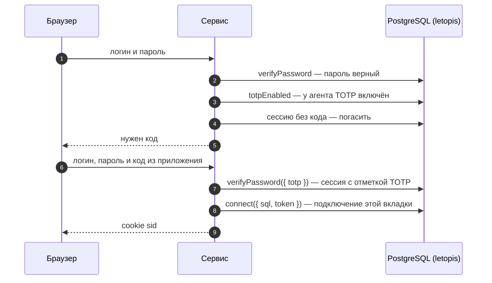
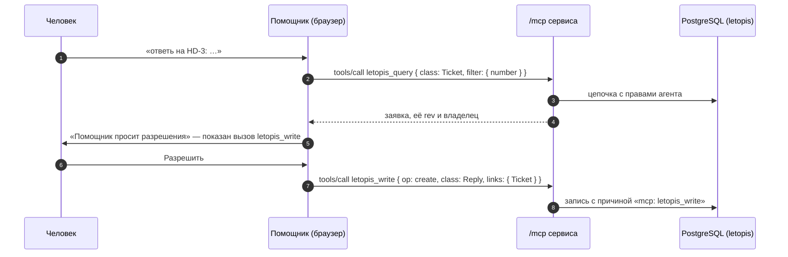

# Helpdesk

Служба поддержки для нескольких компаний. Каждая компания — отдельный арендатор: свои заявки, сотрудники и клиенты; чужого не видно даже по прямому запросу. Роли — руководитель, агент поддержки и клиент, а что кому можно, решают правила доступа в базе. Интерфейс собран из блоков shadcnblocks (`login1`, `signup1`, `navbar1`, `stats8`), сервер — Express, JSON API и адрес `/mcp` для ИИ-агентов.

**Запустить в Docker:** `docker compose -f services/compose.yaml up --build helpdesk` → http://127.0.0.1:8083. Демо с нуля — переменная `FRESH=1`: схема пересоздаётся.

**Запустить руками:** база — `docker compose -f services/compose.yaml up -d pg`, затем `services/helpdesk/run-local.sh`; шаги для PowerShell — в `services/helpdesk/README.md`.

| Кто | Логин | Как войти |
|---|---|---|
| руководитель «Севера» | `boss@sever.ru` | пароль `Sever-2026!` |
| агент поддержки (работает в «Севере» и «Байкале») | `agent@sever.ru` | пароль `Agent-2026!`; после включения TOTP — ещё код |
| клиент «Севера» | `client@sever.ru` | «Код на почту» → письмо в демо-почте http://127.0.0.1:8083/mail |

## Что из letopis здесь работает

| Возможность letopis | Где в сервисе |
|---|---|
| `createTenant` | регистрация компании; приглашение человека в компанию с ролью |
| членство и роли (`member.roles`) | руководитель — `owner`, агент — `agent`, клиент — `client` |
| правила доступа (`Resource`, `rule`) и условия `owner: '$actor'`, `data.client` | клиент видит только свои заявки и ответы на них; внутренние заметки ему закрыты; удалить заявку может только руководитель |
| `acl.check(endpoint)` | разделы «Команда», «Интеграции», «Помощник» — по правилам API |
| `ownerDefault: 'actor'`, `.owner()` | владелец заявки — её автор; интеграция ставит владельцем клиента |
| `verifyPassword({ totp })`, `enrollTotp`, `verifyTotp` | второй фактор с QR-кодом; вход паролем и кодом одним вызовом |
| `issueOtp`, `verifyOtp` | вход по коду из письма (письмо — в демо-почте) |
| `issueApiKey`, `verifyApiKey`, `credentials`, `revokeCredential` | ключи интеграций и ключ ИИ-агента |
| веб-сессия = сессия letopis (`connect({ sql, token })`) | у каждой вкладки своё подключение: `revokeAll` и удаление членства закрывают доступ сразу |
| `auth.switch`, `auth.tenants` | агент переходит между «Севером» и «Байкалом» |
| `svc.as(аккаунт, { tenant })` | «Работать от имени»: в журнале автор — клиент, исполнитель (`agent`) — сервис |
| `purgeAccount` | «Закрыть компанию»: данные арендатора стираются целиком |
| `anonymize` | «Удалить из компании»: имя и email в справочнике затёрты |
| `inc` в транзакции | номер заявки — счётчик компании, без повторов при одновременных обращениях |
| `sort` + `after(cursorOf(…))` | очередь по сроку ответа, страницы по курсору |
| `update(…, { rev })` | правка по устаревшей версии — 409 «заявку уже изменили» |
| `watch()` → SSE | очередь обновляется сама; клиенту приходят события только его заявок |
| `.cache()` | справочник людей компании — повтор без запроса к базе |
| `up({ signals: 'tenant' })` | правки одной компании не будят подписки и кэш другой |
| `createMcpServer` + `createMcpHandler` | помощник и настоящий агент работают через MCP с правами пользователя |
| `onQuery`, `slowMs`, журнал `log`, `flushSignals()` | панель «Под капотом»: запросы и медленные среди них, записанные версии с изменёнными полями (при работе от имени — версии того, от чьего имени, под его правами) и сигналы классов, которые записало действие (только имя класса, без токена арендатора) |

## Модель

Классы компании записывает `syncModels` от её владельца при регистрации — у каждой компании свои. Схема получена из реестра (`db.describe()`), а не нарисована руками:

<!-- er:helpdesk -->

<!-- /er -->

- `Desk` — название компании; править его может только руководитель (правило ниже).
- `Counter` — счётчик номеров заявок (`history: false`: история счётчика не нужна). Его правит каждый, кто создаёт заявку, поэтому он отдельно от названия: иначе любой клиент мог бы переименовать компанию.
- `Profile` — справочник людей компании: имя и email. Чужие учётные записи (`Account`) обычному пользователю не видны, поэтому сервис ведёт свой справочник.
- `Reply` хранит в `client` владельца заявки: условие правила смотрит только в колонки самой строки, связанных строк оно не видит.

## Правила доступа

`createTenant` уже дал всем участникам компании «можно всё» (три правила с весом 10). Сервис добавляет правила сильнее:

| Кто | Что | Решение |
|---|---|---|
| клиент | читать и править `Ticket` с `owner: '$actor'` | разрешено (вес 50) — остальные заявки отсекает база |
| клиент | читать и писать `Reply` с `data.client: '$actor'` | разрешено (вес 50) |
| клиент | `Note` | запрещено (вес 50) |
| все, кроме руководителя (`roles: '!{owner}'`) | удалять `Ticket` | запрещено (вес 50) |
| все, кроме руководителя | писать и удалять `rule`, `Resource`, `member` | запрещено (вес 60) — иначе клиент выдал бы себе права сам |
| все, кроме руководителя | писать `Desk` (название компании) | запрещено (вес 50) |
| руководитель | эндпоинты `desk.*` | разрешено |
| агент | эндпоинты `desk.{queue,assistant}` | разрешено |

## Вход со вторым фактором

letopis второй фактор не навязывает: `verifyPassword` без кода выдаёт сессию и при включённом TOTP. Требовать код — дело сервиса.

## Помощник через MCP

Внешний ИИ-агент (например, Claude Code) подключается к тому же адресу по ключу: раздел «Помощник» → «Выдать ключ для агента» даёт команду `claude mcp add --transport http …` с ключом. ИИ-агент работает с правами того, кому выдан ключ; отзыв ключа отключает его.

## Подводные камни

- **Отозванная сессия при чтении не даёт ошибки.** Запросы просто возвращают пустой результат; `no_session` бросают только функции входа. Сервис проверяет сессию в начале каждого запроса: `svc.auth.session(token)` отвечает `null`, если сессию погасили, и `member: false`, если человека убрали из компании. Так «Выйти на всех устройствах», удаление из компании и отзыв ключа срабатывают сразу. Пример — [«Сессии и арендаторы»](../auth/#сессии-и-арендаторы), шаг 9.
- **`auth.switch()` есть только у самого подключения**, не у `db.as()`. Поэтому веб-сессия здесь — отдельное подключение по токену пользователя (`connect({ sql, token })` поверх общего пула), а не `svc.as()`, как в салоне и кошельке.
- **`auth.tenants()` не упорядочен.** Компанию по умолчанию сервис выбирает сам — ту, где человек состоит дольше всего (свои строки `member` видны всегда, с датой).
- **Свежая сессия входа работает в личном арендаторе** учётной записи — в компанию её переводит `auth.switch()`.
- **Код на почту по логину.** `issueOtp` нужна учётная запись; id учётной записи, заведённой `createTenant`, выводится из логина (`v5Id`). Ответ на «прислать код» одинаков, есть адрес в системе или нет.
- **Закрыть компанию можно, работая в ней:** начиная с 1.4.1 `purgeAccount` стирает и текущего арендатора сессии. Пример — [«Сессии и арендаторы»](../auth/#сессии-и-арендаторы), шаг 8.
- **Название закрытой компании занято навсегда.** `purgeAccount` стирает данные, но надгробие учётной записи компании остаётся в журнале (аудит): `createTenant` с тем же именем отвечает `invalid_data` — «арендатор удалён, а его история осталась в журнале».
- **`createTenant` находит арендатора по имени.** Приглашая человека, сервис сначала сверяет, что имя ведёт именно к арендатору сессии (`v5Id(System, 'Account', ['tenant:' + имя])`), и приглашает только новые адреса: чужую существующую учётную запись в компанию без её согласия не добавить.
- **`revokeAll` завершает сессии во всех компаниях человека.** Поэтому «Завершить сеансы» доступно только для тех, кто состоит в одной этой компании; закрыть доступ сюда — «Удалить из компании».
- **Демо-почта отключает защиту входа по коду:** коды видит любой, кто откроет `/mail`. Запускайте сервис только на своей машине; `DEMO_MAIL=0` выключает демо-почту.
- **Ключ API — вход без пароля.** Интеграции получают ключ отдельной учётной записи «Интеграции» компании, а не руководителя: у неё меньше прав, а отзыв ключа завершает только сессии этого ключа.
