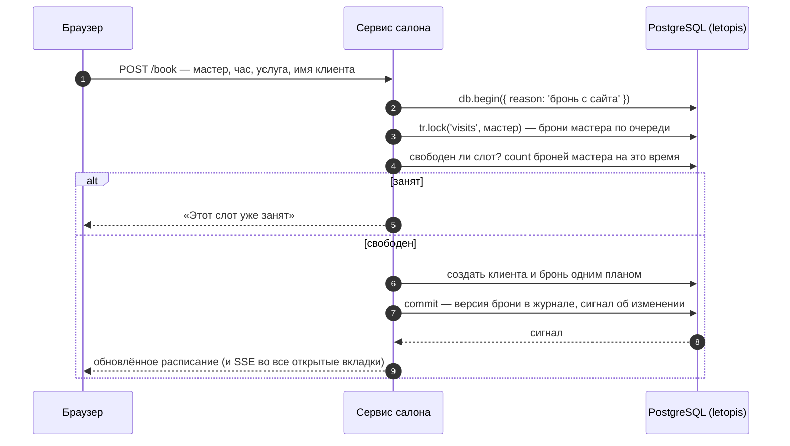

# Салон записи

Веб-приложение для салонов красоты (интерфейс собран из блоков shadcnblocks на shadcn/ui, сервер — Express и JSON API): расписание мастеров на день, запись клиента, перенос, отмена, возврат и история брони, прайс услуг и отчёт дня. Каждый салон — отдельный арендатор: данные одного салона другому не видны.

**Запустить в Docker:** `docker compose -f services/compose.yaml up --build salon`, затем открыть http://127.0.0.1:8081.

**Запустить руками, без Docker:** база — `docker compose -f services/compose.yaml up -d pg` (или своя через `ADMIN_DSN` и `APP_DSN`), затем `services/salon/run-local.sh`: скрипт соберёт библиотеку, поставит зависимости, соберёт интерфейс и запустит сервер. Шаги по отдельности и вариант для PowerShell — в `services/salon/README.md`.
Демо-входы: `admin@lokony.ru` / `Lokony-2026!` (салон «Локоны»), `admin@lastochka.ru` / `Lastochka-2026!` (салон «Ласточка»).

## Что из letopis здесь работает

| Возможность | Где в сервисе |
|---|---|
| `up({ seeds: ['booking'] })` | при старте ставится схема с готовой моделью салона; повтор безопасен |
| `createTenant` | каждый салон — арендатор со своим управляющим |
| `verifyPassword`, `svc.as()` | вход по паролю; запросы идут от имени управляющего в его салоне |
| цепочки с переходами и фильтрами | расписание: салон → мастера; брони дня по времени начала; отчёт дня — брони дня по мастерам |
| `db.begin()` + `lock()` | бронь и перенос одной транзакцией под блокировкой мастера — двойной брони не бывает |
| ключ `[Staff, start_datetime]` | база сама не даст две брони мастера на одно время |
| `rekey`, `versions({ follow: true })` | перенос брони: время начала (и мастер) — в ключе, поэтому у перенесённой брони новый id; конец сдвигается тем же вызовом, у прежнего id — надгробие с `moved`, история идёт через смену id; занятый слот — 409 |
| `delete` с причиной, `restore`, `versions()` | отмена, возврат, история брони с причинами |
| `upsert` | цена услуги — строка класса `price` с ключом `[Item, note]`: цены нет — создаётся, есть — заменяется целиком, те же данные — без новой версии |
| `db.load({ existing: 'update', as, tenant })` | прайс списком — администраторским подключением (`allowBypassRls`, токен управляющего из `createTenant`): строки ложатся в салон вошедшего и от его имени, его права и услуги проверяет загрузчик; цена есть — новая версия, та же — пропуск |
| `.cache()` | каталог услуг читается из кэша, правка сбрасывает его сигналом |
| `watch()` → SSE | вторая вкладка видит новую бронь без перезагрузки |
| `onQuery`, журнал `log`, `flushSignals()` | панель «Под капотом»: какие цепочки и запросы выполнило действие, какие версии оно записало (класс, `rev`, `op`, причина, изменённые поля и концы) и сигналы классов, которые записало действие |

## Модель

Салон работает на готовой модели салона — сиде `booking` (`up({ seeds: ['booking'] })`): организации, люди, сотрудники и клиенты, места, услуги и товары, расписания, слоты и брони. Это классы арендатора System, общие для всех салонов. Схема получена из реестра (`db.describe()`), а не нарисована руками:

```mermaid
erDiagram
  address {
    bool default "необязательное"
    text schedule_info "необязательное"
  }
  booking {
    text notes "необязательное"
    datetime end_datetime "обязательное"
    datetime start_datetime PK "ключ, обязательное"
  }
  Complex {
    num cost "обязательное"
    text name PK "ключ, обязательное"
    num duration "обязательное"
    text description "необязательное"
  }
  compo {
    int order "необязательное"
    int quantity "необязательное"
  }
  content {
    int order "необязательное"
  }
  Customer {
    text name "обязательное"
    text notes "необязательное"
    text phone "обязательное"
    enum preferred_contact "необязательное"
  }
  Element {
    text name PK "ключ, обязательное"
    text description "необязательное"
  }
  Folder {
    text name "обязательное"
  }
  Location {
    text address "обязательное"
    json coordinates "необязательное"
    text description "необязательное"
  }
  Org {
    text name "обязательное"
    text phone "необязательное"
    bool active "необязательное"
    text address "необязательное"
    json settings "необязательное"
    text timezone "необязательное"
  }
  Person {
    text name "обязательное"
    text phone "обязательное"
  }
  price {
    text note PK "ключ, обязательное"
    json amounts "обязательное"
  }
  Product {
    text sku "необязательное"
    text name PK "ключ, обязательное"
    text unit "необязательное"
    text description "необязательное"
  }
  Schedule {
    text name "обязательное"
    int year "обязательное"
    int month "обязательное"
  }
  Service {
    text name PK "ключ, обязательное"
    num duration "необязательное"
    text description "необязательное"
  }
  skill {
    enum level "необязательное"
  }
  slot {
    datetime end_datetime "обязательное"
    datetime start_datetime PK "ключ, обязательное"
  }
  Staff {
    text name "обязательное"
    text phone "обязательное"
    text photo "необязательное"
    text description "необязательное"
    text specialization "необязательное"
  }
  address }o--|| Staff : "Staff, в ключе"
  address }o--|| Location : "Location, в ключе"
  booking }o--|| Element : "Item"
  booking }o--|| Staff : "Staff, в ключе"
  booking }o--o| Customer : "Customer, unset"
  booking }o--|| Location : "Location"
  booking }o--|| Schedule : "Schedule"
  slot ||--o| booking : "потомок"
  Complex }o--|| Org : "Org, в ключе"
  Element ||--o| Complex : "потомок"
  compo }o--|| Service : "Part, в ключе"
  compo }o--|| Product : "Part, в ключе"
  compo }o--|| Complex : "Complex, в ключе"
  content }o--|| Element : "Item, в ключе"
  content }o--|| Folder : "Folder, в ключе"
  Customer }o--|| Org : "Org"
  Person ||--o| Customer : "потомок"
  Element }o--|| Org : "Org, в ключе"
  Folder }o--|| Org : "Org"
  Folder }o--o| Folder : "Parent"
  Location }o--|| Org : "Org"
  Person }o--|| Org : "Org"
  price }o--|| Element : "Item, в ключе"
  Product }o--|| Org : "Org, в ключе"
  Element ||--o| Product : "потомок"
  Schedule }o--|| Org : "Org"
  Service }o--|| Org : "Org, в ключе"
  Element ||--o| Service : "потомок"
  skill }o--|| Staff : "Staff, в ключе"
  skill }o--|| Service : "Service, в ключе"
  slot }o--|| Staff : "Staff, в ключе"
  slot }o--|| Location : "Location"
  slot }o--|| Schedule : "Schedule"
  Staff }o--|| Org : "Org"
  Person ||--o| Staff : "потомок"
```

<!-- er:salon -->

<!-- /er -->

## Как устроена бронь

Жизнь одной брони — что с ней делает сервис и что остаётся в журнале:

```mermaid
stateDiagram-v2
  direction LR
  [*] --> Создана: book() — db.begin(), lock мастера,<br/>слот свободен — booking().create<br/>(занят — 409, брони нет)
  Создана --> Создана: move() — перенос: rekey, новый id<br/>из ключа (мастер, начало), lock мастера;<br/>у прежнего id — надгробие с moved (занят — 409)
  Создана --> Отменена: cancel() — delete({ confirm, reason })<br/>строки нет, в журнале надгробие
  Отменена --> Создана: restore() — тот же id,<br/>следующая версия
```

История брони (`versions({ follow: true })`) показывает все переходы: кто создал, кто перенёс, кто и почему отменил, кто вернул. Перенос меняет id брони, а `follow` идёт по `moved` от нового id к прежнему и обратно — история одна. id брони — из ключа, поэтому у слота одна история: бронь, записанная или перенесённая на место отменённой, продолжает её версии, а надгробие переноса в «Отменённых» не показывается и не возвращается.

## Нюанс: где живёт сессия пользователя

Салон не кладёт токен сессии letopis в cookie: веб-сессия хранится на сервере, cookie несёт только её случайный номер, а запросы идут через `svc.as(аккаунт, { арендатор })` — подключение сервиса, которое работает от имени пользователя. Салон написан так, когда в библиотеке ещё не было метода, который по токену сессии находит аккаунт. С 1.4.1 такой метод есть — `svc.auth.session(token)`: по токену он отвечает, чья это сессия, жива ли она и в каком арендаторе работает. Пример — [«Сессии и арендаторы»](../auth/#сессии-и-арендаторы), шаг 9.

Исходники: `services/salon/src/server.mjs` (JSON API и SSE), `services/salon/web/src/App.tsx` (интерфейс на shadcn/ui: расписание, запись и перенос; экраны прайса и отчёта дня — `web/src/pages/`), `services/salon/src/domain.mjs` (бронь, перенос, отмена, история, прайс, отчёт дня), сценарий «день работы» — `services/salon/scenario.mjs`, проверка в браузере — `services/salon/CHECK.md`. Общее у четырёх сервисов — `services/shared/`: журнал «Под капотом» (`trace.mjs`), веб-сессии (`sessions.mjs`), подписка → SSE (`events.mjs`) и панель (`web/UnderHood.tsx`).
