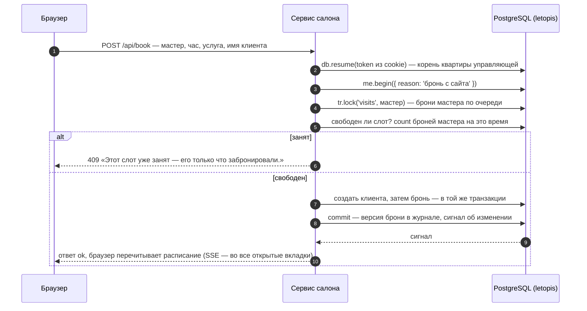
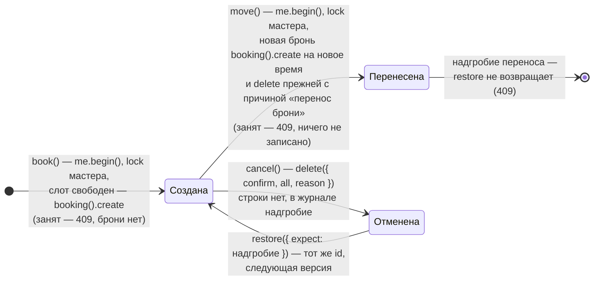

# Салон записи

Веб-приложение для салонов красоты: расписание мастеров на день, запись клиента, перенос, отмена и возврат брони, её история, прайс услуг и отчёт дня. Интерфейс собран из блоков shadcnblocks на shadcn/ui, сервер — Express с JSON API. Каждый салон — отдельная квартира в доме `salon`: данные одного салона другому не видны.

**Сначала — исходники.** Сервисы лежат в [репозитории letopis](https://github.com/alepri51/letopis), а не в npm-пакете: `git clone https://github.com/alepri51/letopis && cd letopis` — все команды ниже выполняются из корня клона ([как запустить](./#run)).

**Запустить в Docker:** `docker compose -f services/compose.yaml up --build salon`, затем открыть адрес сервиса — по умолчанию http://127.0.0.1:8081 (порт меняет переменная `SALON_PORT`, [как запустить](./#run)). Дом строит шаг подготовки `salon-setup`, сервис получает только пропуск.

**Запустить руками, без Docker:** сначала база — `docker compose -f services/compose.yaml up -d pg` или своя (её мастер-ключ — в `ADMIN_DSN`). Затем `services/salon/run-local.sh`: скрипт соберёт библиотеку, поставит зависимости, соберёт интерфейс, построит дом (`node src/setup.mjs` печатает пропуск `LETOPIS_PASS=…`) и запустит сервер с одним пропуском, без мастер-ключа. Шаги по отдельности и вариант для PowerShell — в `services/salon/README.md`.

Демо-входы: `admin@lokony.ru` / `Lokony-2026!` (салон «Локоны»), `admin@lastochka.ru` / `Lastochka-2026!` (салон «Ласточка»).

## Что из letopis здесь работает

| Возможность | Где в сервисе |
|---|---|
| `setup(ADMIN_DSN, 'salon', { seeds: ['booking'] })` | подготовка дома (`src/setup.mjs`) мастер-ключом: готовая модель салона из сида `booking`; повторный запуск безопасен и отдаёт тот же пропуск |
| `connect(pass, { postman })`, `createTenant`, `invite` → `accept` | подготовка дома (`src/setup.mjs`) заводит квартиры «Локоны» и «Ласточка» и зовёт в каждую управляющую с ролью `owner` (приглашение идёт через почтальона-заглушку и тут же принимается) — правило хозяина квартиры даёт ей всё; справочники салона (места, расписание, мастера, услуги) консьерж пишет в квартире сам (`db.in(салон)`) |
| `db.open({ email, password })`, `db.resume(token)` | вход паролем: токен сессии — в cookie (HttpOnly), каждый запрос открывает по нему корень квартиры управляющей; выход — `me.close()` |
| цепочки с переходами и фильтрами | расписание — мастера салона (переход от салона к мастерам) и брони дня (фильтр по времени начала); отчёт дня — те же брони, сервис считает их по мастерам |
| `begin()` + `lock()` | бронь и перенос идут одной транзакцией под блокировкой мастера, поэтому двойной брони не бывает |
| ключ `[Staff, start_datetime]` | база сама не даст две брони мастера на одно время |
| ключ неизменен (`immutable_key`), `begin()` с `create` и `delete` | перенос брони. Мастер и время начала входят в ключ, id вычисляется из ключа, а ключ правкой не меняется. Поэтому перенос — новая бронь на новое время и удаление прежней одной транзакцией `me.begin({ reason: 'перенос брони' })`. У новой брони — новый id, те же концы (клиент, услуга, локация, расписание) и сдвинутое время конца: длительность прежняя. У прежней брони остаётся надгробие с причиной «перенос брони» — это не отмена, вернуть её нельзя (409). Блокировка та же, что у записи, а при переносе к другому мастеру блокируются оба, в порядке id. Занятый слот — ответ 409 |
| `delete({ confirm: true, all: true, reason })`, `restore({ expect })`, `withDeleted().versions()` | отмена, возврат и история брони с причинами: версии одного id, в том числе версия удаления |
| `upsert` | цена услуги — строка класса `price` с ключом `[Item, note]`: услуга и вариант цены. Цены нет — `upsert` её создаёт, есть — заменяет целиком; те же данные новой версии не дают (`$upsert: 'unchanged'`) |
| `begin()` + `upsert` списком | прайс списком: одна транзакция управляющей, `upsert` цены каждой услуги; автор версий — она, право записи проверяет база, ошибка любой строки откатывает весь список. Отчёт — сколько цен новых, изменённых и без изменений (по `$upsert` строк) |
| `.cache()` | каталог услуг читается через кэш результатов; правка услуг сбрасывает кэш сигналом |
| `watch()` → SSE | вторая вкладка видит новую бронь без перезагрузки |
| `onQuery`, журнал `log`, сигналы | панель «Под капотом» — что сделало действие: цепочки letopis и запросы к базе (`onQuery`), версии, которые оно записало (из журнала `log` под правами вошедшей: класс, `rev`, `op`, причина, изменённые поля и концы), и сигналы об изменении классов, в которые оно записало (только имя класса) |

## Модель

Сервис работает на готовой модели салона — сиде `booking` (`setup(…, { seeds: ['booking'] })`): организации, люди, сотрудники и клиенты, места, услуги и товары, расписания, слоты и брони. Это классы дома, общие для всех салонов-квартир. Схема ниже построена из реестра корня квартиры (`me.registry`), а не нарисована вручную, поэтому на ней весь сид `booking`, в том числе классы, которыми салон не пользуется (например, `Complex`, `Folder`, `Product`). Салон работает с классами `Org` (салон), `Staff` (мастер) и `Customer` (клиент) — оба потомки `Person`, `Location` (место), `Service` (услуга, потомок `Element`), `price` (цена элемента — здесь услуги), `Schedule` (расписание) и `booking` (бронь, потомок `slot`). Как читать схему: блок — класс с полями, линия — конец (связь) с именем роли, «в ключе» — конец входит в ключ класса, «потомок» — наследование (`extends`):

<!-- er:salon -->

<!-- /er -->

## Как устроена бронь

Жизнь одной брони — что с ней делает сервис и что остаётся в журнале:

Новая бронь, которую создал перенос, живёт дальше сама: её можно снова перенести, отменить и вернуть.

История брони — версии одного id: `me.booking(id).withDeleted().versions()` отдаёт, кто создал бронь, кто и почему отменил, кто вернул. id брони вычисляется из ключа — мастера и времени начала, а ключ правкой не меняется. Значит, у каждого слота одна история: бронь, записанная или перенесённая на место отменённой, продолжает её версии. Перенос — другой мастер или час, другой id и своя история: у новой брони последняя версия — создание с причиной «перенос брони», а версии прежней брони остаются у её id и заканчиваются надгробием с той же причиной. Это надгробие — не отмена: в списке «Отменённые в этот день» его нет, и вернуть его нельзя — у клиента стало бы две брони.

## Нюанс: сессия — в cookie, корень — на запрос

Сервис держит одного консьержа (`connect(pass)`) на процесс, а не подключение на каждого вошедшего. Вход — `db.open({ email, password })`: токен сессии letopis уходит в cookie (HttpOnly). Каждый запрос открывает по нему корень квартиры — `db.resume(token)` — на пуле консьержа, нового пула не создаёт; все цепочки запроса идут от этого корня, под правами управляющей и только в её салоне. Сессию погасили (выход в другой вкладке) — `resume` отвечает `auth_failed`, сервис — 401 и стирает cookie. После перезапуска сервиса вошедшим не нужно входить заново: токен в cookie жив, а то, что сервис помнит о сессии (имя салона и управляющей), он собирает по корню заново.

Исходники: `services/salon/src/setup.mjs` — подготовка дома мастер-ключом; `services/salon/src/server.mjs` — JSON API и SSE; `services/salon/src/domain.mjs` — бронь, перенос, отмена, история, прайс и отчёт дня; `services/salon/web/src/App.tsx` — интерфейс на shadcn/ui (расписание, запись и перенос), экраны прайса и отчёта дня — в `services/salon/web/src/pages/`. Сценарий «день работы» — `services/salon/scenario.mjs`, проверка в браузере — `services/salon/CHECK.md`. Общее у четырёх сервисов лежит в `services/shared/`: пропуск и демо-жильцы (`house.mjs`), журнал действий для панели «Под капотом» (`trace.mjs`), веб-сессии по cookie (`sessions.mjs`), подписка → SSE (`events.mjs`) и сама панель (`web/UnderHood.tsx`).
