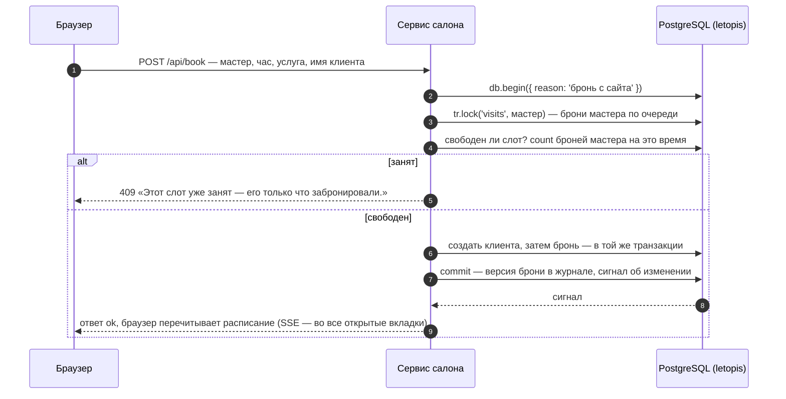
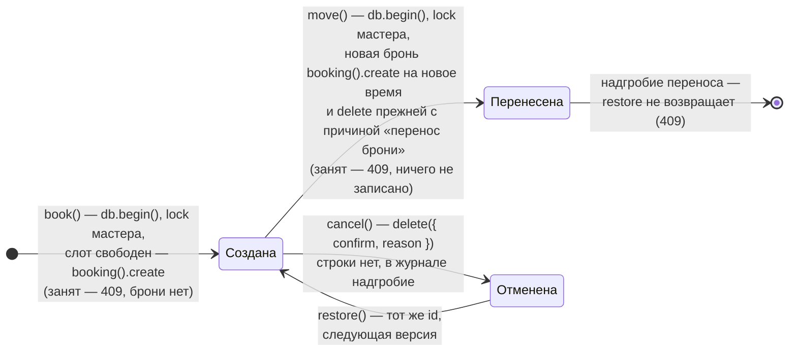

# Салон записи

Веб-приложение для салонов красоты: расписание мастеров на день, запись клиента, перенос, отмена и возврат брони, её история, прайс услуг и отчёт дня. Интерфейс собран из блоков shadcnblocks на shadcn/ui, сервер — Express с JSON API. Каждый салон — отдельный арендатор: данные одного салона другому не видны.

**Запустить в Docker:** `docker compose -f services/compose.yaml up --build salon`, затем открыть http://127.0.0.1:8081.

**Запустить руками, без Docker:** сначала база — `docker compose -f services/compose.yaml up -d pg` или своя (строки подключения — в `ADMIN_DSN` и `APP_DSN`). Затем `services/salon/run-local.sh`: скрипт соберёт библиотеку, поставит зависимости, соберёт интерфейс и запустит сервер. Шаги по отдельности и вариант для PowerShell — в `services/salon/README.md`.

Демо-входы: `admin@lokony.ru` / `Lokony-2026!` (салон «Локоны»), `admin@lastochka.ru` / `Lastochka-2026!` (салон «Ласточка»).

## Что из letopis здесь работает

| Возможность | Где в сервисе |
|---|---|
| `up({ seeds: ['booking'] })` | при старте ставит схему с готовой моделью салона; повторный запуск безопасен |
| `createTenant` | каждый салон — арендатор со своим управляющим |
| `verifyPassword`, `svc.as()` | вход по паролю, дальше запросы идут от имени управляющего и в его салоне |
| цепочки с переходами и фильтрами | расписание — мастера салона (переход от салона к мастерам) и брони дня (фильтр по времени начала); отчёт дня — те же брони, сервис считает их по мастерам |
| `db.begin()` + `lock()` | бронь и перенос идут одной транзакцией под блокировкой мастера, поэтому двойной брони не бывает |
| ключ `[Staff, start_datetime]` | база сама не даст две брони мастера на одно время |
| ключ неизменен (`immutable_key`), `db.begin()` с `create` и `delete` | перенос брони. Мастер и время начала входят в ключ, id вычисляется из ключа, а ключ правкой не меняется. Поэтому перенос — новая бронь на новое время и удаление прежней одной транзакцией `db.begin({ reason: 'перенос брони' })`. У новой брони — новый id, те же концы (клиент, услуга, локация, расписание) и сдвинутое время конца: длительность прежняя. У прежней брони остаётся надгробие с причиной «перенос брони» — это не отмена, вернуть её нельзя (409). Блокировка та же, что у записи, а при переносе к другому мастеру блокируются оба, в порядке id. Занятый слот — ответ 409 |
| `delete` с причиной, `restore`, `withDeleted().versions()` | отмена, возврат и история брони с причинами: версии одного id, в том числе версия удаления |
| `upsert` | цена услуги — строка класса `price` с ключом `[Item, note]`: услуга и вариант цены. Цены нет — `upsert` её создаёт, есть — заменяет целиком; те же данные новой версии не дают |
| `db.load({ price }, { existing: 'update', as, tenant })` | прайс списком. Загрузчику нужно администраторское подключение letopis (`allowBypassRls`: построчные правила доступа базы, RLS, на него не действуют). Оно одно на все салоны и работает без сессии: простой сервиса загрузке не мешает — истекать нечему. Строки пишутся в салон вошедшего (`tenant`) и от его имени (`as`). Его право записи и то, что услуги ему видны, проверяет сам загрузчик. Новая цена создаётся, изменённая получает новую версию, та же пропускается |
| `.cache()` | каталог услуг читается через кэш результатов; правка услуг сбрасывает кэш сигналом |
| `watch()` → SSE | вторая вкладка видит новую бронь без перезагрузки |
| `onQuery`, журнал `log`, `flushSignals()` | панель «Под капотом» — что сделало действие: цепочки letopis и запросы к базе (`onQuery`), версии, которые оно записало (из журнала `log`: класс, `rev`, `op`, причина, изменённые поля и концы), и сигналы об изменении классов, в которые оно записало (`flushSignals()`; только имя класса) |

## Модель

Сервис работает на готовой модели салона — сиде `booking` (`up({ seeds: ['booking'] })`): организации, люди, сотрудники и клиенты, места, услуги и товары, расписания, слоты и брони. Это классы арендатора System, общие для всех салонов. Схема ниже построена из реестра подключения (`db.registry`), а не нарисована вручную:

<!-- er:salon -->

<!-- /er -->

## Как устроена бронь

Жизнь одной брони — что с ней делает сервис и что остаётся в журнале:

Новая бронь, которую создал перенос, живёт дальше сама: её можно снова перенести, отменить и вернуть.

История брони — версии одного id: `db.booking(id).withDeleted().versions()` отдаёт, кто создал бронь, кто и почему отменил, кто вернул. id брони вычисляется из ключа — мастера и времени начала, а ключ правкой не меняется. Значит, у каждого слота одна история: бронь, записанная или перенесённая на место отменённой, продолжает её версии. Перенос — другой мастер или час, другой id и своя история: у новой брони последняя версия — создание с причиной «перенос брони», а версии прежней брони остаются у её id и заканчиваются надгробием с той же причиной. Это надгробие — не отмена: в списке «Отменённые в этот день» его нет, и вернуть его нельзя — у клиента стало бы две брони.

## Нюанс: где живёт сессия пользователя

Салон не хранит токен сессии letopis в cookie. Веб-сессия живёт на сервере, а cookie несёт только её случайный номер. Запросы идут через `svc.as(аккаунт, { tenant })`: подключение сервиса работает от имени пользователя. Другой путь — хранить токен сессии letopis и узнавать по нему аккаунт: `svc.auth.session(token)` отвечает, чья это сессия, жива ли она и в каком арендаторе работает. Пример — [«Сессии и арендаторы»](../auth/#сессии-и-арендаторы), шаг 9.

Исходники: `services/salon/src/server.mjs` — JSON API и SSE; `services/salon/src/domain.mjs` — бронь, перенос, отмена, история, прайс и отчёт дня; `services/salon/web/src/App.tsx` — интерфейс на shadcn/ui (расписание, запись и перенос), экраны прайса и отчёта дня — в `services/salon/web/src/pages/`. Сценарий «день работы» — `services/salon/scenario.mjs`, проверка в браузере — `services/salon/CHECK.md`. Общее у четырёх сервисов лежит в `services/shared/`: журнал действий для панели «Под капотом» (`trace.mjs`), веб-сессии (`sessions.mjs`), подписка → SSE (`events.mjs`) и сама панель (`web/UnderHood.tsx`).
